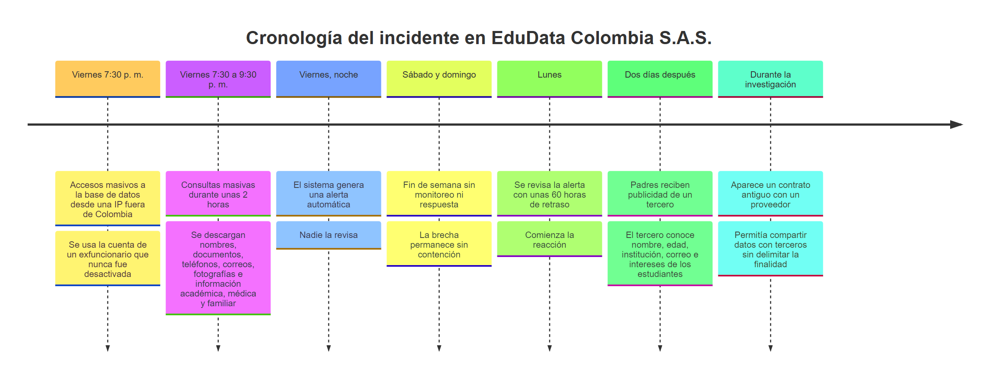
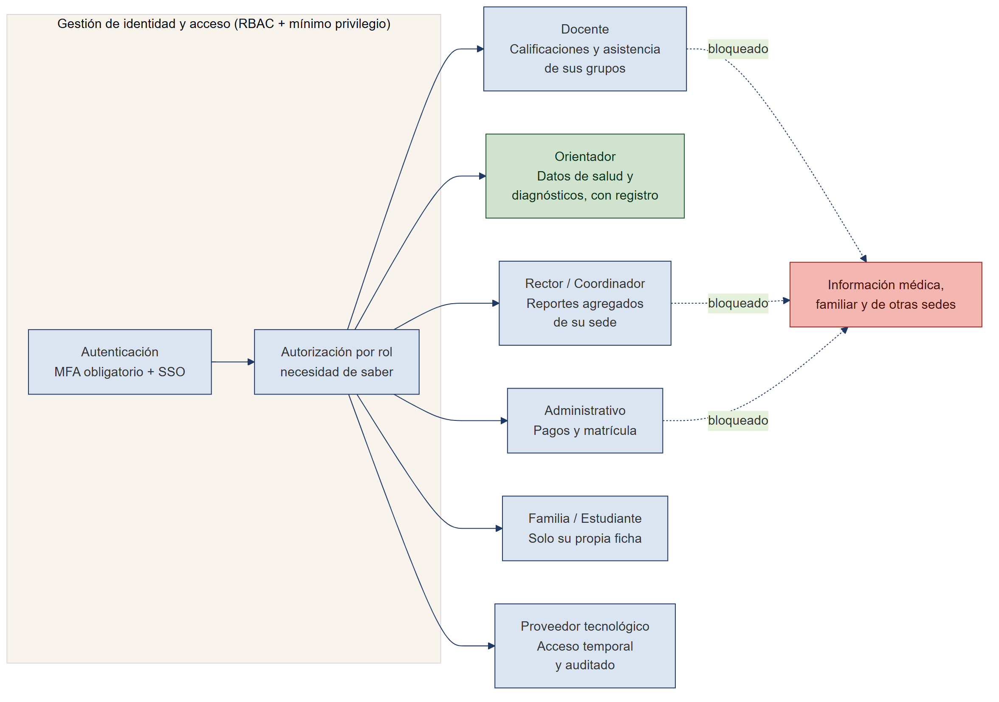
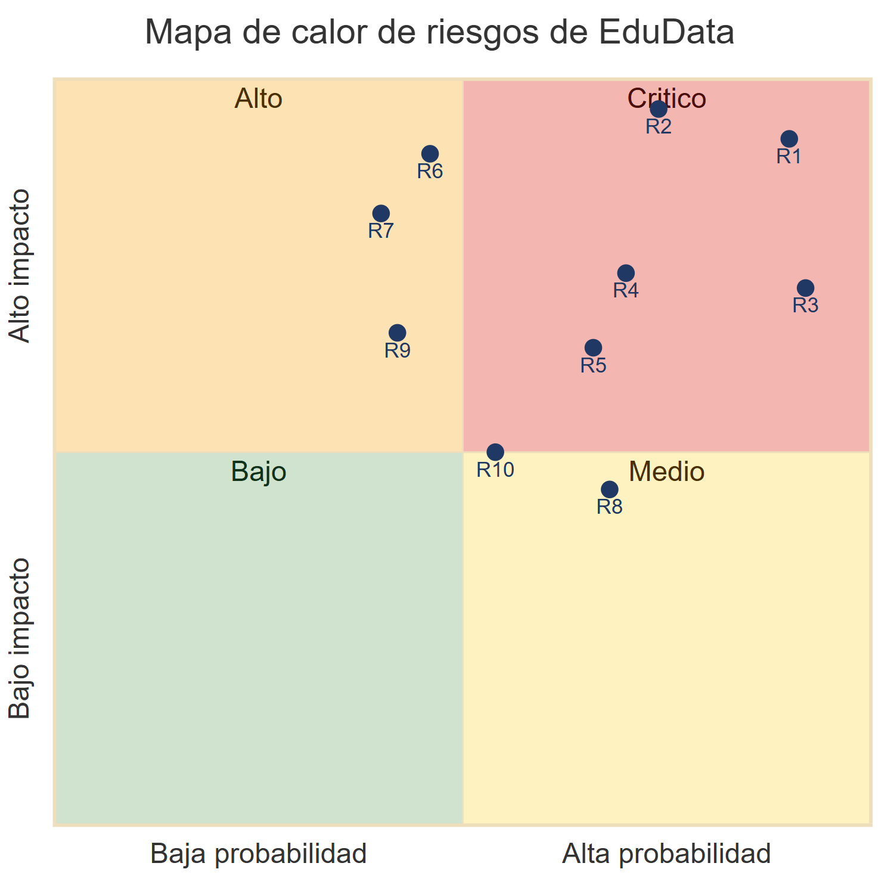
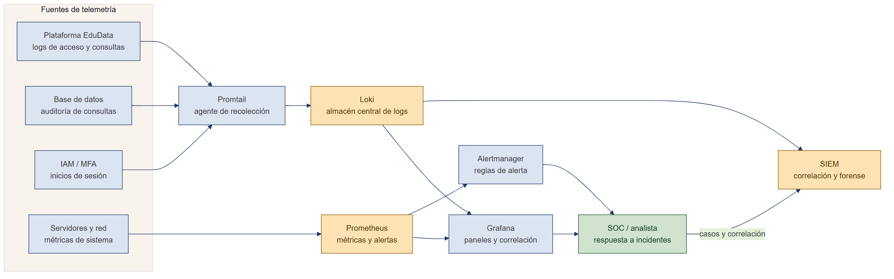
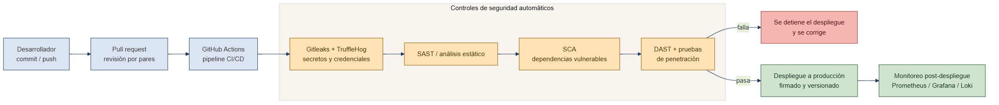
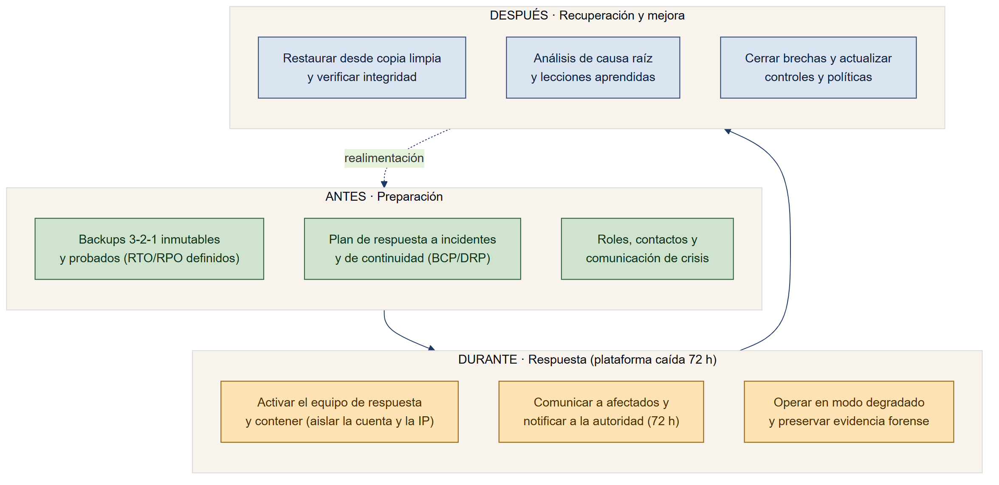

```{=openxml}
<w:p><w:pPr><w:jc w:val="center"/><w:spacing w:before="2000" w:after="120" w:line="360" w:lineRule="auto"/></w:pPr><w:r><w:rPr><w:b/><w:sz w:val="36"/><w:szCs w:val="36"/></w:rPr><w:t xml:space="preserve">Protección de Datos y Resiliencia Digital</w:t></w:r></w:p><w:p><w:pPr><w:jc w:val="center"/><w:spacing w:before="0" w:after="0" w:line="360" w:lineRule="auto"/></w:pPr><w:r><w:rPr><w:b/><w:sz w:val="32"/><w:szCs w:val="32"/></w:rPr><w:t xml:space="preserve">Caso EduData Colombia S.A.S.</w:t></w:r></w:p><w:p><w:pPr><w:jc w:val="center"/><w:spacing w:before="200" w:after="0" w:line="320" w:lineRule="auto"/></w:pPr><w:r><w:rPr><w:sz w:val="26"/><w:szCs w:val="26"/></w:rPr><w:t xml:space="preserve">Informe del Ejercicio Práctico N.° 4. Equipo consultor de ciberseguridad y resiliencia digital</w:t></w:r></w:p><w:p><w:pPr><w:jc w:val="center"/><w:spacing w:before="1400" w:after="0" w:line="480" w:lineRule="auto"/></w:pPr><w:r><w:rPr><w:b/><w:sz w:val="26"/><w:szCs w:val="26"/></w:rPr><w:t xml:space="preserve">Sebastián López Osorno</w:t></w:r></w:p><w:p><w:pPr><w:jc w:val="center"/><w:spacing w:before="0" w:after="0" w:line="480" w:lineRule="auto"/></w:pPr><w:r><w:rPr><w:sz w:val="24"/><w:szCs w:val="24"/></w:rPr><w:t xml:space="preserve">Politécnico Colombiano Jaime Isaza Cadavid</w:t></w:r></w:p><w:p><w:pPr><w:jc w:val="center"/><w:spacing w:before="0" w:after="0" w:line="480" w:lineRule="auto"/></w:pPr><w:r><w:rPr><w:sz w:val="24"/><w:szCs w:val="24"/></w:rPr><w:t xml:space="preserve">Facultad de Ingenierías, Departamento de Informática</w:t></w:r></w:p><w:p><w:pPr><w:jc w:val="center"/><w:spacing w:before="0" w:after="0" w:line="480" w:lineRule="auto"/></w:pPr><w:r><w:rPr><w:sz w:val="24"/><w:szCs w:val="24"/></w:rPr><w:t xml:space="preserve">Diplomado en Ciberseguridad Informática. Módulo 2, Unidad 1</w:t></w:r></w:p><w:p><w:pPr><w:jc w:val="center"/><w:spacing w:before="0" w:after="0" w:line="480" w:lineRule="auto"/></w:pPr><w:r><w:rPr><w:sz w:val="24"/><w:szCs w:val="24"/></w:rPr><w:t xml:space="preserve">Asignatura: Protección de Datos y Resiliencia Digital</w:t></w:r></w:p><w:p><w:pPr><w:jc w:val="center"/><w:spacing w:before="0" w:after="0" w:line="480" w:lineRule="auto"/></w:pPr><w:r><w:rPr><w:sz w:val="24"/><w:szCs w:val="24"/></w:rPr><w:t xml:space="preserve">Docente: Edwin Andrés Ochoa Agudelo. Grupo 02</w:t></w:r></w:p><w:p><w:pPr><w:jc w:val="center"/><w:spacing w:before="1000" w:after="0" w:line="320" w:lineRule="auto"/></w:pPr><w:r><w:rPr><w:sz w:val="24"/><w:szCs w:val="24"/></w:rPr><w:t xml:space="preserve">23 de octubre de 2026</w:t></w:r></w:p>
```

# Resumen ejecutivo

Este informe analiza el caso de **EduData Colombia S.A.S.**, una plataforma de gestión escolar que sufrió una fuga masiva de datos de aproximadamente 35.000 usuarios, en su mayoría menores de edad. El equipo consultor diagnostica qué falló, qué derechos se vulneraron, qué riesgos persisten y qué controles debe implementar la organización para evitar que el incidente se repita.

El hallazgo central es que ninguna etapa del incidente requirió una técnica sofisticada. El atacante entró desde una dirección IP ubicada fuera de Colombia usando la cuenta de un exfuncionario que nunca fue desactivada, consultó y descargó durante dos horas datos personales, académicos, médicos y familiares, y el sistema generó una alerta que nadie revisó hasta el lunes. Días después, un tercero usó esos datos para enviar publicidad a las familias, amparado en un contrato antiguo que permitía compartir información sin delimitar la finalidad. Cada paso aprovechó un control ausente o mal gestionado: cuentas sin dar de baja, credenciales compartidas, falta de MFA, exceso de privilegios, ausencia de monitoreo con respuesta, datos sensibles recogidos sin necesidad y un desarrollo de software sin seguridad desde el diseño.

El análisis se apoya en el marco europeo de protección de datos, es decir, el **Reglamento General de Protección de Datos (RGPD)**, la **LOPDGDD**, los **derechos ARCO-POL** y los estándares **ISO/IEC 27001, 27002 y 27701**, y lo articula con el ordenamiento colombiano aplicable al caso: el **habeas data** (Constitución, artículo 15), la **Ley 1581 de 2012**, la **Ley 1273 de 2009** sobre delitos informáticos y la **autodeterminación informativa** reconocida por la Corte Constitucional. También recoge el contenido del video del curso sobre el RGPD (Montero, s. f.), que resume los principios y las obligaciones que aquí se aplican. Sobre esa base se proponen una matriz de riesgos valorada, un conjunto de más de diez controles técnicos y organizativos, un esquema de monitoreo con SIEM, un ciclo de desarrollo seguro y un plan de resiliencia para una interrupción de 72 horas. La conclusión sostiene que el problema de EduData fue, antes que nada, **organizacional**: la dirección priorizó la practicidad y la rapidez sobre la gestión del riesgo, y de esa decisión se derivan las fallas técnicas, humanas y jurídicas.

# 1. Introducción

La digitalización de la gestión escolar concentra en una sola plataforma información que antes estaba dispersa: identidad, salud, desempeño académico, comportamiento y pagos de miles de estudiantes y sus familias. Esa concentración mejora la operación, pero convierte al sistema en un objetivo de alto valor y eleva el deber de protección. EduData adoptó la tecnología sin acompañar esa adopción con la madurez de seguridad y privacidad que el tratamiento de datos de menores exige, y el incidente fue la consecuencia previsible de ese desfase.

Este documento asume el papel de un **equipo consultor de ciberseguridad y resiliencia digital** contratado por la dirección tras el incidente. Su objetivo es doble: diagnosticar cómo ocurrió la fuga y qué debilidades la permitieron, y proponer un plan de protección, respuesta y recuperación que eleve la postura de seguridad y el cumplimiento normativo de la organización. No basta con afirmar que hubo una vulnerabilidad; cada conclusión se demuestra con los hechos del caso y se relaciona con los conceptos estudiados en la unidad.

**Objetivos específicos.**

1. Identificar las situaciones que comprometieron la confidencialidad, la integridad y la disponibilidad de la información.
2. Analizar los controles de acceso bajo los principios de mínimo privilegio y necesidad de saber.
3. Reconocer la afectación de la protección de datos, la privacidad, la intimidad, el habeas data, la autodeterminación informativa y la dignidad humana.
4. Identificar y valorar los riesgos a partir de activos, amenazas, vulnerabilidades, consecuencias, probabilidad e impacto.
5. Proponer controles preventivos, detectivos y correctivos acordes con los riesgos.
6. Relacionar la seguridad con el ciclo de vida del desarrollo de software.
7. Diseñar un plan de resiliencia orientado a la continuidad, la respuesta y la recuperación.

**Alcance y método.** El análisis se limita a los hechos descritos en el caso; no se inventan datos técnicos adicionales. El marco de referencia es, en primer lugar, el europeo de protección de datos (RGPD, LOPDGDD, derechos ARCO-POL e ISO/IEC 27701), complementado con los estándares de seguridad ISO/IEC 27001 y 27002, el *Cybersecurity Framework* del NIST y las guías NIST SP 800-61 y 800-34, y con el marco colombiano de habeas data (Constitución artículo 15, Ley 1581 de 2012 y Decreto 1377 de 2013) y de delitos informáticos (Ley 1273 de 2009). Las fuentes obligatorias de la unidad, las lecturas sobre ciberdelitos y regulación y el video del curso sobre el RGPD, sustentan la argumentación jurídica a lo largo del documento. Se adopta como premisa la **responsabilidad proactiva** (*accountability*) que exige el RGPD: no basta con cumplir, hay que poder demostrar que se cumple.

## 1.1 El marco europeo: principios del RGPD y derechos ARCO-POL

El Reglamento General de Protección de Datos es el eje normativo de este informe, porque fija el estándar más exigente y porque es la base que estudia la unidad. Su artículo 5 enumera los principios que rigen todo tratamiento de datos, y conviene tenerlos presentes porque el caso EduData los incumple casi uno por uno. El principio de **licitud, lealtad y transparencia** obliga a tratar los datos con una base legal y a informar con claridad al titular. El de **limitación de la finalidad** exige recoger los datos para fines determinados y no usarlos después para otros incompatibles. El de **minimización** limita la recogida a los datos estrictamente necesarios. El de **exactitud** obliga a mantenerlos actualizados. El de **limitación del plazo de conservación** impide guardarlos más tiempo del necesario. El de **integridad y confidencialidad** exige medidas de seguridad adecuadas. Y el de **responsabilidad proactiva** obliga al responsable a demostrar que cumple todos los anteriores.

A estos principios se suman reglas específicas que el caso activa de forma directa. La licitud del tratamiento requiere una base jurídica, que para los datos de estudiantes suele ser el consentimiento (artículos 6 y 7), el cual debe ser libre, específico, informado e inequívoco. Los datos de salud, diagnósticos y estado emocional son **categorías especiales** (artículo 9), cuyo tratamiento está prohibido salvo excepción tasada. Y cuando los titulares son menores, el consentimiento debe prestarlo quien ejerce la patria potestad (artículo 8), con una protección reforzada.

El RGPD también otorga a las personas un conjunto de derechos que la unidad estudia bajo el nombre de **derechos ARCO-POL**. La Tabla A resume cada uno y muestra cómo podría ejercerlo una familia frente a EduData.

| Derecho | Qué permite al titular | Ejemplo de ejercicio frente a EduData |
|:---|:---|:---|
| Acceso | Saber qué datos se tratan, con qué fin y con quién se comparten | Una familia pide conocer qué datos de su hijo guarda la plataforma y a qué terceros se cedieron |
| Rectificación | Corregir datos inexactos o incompletos | Corregir un diagnóstico mal registrado o un dato de contacto erróneo |
| Cancelación o supresión | Eliminar los datos cuando ya no son necesarios | Borrar los datos de un estudiante que se retiró de la institución |
| Oposición | Oponerse a un tratamiento concreto | Oponerse a que los datos se usen con fines publicitarios |
| Portabilidad | Recibir los datos y transferirlos a otro responsable | Llevar el expediente del estudiante a otra institución |
| Olvido | Suprimir datos personales accesibles en Internet | Retirar fotografías o datos del estudiante indexados en buscadores |
| Limitación | Restringir el tratamiento mientras se resuelve una reclamación | Congelar el uso de ciertos datos médicos mientras se aclara una disputa |

*Tabla A.* Derechos ARCO-POL del RGPD aplicados al caso EduData.

## 1.2 Figuras relevantes y medidas de cumplimiento

El RGPD organiza las responsabilidades en torno a varias figuras. El **responsable del tratamiento** decide los fines y los medios, y en el caso es EduData. El **encargado del tratamiento** trata datos por cuenta del responsable, como haría el proveedor tecnológico, y debe estar vinculado por un contrato de encargo con garantías. El **Delegado de Protección de Datos (DPO o DPD)** supervisa el cumplimiento y es el punto de contacto con la autoridad, una figura que en EduData sencillamente no existía. La **autoridad de control** vigila y sanciona, papel que en Europa cumple la Agencia Española de Protección de Datos y en Colombia la Superintendencia de Industria y Comercio a través de su Delegatura para la Protección de Datos Personales.

Sobre esas figuras, el Reglamento define un conjunto de **medidas de cumplimiento** que son, en la práctica, la hoja de ruta de lo que EduData debió hacer y no hizo. La **protección de datos desde el diseño y por defecto** (artículo 25) exige incorporar la privacidad desde la concepción del sistema y tratar por defecto solo los datos necesarios. La **evaluación de impacto relativa a la protección de datos (EIPD o DPIA)** (artículo 35) es obligatoria cuando el tratamiento entraña un alto riesgo, como ocurre al tratar datos de salud de menores a gran escala. El **registro de las actividades de tratamiento** (artículo 30) documenta qué datos se tratan y para qué. La **seguridad del tratamiento** (artículo 32) obliga a aplicar medidas técnicas y organizativas apropiadas, como el cifrado y el control de acceso. La **notificación de brechas** (artículos 33 y 34) impone comunicar los incidentes a la autoridad en un plazo de 72 horas y a los afectados cuando el riesgo es alto. El incumplimiento de estas obligaciones puede acarrear **sanciones** de hasta veinte millones de euros o el cuatro por ciento de la facturación anual (artículo 83). Para evidenciar el cumplimiento en materia de privacidad, la norma **ISO/IEC 27701** extiende el sistema de gestión de seguridad de la información de la ISO/IEC 27001 con un sistema de gestión de la privacidad, y es la referencia que EduData debería adoptar junto con los controles de la ISO/IEC 27002.

## 1.3 El marco colombiano: habeas data y autodeterminación informativa

Como EduData opera en Colombia, el marco europeo se articula con el ordenamiento nacional, que protege los mismos bienes jurídicos con instituciones propias. El **habeas data** es un derecho fundamental reconocido en el artículo 15 de la Constitución, que garantiza a toda persona conocer, actualizar y rectificar la información que se haya recogido sobre ella. La **Ley 1581 de 2012**, con su Decreto reglamentario 1377 de 2013, desarrolla el régimen general de protección de datos personales, define los **datos sensibles** (artículo 5), entre ellos los de salud, y da un tratamiento especial a los datos de niños y adolescentes (artículo 7), que solo pueden tratarse atendiendo a su interés superior. La **autodeterminación informativa**, reconocida por la Corte Constitucional en las sentencias T-414 de 1992 y C-748 de 2011, es el derecho de la persona a controlar el uso de sus datos, y coincide en su contenido con el que fundó la jurisprudencia europea. La **Ley 1273 de 2009** tipifica los delitos informáticos, entre ellos el acceso abusivo a un sistema informático y la violación de datos personales, que describen con precisión lo que ocurrió en el incidente. La autoridad competente para investigar y sancionar es la Superintendencia de Industria y Comercio. Este doble marco, el europeo como estándar técnico y de garantías y el colombiano como derecho aplicable, es el que sostiene el análisis de las partes siguientes.

# 2. Contexto del caso y cronología del incidente

EduData gestiona matrícula, información personal, calificaciones, asistencia, mensajería con las familias, fotografías, reportes académicos, seguimiento del comportamiento y pagos. En el registro, además de los datos de identidad y contacto, solicita dirección, situación familiar, fotografías, información médica, diagnósticos, dificultades de aprendizaje y estado emocional, bajo la idea de que son «útiles para conocer mejor al estudiante». El formulario incluye una única casilla, «Acepto los términos y condiciones para el uso de mis datos», que no explica qué datos se usan, con qué finalidad ni durante cuánto tiempo.

La auditoría previa al incidente ya mostraba un cuadro frágil. Algunos docentes consultaban información que no necesitaban. Varios usuarios y contraseñas se compartían entre empleados. Ciertos administradores tenían acceso a toda la base. El MFA se usaba solo en parte de las cuentas. Las cuentas de empleados retirados seguían activas durante semanas. No había revisión periódica de permisos, los registros de acceso no se revisaban, los archivos descargados terminaban en computadores personales y las copias de seguridad no estaban verificadas. La dirección justificaba el exceso de acceso con un argumento de conveniencia: «es más práctico que los funcionarios tengan acceso a toda la información para poder trabajar rápidamente». Ese razonamiento, cómodo en el día a día, fue el que amplió el alcance del daño cuando la cuenta de un exfuncionario cayó en manos ajenas.

El incidente se desarrolló como muestra la Figura 1.

{ width=6.4in }

*Figura 1.* Cronología del incidente en EduData: acceso con una cuenta de exfuncionario desde una IP extranjera, descarga masiva de datos sensibles, una alerta desatendida durante el fin de semana y la posterior aparición de datos en manos de un tercero.

El patrón es claro. Una cuenta que debió estar desactivada, una alerta que nadie atendió y un contrato que permitía ceder datos sin control bastaron para comprometer a decenas de miles de menores. Sobre esa base se desarrolla el análisis de las partes A a J, que recorre los principios de seguridad, los controles de acceso, los derechos vulnerados, la valoración de riesgos, los controles propuestos, el monitoreo, el desarrollo seguro, la resiliencia, el plan de acciones y la conclusión.

# 3. Parte A: identificación de los principios de seguridad (CID)

Los tres principios de la seguridad de la información, es decir, la **Confidencialidad, la Integridad y la Disponibilidad (CID o CIA)**, se vieron comprometidos en distintos momentos del incidente. A continuación se responde a las cuatro preguntas de la guía, relacionando cada una con los hechos concretos del caso.

## 3.1 Confidencialidad: ¿qué información pudo conocer quien no estaba autorizado?

La confidencialidad fue el principio roto de forma más directa. La confidencialidad garantiza que la información solo sea accesible para quien está autorizado a verla, y en EduData ese límite se rompió en dos frentes. Durante la intrusión se consultaron y descargaron **nombres, números de documento, teléfonos, correos, fotografías e información académica, médica y familiar** de los estudiantes. Esa información llegó a dos tipos de terceros no autorizados. El primero fue el atacante externo, que operó desde una IP ubicada fuera de Colombia mediante la cuenta de un exfuncionario. El segundo fue la empresa que después usó datos de los estudiantes, como el nombre, la edad, la institución, el correo y algunos intereses académicos, para enviar publicidad a las familias.

El daño es especialmente grave porque incluye **categorías especiales de datos**, como la salud, los diagnósticos, las dificultades de aprendizaje y el estado emocional. El RGPD protege estos datos con un régimen reforzado en su artículo 9, y la Ley 1581 de 2012 los clasifica como **datos sensibles** en su artículo 5, precisamente porque su divulgación puede dar lugar a discriminación o afectar la intimidad más profunda de la persona. A esto se suma un agravante: la mayoría de los titulares son **menores de edad**, por lo que la exposición vulnera garantías adicionales previstas tanto en el RGPD (artículo 8) como en el deber de atender el interés superior del menor. Conocer que un niño tiene cierto diagnóstico o cierta dificultad de aprendizaje es una información que, en manos equivocadas, puede marcar su trayectoria escolar y social durante años.

## 3.2 Integridad: ¿puede modificarse indebidamente la información?

Sí, y el mismo conjunto de debilidades que permitió leer los datos permite alterarlos. La integridad protege la exactitud de la información y la ausencia de cambios no autorizados. Una cuenta de exfuncionario nunca desactivada, las contraseñas compartidas y los administradores con acceso total crean un escenario donde es posible **modificar calificaciones, registros de asistencia o datos médicos** sin que quede claro quién lo hizo. El riesgo más delicado es la posibilidad de **alterar o borrar los registros de acceso** para ocultar la actividad, porque sin esos registros la organización pierde la capacidad de reconstruir lo ocurrido.

El propio caso confirma que la integridad de la pista de auditoría no estaba garantizada: los registros no se revisaban y la empresa no pudo determinar con certeza qué información fue consultada o copiada ni qué sistemas se vieron afectados. Sin funciones de *hash* que detecten cambios, sin control de versiones y sin registros protegidos contra modificación mediante almacenamiento inmutable o de tipo WORM, no hay forma de probar que la información no fue manipulada. La manipulación de notas o de datos médicos de un estudiante no solo afecta a la organización, sino que puede tener consecuencias directas sobre decisiones académicas y sobre la vida de la persona.

## 3.3 Disponibilidad: ¿qué pasaría si la plataforma dejara de funcionar?

La disponibilidad asegura que los usuarios autorizados puedan acceder a la información cuando la necesitan. Si la plataforma deja de operar durante varias horas o días, varias instituciones quedan sin poder matricular, consultar calificaciones, registrar asistencia, comunicarse con las familias ni gestionar pagos. La operación académica y administrativa se detiene de forma simultánea en todos los colegios que dependen del servicio, lo que multiplica el impacto de una sola falla.

El riesgo se agrava porque **las copias de seguridad no estaban verificadas**. Ante un cifrado por *ransomware* o un borrado masivo, la recuperación podría fallar y producir una pérdida permanente de datos, además de la interrupción del servicio. La Parte H desarrolla este escenario para una caída de 72 horas y propone las medidas de continuidad y recuperación que lo mitigan. Conviene recordar la premisa de la unidad: el riesgo cero no existe, de modo que el objetivo no es evitar toda falla, sino garantizar que, cuando ocurra, la organización pueda restablecer el servicio en un tiempo aceptable.

## 3.4 ¿Cuál principio se afectó directamente y pudieron afectarse los otros dos?

El principio afectado de forma **directa fue la confidencialidad**, por la exfiltración de datos sensibles de menores que caracteriza al incidente. Los otros dos quedaron comprometidos en el mismo encadenamiento. La **integridad** se vio en riesgo porque las cuentas con privilegios excesivos y la ausencia de auditoría protegida permiten modificar datos y registros sin dejar un rastro verificable. La **disponibilidad** quedó expuesta porque la misma falta de controles, sumada a copias de seguridad no probadas, deja a la organización sin capacidad de garantizar la continuidad y la recuperación.

La lección es que los tres principios están conectados. Un incidente que empieza como una pérdida de confidencialidad puede terminar afectando a la integridad y a la disponibilidad cuando no existen barreras que lo contengan. En EduData no había mínimo privilegio que limitara el alcance del acceso, ni monitoreo que detuviera la intrusión a tiempo, ni copias confiables que permitieran recuperarse, así que una sola puerta abierta puso en riesgo todo el modelo CID.

# 4. Parte B: controles de acceso

La gestión de acceso de EduData combinaba contraseñas, cuentas compartidas, exceso de privilegios y MFA parcial. Esa combinación fue determinante en el incidente, porque permitió que una única credencial comprometida diera paso a toda la base de datos. La Tabla 1 propone un control concreto para cada situación encontrada en la auditoría, con el principio CID que protege.

| Situación encontrada | Problema de seguridad | Control propuesto | Principio protegido |
|:---|:---|:---|:---|
| Docentes consultan información innecesaria | Se vulnera la necesidad de saber; exceso de privilegio | Control de acceso basado en roles (RBAC) con mínimo privilegio; acceso solo a los grupos a cargo | Confidencialidad |
| Se comparten contraseñas | Sin trazabilidad ni no repudio; credenciales débiles | Cuentas nominales únicas, prohibición de compartir, gestor de contraseñas y MFA | Confidencialidad e Integridad |
| Cuentas de retirados permanecen activas | Acceso de exempleados; fue el vector del ataque | Proceso de baja (*offboarding*) automatizado bajo el ciclo altas, cambios y bajas; desactivación inmediata | Confidencialidad y Disponibilidad |
| No todos utilizan MFA | Las credenciales robadas bastan para entrar | MFA obligatorio y resistente a *phishing* para todos los perfiles | Confidencialidad |
| Administradores acceden a toda la base | Superprivilegios; superficie de ataque muy amplia | Gestión de accesos privilegiados (PAM), acceso *just-in-time*, segregación de funciones y cuentas de administración separadas | Confidencialidad e Integridad |
| No se revisan los permisos | Acumulación de privilegios (*privilege creep*) | Recertificación periódica de accesos y auditoría de permisos | Confidencialidad |

*Tabla 1.* Controles de acceso propuestos para cada situación detectada en la auditoría.

Cada control responde a un problema puntual, pero todos comparten una misma idea: el acceso no debe concederse por comodidad, sino por necesidad justificada. El MFA habría bloqueado el uso de la credencial robada aun teniendo la contraseña correcta. Las cuentas nominales habrían dado trazabilidad para saber quién hizo qué. El proceso de baja automatizado habría cerrado la cuenta del exfuncionario el mismo día de su salida, eliminando el vector exacto del ataque. La Figura 2 ilustra el modelo de acceso objetivo, en el que cada perfil recibe solo lo que su función necesita y la información médica, familiar y de otras sedes queda fuera del alcance de los roles que no la requieren.

{ width=6.0in }

*Figura 2.* Modelo de acceso por roles (RBAC) con mínimo privilegio y necesidad de saber. El rol de orientación es el único habilitado para tratar datos de salud, con registro; los demás perfiles quedan bloqueados para esa información.

**¿Debe un docente acceder a toda la información médica y familiar de los estudiantes por el solo hecho de trabajar en la institución?** No, y hay dos principios que lo impiden con claridad. El primero es el **mínimo privilegio**, recogido en la seguridad del tratamiento del artículo 32 del RGPD y en la protección desde el diseño del artículo 25. Este principio establece que cada usuario debe tener únicamente los accesos que su función exige, de modo que un docente trata las calificaciones y la asistencia de sus grupos, pero no los historiales médicos de toda la institución. El segundo es la **limitación de la finalidad**, prevista en el artículo 5.1.b del RGPD y en el principio de finalidad de la Ley 1581 de 2012, que exige que los datos se usen solo para el fin para el que se recogieron.

Los datos de salud, los diagnósticos y el estado emocional son categorías especiales según el artículo 9 del RGPD y datos sensibles según el artículo 5 de la Ley 1581, cuyo tratamiento está prohibido como regla general, salvo que exista una base habilitante y una finalidad concreta. Su manejo corresponde al profesional de orientación, que los trata con un propósito definido y deja registro de ello, no al conjunto del personal. Conceder acceso universal a un docente contradice la necesidad de saber, multiplica la superficie de exposición y debilita la rendición de cuentas, porque cuando todos pueden ver todo, nadie es realmente responsable de nada. Pertenecer a la institución no habilita un acceso universal: habilita, a lo sumo, el acceso estrictamente necesario para la tarea asignada.

# 5. Parte C: derechos y principios de protección de datos

El caso toca de lleno la protección de datos, la privacidad, la intimidad, el habeas data, la autodeterminación informativa y la dignidad humana. La Tabla 2 relaciona cada situación con el concepto o derecho afectado, la razón por la que lo vulnera y la acción correctiva que debería adoptar EduData.

| Situación | Concepto / derecho afectado | ¿Por qué? | ¿Qué debería hacer EduData? |
|:---|:---|:---|:---|
| Se solicitan datos médicos | Categorías especiales / datos sensibles; intimidad (art. 9 RGPD; art. 5 Ley 1581) | Su tratamiento está prohibido salvo excepción y exige garantías reforzadas; afecta la intimidad y puede derivar en discriminación | Recogerlos solo con base legal y finalidad explícita, consentimiento informado de los tutores, evaluación de impacto (EIPD) y cifrado; si no son imprescindibles, no recogerlos |
| Se recolectan datos aparentemente innecesarios | Minimización de datos y limitación de finalidad (art. 5.1.c RGPD) | Recoger datos «útiles» sin una finalidad definida excede lo necesario para la gestión escolar | Definir las finalidades, recoger solo lo imprescindible y suprimir lo superfluo |
| No se explica el uso de los datos | Transparencia, licitud y consentimiento informado (art. 5.1.a, 7, 12-14 RGPD); habeas data | Una única casilla de «acepto» no es un consentimiento válido: no es informado, ni específico, ni libre, ni granular | Publicar una política de privacidad clara, informar por finalidad y recoger consentimiento granular; para menores, de quienes ejercen la patria potestad |
| Datos compartidos con terceros | Comunicación o cesión sin base ni finalidad; encargo del tratamiento (art. 6, 28 RGPD); habeas data | El contrato antiguo permitía compartir datos sin delimitar los usos posteriores | Suscribir contratos de encargo con finalidad y garantías, informar a los titulares y cesar las cesiones no consentidas |
| Se conserva información después del retiro | Limitación del plazo de conservación; derecho de supresión y olvido (art. 5.1.e RGPD; ARCO-POL) | Conservar datos de forma indefinida aumenta la exposición sin aportar una finalidad legítima | Definir una política de retención y supresión y borrar de forma segura al cumplirse la finalidad o el plazo legal |
| Funcionarios acceden a información privada innecesaria | Intimidad; necesidad de saber; minimización del acceso | El acceso amplio vulnera la intimidad y la autodeterminación de los titulares | Aplicar RBAC y mínimo privilegio, registrar los accesos y desplegar prevención de fuga de datos (DLP) |
| Se usan datos para otra finalidad | Limitación de finalidad; autodeterminación informativa (art. 5.1.b RGPD) | Usar datos de gestión escolar para publicidad es una finalidad incompatible con la original | Prohibir los usos secundarios sin una nueva base legal o consentimiento específico |

*Tabla 2.* Análisis de derechos y principios de protección de datos para cada situación del caso.

Más allá de la tabla, conviene detenerse en el punto que mejor resume el problema jurídico de EduData: el consentimiento. El video del curso sobre el RGPD (Montero, s. f.) recuerda que el consentimiento debe ser **libre, específico, informado e inequívoco**, y que una casilla genérica de aceptación no cumple ninguna de esas condiciones. En EduData, la frase «acepto los términos y condiciones para el uso de mis datos» no dice qué datos se tratan, con qué finalidad ni por cuánto tiempo, así que el titular no puede decidir con conocimiento. Cuando además se trata de menores, el consentimiento debe provenir de quienes ejercen la patria potestad, como señala la propia normativa de desarrollo del RGPD para los menores de catorce años. La suma de un consentimiento inválido, una recolección excesiva de datos sensibles y una cesión a terceros sin finalidad definida configura un incumplimiento que, bajo el RGPD, puede acarrear sanciones de hasta veinte millones de euros o el cuatro por ciento de la facturación anual (artículo 83), y que en Colombia activa la competencia sancionadora de la Superintendencia de Industria y Comercio.

El caso también ilustra el principio de **minimización**: recoger datos «útiles para conocer mejor al estudiante» sin un propósito concreto invierte la lógica correcta, que consiste en definir primero la finalidad y recoger después solo los datos que esa finalidad exige. Y pone en evidencia la **limitación de la finalidad**, porque usar en publicidad unos datos recogidos para la gestión escolar es, según el RGPD, un tratamiento para una finalidad incompatible con la original, que requeriría una nueva base legal que aquí no existe.

# 6. Autodeterminación informativa y dignidad humana

Dos conceptos merecen un análisis propio porque atraviesan todo el caso y son el núcleo del marco de derechos que la unidad trabaja.

La **autodeterminación informativa** es el derecho de la persona a decidir y controlar quién trata sus datos, cómo y para qué. Nació en la jurisprudencia europea: el Tribunal Constitucional Federal alemán lo formuló en 1983, en la conocida sentencia sobre el censo, al declarar que cada individuo debe conservar la capacidad de decidir qué aspectos de su vida revela y a quién. De ahí pasó a ser uno de los fundamentos del derecho a la protección de datos reconocido en el artículo 8 de la Carta de los Derechos Fundamentales de la Unión Europea y desarrollado por el RGPD. En Colombia, la Corte Constitucional lo ha reconocido como parte del habeas data en las sentencias T-414 de 1992 y C-748 de 2011, esta última al revisar la ley estatutaria de protección de datos. En EduData este derecho se vulnera en cadena: la casilla única impide un consentimiento informado, los usos de los datos no se explican, la información se cede a terceros y se conserva de forma indefinida. Los titulares, y sus familias por tratarse de menores, nunca tuvieron control real sobre su propia información.

La **dignidad humana** es el fundamento de los demás derechos y el bien que, en última instancia, la protección de datos defiende. Tratar datos de salud, estado emocional y dificultades de aprendizaje de niños sin garantías, y luego exponerlos, reduce a la persona a un perfil explotable y abre la puerta a la estigmatización y la discriminación. No es lo mismo filtrar un correo electrónico que filtrar el diagnóstico o el estado emocional de un niño, porque lo segundo afecta su intimidad más profunda y puede condicionar cómo lo tratan sus compañeros, sus docentes o futuras instituciones. El deber de atender el **interés superior del menor**, presente en el artículo 8 del RGPD, en el artículo 7 de la Ley 1581 de 2012 y en la Convención sobre los Derechos del Niño, refuerza esa protección y obliga a extremar el cuidado. Por eso la brecha de EduData no debe leerse solo como una pérdida de datos: es una afectación de la dignidad de los menores, a quienes se expuso en lo más íntimo de su vida sin que ellos ni sus familias pudieran evitarlo.

# 7. Parte D: identificación y valoración de riesgos

Se identifican diez riesgos a partir de los hechos del caso. Para que la información quede legible, la matriz se presenta en dos tablas que comparten la numeración. La Tabla 3 describe cada riesgo con su activo, la información afectada, la amenaza, la vulnerabilidad y la consecuencia. La Tabla 4 lo valora y le asigna tratamiento, con la probabilidad, el impacto, el nivel de riesgo, el control existente, el control propuesto y el responsable.

La valoración usa una escala de tres niveles para la probabilidad y el impacto, con los siguientes criterios:

- **Probabilidad.** *Alta*: no existen barreras que impidan que la amenaza se materialice, como una cuenta activa sin MFA o una alerta sin vigilancia. *Media*: hay barreras parciales o la amenaza depende de condiciones adicionales. *Baja*: existen controles que hacen poco probable el evento.
- **Impacto.** *Muy alto* o *Alto*: compromiso masivo de datos sensibles de menores, interrupción del servicio o incumplimiento legal grave. *Medio*: afectación acotada o recuperable sin daño a datos sensibles. *Bajo*: efecto menor sobre la operación o los datos.
- **Nivel de riesgo.** Resulta de combinar las dos dimensiones. *Crítico*: probabilidad alta e impacto alto o muy alto. *Alto*: impacto alto o muy alto con probabilidad media. *Medio*: el resto de las combinaciones.

**Tabla 3. Identificación de riesgos**

| N.° | Activo | Información | Amenaza | Vulnerabilidad | Consecuencia |
|:--:|:---|:---|:---|:---|:---|
| R1 | Gestión de identidades | Credenciales de acceso | Acceso no autorizado con cuenta válida | Cuenta de exfuncionario nunca desactivada | Intrusión y exfiltración masiva de datos |
| R2 | Base de datos de estudiantes | Datos personales, médicos y familiares | Exfiltración de datos sensibles | Falta de cifrado, de MFA y de monitoreo con respuesta | Fuga de datos de menores; daño a derechos y reputación |
| R3 | Autenticación | Usuarios y contraseñas | Robo o uso de credenciales | Contraseñas compartidas sin MFA | Suplantación y accesos sin trazabilidad |
| R4 | Plataforma y repositorios | Toda la información de la base | Abuso de privilegios | Administradores y usuarios con exceso de permisos | Acceso y posible alteración de datos no pertinentes |
| R5 | Centro de monitoreo | Alertas y registros de acceso | Intrusión no detectada a tiempo | Alertas sin vigilancia 24/7 y *logs* sin revisar | Respuesta tardía (unas 60 horas) y mayor impacto |
| R6 | Contratos con terceros | Datos cedidos a proveedores | Cesión y uso indebido por terceros | Contrato sin delimitar la finalidad | Uso publicitario no consentido; incumplimiento legal |
| R7 | Copias de seguridad | Respaldo de la base de datos | Pérdida de datos o *ransomware* | Copias no verificadas ni probadas | Recuperación fallida e interrupción prolongada |
| R8 | Estaciones de trabajo | Archivos descargados | Fuga desde equipos personales | Descargas a computadores personales sin control | Dispersión de datos fuera del entorno seguro |
| R9 | Formulario de registro | Datos médicos y de estado emocional | Recolección excesiva de datos sensibles | Ausencia de minimización y de finalidad | Exposición innecesaria y afectación de la intimidad |
| R10 | Ciclo de desarrollo | Código y funcionalidades | Despliegue de software vulnerable | Sin pruebas de seguridad ni análisis de riesgos | Vulnerabilidades en producción y nuevas brechas |

**Tabla 4. Valoración y tratamiento de riesgos**

| N.° | Prob. | Impacto | Nivel | Control existente | Control propuesto | Responsable |
|:--:|:--:|:--:|:--:|:---|:---|:---|
| R1 | Alta | Alto | Crítico | Ninguno efectivo | Baja automatizada de cuentas y revisión de accesos | Administración de TI y RR. HH. |
| R2 | Alta | Muy alto | Crítico | Control de acceso básico | Cifrado, MFA, DLP y monitoreo con respuesta | CISO y Seguridad |
| R3 | Alta | Alto | Crítico | Contraseñas | Cuentas nominales y MFA obligatorio | Administración de TI |
| R4 | Alta | Alto | Crítico | Permisos amplios por defecto | RBAC, mínimo privilegio y PAM | CISO y Seguridad |
| R5 | Alta | Alto | Crítico | Alertas sin vigilancia | SOC 24/7, SIEM y reglas de alerta accionables | SOC y Seguridad |
| R6 | Media | Muy alto | Alto | Contrato antiguo sin control | Contratos de encargo con finalidad; cese de cesiones | DPO y Jurídica |
| R7 | Media | Muy alto | Alto | Copias sin verificar | Esquema 3-2-1 inmutable y probado; DRP | Administración de TI |
| R8 | Alta | Medio | Medio | Sin control de descargas | DLP, cifrado de disco y políticas de puesto | Seguridad y TI |
| R9 | Media | Alto | Alto | Recolección sin límite | Minimización, EIPD y supresión de datos superfluos | DPO |
| R10 | Media | Medio | Medio | Sin pruebas de seguridad | Pentest, SAST/DAST y CI/CD seguro | Desarrollo y Seguridad |

*Tablas 3 y 4.* Matriz de identificación y valoración de riesgos de EduData. La Figura 3 representa estos mismos riesgos (R1 a R10) en un mapa de calor.

{ width=4.8in }

*Figura 3.* Mapa de calor de los riesgos R1 a R10 según probabilidad e impacto. Los riesgos R1 a R5 caen en la zona crítica de alta probabilidad y alto impacto, y concentran la mayor parte del daño potencial; R6, R7 y R9 son de nivel alto por su impacto; R8 y R10 son de nivel medio.

La matriz responde, riesgo por riesgo, a las preguntas que plantea la guía. La pregunta de *qué puede pasar* la contesta la columna de amenaza; la de *por qué puede pasar*, la columna de vulnerabilidad; las de *qué activo se afecta* y *qué consecuencias tendría* figuran en la Tabla 3; y la de *qué control reduce la probabilidad o el impacto* aparece en la Tabla 4. Para desarrollar esta exigencia de forma explícita, se detallan a continuación los tres riesgos críticos.

**R1. Cuenta de exfuncionario activa.** *¿Qué puede pasar?* Que un tercero use una cuenta válida para entrar al sistema sin levantar sospechas. *¿Por qué puede pasar?* Porque la cuenta nunca se desactivó tras la salida del funcionario y no había revisión de permisos. *¿Qué activo se afecta?* La gestión de identidades y, a través de ella, toda la base de datos. *¿Qué consecuencias tendría?* La intrusión y la exfiltración masiva de datos que efectivamente ocurrieron. *¿Qué control reduce la probabilidad o el impacto?* La baja automatizada de cuentas en el proceso de salida y la revisión periódica de accesos, que habrían cerrado la cuenta el mismo día de la desvinculación.

**R2. Exfiltración de datos sensibles.** *¿Qué puede pasar?* Que se descarguen y se filtren datos personales, médicos y familiares de menores. *¿Por qué puede pasar?* Porque los datos no estaban cifrados, el MFA era parcial y el monitoreo no tenía respuesta. *¿Qué activo se afecta?* La base de datos de estudiantes, que es el activo de información más valioso y más sensible. *¿Qué consecuencias tendría?* Un daño directo a los derechos de los menores, un golpe reputacional y la exposición de la empresa a investigaciones y multas de la Delegatura para la Protección de Datos Personales de la Superintendencia de Industria y Comercio (SIC). *¿Qué control reduce la probabilidad o el impacto?* El cifrado en reposo y en tránsito, el MFA obligatorio, la prevención de fuga de datos y el monitoreo con respuesta.

**R5. Ausencia de monitoreo con respuesta.** *¿Qué puede pasar?* Que una intrusión avance durante horas sin que nadie la detenga. *¿Por qué puede pasar?* Porque las alertas no se vigilaban 24/7 y los registros no se revisaban. *¿Qué activo se afecta?* El centro de monitoreo y, por extensión, todos los datos que la intrusión alcance mientras no se responde. *¿Qué consecuencias tendría?* Una respuesta tardía, que en el caso fue de unas sesenta horas, y un impacto mucho mayor del necesario. *¿Qué control reduce la probabilidad o el impacto?* Un SOC con vigilancia continua, un SIEM que correlacione eventos y reglas de alerta accionables con escalamiento.

Atender estos tres riesgos primero reduce de forma sustancial el nivel de exposición global de la organización, porque desactiva el vector de entrada, protege el activo más sensible y recorta el tiempo durante el cual un ataque puede causar daño.

# 8. Parte E: controles de seguridad

La Tabla 5 selecciona catorce controles técnicos y organizativos, clasificados en preventivos, detectivos o correctivos, con el principio CID que protegen y su prioridad. El conjunto cubre las categorías que pide la guía: autenticación, gestión de identidades, mínimo privilegio, cifrado, copias de seguridad, segmentación, auditoría, SIEM, pruebas, parcheo, capacitación, políticas y gestión de incidentes.

| Control | Problema que soluciona | Tipo | Principio CID | Prioridad |
|:---|:---|:---|:--:|:--:|
| MFA obligatorio resistente a *phishing* | Impide usar la cuenta de exfuncionario robada para entrar con solo la contraseña | Preventivo | Confidencialidad | Alta |
| Gestión de identidades, RBAC y mínimo privilegio | Corrige a los docentes y administradores con acceso a toda la base | Preventivo | Confidencialidad | Alta |
| Gestión de accesos privilegiados (PAM) | Limita a los administradores que hoy acceden a toda la información | Preventivo | Confidencialidad e Integridad | Alta |
| Gestión de cuentas (altas, cambios y bajas) | Desactiva la cuenta del exfuncionario que fue el vector del ataque | Preventivo y Correctivo | Confidencialidad | Alta |
| Recertificación periódica de permisos | Revisa los permisos que en EduData nunca se revisaban | Detectivo | Confidencialidad | Media |
| Cifrado en reposo y en tránsito | Mantiene ilegibles los datos médicos y familiares de los menores si se exfiltran | Preventivo | Confidencialidad | Alta |
| Copias de seguridad 3-2-1 inmutables y probadas | Permite recuperarse pese a las copias no verificadas del caso | Correctivo | Disponibilidad | Alta |
| Segmentación de red | Evita que un acceso comprometido salte del portal a la base de datos con la información médica de los menores | Preventivo | Confidencialidad e Integridad | Media |
| Registro centralizado de *logs* y SIEM | Corrige los registros de acceso que no se revisaban | Detectivo | Integridad | Alta |
| Monitoreo 24/7 con alertas accionables | Evita que una alerta como la del viernes quede sin revisar hasta el lunes | Detectivo | Disponibilidad e Integridad | Alta |
| Prevención de fuga de datos (DLP) | Frena las descargas de archivos a computadores personales detectadas en la auditoría | Preventivo y Detectivo | Confidencialidad | Media |
| Pruebas de penetración y gestión de parches | Detecta vulnerabilidades que hoy llegan a producción sin pruebas | Preventivo y Detectivo | Integridad | Media |
| Capacitación y concienciación del personal | Reduce el *phishing* y el hábito de compartir contraseñas | Preventivo | Confidencialidad | Media |
| Plan de gestión de incidentes y políticas (DPO, ISO 27701) | Sustituye la respuesta improvisada por un procedimiento con responsables | Correctivo | CID (los tres) | Alta |

*Tabla 5.* Controles de seguridad propuestos, clasificados por tipo, principio CID protegido y prioridad.

La clasificación por tipo es deliberada y responde a una lógica de defensa en capas. Los **controles preventivos**, como el MFA, el RBAC, el cifrado y la segmentación, reducen la probabilidad de que el incidente ocurra, es decir, actúan antes del ataque. Los **controles detectivos**, como el SIEM, el monitoreo 24/7 y la recertificación de permisos, reducen el tiempo de detección, que en el caso de EduData fue de unas sesenta horas y debió ser de minutos. Los **controles correctivos**, como las copias 3-2-1 y el plan de gestión de incidentes, reducen el impacto una vez que el ataque ya ocurrió y habilitan la recuperación. Un programa de seguridad equilibrado necesita los tres tipos a la vez, porque prevenir no elimina el riesgo por completo, y detectar una intrusión sin tener la capacidad de responder a ella no sirve de nada, como demostró la alerta que nadie atendió durante el fin de semana.

# 9. Parte F: monitoreo y respuesta

**¿Qué falló en el monitoreo?** La detección técnica funcionó, porque el sistema generó la alerta, pero no existía una capacidad de respuesta detrás de ella. Nadie vigilaba de forma continua, no había un turno de guardia ni un procedimiento de escalamiento, los registros de acceso no se revisaban y no había un SIEM que correlacionara los eventos. Una alerta que nadie atiende hasta el lunes equivale, en la práctica, a no tener alerta. El fallo de EduData no fue de detección, sino de operación y respuesta: la organización había comprado el humo del incendio, pero no tenía a nadie mirando el detector ni un plan para actuar cuando sonara.

**¿Qué información deberían registrar los *logs*?** Como mínimo, los registros deben capturar las autenticaciones correctas y fallidas con su origen, incluyendo la dirección IP, la geolocalización y el uso de MFA; los accesos a datos, indicando quién accedió, a qué registro, en qué momento y con qué acción; las consultas masivas, las exportaciones y las descargas; los cambios de permisos y las acciones administrativas; las altas y bajas de cuentas; y los cambios de configuración del sistema. Cada registro debe llevar sello de tiempo e identidad, almacenarse de forma íntegra mediante mecanismos inmutables o de tipo WORM, y conservarse durante un plazo adecuado que permita el análisis posterior. Un cuidado adicional es no almacenar datos sensibles en claro dentro del propio registro, para que el *log* no se convierta él mismo en una fuente de fuga.

**¿Qué eventos deberían generar una alerta automática?** Los inicios de sesión desde países o ubicaciones inusuales y en horarios atípicos; el uso de cuentas inactivas o dadas de baja; las consultas masivas, las exportaciones o las descargas que se salen del patrón normal; los fallos de autenticación repetidos, que delatan un intento de fuerza bruta; los accesos a datos sensibles sin justificación; los cambios de privilegios; y los llamados «viajes imposibles», en los que una misma cuenta aparece en dos ubicaciones incompatibles en poco tiempo. El acceso del viernes a las 7:30 de la noche reunía varias de estas condiciones a la vez, porque provenía de una IP extranjera, usaba una cuenta de exfuncionario y realizaba descargas masivas, de modo que debió disparar una alerta de severidad alta con respuesta inmediata y no un simple aviso que quedó sin leer. La Tabla 6 resume los eventos que deben tener una regla de alerta definida, con la razón por la que son sospechosos y la severidad sugerida.

| Evento | Por qué es sospechoso | Severidad |
|:---|:---|:--:|
| Inicio de sesión desde un país o una ubicación inusual | Posible uso de credenciales robadas | Alta |
| Uso de una cuenta inactiva o dada de baja | Fue justamente el vector del incidente | Crítica |
| Descarga o exportación masiva de registros | Patrón típico de exfiltración de datos | Crítica |
| Fallos de autenticación repetidos | Intento de fuerza bruta o de adivinación de claves | Media |
| Acceso a datos sensibles fuera del patrón habitual | Posible abuso de privilegios | Alta |
| Cambio de privilegios de una cuenta | Posible escalada de permisos | Alta |
| Sesión simultánea en ubicaciones incompatibles (viaje imposible) | Indica que la cuenta está siendo usada por dos partes | Alta |

*Tabla 6.* Eventos que deberían generar una alerta automática, con su severidad sugerida.

**¿Cómo podría utilizarse un SIEM?** Un SIEM, o sistema de gestión de información y eventos de seguridad, centraliza y correlaciona los registros de todas las fuentes, como la plataforma, la base de datos, el sistema de identidades y la red. Sobre esos datos aplica reglas de correlación y análisis de comportamiento (UEBA) para detectar anomalías, genera alertas priorizadas, ofrece paneles de visualización y conserva la evidencia para el análisis forense posterior. Un esquema práctico y de bajo costo para EduData combina el SIEM con un stack de observabilidad de código abierto. En ese esquema, **Promtail** recolecta los registros de la plataforma, la base de datos y el sistema de identidades; **Loki** los almacena de forma centralizada; **Prometheus** recoge las métricas del sistema y, junto con **Alertmanager**, dispara las alertas; y **Grafana** visualiza y correlaciona la información. El SOC recibe las alertas y actúa sobre ellas, mientras el SIEM correlaciona los eventos y preserva la evidencia. La Figura 4 muestra ese flujo de principio a fin.

{ width=6.4in }

*Figura 4.* Arquitectura de observabilidad y SIEM para centralizar la auditoría de accesos: recolección con Promtail, almacenamiento en Loki, métricas y alertas con Prometheus y Alertmanager, visualización y correlación en Grafana, y correlación forense en el SIEM, con el SOC como punto de respuesta.

**¿Qué procedimiento debería activarse tras detectar el acceso no autorizado?** Debe activarse el plan de respuesta a incidentes, alineado con la norma ISO/IEC 27035 y con la guía NIST SP 800-61. Este plan avanza por fases encadenadas: la identificación del alcance del incidente; la contención inmediata, que en este caso significa aislar y deshabilitar la cuenta de exfuncionario, revocar las sesiones activas y bloquear la IP de origen; la erradicación de la causa; la recuperación desde una copia limpia; y, por último, las lecciones aprendidas que cierran el ciclo. En paralelo a estas fases deben preservarse las evidencias forenses, activarse el comité de crisis y cumplirse las obligaciones legales. Entre estas últimas destaca la **notificación de la brecha a la autoridad de control en un plazo de 72 horas**, prevista en los artículos 33 y 34 del RGPD, y que en Colombia se traduce en el reporte a la Superintendencia de Industria y Comercio, además de la comunicación a los afectados cuando el riesgo para sus derechos sea alto.

# 10. Parte G: desarrollo seguro (SDLC)

La plataforma se desarrolló con prisa para cumplir una fecha de lanzamiento. En ese proceso no hubo un análisis formal de riesgos para algunas funcionalidades, no se hicieron pruebas de penetración antes de pasar a producción, se incorporaron funciones sin revisar su impacto en la privacidad, no se establecieron controles de seguridad desde el diseño y no quedó evidencia suficiente de pruebas de seguridad antes de cada actualización. La Tabla 7 define la acción de seguridad que corresponde a cada etapa del ciclo de vida del software para corregir ese enfoque.

| Etapa | Acción de seguridad |
|:---|:---|
| Diseño | Análisis de riesgos y modelado de amenazas; privacidad desde el diseño y por defecto (art. 25 RGPD); evaluación de impacto (EIPD, art. 35 RGPD); definición de requisitos de seguridad y clasificación de datos |
| Codificación | Estándares de código seguro (OWASP); revisión por pares; gestión de secretos sin credenciales en el código; análisis estático (SAST) y de dependencias (SCA); integración continua en GitHub Actions con Gitleaks y TruffleHog para detectar secretos antes de fusionar |
| Pruebas | SAST y DAST; pruebas de penetración antes de producción; pruebas de seguridad en cada actualización; revisión de dependencias vulnerables |
| Despliegue | Pipeline CI/CD en GitHub Actions con puertas de seguridad; despliegues firmados y versionados; configuración segura que evite errores de *misconfiguration*; separación de entornos |
| Mantenimiento | Gestión de parches y vulnerabilidades; monitoreo continuo; gestión de incidentes; reevaluación periódica y actualización de dependencias |

*Tabla 7.* Acciones de seguridad por etapa del ciclo de vida del desarrollo de software.

La Figura 5 concreta las etapas de codificación y despliegue en un pipeline de integración y despliegue continuos con puertas de seguridad automáticas, de modo que ningún cambio llegue a producción sin pasar los controles.

{ width=6.4in }

*Figura 5.* Pipeline DevSecOps en GitHub Actions: cada cambio pasa por el escaneo de secretos con Gitleaks y TruffleHog, el análisis estático, el análisis de dependencias y las pruebas dinámicas; si alguna puerta falla, el despliegue se detiene y se corrige antes de llegar a producción.

**¿Cuál fue el principal error de EduData al desarrollar la plataforma?** El error principal fue tratar la seguridad como un añadido posterior en lugar de un requisito presente desde el inicio. La seguridad debió incorporarse desde la etapa de diseño, con un enfoque de *shift-left* que lleva los controles al principio del ciclo. En concreto, debió haber modelado de amenazas, evaluación de impacto en la protección de datos y privacidad por defecto, y esos controles debieron mantenerse con pruebas de seguridad antes de cada actualización. Los controles que debieron existir y faltaron son el análisis de riesgos, el modelado de amenazas, la EIPD, el análisis estático y dinámico, el escaneo de secretos, las pruebas de penetración y la revisión de privacidad de cada nueva función. La experiencia del caso confirma una regla conocida en la ingeniería de software: añadir seguridad después de un incidente siempre cuesta más dinero, más tiempo y más confianza que diseñarla desde el principio.

El caso señala que la plataforma se desarrolló «rápidamente para cumplir una fecha de lanzamiento», y ese es justamente el escenario donde los controles manuales fallan. Cuando hay prisa por desplegar, las revisiones de seguridad son lo primero que se omite, porque dependen de que alguien se acuerde de hacerlas bajo presión. Un pipeline de CI/CD automatizado con puertas de seguridad resuelve ese problema de raíz, porque el análisis estático, el escaneo de dependencias y la búsqueda de secretos se ejecutan solos en cada cambio y bloquean el despliegue si encuentran un fallo, sin depender de la voluntad o la disponibilidad de una persona apurada. Automatizar la seguridad convierte «hacer las pruebas si hay tiempo» en «no se despliega sin pasar las pruebas», que es la única forma de que la prisa no vuelva a dejar vulnerabilidades en producción.

# 11. Parte H: resiliencia digital

Se plantea el escenario de que un ataque deje la plataforma fuera de servicio durante 72 horas. La resiliencia se organiza en tres momentos, el antes, el durante y el después, como muestra la Figura 6, e integra el respaldo, la recuperación, la continuidad, la comunicación, los responsables, el análisis del incidente y las medidas para evitar la repetición. A continuación se responde a las tres preguntas de la guía (10, 11 y 12).

{ width=6.0in }

*Figura 6.* Ciclo de resiliencia digital para una interrupción de 72 horas: preparación previa, respuesta durante el incidente y recuperación con mejora posterior, con realimentación hacia la fase de preparación.

## 11.1 Pregunta 10. Antes del incidente: ¿qué debe tener preparado la organización?

La organización debe tener listas, antes de que ocurra cualquier incidente, las piezas que harán posible una respuesta ordenada. La primera es un **plan de continuidad del negocio (BCP)** y un **plan de recuperación ante desastres (DRP)** con objetivos de tiempo de recuperación (RTO) y de punto de recuperación (RPO) definidos para los servicios críticos, de modo que se sepa de antemano en cuánto tiempo debe restablecerse cada servicio y cuántos datos como máximo se pueden perder. La segunda son las **copias de seguridad bajo el esquema 3-2-1**, es decir, tres copias, en dos medios distintos, con una de ellas fuera de línea, inmutables y sometidas a pruebas de restauración periódicas, porque una copia que nunca se ha probado no es una copia confiable. La tercera es la redundancia y la alta disponibilidad de la infraestructura. La cuarta es un **plan de respuesta a incidentes** y un **plan de comunicación de crisis** con roles y responsables asignados por nombre y cargo. La quinta son los simulacros que validen que todo lo anterior funciona de verdad. Sin estas piezas, la reacción se improvisa, que es exactamente lo que le ocurrió a EduData.

En cuanto a los **responsables**, la preparación debe dejar asignado quién ejecuta cada tarea. El **DPO** mantiene actualizado el registro de actividades de tratamiento y el procedimiento de notificación de brechas. El **CISO** es responsable de que existan y se prueben los controles técnicos y el plan de respuesta. La **administración de TI** es responsable de las copias de seguridad, de su verificación periódica y del DRP. La **dirección** aprueba el plan de continuidad y los recursos, y designa al vocero para la comunicación de crisis.

Los objetivos de recuperación deben fijarse antes del incidente, no durante él. El RTO indica en cuánto tiempo debe restablecerse un servicio y el RPO cuántos datos, medidos en tiempo, se pueden perder como máximo. La Tabla 8 propone valores por servicio que la dirección debe validar según su tolerancia al riesgo, y que ordenan el trabajo de recuperación durante una caída de 72 horas.

| Servicio crítico | RTO objetivo | RPO objetivo | Prioridad |
|:---|:--:|:--:|:--:|
| Autenticación e identidad | 2 horas | 15 minutos | Crítica |
| Base de datos académica y matrícula | 4 horas | 1 hora | Crítica |
| Consulta de calificaciones y asistencia | 8 horas | 1 hora | Alta |
| Gestión de pagos y servicios escolares | 8 horas | 1 hora | Alta |
| Mensajería con las familias | 12 horas | 4 horas | Media |
| Reportes académicos | 24 horas | 24 horas | Baja |

*Tabla 8.* Objetivos de tiempo de recuperación (RTO) y de punto de recuperación (RPO) propuestos por servicio.

## 11.2 Pregunta 11. Durante el incidente: ¿qué debe hacer?

Durante el incidente, la organización activa el equipo de respuesta y el comité de crisis, y ejecuta tres líneas de trabajo en paralelo. La primera es la **contención** de la amenaza, que consiste en aislar la cuenta comprometida, revocar los accesos activos y bloquear la IP de origen, al tiempo que se **preserva la evidencia** para el análisis forense posterior. La segunda es la **continuidad** del servicio en modo degradado, con procesos manuales temporales y un canal de comunicación de respaldo con las familias y las instituciones, para que la operación esencial no se detenga por completo durante las 72 horas. La tercera es la **comunicación transparente** con los afectados, las instituciones y la autoridad, que sustituye a la respuesta inicial de EduData, la cual minimizó el problema atribuyéndolo a «información que ya estaba disponible en Internet».

La asignación de **responsables** durante la crisis debe ser granular, para que nadie dé por hecho que otro se está ocupando de una tarea crítica. El **DPO** es el responsable de notificar la brecha a la autoridad, es decir, a la Superintendencia de Industria y Comercio en Colombia o a la autoridad de control correspondiente, dentro del plazo de 72 horas que exige el RGPD, y de comunicar a los afectados cuando el riesgo sea alto. El **CISO** lidera la contención técnica y coordina al SOC en el aislamiento de la cuenta y el bloqueo de la IP. La **administración de TI** prepara el entorno de recuperación y protege las copias de seguridad para que no se vean afectadas. El **vocero designado por la dirección** gestiona la comunicación externa y con los medios, y el **área jurídica** acompaña el cumplimiento de las obligaciones legales. Esta distribución evita la parálisis que produce la ambigüedad sobre quién decide y quién ejecuta.

## 11.3 Pregunta 12. Después del incidente: ¿qué debe hacer para recuperar y mejorar?

Después del incidente, la organización restaura el servicio desde una **copia limpia y verificada**, comprobando la integridad de los datos antes de volver a producción, para no reintroducir el problema que causó la brecha. A continuación realiza el **análisis de causa raíz** y documenta las **lecciones aprendidas**, de modo que el conocimiento quede en la organización y no en la memoria de unas pocas personas. Con ese diagnóstico, **cierra las brechas** que permitieron el ataque, lo que en este caso significa habilitar el MFA, dar de baja las cuentas de retirados, poner en marcha el monitoreo y cifrar los datos sensibles, y **actualiza las políticas y el plan** de respuesta con lo aprendido.

El cierre del ciclo incluye informar a la dirección y a la autoridad sobre las medidas adoptadas, ofrecer apoyo a los afectados, por ejemplo con monitoreo de identidad para los titulares cuyos datos se expusieron, y adoptar las medidas que eviten la repetición. Aquí los **responsables** vuelven a ser explícitos: la administración de TI ejecuta y valida la restauración, el CISO lidera el análisis de causa raíz y la actualización de controles, el DPO revisa el tratamiento de datos y cierra el expediente ante la autoridad, y la dirección aprueba el plan de mejora y los recursos que exige. La realimentación de esta fase alimenta de nuevo la preparación, de manera que la organización sale del incidente con un plan más sólido que el que tenía antes.

# 12. Parte I: plan de 10 acciones priorizadas

La Tabla 9 ordena las diez acciones más urgentes, de la más prioritaria a la menos prioritaria. El criterio de orden combina la gravedad del riesgo que reduce cada acción, según las Tablas 3 y 4, con la rapidez con que puede implementarse, de modo que las primeras posiciones corresponden a medidas de alto impacto y aplicación inmediata.

| Prioridad | Acción | Riesgo que reduce | Derecho / principio protegido | Justificación |
|:--:|:---|:--|:--|:---|
| 1 | Desactivar las cuentas de retirados y revisar todas las cuentas (*offboarding* automatizado) | R1 | Confidencialidad; habeas data | Cierra el vector exacto del ataque; es inmediato y de bajo costo |
| 2 | Imponer MFA obligatorio a todos los perfiles | R3 | Confidencialidad | Bloquea el uso de credenciales robadas o compartidas |
| 3 | Establecer monitoreo 24/7 con alertas accionables y SIEM | R5 | Disponibilidad; integridad | La alerta existió, pero nadie respondió; reduce el tiempo de detección |
| 4 | Aplicar mínimo privilegio, RBAC y recertificación de permisos | R4 | Confidencialidad; finalidad | Reduce la superficie de ataque y los accesos indebidos |
| 5 | Ejecutar la respuesta al incidente actual y notificar la brecha (72 h; SIC) | R2 | Habeas data; transparencia | Es una obligación legal y limita el daño ya causado |
| 6 | Cifrar los datos sensibles en reposo y en tránsito | R2 | Confidencialidad; intimidad | Protege los datos de menores incluso si vuelven a exfiltrarse |
| 7 | Implantar copias 3-2-1 inmutables y probadas con DRP | R7 | Disponibilidad | Habilita la recuperación ante *ransomware* o una caída prolongada |
| 8 | Minimizar y revisar los datos recogidos; realizar una EIPD | R9 | Minimización; dignidad | Reduce la exposición y cumple el RGPD y la Ley 1581 |
| 9 | Revisar y cesar las cesiones a terceros; política de privacidad y consentimiento | R6 | Finalidad; autodeterminación | Frena la fuga hacia terceros y los usos secundarios |
| 10 | Incorporar seguridad al SDLC (pentest, SAST/DAST, escaneo de secretos) y capacitar al personal | R10 | Integridad; confidencialidad | Cierra la causa de origen, que es el desarrollo inseguro, y el factor humano |

*Tabla 9.* Plan de diez acciones priorizadas, con el riesgo que reduce cada una y el derecho o principio que protege.

El orden no es casual. Las tres primeras acciones son de contención y detección, y atacan los riesgos críticos que permitieron la intrusión y su permanencia durante el fin de semana. Las acciones cuatro a seis consolidan el control de acceso y cumplen las obligaciones legales inmediatas. Las últimas cuatro corrigen las causas de fondo, como la recolección excesiva de datos, las cesiones sin finalidad y el desarrollo inseguro, que exigen más tiempo pero sin las cuales el problema volvería a aparecer. Priorizar así permite reducir el riesgo desde la primera semana sin perder de vista las reformas estructurales.

# 13. Parte J: conclusión argumentada

**¿El problema de EduData fue principalmente tecnológico, jurídico, organizacional o humano?** El factor más determinante fue el **organizacional**, y los otros tres se derivan de él.

Las fallas técnicas, como la ausencia de MFA, la falta de cifrado, las cuentas sin dar de baja, el monitoreo sin respuesta y el desarrollo sin seguridad, no aparecieron por limitaciones de la tecnología, que existe, es madura y es accesible. Aparecieron porque nadie en la organización era responsable de implementarlas y mantenerlas. Las fallas humanas, como compartir contraseñas o no revisar las alertas, no fueron descuidos aislados, sino el resultado previsible de la ausencia de políticas, de formación y de una cultura de seguridad que orientara el comportamiento del personal. Y las fallas jurídicas, como el consentimiento inválido, la cesión de datos sin finalidad y la conservación indefinida, reflejan que no existía una función de cumplimiento ni un responsable de protección de datos que velara por el habeas data y por los principios del RGPD. Ese incumplimiento no es solo teórico. Al vulnerar datos sensibles de menores, EduData queda expuesta a las investigaciones y sanciones de la Delegatura para la Protección de Datos Personales de la Superintendencia de Industria y Comercio y, bajo el estándar del RGPD, a multas que pueden alcanzar el cuatro por ciento de la facturación anual. El riesgo jurídico y financiero es, por tanto, la materialización económica del problema organizacional, y no un asunto separado de él.

El origen común de todas ellas es una decisión de gobierno. La dirección priorizó la practicidad, resumida en la frase «es más práctico que todos accedan a todo», y la velocidad de lanzamiento por encima de la gestión del riesgo. Sin gobierno de seguridad y privacidad, es decir, sin políticas, sin responsables como el DPO y el CISO, sin procesos de baja de cuentas, revisión de permisos y respuesta a incidentes, y sin una cultura que los sostenga, los controles técnicos no se implementan, las buenas prácticas no se siguen y las obligaciones legales no se cumplen. El video del curso sobre el RGPD (Montero, s. f.) insiste en esta misma idea cuando presenta el cumplimiento como una responsabilidad de la organización en su conjunto, articulada alrededor de figuras y procedimientos definidos, y no como una tarea técnica aislada. Por eso la solución empieza por lo organizacional: la responsabilidad proactiva o *accountability* que exige el RGPD, de la que después se desprenden, de forma coherente, los controles técnicos y el cumplimiento jurídico. Lo tecnológico, lo humano y lo jurídico son las manifestaciones del problema; lo organizacional es su causa, y es ahí donde debe concentrarse primero el esfuerzo de mejora.

# 14. Referencias

- Congreso de Colombia. (2008). *Ley 1266 de 2008. Por la cual se dictan las disposiciones generales del habeas data.*
- Congreso de Colombia. (2009). *Ley 1273 de 2009. De la protección de la información y de los datos* (delitos informáticos).
- Congreso de Colombia. (2012). *Ley 1581 de 2012. Régimen general de protección de datos personales.*
- Constitución Política de Colombia. (1991). Artículo 15 (habeas data e intimidad).
- Corte Constitucional de Colombia. Sentencias T-414 de 1992 y C-748 de 2011 (autodeterminación informativa y habeas data).
- ENISA. *Guidelines and good practices on security measures and personal data breach notification.* Agencia de la Unión Europea para la Ciberseguridad.
- ISO/IEC 27001, 27002, 27035 y 27701; ISO 22301 (continuidad del negocio). Organización Internacional de Normalización.
- Ministerio de Comercio, Industria y Turismo de Colombia. (2013). *Decreto 1377 de 2013* (reglamentario de la Ley 1581 de 2012).
- Montero, J. (s. f.). *RGPD en España: todo lo que debes saber sobre el Reglamento General de Protección de Datos* [Video]. YouTube. https://www.youtube.com/watch?v=w7wJv4z3dbs
- NIST. *Cybersecurity Framework (CSF)*; *SP 800-61* (respuesta a incidentes) y *SP 800-34* (planificación de contingencia). National Institute of Standards and Technology.
- OWASP Foundation. *OWASP Top 10* y *Application Security Verification Standard (ASVS)*.
- Parlamento Europeo y Consejo. (2016). *Reglamento (UE) 2016/679, Reglamento General de Protección de Datos (RGPD).*
- Parlamento Europeo y Consejo. (2022). *Directiva (UE) 2022/2555 (NIS2).*
- Material del módulo. *Unidad temática: Protección de datos y cumplimiento del RGPD; derechos ARCO-POL, figuras relevantes, medidas de cumplimiento, infracciones y sanciones, e ISO 27701.* Diplomado en Ciberseguridad Informática, Politécnico Colombiano Jaime Isaza Cadavid.
- Jefatura del Estado (España). (2018). *Ley Orgánica 3/2018 (LOPDGDD).*
