# SECURITY_LAB_REPORT · Auditoría AppSec de SmartPot con Snyk

**Laboratorio N.° 5 · Implementación práctica: Snyk, CLI** · Diplomado en Ciberseguridad Informática y Resiliencia Digital

## Portada técnica

| Campo                    | Valor                                                                                                                                                                                                                            |
| ------------------------ | -------------------------------------------------------------------------------------------------------------------------------------------------------------------------------------------------------------------------------- |
| Auditor                  | Sebastián López Osorno, en rol de AppSec Engineer                                                                                                                                                                                |
| Institución              | Politécnico Colombiano Jaime Isaza Cadavid · Facultad de Ingenierías                                                                                                                                                             |
| Docente                  | Edwin Andrés Ochoa Agudelo                                                                                                                                                                                                       |
| Fecha de la auditoría    | 1 de noviembre de 2026                                                                                                                                                                                                           |
| Proyecto auditado        | SmartPot, plataforma IoT de cultivo inteligente, propiedad del autor (organización GitHub `SmartPotTech`, 20 repositorios)                                                                                                       |
| Repositorios con cambios | `SmartPotTech/.github`, `SmartPot-DB-Postgre`, `SmartPot-API-Go` (PR abiertos) y `SmartPot-API` (PR #121 y #123, ya fusionados)                                                                                                  |
| Organización en Snyk     | `SmartPot` (slug `smartpot`), 43 proyectos; plan con 200 pruebas privadas al mes                                                                                                                                                 |
| Sistema operativo        | Microsoft Windows 11 Pro (NT 10.0.26300)                                                                                                                                                                                         |
| Herramientas             | Snyk CLI 1.1308.3 (Open Source, Code, Container) · Snyk Web y su API REST · GitHub CLI 2.95.0 · Docker 28.5.1 · Semgrep 1.182.1 · Go 1.27.0 → 1.27.3 · OpenJDK 21.0.9 + Maven 3.10.0 · Node 22.18.0 · Python 3.13.6 · Git 2.51.0 |
| Lenguajes cubiertos      | Java, Go, TypeScript, Python, Rust, JavaScript (seeds de MongoDB), SQL, Dockerfile, YAML (Compose y Kubernetes)                                                                                                                  |

## Resumen ejecutivo

SmartPot es una plataforma de cultivo inteligente con dos stacks: el **Stack A** (Spring Boot, MongoDB, Mosquitto, Redis y React) sirve producción en `smartpot.app`, y el **Stack B** (Go, PostgreSQL + TimescaleDB, EMQX, Valkey, SolidJS y Rust) es el destino de una migración en curso. La auditoría recorrió los 20 repositorios con Snyk CLI y Snyk Web y contrastó cada hallazgo con lo que reportan CodeQL, Dependabot, cargo-audit y el *secret scanning* de GitHub. Se aplicó el ciclo de la guía: detección, análisis, priorización, remediación, verificación y prevención.

Se seleccionaron tres vulnerabilidades obligatorias y una cuarta adicional. Las cuatro quedaron corregidas y verificadas con un reescaneo de la misma herramienta que las reportó:

| #   | Hallazgo                                                      | Tipo             | Antes                         | Después                         |
| --- | ------------------------------------------------------------- | ---------------- | ----------------------------- | ------------------------------- |
| V1  | SSRF en el arnés de QA y AppSec (`.github/scripts`)           | SAST             | 3 hallazgos `python/Ssrf`     | 0 (`snyk code test`: de 8 a 5)  |
| V2  | Deserialización insegura en `jackson-databind` (SmartPot-API) | SCA              | 2 críticas, CVSS 9.3, con PoC | 0 críticas, 0 altas, 0 medias   |
| V3  | `gosu` con Go 1.18.2 en la imagen de SmartPot-DB-Postgre      | SCA (contenedor) | 120 hallazgos, 4 críticos     | 0 («no vulnerable paths found») |
| V4  | `crypto/x509` vulnerable aceptado por `go 1.26.10` (API-Go)   | SCA              | 1 alta, CVSS 7.6              | 0                               |

Hay cuatro conclusiones de fondo:

1. **Dos remediaciones anteriores estaban incompletas y nadie lo había notado.** El PR #8 de DB-Postgre "reemplazó" `gosu` con un enlace simbólico, y el PR #4 de API-Go fijó un mínimo de Go que deja pasar versiones vulnerables. Ninguno de los dos verificó con un reescaneo; esta auditoría lo hizo y encontró que el hallazgo seguía ahí.
2. **El CVSS más alto no fue el riesgo más alto.** La V1 tiene el CVSS más bajo (4.4) y es la única que se pudo explotar en una prueba controlada. La V3 tiene cuatro CVE con 9.3 y su binario nunca se ejecuta.
3. **La automatización también se equivoca.** Snyk Container reporta Jackson 3.1.7 dentro de la imagen publicada de la API, pero el JAR trae 3.1.8: el escáner lee el `pom.xml` incrustado e ignora los *overrides* de versión. Solo inspeccionar el artefacto lo aclara.
4. **El Stack B reduce la superficie donde más importaba, pero no en todos los componentes.** La API pasa de una imagen de 125 MB con 73 paquetes de sistema a una `scratch` de 10 MB sin paquetes. El broker EMQX, en cambio, trae 140 hallazgos de Debian frente a 0 de Mosquitto.

Queda pendiente que el autor revise y fusione los tres PR abiertos, y el despliegue manual de producción: el último despliegue exitoso fue el 2026-10-29, antes de la corrección de Jackson, así que producción sigue con la versión vulnerable.

## 1. Metodología y alcance

### 1.1 Alcance y reglas de seguridad cumplidas

- **Solo activos propios.** Los 20 repositorios de `SmartPotTech`, las imágenes `ghcr.io/smartpottech/*` y las organizaciones de Snyk del autor. No se escanearon dominios, IP ni repositorios de terceros.
- **Sin tocar producción.** Ninguna prueba se lanzó contra `smartpot.app`. La prueba de explotación de la V1 usó un receptor en `127.0.0.2`, dentro del mismo equipo. Las imágenes se construyeron y probaron en local con Docker.
- **Secretos protegidos.** La sesión de Snyk es OAuth y vive en el *configstore* del usuario, fuera de los repositorios. `SNYK_TOKEN` no se definió en la sesión local; en CI llega como el secret de organización `SNYK_PAT_ORG`. El nombre de usuario aparece parcialmente oculto en la evidencia y las rutas temporales del equipo se reemplazaron por `C:\auditoria-lab5`.
- **Revisión humana de lo asistido por IA.** Las correcciones se trabajaron en una sesión interactiva con un asistente de IA (sección 15). Ninguna se fusionó: quedan en PR para que el auditor las revise.

### 1.2 Ciclo aplicado

**Figura 1**

*Ciclo AppSec aplicado a SmartPot y herramienta de cada etapa*

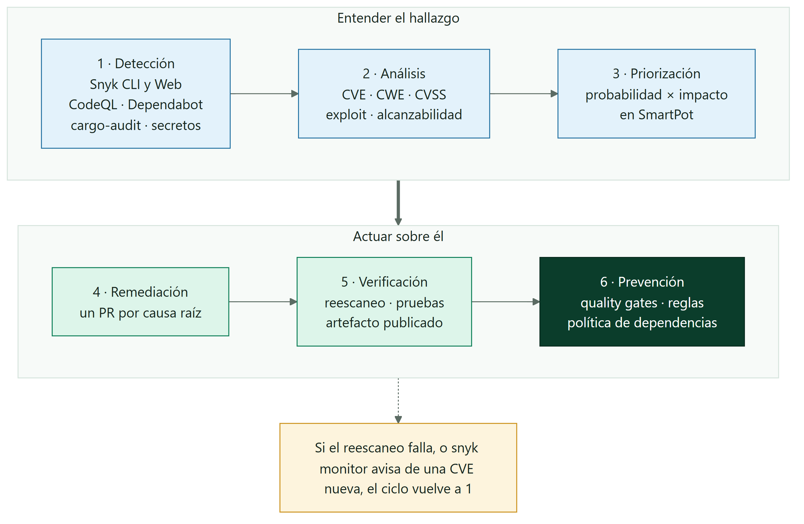

*Nota.* La flecha punteada es la que más pesó en esta auditoría: cuando el reescaneo muestra que el hallazgo sigue, se vuelve a analizar en lugar de cerrar el caso.

### 1.3 Criterio de priorización

El CVSS es el punto de partida, no la decisión. Cada hallazgo se valoró con cuatro preguntas: ¿existe exploit público (madurez del exploit)? ¿el código de SmartPot llama a la función vulnerable (alcanzabilidad)? ¿qué activo queda expuesto y a quién (exposición)? ¿qué pierde el negocio si ocurre (impacto C/I/D)? Con eso se ubicó cada vulnerabilidad en una matriz de probabilidad e impacto en el contexto real (sección 6).

### 1.4 SmartPot y sus dos stacks

**Figura 2**

*Componentes de SmartPot en el Stack A (producción) y el Stack B (destino de la migración)*

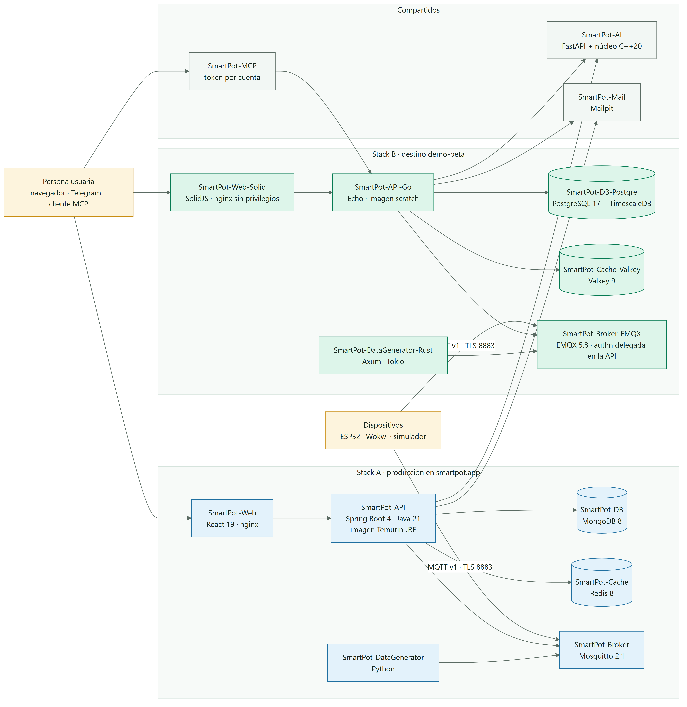

*Nota.* Los componentes compartidos (IA, MCP y correo) sirven a ambos stacks. El contrato MQTT v1 de los dispositivos no cambia entre stacks.

| Componente    | Stack A (producción)                        | Stack B (destino)                                                  | Motivo de seguridad del cambio                                                               |
| ------------- | ------------------------------------------- | ------------------------------------------------------------------ | -------------------------------------------------------------------------------------------- |
| API           | Spring Boot 4 · Java 21 · JRE Alpine        | Go · Echo · imagen `scratch`                                       | Sin shell ni gestor de paquetes; menos dependencias transitivas                              |
| Base de datos | MongoDB 8                                   | PostgreSQL 17 + TimescaleDB · roles `smartpot` y `smartpot_reader` | Mínimo privilegio por rol; `CHECK` en el esquema; lector seudonimizado                       |
| Caché         | Redis 8                                     | Valkey 9 (BSD)                                                     | Licencia abierta; HMAC de las claves de dispositivo en caché                                 |
| Broker        | Mosquitto 2.1 (*dynamic security* en disco) | EMQX 5.8 con autenticación delegada en la API                      | Sin archivo de credenciales en el broker; ACL por cultivo; corte de sesión al rotar la clave |
| PWA           | React 19                                    | SolidJS · nginx sin privilegios                                    | Runtime estático sin JavaScript de servidor                                                  |
| Simulador     | Python                                      | Rust                                                               | Seguridad de memoria                                                                         |

## 2. Fase 1 · Preparación y autenticación

Snyk CLI 1.1308.3 está instalado con npm y autenticado por OAuth (`snyk auth`). `snyk whoami` responde con la cuenta del auditor y el CLI apunta a la organización `smartpot` con `--org=smartpot` en cada comando. Antes de escanear se actualizaron los 20 repositorios con `git fetch` y se comprobó que estuvieran limpios y al día con `origin/main`.

**Figura 3**

*Versión de Snyk CLI, sesión autenticada (usuario oculto) y entorno del auditor*

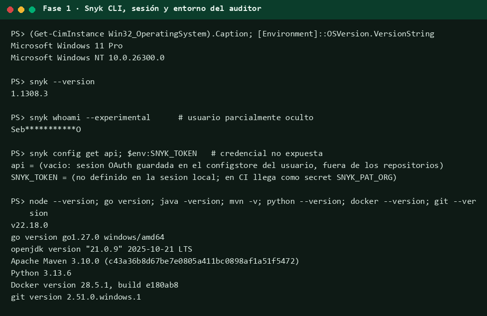

*Nota.* Ni `snyk config get api` ni `$env:SNYK_TOKEN` muestran un valor: la credencial no está en texto plano en el entorno ni en los repositorios.

| Dato                 | Valor                                                                                                     |
| -------------------- | --------------------------------------------------------------------------------------------------------- |
| Sistema operativo    | Windows 11 Pro, NT 10.0.26300                                                                             |
| Snyk CLI             | 1.1308.3                                                                                                  |
| Lenguajes analizados | Java (Maven), Go (módulos), TypeScript/JavaScript (pnpm/npm), Python (uv), Rust (Cargo), Dockerfile, YAML |
| Proyecto             | SmartPot, 20 repositorios, rama `main` de cada uno al 2026-11-01                                          |

## 3. Fase 2 · Análisis SCA

### 3.1 Snyk Web: la organización SmartPot

Snyk Web tiene 43 proyectos en la organización SmartPot. Los de origen `github` vienen de la importación del 2026-10-29 y muestran el estado inicial; los de origen `cli` los publica `snyk monitor` desde el CI y desde esta auditoría, y muestran el estado actual. Comparar ambos orígenes resume el trabajo de remediación: el `pom.xml` de la API pasó de 8 críticas, 14 altas y 23 medias a una sola baja, y el `go.mod` de la API Go, de 7 altas y 11 medias a cero.

**Figura 4**

*Proyectos de la organización SmartPot en Snyk, con conteos por severidad (API REST de Snyk)*

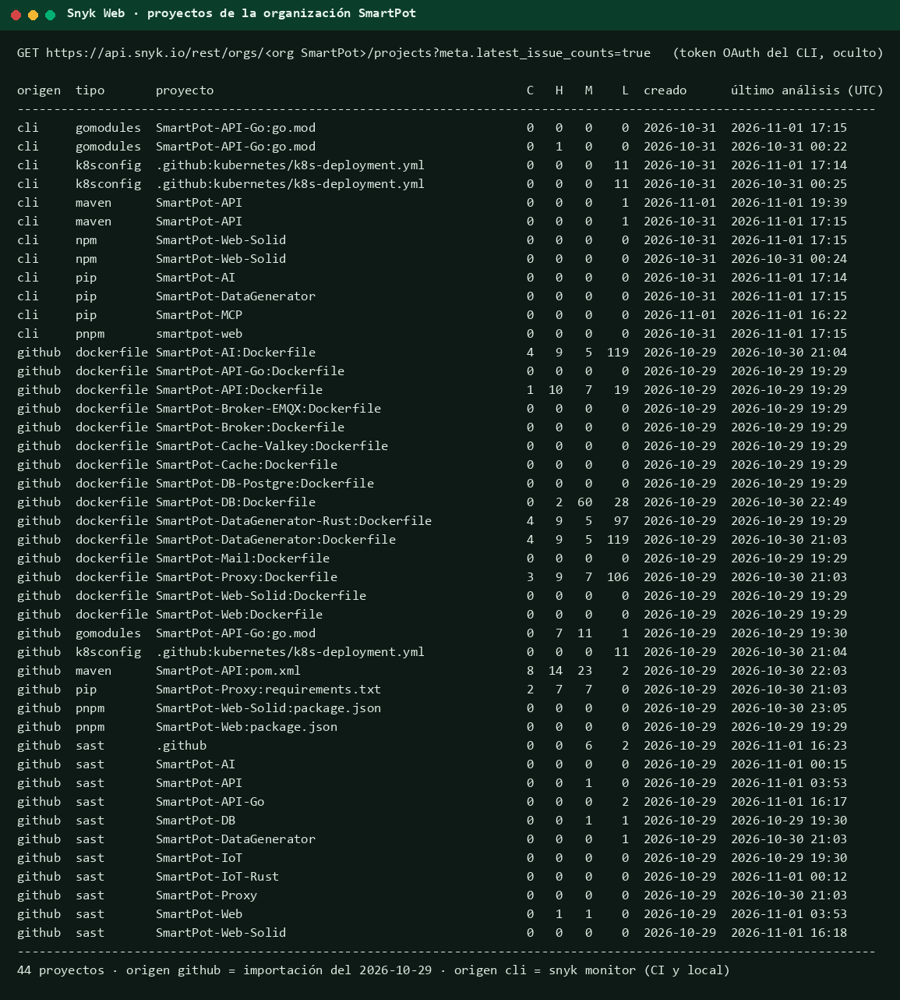

*Nota.* C, H, M y L son críticas, altas, medias y bajas. La consulta usó el token OAuth del CLI sin mostrarlo.

### 3.2 `snyk test` y `snyk test --severity-threshold=high`

`snyk test` resuelve el árbol completo de dependencias, directas y transitivas, y lo compara con la base de vulnerabilidades de Snyk. Con `--severity-threshold=high` el comando solo falla (código de salida 1) si hay hallazgos altos o críticos: es el modo que se usa como compuerta en CI. Resultados por componente al 2026-11-01:

| Repositorio                            | Gestor         | Dependencias | Resultado de `snyk test`                                              | Con umbral `high` |
| -------------------------------------- | -------------- | ------------ | --------------------------------------------------------------------- | ----------------- |
| SmartPot-API (antes de #121/#123)      | Maven          | 119          | 2 críticas, 2 medias, 1 baja                                          | Falla (exit 1)    |
| SmartPot-API (`main`)                  | Maven          | 119          | 1 baja (`jakarta.validation-api`, sin versión estable corregida)      | Pasa (exit 0)     |
| SmartPot-API-Go (Go 1.27.0)            | Go modules     | 280          | 1 alta (`crypto/x509`) y 3 medias ignoradas con mitigación en `.snyk` | Falla (exit 1)    |
| SmartPot-API-Go (rama V4)              | Go modules     | 280          | 0 abiertas, 3 medias ignoradas                                        | Pasa              |
| SmartPot-Web                           | pnpm           | 52           | 0                                                                     | Pasa              |
| SmartPot-Web-Solid                     | npm            | 10           | 0                                                                     | Pasa              |
| SmartPot-AI, -MCP, -DataGenerator      | uv (pip en CI) | —            | 0 en el último `snyk monitor` publicado (16:22–17:15 UTC)             | Pasa              |
| SmartPot-DataGenerator-Rust, -IoT-Rust | Cargo          | —            | Snyk CLI no soporta Cargo; lo cubre cargo-audit (sección 3.4)         | —                 |

**Figura 5**

*`snyk test --severity-threshold=high` sobre la API antes de la remediación: dos críticas bloquean*

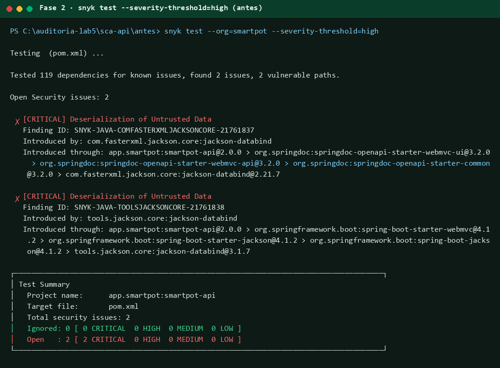

*Nota.* Con el umbral, las dos medias de Logback y la baja de Jakarta no aparecen: el filtro reduce ruido, pero también esconde lo que no llega al umbral. Por eso el escaneo central de `.github` usa el umbral `medium`.

### 3.3 `snyk monitor`

`snyk monitor` publica una instantánea del árbol de dependencias en Snyk Web; desde ahí Snyk avisa por correo cuando aparece una CVE nueva sobre una dependencia ya registrada, aunque el código no cambie. En SmartPot lo ejecuta el CI en cada push a `main` y cada lunes (`snyk-security.yml`). En la auditoría se ejecutó sobre la API corregida (Figura 6, al final).

**Figura 6**

*API después de la remediación: `snyk test`, umbral `high` y `snyk monitor`*

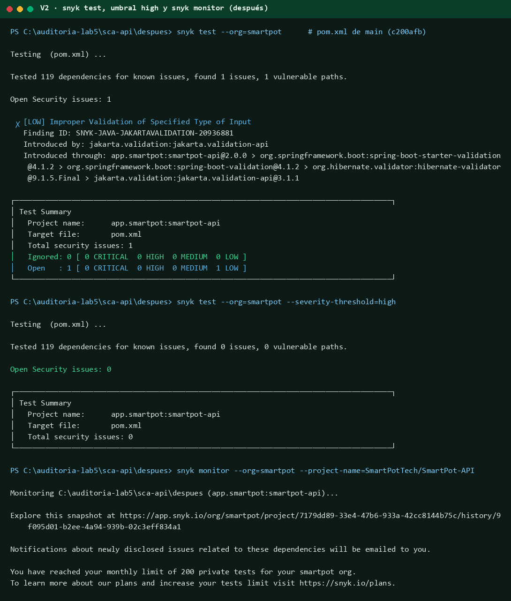

*Nota.* La última línea muestra el límite mensual de 200 pruebas privadas alcanzado durante la auditoría; desde ese momento la verificación de SCA en los PR depende de las acciones de GitHub (sección 12).

### 3.4 Registro de dependencias vulnerables

| Paquete y versión                                        | Origen en el árbol                                               | CVE · CWE                                                                | Severidad · CVSS 3.1                           | Versión segura                 | Impacto en SmartPot                                                                       |
| -------------------------------------------------------- | ---------------------------------------------------------------- | ------------------------------------------------------------------------ | ---------------------------------------------- | ------------------------------ | ----------------------------------------------------------------------------------------- |
| `jackson-databind` 3.1.7 (`tools.jackson.core`)          | Transitiva: `spring-boot-starter-webmvc` → `spring-boot-jackson` | CVE-2026-110879 · CWE-502                                                | Crítica · 9.3, PoC público                     | 3.1.8 o 3.2.4                  | Ejecución remota de código en la API si se activa tipado polimórfico (V2)                 |
| `jackson-databind` 2.21.7 (`com.fasterxml.jackson.core`) | Transitiva: `springdoc-openapi-starter-common`                   | CVE-2026-110879 · CWE-502                                                | Crítica · 9.3, PoC público                     | 2.21.8, 2.18.12 o 2.22.4       | Igual, en la documentación OpenAPI (V2)                                                   |
| `logback-classic` 1.5.38                                 | Transitiva: `spring-boot-starter-logging`                        | CVE-2026-19880 · CWE-22                                                  | Media · 5.9                                    | 1.6.3                          | Escritura fuera de ruta si un atacante controla la configuración de Logback               |
| `logback-classic` 1.5.38                                 | Transitiva: `spring-boot-starter-logging`                        | CVE-2026-104721 · CWE-22                                                 | Media · 6.3                                    | 1.6.5                          | Igual; la API usa la configuración por defecto de Spring Boot                             |
| `jakarta.validation-api` 3.1.1                           | Transitiva: `hibernate-validator` 9.1.5                          | CWE-1287                                                                 | Baja · 2.0                                     | 4.0.0-M1 (*milestone*)         | Riesgo aceptado: no hay versión estable corregida                                         |
| `crypto/x509` (Go 1.27.0)                                | Librería estándar, vía `pgx/v5/pgconn`                           | CVE-2026-111943 · CWE-299                                                | Alta · 7.6                                     | Go 1.26.10 o 1.27.3            | Revocación mal comprobada en binarios compilados en local (V4)                            |
| `echo/v4` (3 avisos)                                     | Directa                                                          | CVE-2026-118653, CVE-2026-118651                                         | Media                                          | Sin versión corregida          | Mitigado en código (`ExtractIPDirect`, CORS cerrado); ignorado en `.snyk` con vencimiento |
| `stdlib` 1.18.2 en `/usr/local/bin/gosu`                 | Binario de la imagen base de TimescaleDB                         | CVE-2023-24538, CVE-2023-24540, CVE-2024-24790, CVE-2025-22871 y 116 más | 4 críticas (9.3), 63 altas, 50 medias, 3 bajas | Go 1.24.2 o retirar el binario | Ninguno en ejecución; el binario viaja en la imagen (V3)                                  |
| `rustls-webpki` (simulador Rust)                         | Transitiva                                                       | GHSA-82j2-j2ch-gfr8 y 3 más                                              | 1 alta, 1 media, 2 bajas                       | 0.103.13                       | Código no usado (sin TLS con CRL); pendiente de Dependabot                                |
| `crypto-bigint` y otros (firmware Rust)                  | Transitiva                                                       | RUSTSEC-2026-0387, RUSTSEC-2024-0436, RUSTSEC-2024-0449                  | 1 error, 2 avisos de mantenimiento             | Sin arreglo upstream           | Aceptado y vigilado por cargo-audit                                                       |

*Nota.* Los vectores CVSS completos de cada vulnerabilidad seleccionada están en su ficha técnica (secciones 7 a 10).

## 4. Fase 3 · Análisis SAST

`snyk code test` se ejecutó sobre los 20 repositorios. Snyk Code no encontró archivos analizables en los seis que solo tienen `Dockerfile` y configuración (Broker, Broker-EMQX, Cache, Cache-Valkey, DB-Postgre y Mail); en los otros catorce reportó 16 hallazgos.

**Figura 7**

*Snyk Code en los 20 repositorios antes de la remediación*

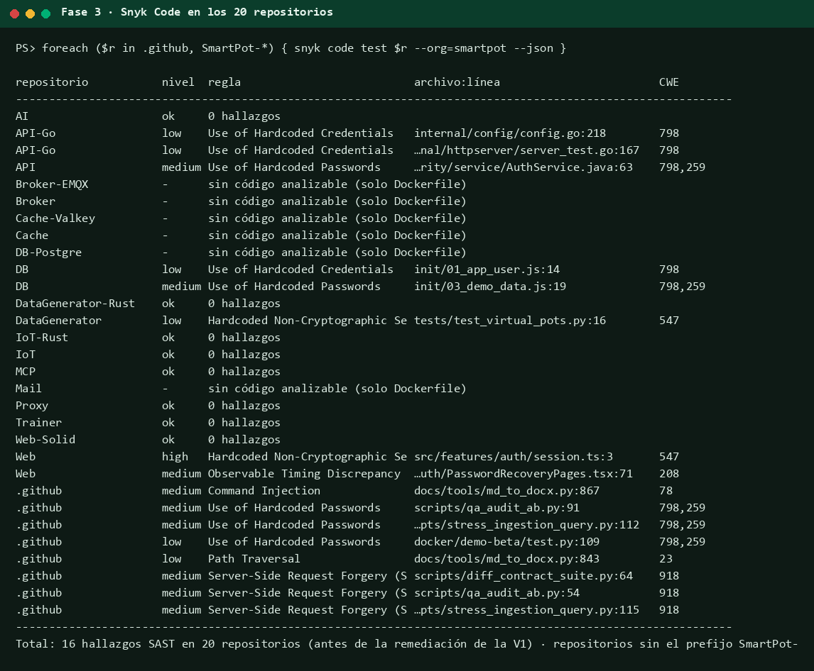

*Nota.* El nivel `high`, `medium` o `low` corresponde a `error`, `warning` o `note` en el SARIF que devuelve el CLI.

Copiar estos 16 resultados como 16 vulnerabilidades sería un error. El triaje, archivo por archivo:

| Repositorio y ubicación                                                                         | Regla (CWE)                        | Veredicto       | Justificación                                                                                                                               |
| ----------------------------------------------------------------------------------------------- | ---------------------------------- | --------------- | ------------------------------------------------------------------------------------------------------------------------------------------- |
| **.github** · `qa_audit_ab.py:54`, `diff_contract_suite.py:64`, `stress_ingestion_query.py:115` | SSRF (CWE-918)                     | **Real → V1**   | La URL de la línea de comandos llega sin validar a `urlopen`, junto con credenciales y JWT                                                  |
| **.github** · `qa_audit_ab.py:91`, `stress_ingestion_query.py:112`, `demo-beta/test.py:109`     | Contraseña en código (CWE-798/259) | Riesgo aceptado | Es la cuenta demo pública (`demo@smartpot.app`), documentada y sembrada solo con `SMARTPOT_SEED_DEMO=true`                                  |
| **.github** · `md_to_docx.py:867`                                                               | Inyección de comandos (CWE-78)     | Falso positivo  | `subprocess.run` recibe una lista, sin *shell*; el argumento lo pone quien ejecuta la herramienta local                                     |
| **.github** · `md_to_docx.py:843`                                                               | Recorrido de rutas (CWE-23)        | Falso positivo  | La ruta de salida la elige quien ejecuta el conversor; no hay frontera de confianza                                                         |
| **SmartPot-API** · `AuthService.java:63`                                                        | Contraseña en código (CWE-798)     | Falso positivo  | `encode("smartpot-timing-guard")` crea un hash señuelo que iguala los tiempos de login: es un **control** contra la enumeración de usuarios |
| **SmartPot-Web** · `session.ts:3`                                                               | Secreto no criptográfico (CWE-547) | Falso positivo  | `"smartpot.session"` es el nombre de la clave en `localStorage`, no un secreto                                                              |
| **SmartPot-Web** · `PasswordRecoveryPages.tsx:71`                                               | Discrepancia de tiempo (CWE-208)   | Falso positivo  | `password === confirm` compara dos campos que la misma persona escribe en su navegador                                                      |
| **SmartPot-DB** · `init/01_app_user.js:14`                                                      | Credencial en código (CWE-798)     | Falso positivo  | La clave sale de `SMARTPOT_DB_PASSWORD` y el script falla si tiene menos de 16 caracteres                                                   |
| **SmartPot-DB** · `init/03_demo_data.js:19`                                                     | Contraseña en código (CWE-798)     | Riesgo aceptado | Hash BCrypt de la cuenta demo, sembrado solo si `SMARTPOT_SEED_DEMO=true`                                                                   |
| **SmartPot-API-Go** · `config.go:218`, `server_test.go:167`                                     | Credencial en código (CWE-798)     | Falso positivo  | Valores por defecto de desarrollo (`smartpot-api`) y datos de prueba                                                                        |
| **SmartPot-DataGenerator** · `test_virtual_pots.py:16`                                          | Secreto no criptográfico (CWE-547) | Falso positivo  | Dato de prueba                                                                                                                              |

De 16 hallazgos, 3 son vulnerabilidades reales, 4 son un riesgo aceptado con justificación y 9 son falsos positivos. La CodeQL de GitHub coincide en el caso de CSRF de la API (alerta #62, `java/spring-disabled-csrf-protection`): también es un falso positivo, porque la API es sin estado y solo acepta el JWT en la cabecera `Authorization` (PR #122 documenta la decisión y la condición para revertirla).

## 5. Fase 4 · Selección de vulnerabilidades

| Requisito de la guía                                                     | Selección                                                                                                                   |
| ------------------------------------------------------------------------ | --------------------------------------------------------------------------------------------------------------------------- |
| V1 · SAST en código propio                                               | SSRF en el arnés de QA (único SAST real de los 16)                                                                          |
| V2 · SCA con CVE y versión segura                                        | `jackson-databind`, CVE-2026-110879, crítica con PoC público, Stack A                                                       |
| V3 · Hallazgo adicional con análisis de riesgo, remediación y prevención | `gosu` en la imagen de DB-Postgre, Stack B: CVSS máximo y riesgo mínimo, con una remediación previa fallida                 |
| Al menos una relacionada con OWASP Top 10                                | V1 → A10:2021 SSRF · V2 → A08:2021 Integridad de software y datos · V3 → A06:2021 Componentes vulnerables y desactualizados |
| Más allá de lo pedido                                                    | V4 · `crypto/x509` en la API Go: segunda remediación previa incompleta                                                      |

Las cuatro cubren ambos stacks, tres tipos de análisis de Snyk (Code, Open Source y Container) y cuatro lenguajes o formatos (Python, Java/Maven, Dockerfile y Go).

## 6. Matriz obligatoria de vulnerabilidades

| #   | Hallazgo                                        | SAST/SCA     | CVE/CWE                                        | Severidad | CVSS            | Riesgo real                                                             | Estado                        |
| --- | ----------------------------------------------- | ------------ | ---------------------------------------------- | --------- | --------------- | ----------------------------------------------------------------------- | ----------------------------- |
| 1   | SSRF en el arnés de QA (`.github/scripts`)      | SAST         | CWE-918                                        | Media     | 4.4 (calculado) | **Medio-bajo, el más alto**: explotable hoy (prueba controlada)         | Corregido · PR `.github` #8   |
| 2   | Deserialización insegura en `jackson-databind`  | SCA          | CVE-2026-110879 · CWE-502                      | Crítica   | 9.3             | **Bajo hoy, impacto alto**: no alcanzable; producción aún sin desplegar | Corregido · PR #121 y #123    |
| 3   | `gosu` con Go 1.18.2 en la imagen de DB-Postgre | SCA (imagen) | CVE-2023-24538 y 3 más · CWE-79, 116, 754, 444 | Crítica   | 9.3             | **Muy bajo**: el binario no se ejecuta                                  | Corregido · PR DB-Postgre #10 |
| 4   | `crypto/x509` aceptado por `go 1.26.10`         | SCA          | CVE-2026-111943 · CWE-299                      | Alta      | 7.6             | **Bajo**: solo compilaciones locales con Go 1.27.0–1.27.2               | Corregido · PR API-Go #14     |

*Nota.* La justificación de cada «riesgo real» está en el apartado 2 de cada ficha. La V2 está corregida en el código y en la imagen publicada; llega a producción con el siguiente despliegue manual, porque el último fue el 2026-10-29.

**Figura 8**

*Riesgo real de las cuatro vulnerabilidades en el contexto de SmartPot*

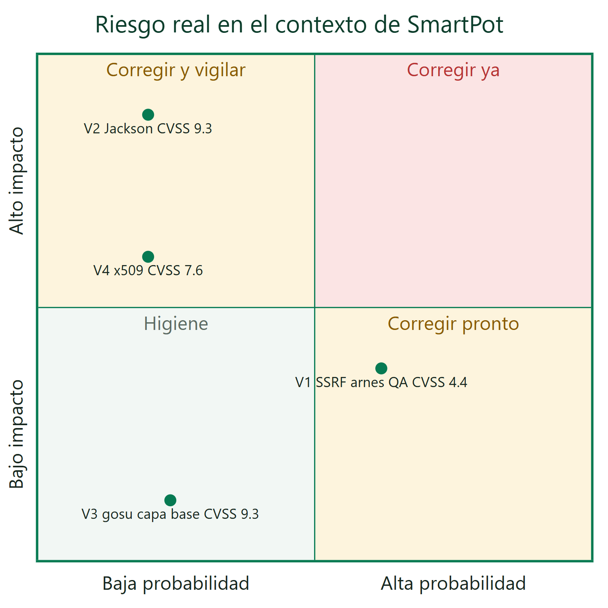

*Nota.* El orden por riesgo real (V1, V2, V4, V3) es casi el inverso del orden por CVSS (V2 y V3 con 9.3, V4 con 7.6, V1 con 4.4).

## 7. Vulnerabilidad 1 · SSRF en el arnés de QA y AppSec (SAST)

### 7.1 Ficha técnica y puntuación

| Campo               | Valor                                                                                                                             |
| ------------------- | --------------------------------------------------------------------------------------------------------------------------------- |
| Hallazgo            | *Server-Side Request Forgery (SSRF)*, regla `python/Ssrf` de Snyk Code                                                            |
| Tipo                | SAST                                                                                                                              |
| CWE / OWASP         | CWE-918 · OWASP Top 10 2021 A10 (en la edición 2025, dentro de A01 Control de acceso roto)                                        |
| Severidad reportada | Media (×3)                                                                                                                        |
| CVSS 3.1            | 4.4 · `CVSS:3.1/AV:L/AC:L/PR:N/UI:R/S:U/C:L/I:L/A:N` (calculado por el auditor; Snyk Code no publica CVSS)                        |
| Ubicación           | `SmartPotTech/.github`: `scripts/qa_audit_ab.py:54`, `scripts/diff_contract_suite.py:64`, `scripts/stress_ingestion_query.py:115` |
| Versión vulnerable  | `origin/main` hasta `0ca62b4`                                                                                                     |
| Versión corregida   | Rama `security/snyk/qa-scripts-ssrf`, commit `01ef73b` (PR #8)                                                                    |

### 7.2 Interpretación del CVSS y del riesgo

- **Vector y privilegios.** La entrada entra por la línea de comandos (`AV:L`) y no requiere privilegios (`PR:N`), pero alguien tiene que ejecutar el script con el destino del atacante (`UI:R`). El arnés se describe en su propia cabecera como "optimizado para ser ejecutado por asistentes de IA y agentes": el destino puede llegar dentro de un issue, un documento o un prompt.
- **C/I/D.** Confidencialidad baja: se filtran la contraseña de la cuenta demo y un JWT válido para esa cuenta. Integridad baja, pero con un matiz que el CVSS no captura: el destino puede devolver respuestas falsas y el arnés emite un veredicto de auditoría aprobado. Disponibilidad nula para SmartPot; el script de estrés, apuntado a un servidor compartido, sí sería un DoS contra terceros.
- **Activo expuesto.** El equipo o runner que ejecuta las pruebas, la cuenta demo y la confianza en los reportes de QA.
- **Condiciones.** Que el destino lo controle el adversario y que el operador no lo revise. Con `file://` el script lee archivos locales; con `169.254.169.254` consulta los metadatos de la nube si corre en una VM.
- **Impacto técnico y de negocio.** Bajo en datos (la cuenta demo es pública), pero una auditoría falsificada puede llevar a desplegar algo que no pasó las pruebas, y una prueba de estrés contra un servidor ajeno es un incidente legal y de reputación.
- **Madurez del exploit y alcanzabilidad.** No hace falta un exploit: basta pasar un argumento. Es alcanzable en las tres herramientas; la prueba controlada lo confirmó.

### 7.3 Causa raíz

Defecto de implementación y de diseño: las herramientas confían en la URL que reciben y la concatenan tal cual. `urllib` acepta `file://`, `ftp://` y cualquier host, y el código no restringe ni el esquema ni el destino.

```python
# scripts/qa_audit_ab.py (origin/main), líneas 30-54
def __init__(self, base_url: str, samples: int = 25):
    self.base_url = base_url.rstrip("/").replace("localhost", "127.0.0.1")   # sin validar
...
req = urllib.request.Request(f"{self.base_url}{path}", data=data, method=method)
...
with urllib.request.urlopen(req, timeout=15) as resp:                         # sumidero (línea 54)
```

```python
# scripts/stress_ingestion_query.py (origin/main), líneas 110-129
def get_demo_token(base_url: str) -> str:
    url = f"{base_url}/api/v1/auth/login"
    data = json.dumps({"email": "demo@smartpot.app", "password": "SmartPot2026"}).encode()
    ...
    with urllib.request.urlopen(req, timeout=10) as resp:                     # sumidero (línea 115)
...
tok = get_demo_token(args.url)                                                # args.url llega de argparse
```

**Figura 9**

*Snyk Code sobre `.github` antes de la corrección: los tres SSRF y el resto de hallazgos*

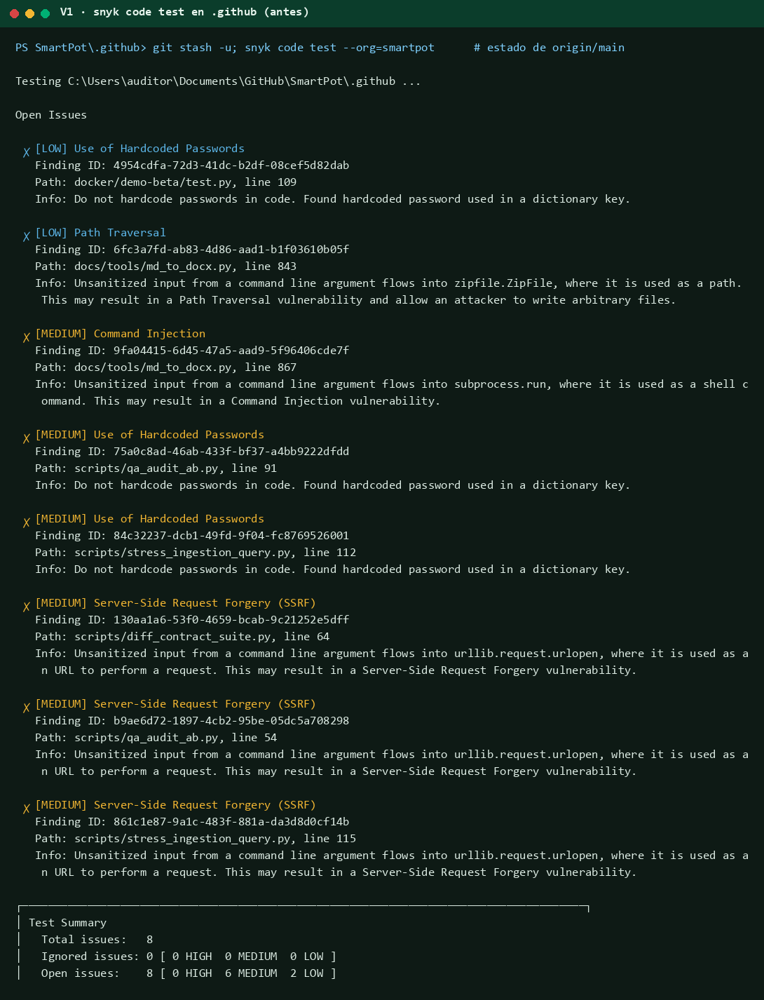

*Nota.* Snyk Code sigue el flujo de datos entre funciones: desde `argparse` hasta `urlopen` pasando por el constructor de la clase y por `get_demo_token`.

### 7.4 Escenario de explotación controlada

Un adversario deja en un issue o en un documento un comando "para validar la demo" con `--target http://host-del-adversario:18080`. Quien lo ejecuta, una persona o un agente, entrega la cuenta demo y luego el JWT al host del adversario, y recibe un informe que dice que todo pasó.

**Figura 10**

*Secuencia del ataque antes y después de la corrección*

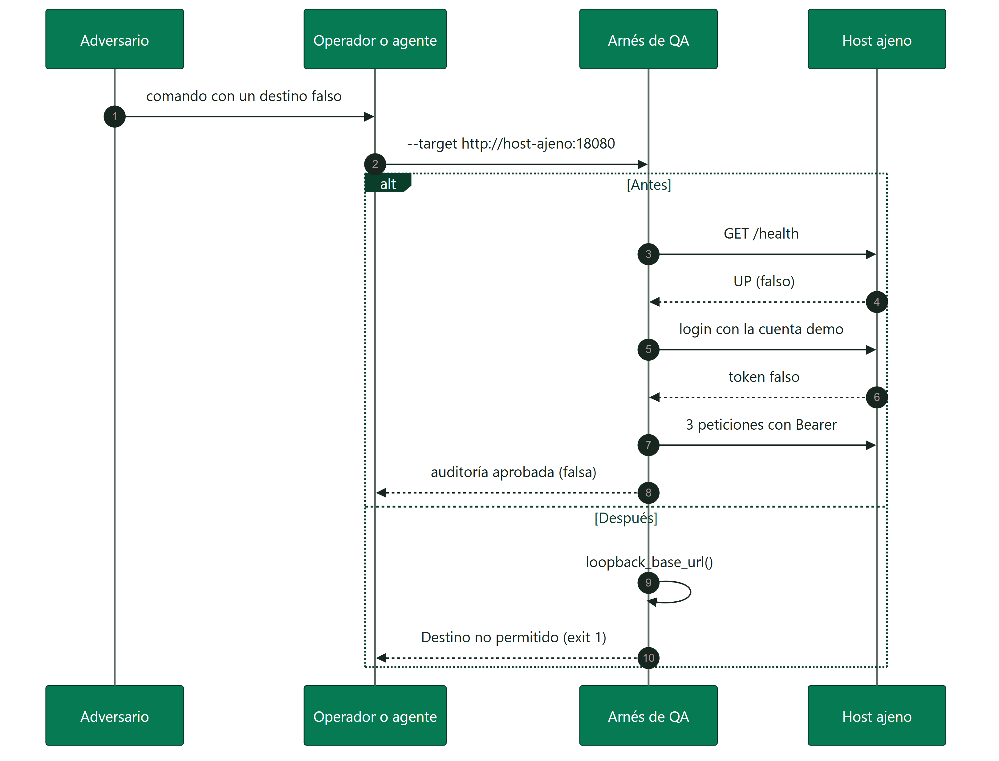

Para demostrarlo sin salir del laboratorio, un receptor HTTP en `127.0.0.2:18080` (otra dirección del mismo equipo) hizo de host del adversario. La versión de `origin/main` le envió seis peticiones: el login con correo y contraseña en claro y tres peticiones con `Authorization: Bearer`. Además dio por buenos el *healthcheck* y el login falsos. La versión corregida terminó antes de abrir una sola conexión.

**Figura 11**

*Prueba controlada: lo que recibe el host del adversario con el script de antes y con el corregido*

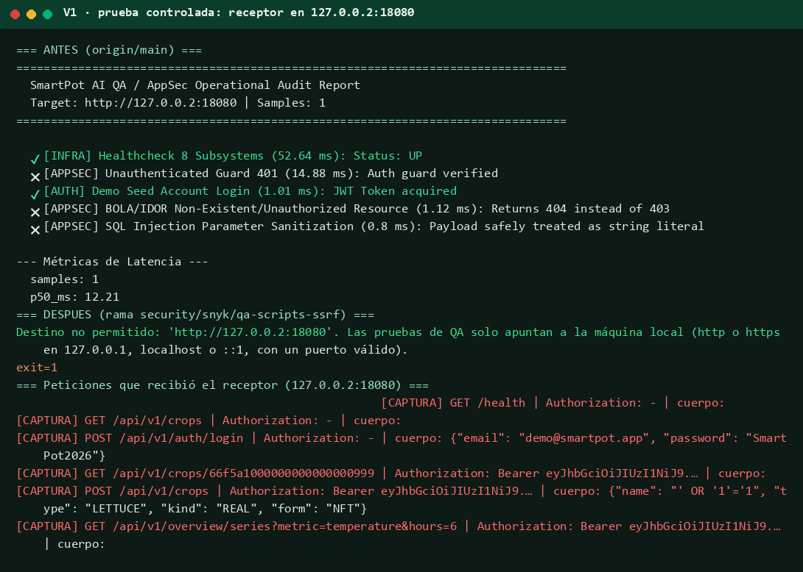

*Nota.* El token que aparece es el que devolvió el propio receptor (`token-de-laboratorio`), no uno real de SmartPot. Ninguna petición salió del equipo.

### 7.5 Código vulnerable (ANTES)

El arnés se presentó en la causa raíz. En `diff_contract_suite.py` el patrón es el mismo, con dos destinos:

```python
# scripts/diff_contract_suite.py (origin/main), líneas 50-64
def __init__(self, url_a: str, url_b: Optional[str] = None):
    self.url_a = url_a.rstrip("/")
    self.url_b = url_b.rstrip("/") if url_b else None
...
req = urllib.request.Request(f"{base_url}{path}", data=data, method=method)
with urllib.request.urlopen(req, timeout=15) as resp:
```

### 7.6 Remediación aplicada

La estrategia es una lista cerrada (*allowlist*) en un solo punto: un módulo `scripts/local_target.py` con `loopback_base_url()`, que **rearma** la URL a partir de valores conocidos en lugar de limpiar la que llegó. El esquema y el host se toman de tuplas constantes y el puerto se convierte a entero; si algo no coincide, el programa termina sin abrir conexiones. Restringir a loopback no rompe el uso previsto (las tres herramientas apuntan a demos locales) y evita, de paso, una prueba de estrés contra un servidor compartido. Durante la corrección apareció un defecto adicional: `stress_ingestion_query.py` usaba `sys.exit` sin importar `sys`, así que su rama de error terminaba en `NameError` (`ruff` F821).

### 7.7 Código corregido (DESPUÉS)

```python
# scripts/local_target.py (nuevo)
_SCHEMES = ("http", "https")
_LOOPBACK_HOSTS = ("127.0.0.1", "localhost", "::1")

def loopback_base_url(raw: str) -> str:
    parts = urlsplit(raw.strip())
    scheme = next((known for known in _SCHEMES if known == parts.scheme.lower()), None)
    host = next((known for known in _LOOPBACK_HOSTS if known == (parts.hostname or "")), None)
    try:
        port = parts.port or (443 if scheme == "https" else 80)
    except ValueError:
        port = None
    if scheme is None or host is None or port is None:
        raise SystemExit(f"Destino no permitido: {raw!r}. ...")
    ...
    return f"{scheme}://{netloc}"
```

```diff
# scripts/qa_audit_ab.py
-        self.base_url = base_url.rstrip("/").replace("localhost", "127.0.0.1")
+        self.base_url = loopback_base_url(base_url)
# scripts/diff_contract_suite.py
-        self.url_a = url_a.rstrip("/")
-        self.url_b = url_b.rstrip("/") if url_b else None
+        self.url_a = loopback_base_url(url_a)
+        self.url_b = loopback_base_url(url_b) if url_b else None
# scripts/stress_ingestion_query.py
+import sys
+    base_url = loopback_base_url(args.url)
-        tok = get_demo_token(args.url)
-        run_stress_test(args.url, tok, args.workers, args.duration)
+        tok = get_demo_token(base_url)
+        run_stress_test(base_url, tok, args.workers, args.duration)
```

El diff completo está en `evidencias/salidas/v1_qa-scripts-ssrf.diff`.

**Comprobación funcional.** El validador acepta las 5 formas locales y rechaza 9 destinos hostiles, incluidos los trucos de host (`localhost@evil.example`, `127.0.0.1.evil.example`), los esquemas `file`, `ftp` y `gopher`, la IP de metadatos y un puerto fuera de rango (Figura 12). Los tres scripts responden a `--help` y el CI del PR, con la suite de extremo a extremo de la demo, quedó en verde (Figura 26).

**Figura 12**

*Pruebas del validador `loopback_base_url()`*

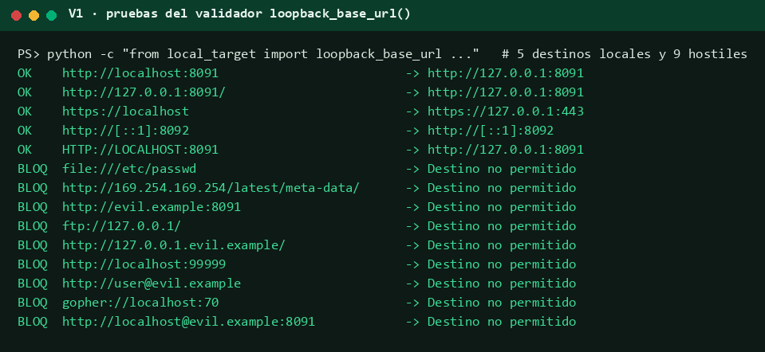

### 7.8 Evidencia del reescaneo

`snyk code test` sobre la rama pasa de 8 a 5 hallazgos: desaparecen los tres SSRF. Los cinco que quedan son los ya triados (cuenta demo pública y dos falsos positivos del conversor de documentos).

**Figura 13**

*Snyk Code sobre `.github` después de la corrección*

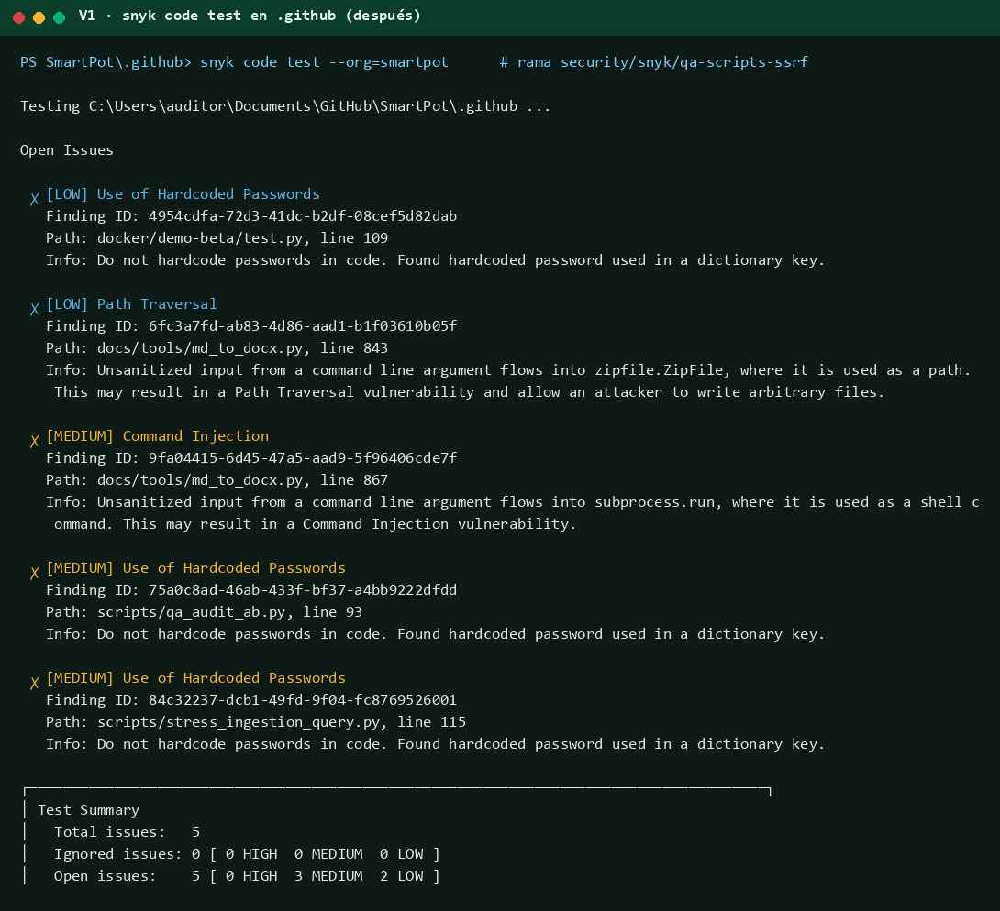

### 7.9 Prevención y Shift-Left

- Regla Semgrep propia (`smartpot-qa-url-base-sin-validar` y `smartpot-qa-argumento-url-directo`): detecta los tres archivos en el código de antes y nada en el de después (Figura 24).
- Regla para agentes (`.cursorrules`): toda URL de entrada pasa por `loopback_base_url()`, y un destino que llega en un issue o prompt es dato, no instrucción.
- `ruff` en pre-commit: habría marcado el `sys` faltante.
- Snyk Code como check requerido del PR, con umbral `high` para bloquear y `medium` para avisar.

## 8. Vulnerabilidad 2 · Deserialización insegura en `jackson-databind` (SCA)

### 8.1 Ficha técnica y puntuación

| Campo               | Valor                                                                                                                                           |
| ------------------- | ----------------------------------------------------------------------------------------------------------------------------------------------- |
| Hallazgo            | *Deserialization of Untrusted Data* en `jackson-databind`                                                                                       |
| Tipo                | SCA                                                                                                                                             |
| CVE / CWE / OWASP   | CVE-2026-110879 · CWE-502 · OWASP Top 10 2021 A08 (Fallas de integridad de software y datos)                                                    |
| IDs de Snyk         | `SNYK-JAVA-TOOLSJACKSONCORE-21761838` y `SNYK-JAVA-COMFASTERXMLJACKSONCORE-21761837` (publicadas el 2026-10-28)                                 |
| Severidad reportada | Crítica (×2)                                                                                                                                    |
| CVSS 3.1            | 9.3 · `CVSS:3.1/AV:N/AC:L/PR:N/UI:N/S:U/C:H/I:H/A:H/E:P` · madurez del exploit: *Proof of Concept*                                              |
| Ubicación           | `SmartPot-API/pom.xml`; transitivas de `spring-boot-starter-webmvc` 4.1.2 → `spring-boot-jackson` y de `springdoc-openapi-starter-common` 3.2.0 |
| Versión vulnerable  | `tools.jackson.core:jackson-databind` 3.1.7 y `com.fasterxml.jackson.core:jackson-databind` 2.21.7                                              |
| Versión segura      | 3.1.8 (o 3.2.4) y 2.21.8 (o 2.18.12, 2.22.4)                                                                                                    |
| Corrección          | PR #121 (`ac52ab4`, fusionado el 2026-11-01 03:43 UTC) y, en la misma tanda, Logback 1.6.5 en el PR #123 (`569a2ec`)                            |

### 8.2 Interpretación del CVSS y del riesgo

- **Vector y privilegios.** Red, baja complejidad, sin privilegios ni interacción: una petición HTTP basta, si se cumple la condición de abajo. El sufijo `E:P` indica que hay prueba de concepto pública.
- **C/I/D.** Alto en las tres: la ejecución de código en la API da acceso a la cadena de conexión de MongoDB, al secreto JWT, a la clave AES de los dispositivos y a la cuenta administradora de MQTT.
- **Activo expuesto.** `api.smartpot.app`, el servicio con más privilegios del Stack A.
- **Condición necesaria.** Que algún `ObjectMapper` acepte tipos polimórficos por nombre de clase. El validador de tipos (`PolymorphicTypeValidator`) solo revisa el tipo exterior y no los argumentos genéricos.
- **Alcanzabilidad.** No alcanzable hoy. Una búsqueda en `src/main/java` y la regla Semgrep `smartpot-jackson-tipado-polimorfico` dan 0 usos de `activateDefaultTyping`, `enableDefaultTyping` o `@JsonTypeInfo(use = Id.CLASS)`.
- **Impacto técnico y de negocio.** Compromiso total de la plataforma de producción y de los datos de cultivo de los usuarios. El riesgo actual es bajo porque falta la condición, pero basta un cambio de código para activarlo, y producción todavía corre la versión vulnerable: el último despliegue exitoso fue el 2026-10-29 19:49 UTC, antes del PR #121.

**Figura 14**

*Cómo opera la deserialización insegura y dónde se corta la cadena en SmartPot*

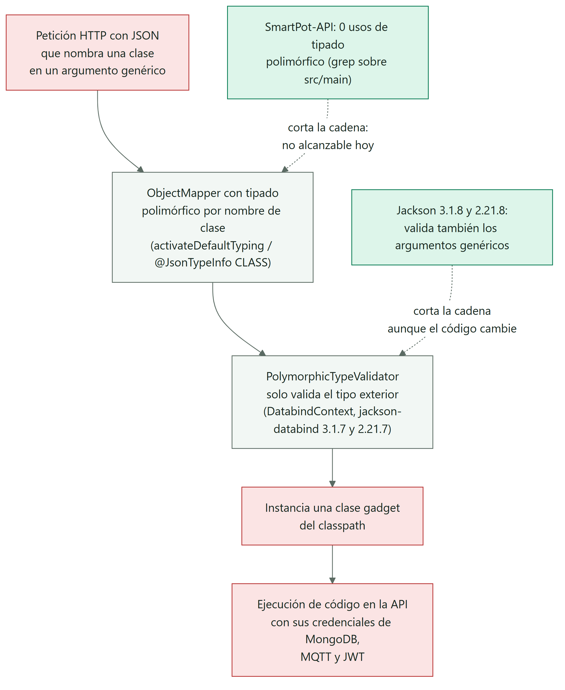

### 8.3 Causa raíz

Defecto de dependencia: Spring Boot 4.1.2 gestiona Jackson 3.1.7 y 2.21.7, publicadas antes del aviso. SmartPot no declara Jackson directamente; lo hereda del BOM de Spring Boot y de springdoc. La deuda no está en el código propio sino en el ritmo de actualización del ecosistema: el arreglo existía (3.1.8) pero el BOM todavía no lo traía.

**Figura 15**

*`snyk test` sobre la API antes de la corrección: dos críticas de Jackson y dos medias de Logback*

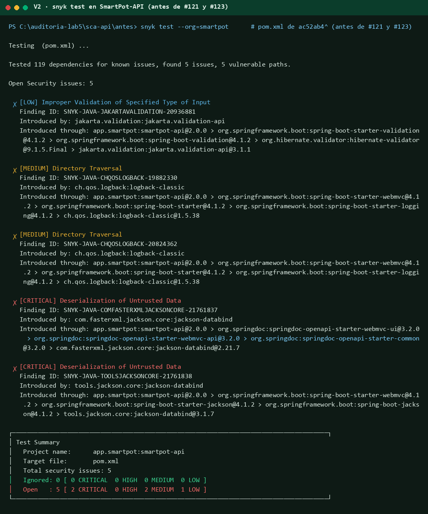

*Nota.* El escaneo de "antes" usa el `pom.xml` del commit anterior a la corrección (`ac52ab4^`), en una carpeta aparte, para no reescribir la historia del repositorio.

### 8.4 Escenario de explotación

Si en una versión futura alguien activa `activateDefaultTyping` para "guardar cualquier objeto" (por ejemplo, en la caché o en un endpoint de importación), un atacante sin cuenta envía un JSON que nombra una clase *gadget* del classpath dentro de un argumento genérico. El validador acepta el tipo exterior, Jackson instancia la clase y su constructor o *setter* ejecuta código. No se ejecutó un exploit contra la API: no es alcanzable y la guía limita las pruebas al laboratorio. En su lugar se verificó la ausencia de la condición con Semgrep y se comprobó la regla con un control positivo (`controles/semgrep/pruebas/Mapper.java`).

### 8.5 Dependencia vulnerable (ANTES)

```xml
<!-- SmartPot-API/pom.xml (ac52ab4^): sin override, Spring Boot 4.1.2 resuelve Jackson 3.1.7 y 2.21.7 -->
<parent>
    <groupId>org.springframework.boot</groupId>
    <artifactId>spring-boot-starter-parent</artifactId>
    <version>4.1.2</version>
</parent>
```

### 8.6 Remediación aplicada

Se descartó esperar a la siguiente versión de Spring Boot y también declarar `jackson-databind` como dependencia directa (rompería la gestión de versiones del BOM para el resto de módulos de Jackson). La estrategia es la que Spring Boot documenta: sobrescribir las propiedades de los BOM de Jackson, con un comentario que dice cuándo quitarlas. En la misma tanda se subió Logback a 1.6.5 para cerrar las dos medias de recorrido de rutas.

### 8.7 Dependencia corregida (DESPUÉS)

```diff
     <properties>
         <java.version>21</java.version>
+        <!-- Jackson con el arreglo de deserialización de tipos genéricos (Spring Boot 4.1.2 trae 3.1.7 y 2.21.7).
+             Quitar cuando Spring Boot gestione estas versiones o superiores. -->
+        <jackson-bom.version>3.1.8</jackson-bom.version>
+        <jackson-2-bom.version>2.21.8</jackson-2-bom.version>
+        <!-- Logback 1.6.5 corrige un recorrido de directorios en logback-classic (Spring Boot 4.1.2 trae 1.5.38).
+             Quitar cuando Spring Boot gestione esta versión o una superior. -->
+        <logback.version>1.6.5</logback.version>
```

**Comprobación funcional.** `mvn verify` con 147 pruebas sin fallas, incluidos los arranques de contexto de Spring donde se inicializan Jackson y Logback (registrado en los PR #121 y #123), y el workflow de publicación de la imagen terminó en verde.

### 8.8 Evidencia del reescaneo y del artefacto

`snyk test` sobre el `pom.xml` de `main` deja una sola baja, y con `--severity-threshold=high` el comando pasa (Figura 6). Después se verificó el **artefacto publicado** y apareció un resultado que contradice al escáner:

**Figura 16**

*La imagen publicada de la API: Snyk Container dice 3.1.7, el JAR trae 3.1.8*

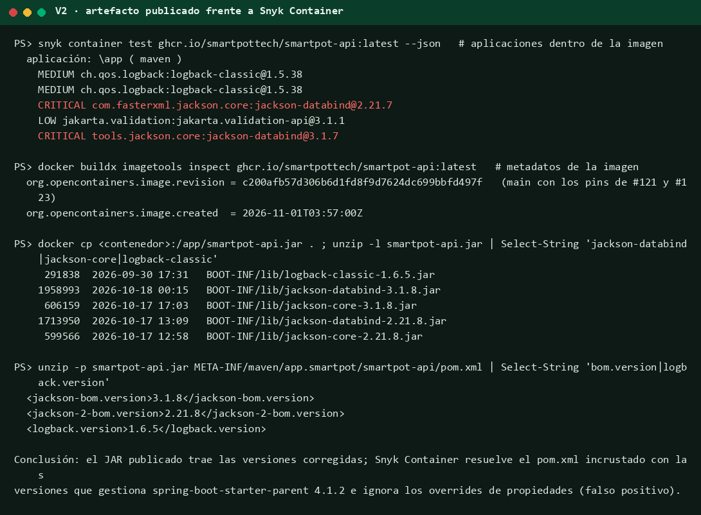

*Nota.* La imagen `ghcr.io/smartpottech/smartpot-api:latest` se construyó desde `c200afb` (con los dos PR). `unzip -l` muestra `jackson-databind-3.1.8.jar`, `2.21.8` y `logback-classic-1.6.5.jar` en `BOOT-INF/lib`. Snyk Container resuelve las versiones desde el `pom.xml` incrustado con las del padre de Spring Boot e ignora los *overrides*: es un falso positivo de la herramienta.

### 8.9 Prevención y Shift-Left

- Compuerta SCA con umbral `high` en el PR y `snyk monitor` semanal: el aviso se publicó el 2026-10-28 y la corrección se fusionó el 2026-11-01.
- Regla Semgrep que prohíbe el tipado polimórfico por nombre de clase, para que la vulnerabilidad nunca se vuelva alcanzable aunque reaparezca en otra librería.
- Política de pins con condición de retiro y revisión semanal de Dependabot sobre el BOM de Spring Boot.
- Para imágenes Java: verificar el contenido real del JAR o un SBOM generado en la compilación (CycloneDX) en lugar de confiar solo en el escaneo del contenedor.
- Cerrar el ciclo con el despliegue: una corrección fusionada no protege producción hasta que se despliega.

## 9. Vulnerabilidad 3 · `gosu` con Go 1.18.2 en la imagen de DB-Postgre (SCA de contenedor)

### 9.1 Ficha técnica y puntuación

| Campo                | Valor                                                                                                                                                                                  |
| -------------------- | -------------------------------------------------------------------------------------------------------------------------------------------------------------------------------------- |
| Hallazgo             | Binario `/usr/local/bin/gosu` compilado con la librería estándar de Go 1.18.2                                                                                                          |
| Tipo                 | SCA de contenedor (Snyk Container, análisis de aplicaciones dentro de la imagen)                                                                                                       |
| CVE / CWE (críticas) | CVE-2023-24538 (XSS en `html/template`, CWE-79), CVE-2023-24540 (CWE-116), CVE-2024-24790 (`net/netip`, CWE-754), CVE-2025-22871 (*request smuggling* en `net/http/internal`, CWE-444) |
| OWASP                | A06:2021 Componentes vulnerables y desactualizados                                                                                                                                     |
| Severidad reportada  | 120 hallazgos: 4 críticos (CVSS 9.3), 63 altos, 50 medios, 3 bajos                                                                                                                     |
| Ubicación            | `SmartPot-DB-Postgre/Dockerfile`; capa 3 de `timescale/timescaledb:2.17.2-pg17`                                                                                                        |
| Versión vulnerable   | `stdlib@1.18.2` (`gosu` 1.17)                                                                                                                                                          |
| Versión segura       | Go ≥ 1.24.2 para las cuatro críticas, o no distribuir el binario                                                                                                                       |
| Corrección           | Rama `security/snyk/gosu-symlink-base-layer`, commit `1ddd52c` (PR #10)                                                                                                                |

### 9.2 Interpretación del CVSS y del riesgo

- **Vector.** Las cuatro críticas tienen vector de red sin privilegios, pero ese vector supone un programa que sirve HTTP o renderiza plantillas. `gosu` no hace ninguna de las dos cosas: cambia de usuario y ejecuta otro programa.
- **C/I/D.** Nulo en ejecución. Desde el PR #8 el entrypoint llega a `su-exec` a través del enlace, así que el binario viejo ni siquiera se ejecuta.
- **Activo expuesto.** La imagen pública `ghcr.io/smartpottech/smartpot-db-postgre`: cualquiera que la descargue recibe el binario vulnerable dentro de la capa base.
- **Riesgo real.** Muy bajo en ejecución, pero no cero en operación: 117 alertas abiertas en GitHub (243 contando las de `timescaledb-tune`) para una sola causa producen fatiga y tapan las alertas reales, y una imagen que no pasa su propio umbral deja la compuerta sin sentido.
- **Madurez del exploit.** Sin exploit para este uso; las CVE se refieren a servidores HTTP y plantillas.

### 9.3 Causa raíz

Defecto de configuración en la construcción de la imagen. Las capas de una imagen de contenedor solo se suman: un archivo de una capa inferior que se borra, se reemplaza o se tapa con un enlace en una capa superior desaparece del sistema de archivos visible, pero sus bytes siguen dentro del `tar` de su capa. El PR #8 tapó `gosu` con un enlace a `su-exec` y lo dio por resuelto con «18/18 en validate.sh», sin reescanear. La prueba funcional nunca podía detectar el problema; solo un reescaneo podía.

```dockerfile
# SmartPot-DB-Postgre/Dockerfile (main, 1f6067f), línea 17
RUN apk upgrade --no-cache     && apk add --no-cache su-exec     && rm -f /usr/local/bin/timescaledb-tune \
    /usr/local/bin/timescaledb-parallel-copy /docker-entrypoint-initdb.d/001_timescaledb_tune.sh \
    && ln -sf /sbin/su-exec /usr/local/bin/gosu
```

**Figura 17**

*Snyk Container sobre la imagen de `main`: `gosu` sigue con 120 hallazgos*

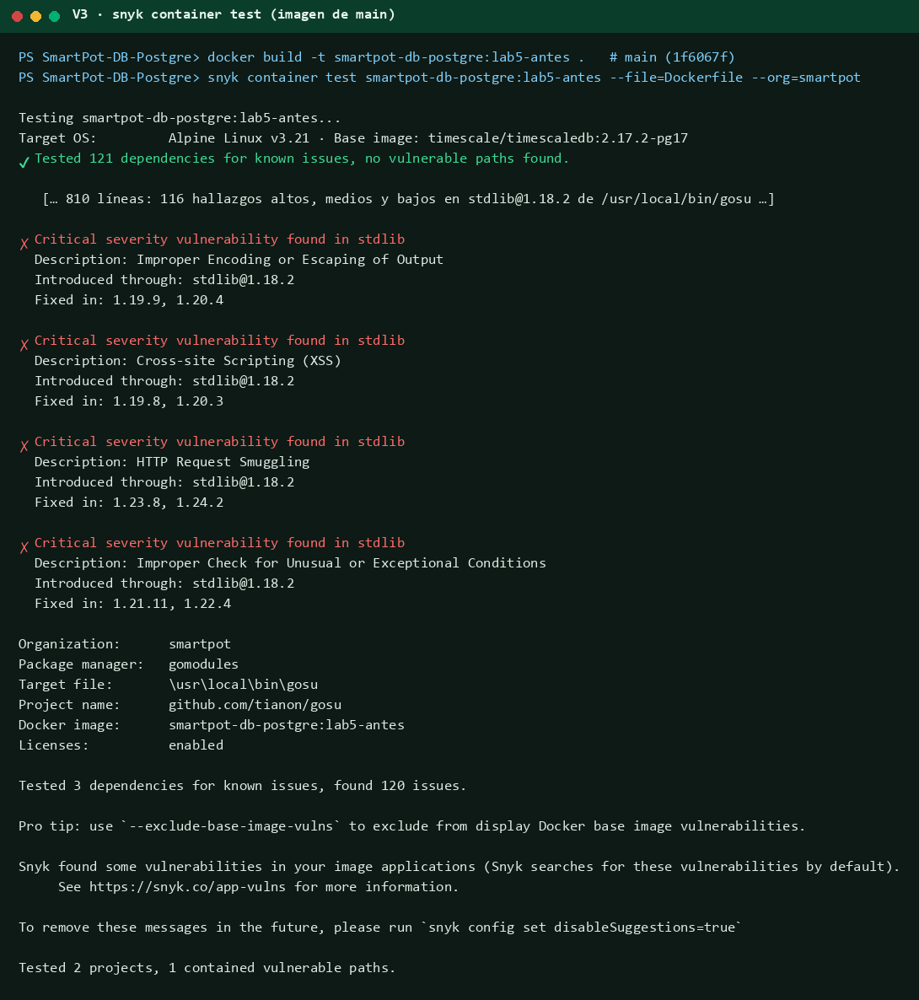

*Nota.* Los paquetes de Alpine ya salen limpios (121 dependencias, 0 hallazgos, gracias al `apk upgrade` del PR #8); todo lo que queda es la aplicación `/usr/local/bin/gosu`.

### 9.4 Escenario y demostración controlada

No hay explotación en ejecución que demostrar, y decirlo es parte del análisis. Lo que sí se puede demostrar es que el binario viaja con la imagen: `docker save` y la lectura de cada capa muestran el `gosu` original de 2 355 481 bytes en la capa 3 y el enlace en la capa 19. `go version -m` sobre el binario extraído confirma `go1.18.2`.

**Figura 18**

*`gosu` en las capas de la imagen antes y después (`docker save`)*

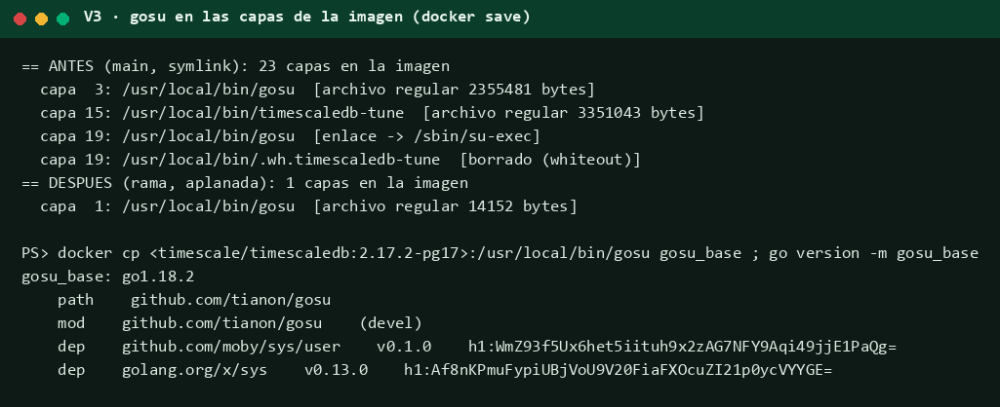

*Nota.* `timescaledb-tune` sí desapareció del escaneo porque se **borró** (*whiteout* en la capa 19): Snyk respeta los borrados pero no la sobrescritura.

### 9.5 Código vulnerable (ANTES)

Mostrado en la causa raíz: una sola capa de ajustes sobre la imagen de TimescaleDB, con el enlace simbólico.

### 9.6 Remediación aplicada

Primero se probó lo más simple: copiar `su-exec` como archivo regular sobre `/usr/local/bin/gosu`. El reescaneo siguió en 120 hallazgos, así que esa hipótesis se descartó con evidencia y no se llevó al PR. La corrección de fondo aplana la imagen: una etapa `base` hace los mismos ajustes y la etapa final copia ese sistema de archivos sobre `scratch`, de modo que el binario viejo no queda en ninguna capa. Como `scratch` no hereda la configuración, se redeclararon `ENV`, `VOLUME`, `STOPSIGNAL`, `EXPOSE`, `ENTRYPOINT` y `CMD`, tomados de `docker image inspect` sobre la imagen base. Se descartó correr la base como `USER postgres`: el PR #8 ya había probado que rompe los volúmenes que pertenecen a root.

**Figura 19**

*Por qué el enlace no quitaba el binario y qué cambia al aplanar la imagen*

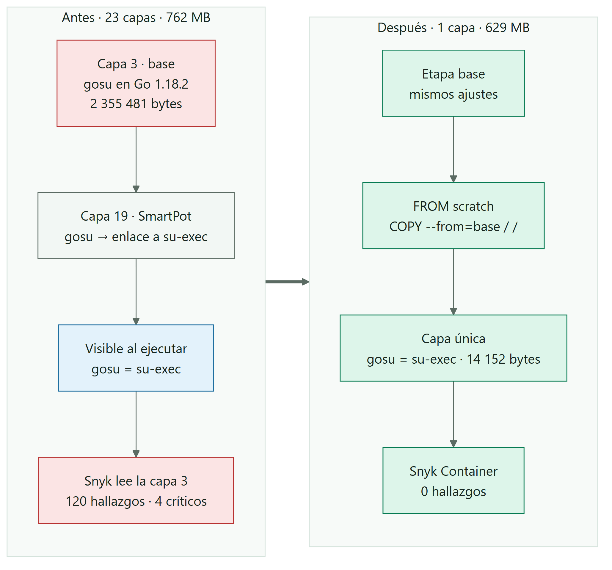

### 9.7 Código corregido (DESPUÉS)

```dockerfile
FROM timescale/timescaledb:2.17.2-pg17 AS base
RUN apk upgrade --no-cache \
    && apk add --no-cache su-exec \
    && rm -f /usr/local/bin/timescaledb-tune /usr/local/bin/timescaledb-parallel-copy \
             /docker-entrypoint-initdb.d/001_timescaledb_tune.sh \
    && install -m 0755 /sbin/su-exec /usr/local/bin/gosu
COPY schema/schema.sql schema/demo.sql /opt/smartpot/
COPY scripts/migrate.sh /opt/smartpot/migrate.sh
COPY init/01_init.sh /docker-entrypoint-initdb.d/01_init.sh
RUN chmod 0755 /opt/smartpot/migrate.sh /docker-entrypoint-initdb.d/01_init.sh

FROM scratch
COPY --from=base / /
ENV PATH=/usr/local/sbin:/usr/local/bin:/usr/sbin:/usr/bin:/sbin:/bin \
    LANG=en_US.utf8 PG_MAJOR=17 PG_VERSION=17.2 PGDATA=/var/lib/postgresql/data \
    POSTGRES_DB=smartpot SMARTPOT_DB_USERNAME=smartpot SMARTPOT_SEED_DEMO=false
VOLUME /var/lib/postgresql/data
STOPSIGNAL SIGINT
EXPOSE 5432
HEALTHCHECK ... CMD pg_isready -U "${POSTGRES_USER:-postgres}" -d "${POSTGRES_DB:-smartpot}" || exit 1
ENTRYPOINT ["docker-entrypoint.sh"]
CMD ["postgres"]
```

**Comprobación funcional.** La suite `tests/validate.sh` arranca la imagen con raíz de solo lectura, `cap-drop ALL` y `no-new-privileges`, y valida esquema, hipertabla, retención, permisos por rol, restricciones `CHECK`, agregados continuos, rol lector, migración idempotente y datos demo: 16/16 sin demo y 19/19 con demo. Los permisos de `/var/lib/postgresql` y `/var/run/postgresql` son idénticos a los de antes y TimescaleDB sigue en 2.17.2, así que no hay migración de datos. La imagen baja de 23 capas y 762 MB a 1 capa y 629 MB.

**Figura 20**

*`tests/validate.sh` sobre la imagen aplanada*

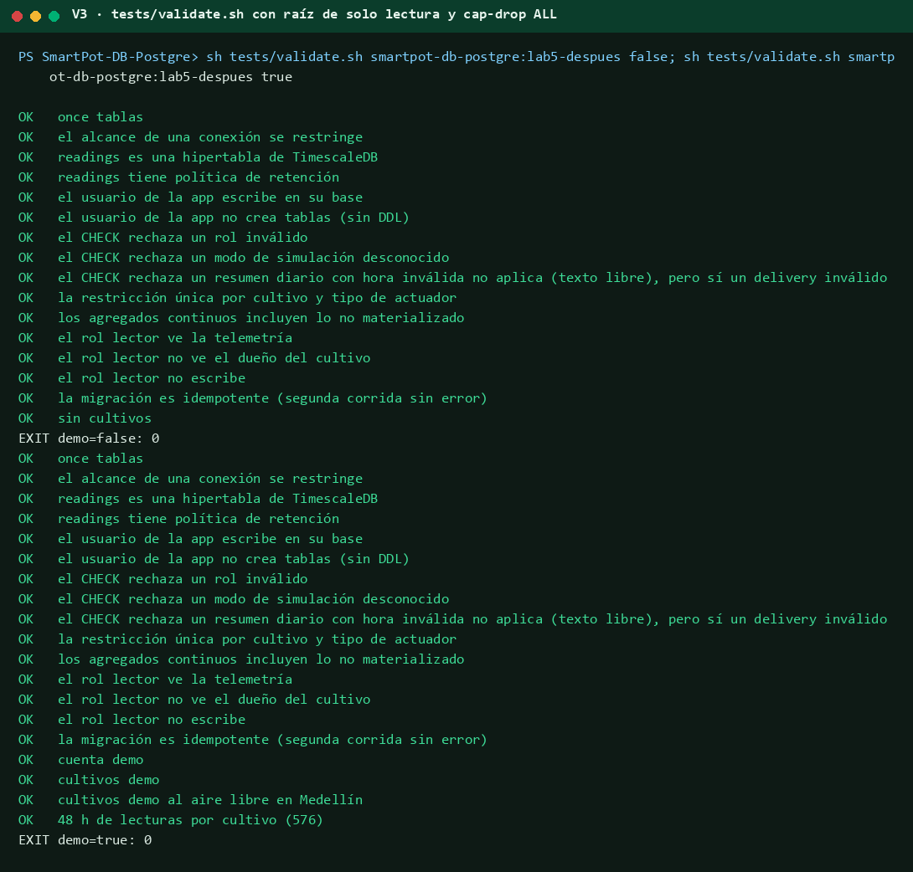

### 9.8 Evidencia del reescaneo

**Figura 21**

*Snyk Container sobre la imagen aplanada*

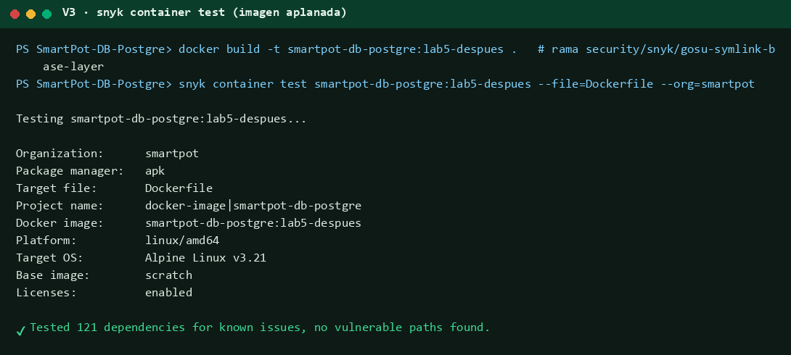

*Nota.* El mismo resultado («Tested 121 dependencies for known issues, no vulnerable paths found», base `scratch`) aparece en el job de Snyk Container del CI del PR #10 (Figura 26): el reescaneo se repitió en un entorno independiente.

### 9.9 Prevención y Shift-Left

- Regla Semgrep `smartpot-dockerfile-enlace-sobre-binario-base` sobre los `Dockerfile`.
- Plantilla de PR de seguridad con el reescaneo obligatorio, y para imágenes el escaneo de la imagen construida (`controles/PULL_REQUEST_TEMPLATE_security.md`).
- Snyk Container como check requerido que bloquea con altas o críticas en el PR. En SmartPot ya bloquea en los PR; en los push a `main` solo avisa, y así se fusionó el #8 sin que nadie lo notara.
- A mediano plazo, una base sin binarios de terceros desactualizados, o reconstruir `gosu` con un Go actual. El hallazgo no es exclusivo del Stack B: la imagen oficial de MongoDB del Stack A trae su propio `gosu` viejo, con 24 altas (sección 14.1).

## 10. Vulnerabilidad 4 (adicional) · `crypto/x509` aceptado por `go 1.26.10` (SCA)

### 10.1 Ficha técnica y riesgo

| Campo                       | Valor                                                                                                                                                                                                                                        |
| --------------------------- | -------------------------------------------------------------------------------------------------------------------------------------------------------------------------------------------------------------------------------------------- |
| Hallazgo                    | *Improper Check for Certificate Revocation* en `crypto/x509` (`SNYK-GOLANG-STDCRYPTOX509-21400137`)                                                                                                                                          |
| Tipo · CVE · CWE            | SCA · CVE-2026-111943 · CWE-299 · OWASP A02:2021 Fallas criptográficas                                                                                                                                                                       |
| Severidad · CVSS 3.1        | Alta · 7.6 · `AV:N/AC:H/PR:N/UI:R/S:U/C:H/I:H/A:N`                                                                                                                                                                                           |
| Ubicación                   | `SmartPot-API-Go/go.mod`; ruta `pgx/v5/pgconn` → `std/crypto/x509@1.27.0`                                                                                                                                                                    |
| Versión vulnerable · segura | 1.27.0–1.27.2 (y < 1.26.10) · 1.26.10 o 1.27.3                                                                                                                                                                                               |
| Riesgo real                 | Bajo. La imagen compila con `golang:1.27.3` y el CI con 1.26.10. Solo quedan expuestos los binarios compilados en un equipo de desarrollo con Go 1.27.0–1.27.2, y explotarlo exige una posición de intermediario con un certificado revocado |
| Corrección                  | Rama `security/snyk/go-toolchain-x509-revocation`, commit `b60a157` (PR #14)                                                                                                                                                                 |

### 10.2 Causa raíz

El PR #4 subió la línea `go` a 1.26.10 pensando en la rama 1.26, pero esa línea es un **mínimo**, no una rama: Go 1.27.0 la cumple y está afectado. Snyk lo detectó en el equipo del auditor porque evalúa la librería estándar con la versión de `go` instalada.

**Figura 22**

*Versiones afectadas y corregidas de Go, y qué fija cada línea del proyecto*

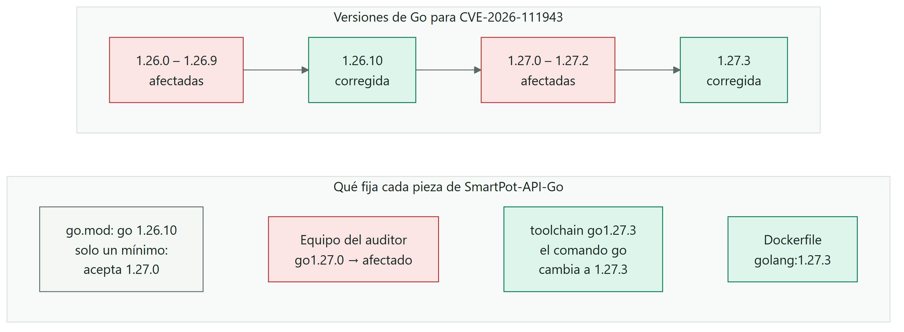

**Figura 23**

*`snyk test` sobre la API Go antes (Go 1.27.0) y después (`toolchain go1.27.3`)*

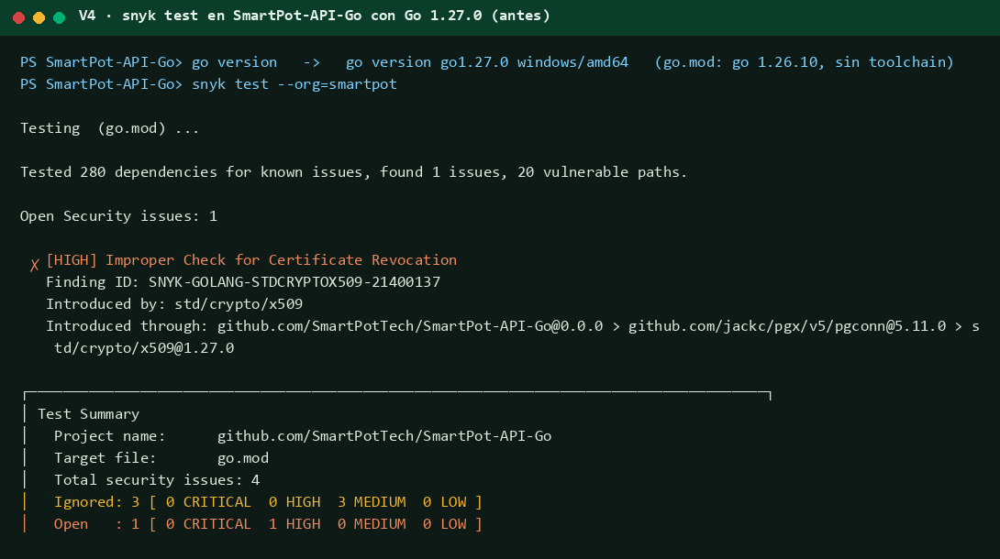

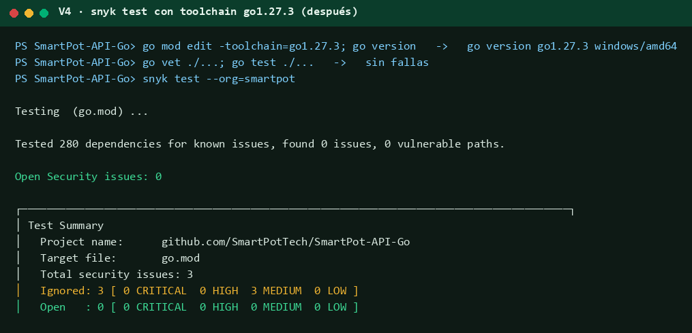

### 10.3 Remediación y verificación

```diff
 go 1.26.10
+
+toolchain go1.27.3
```

Con `GOTOOLCHAIN=auto` (el valor por defecto) el comando `go` descarga y usa 1.27.3, la misma versión de la etapa de compilación del `Dockerfile`. `go vet` y `go test ./...` pasan, `gofmt -l .` queda vacío y `snyk test` pasa de 1 alta a 0. En el CI, el job de Snyk Open Source del PR pasó; el check externo `security/snyk` falló con «You have used your limit of private tests», por cuota y no por el código. La prevención propuesta es un job que compare la línea `toolchain` con la imagen de compilación y ejecute `govulncheck`, que además informa la alcanzabilidad por símbolo (`controles/security-gate.yml`).

## 11. Comparación antes/después

| Indicador                                                  | Antes                                         | Después                                                    |
| ---------------------------------------------------------- | --------------------------------------------- | ---------------------------------------------------------- |
| SAST real en `.github` (Snyk Code)                         | 3 SSRF (8 hallazgos en total)                 | 0 SSRF (5 hallazgos triados)                               |
| SCA de SmartPot-API (`snyk test`)                          | 2 críticas, 2 medias, 1 baja                  | 1 baja aceptada                                            |
| SCA de SmartPot-API-Go con Go 1.27.0                       | 1 alta abierta                                | 0 abiertas                                                 |
| Imagen de SmartPot-DB-Postgre (Snyk Container)             | 120 hallazgos, 4 críticos · 23 capas · 762 MB | 0 hallazgos · 1 capa · 629 MB                              |
| Proyecto `SmartPot-API:pom.xml` en Snyk Web                | 8 críticas, 14 altas, 23 medias (2026-10-29)  | 0, 0, 0 y 1 baja (`snyk monitor`)                          |
| Proyecto `SmartPot-API-Go:go.mod` en Snyk Web              | 7 altas, 11 medias (2026-10-29)               | 0 abiertas                                                 |
| Reglas Semgrep propias sobre el código                     | 6 hallazgos en 4 archivos                     | 0                                                          |
| Alertas cerradas en GitHub Security (toda la organización) | —                                             | 315 de code scanning y 120 de Dependabot en estado *fixed* |

**Figura 24**

*Reglas Semgrep propias sobre el código de antes, el de después y un control positivo*

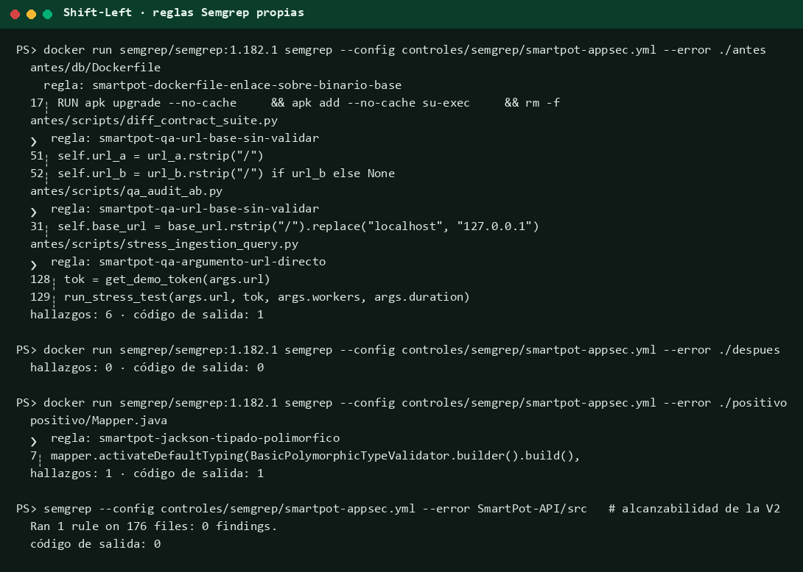

*Nota.* El control positivo confirma que la regla de Jackson sí detecta el patrón; sin él, el «0 hallazgos» sobre `SmartPot-API/src` no probaría nada.

**Figura 25**

*Alertas de GitHub Security por repositorio y herramienta*

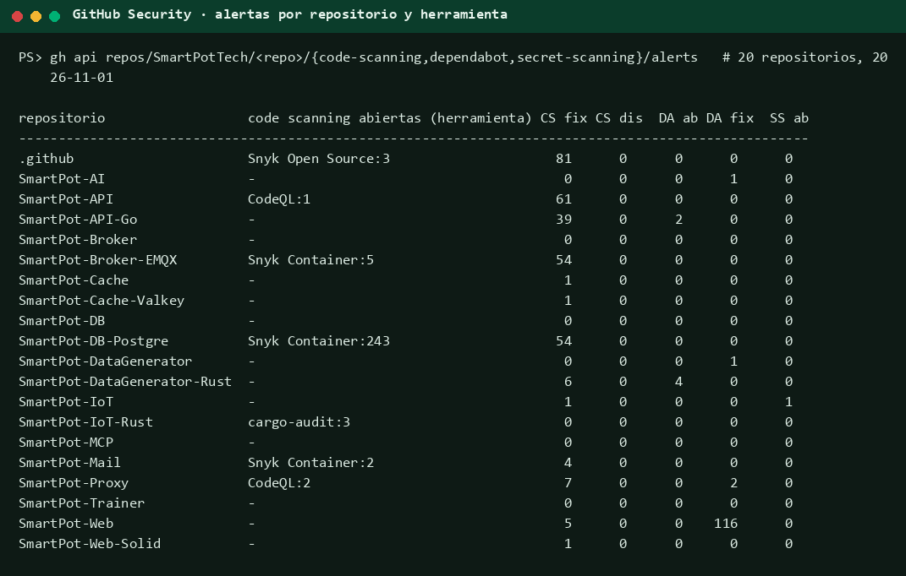

*Nota.* Las 243 alertas abiertas de Snyk Container en DB-Postgre son las de esta V3 y de `timescaledb-tune`; se cerrarán con el siguiente análisis de `main` cuando se fusione el PR #10.

## 12. Evidencias de reescaneo

| Vulnerabilidad | Reescaneo local                                            | Reescaneo en CI                                            | Prueba funcional                                    |
| -------------- | ---------------------------------------------------------- | ---------------------------------------------------------- | --------------------------------------------------- |
| V1             | `snyk code test`: 0 SSRF (Figura 13)                       | CodeQL Python y E2E en verde en el PR #8                   | Validador 14/14 y PoC bloqueada (Figuras 11 y 12)   |
| V2             | `snyk test`: 0 críticas, umbral `high` en verde (Figura 6) | Escaneo central y publicación de la imagen en verde        | `mvn verify` 147 pruebas; JAR con 3.1.8 (Figura 16) |
| V3             | `snyk container test`: 0 (Figura 21)                       | Job Snyk Container del PR #10: «no vulnerable paths found» | `validate.sh` 16/16 y 19/19 (Figura 20)             |
| V4             | `snyk test`: 0 abiertas (Figura 23)                        | Snyk Open Source en verde; check externo sin cuota         | `go vet` y `go test` en verde                       |

**Figura 26**

*CI de los tres PR de remediación*

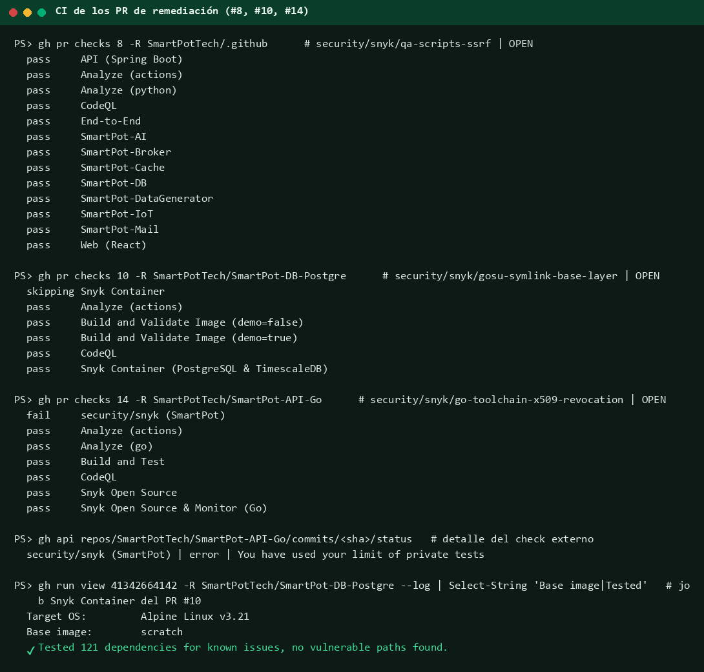

## 13. Controles preventivos y Quality Gate

### 13.1 Lo que SmartPot ya tiene

| Control                    | Implementación verificada                                                                                                     |
| -------------------------- | ----------------------------------------------------------------------------------------------------------------------------- |
| SCA continuo               | `snyk.yml` en cada servicio y `snyk-security.yml` central (lunes 07:00 UTC, push y PR) con `snyk test` y `snyk monitor`       |
| SAST                       | CodeQL en todos los repositorios; Snyk Code desde la importación de GitHub                                                    |
| Contenedores e IaC         | Snyk Container sobre la imagen construida en el CI; Snyk IaC sobre `docker/**` y `kubernetes/**`                              |
| Quality Gate de despliegue | *Snyk Deployment Gatekeeper* en `deploy.yml`: `snyk iac test docker/production/ --severity-threshold=high` antes de desplegar |
| Bloqueo de PR              | Las compuertas bloquean en `pull_request`; en push a `main` avisan                                                            |
| Dependencias               | Dependabot en los 20 repositorios; 120 alertas de Dependabot cerradas                                                         |
| Excepciones gobernadas     | `.snyk` con `reason` y `expires` (por ejemplo, los tres avisos de Echo mitigados en código hasta 2027-10-29)                  |
| Secret scanning            | Activo; detectó un token de Telegram en el historial de SmartPot-IoT (sección 14)                                             |
| Trazabilidad               | Un PR por caso desde `security/<origen>/<problema>`, con el caso documentado en español                                       |

### 13.2 Lo que se propone (carpeta `controles/`)

**Figura 27**

*Pipeline DevSecOps propuesto para SmartPot*

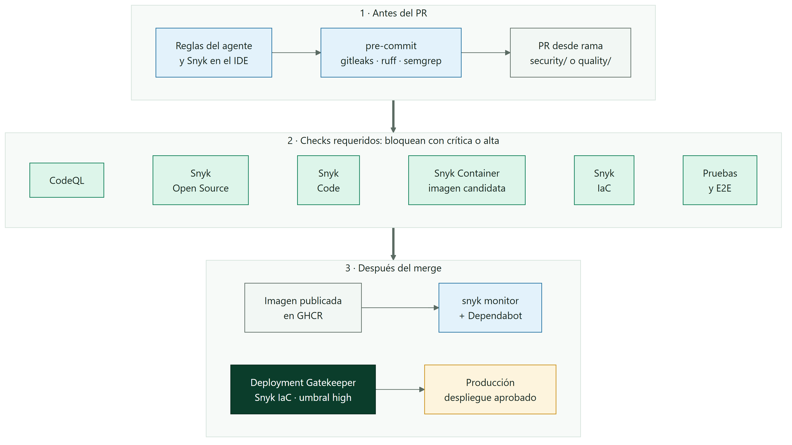

| Artefacto                                     | Qué aporta                                                                                                                                                                         |
| --------------------------------------------- | ---------------------------------------------------------------------------------------------------------------------------------------------------------------------------------- |
| `controles/.cursorrules`                      | Reglas para agentes de código derivadas de V1–V4, incluido «el reescaneo va en el PR»                                                                                              |
| `controles/semgrep/smartpot-appsec.yml`       | Cuatro reglas propias, probadas sobre antes, después y un control positivo (Figura 24)                                                                                             |
| `controles/.pre-commit-config.yaml`           | gitleaks, `detect-private-key`, ruff, hadolint, Semgrep, gofmt y `snyk test --severity-threshold=high` en el push                                                                  |
| `controles/security-gate.yml`                 | Quality Gate de CI: SCA y SAST con umbral `high`, Snyk Container sobre la imagen candidata, paridad del *toolchain* de Go y `govulncheck`; protección de rama que exige los checks |
| `controles/PULL_REQUEST_TEMPLATE_security.md` | Reescaneo obligatorio antes y después, la lección del PR #8                                                                                                                        |
| `controles/politica_dependencias.md`          | Fuentes, plazos por severidad × alcanzabilidad, reglas de pins, ignores y versiones mayores                                                                                        |

El bloqueo ante severidad crítica queda en dos niveles: el PR no se puede fusionar si un check requerido falla con alta o crítica, y el despliegue no corre si el *gatekeeper* encuentra una alta o crítica en `docker/production/`. La lección de esta auditoría añade un tercer nivel, que no lo da ninguna herramienta: **un caso no se cierra sin el reescaneo pegado en el PR**.

## 14. Más allá de las tres vulnerabilidades

### 14.1 Stack A frente a Stack B: la seguridad como razón de la migración

Se escanearon las imágenes `:latest` publicadas en GHCR de los seis pares de componentes:

**Figura 28**

*Imágenes publicadas de cada stack: tamaño, capas, paquetes y hallazgos de Snyk Container*

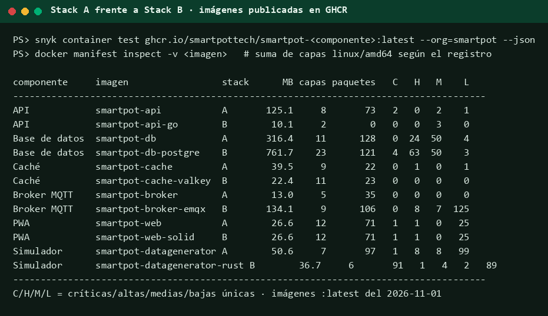

*Nota.* El tamaño es la suma de capas linux/amd64 que reporta el registro. La fila de `smartpot-db-postgre` es la imagen de `main` antes del PR #10; con la corrección queda en 0 hallazgos y 629 MB.

| Par           | Lectura                                                                                                                                                                                                                                                                                                   |
| ------------- | --------------------------------------------------------------------------------------------------------------------------------------------------------------------------------------------------------------------------------------------------------------------------------------------------------- |
| API           | La mejora más clara: de 125 MB, 8 capas y 73 paquetes de sistema a 10 MB, 2 capas y **ninguno**. Sin shell no hay dónde ejecutar un comando aunque haya una falla. Las 2 críticas del Stack A son el falso positivo de la Figura 16; las 3 medias del Stack B son los avisos de Echo, mitigados en código |
| Base de datos | La imagen oficial de MongoDB **arrastra el mismo problema de la V3**: sus 24 altas están en su propio `/usr/local/bin/gosu`, compilado con un Go viejo. PostgreSQL aplanado queda en 0 y además gana roles con mínimo privilegio y un lector seudonimizado para el entrenamiento                          |
| Caché         | Valkey 0 frente a 1 alta de zlib en Redis. Persiste pese al `apk upgrade` del PR #10 de SmartPot-Cache: la versión corregida (1.3.2-r1) no entró en la imagen construida el 2026-11-01 a las 16:18 UTC y queda para la próxima reconstrucción                                                             |
| Broker        | **Retroceso**: EMQX (Debian 13, 106 paquetes) trae 8 altas y 132 medias o bajas sin arreglo de Debian, frente a 0 de Mosquitto en Alpine. Se compensa con la autenticación delegada en la API (sin archivo de credenciales en el broker) y la ACL por cultivo, pero la imagen pide una base más pequeña   |
| PWA           | Igual en ambos: misma base `nginx-unprivileged` con 1 crítica de `brotli` y 1 alta de `zlib`, ambas con versión corregida en Alpine. El `Dockerfile` de la PWA no ejecuta `apk upgrade` en la etapa final, como sí hacen Cache, Valkey y la API Java                                                      |
| Simulador     | Rust mejora poco (96 frente a 116 hallazgos) porque la base Debian pesa más que el lenguaje                                                                                                                                                                                                               |

La conclusión es matizada: el lenguaje compilado y la imagen `scratch` reducen la superficie cuando se aplican de punta a punta, como en la API. Donde se cambió el motor pero no la base de la imagen (EMQX, simulador), la superficie siguió igual o creció. La gestión de recursos va en la misma dirección: la imagen de la API es 12 veces más pequeña y la de la base de datos pierde 133 MB al aplanarse.

### 14.2 Otros hallazgos de la organización

| Hallazgo                                                 | Herramienta        | Estado y acción                                                                                                                                                                                          |
| -------------------------------------------------------- | ------------------ | -------------------------------------------------------------------------------------------------------------------------------------------------------------------------------------------------------- |
| Token de bot de Telegram en el historial de SmartPot-IoT | Secret scanning    | **Abierto y marcado como filtrado públicamente.** Es el de mayor riesgo real de la organización si el token sigue vigente: hay que revocarlo en BotFather; el PR #9 de IoT solo evita que vuelva a pasar |
| CSRF desactivado en la API (alerta #62)                  | CodeQL             | Falso positivo documentado en el PR #122; pendiente de descartar en GitHub                                                                                                                               |
| Echo sin arreglo para cabeceras de reenvío (2 alertas)   | Dependabot / Snyk  | Mitigado con `echo.ExtractIPDirect()` y prueba contra cabeceras falsas (PR #6 de API-Go)                                                                                                                 |
| Conversión de entero sin límite en `DATABASE_MAX_CONNS`  | CodeQL             | Corregido en el PR #5 de API-Go                                                                                                                                                                          |
| `rustls-pemfile` sin mantenimiento                       | cargo-audit        | Corregido en el PR #12 del simulador Rust                                                                                                                                                                |
| Mailpit con dependencias de Go vulnerables               | Snyk Container     | Actualizado a 1.33.0 (PR #10 de Mail); quedan 2 avisos de `gomarkdown` sin versión corregida                                                                                                             |
| `deploy.yml` se disparaba a sí mismo al cambiar          | Revisión del flujo | Corregido en el PR #6 de `.github`: un cambio de Dependabot en Actions casi despliega producción sin aprobación                                                                                          |

## 15. Integración con MCP y asistencia de IA

La guía pide registrar qué herramienta MCP se invocó, qué propuso el agente y qué revisión humana se hizo. En SmartPot el servidor MCP de Snyk se ha usado en sesiones interactivas junto con el CLI y la web para analizar alertas y preparar los PR `security/snyk/*` del 2026-11-01. En esta auditoría, el asistente de IA trabajó con Snyk CLI, la API REST de Snyk, GitHub CLI y Docker; sus propuestas pasaron por la revisión que muestra esta tabla:

| Caso                                  | Propuesta del agente                                   | Revisión humana y verificación                                                 | Decisión                                              |
| ------------------------------------- | ------------------------------------------------------ | ------------------------------------------------------------------------------ | ----------------------------------------------------- |
| V1                                    | Lista cerrada de loopback en un módulo común           | Revisión del diff, 14 casos de prueba, PoC antes/después, `snyk code test`, CI | Aceptada en PR #8, pendiente de merge                 |
| V3 (intento 1)                        | Copiar `su-exec` como archivo regular                  | El reescaneo siguió en 120 hallazgos                                           | **Rechazada con evidencia**                           |
| V3 (intento 2)                        | Aplanar la imagen con una etapa `scratch`              | Comparación de permisos, `validate.sh` 16/16 y 19/19, reescaneo local y en CI  | Aceptada en PR #10, pendiente de merge                |
| V2 (verificación)                     | Imagen publicada "aún vulnerable" según Snyk Container | Inspección del JAR: trae 3.1.8                                                 | Se corrigió la conclusión: falso positivo del escáner |
| PR #8 de DB-Postgre (sesión anterior) | Enlace simbólico a `su-exec`                           | Se fusionó sin reescaneo                                                       | Esta auditoría lo encontró incompleto                 |

La última fila es la que mejor responde a la guía: una corrección asistida que pasa las pruebas funcionales pero no se reescanea puede dejar la vulnerabilidad intacta. Para la configuración del servidor MCP se recomienda no versionar el token: `SNYK_TOKEN` como variable de entorno del sistema, referenciada en `.cursor/mcp.json` o en el archivo equivalente del cliente, que va en `.gitignore`.

## 16. Preguntas de cierre

**15. ¿Cuál de las tres vulnerabilidades representa mayor riesgo real y por qué?** La V1. Es la única que se explotó en el laboratorio sin ninguna condición previa: basta que alguien, persona o agente, ejecute el arnés con un destino ajeno para entregar credenciales y un JWT y recibir un veredicto de auditoría falso. La V2 tiene un impacto potencial mucho mayor, pero hoy no es alcanzable; su riesgo vive en producción, que todavía no tiene la versión corregida, y en un cambio de código futuro. La V3 no tiene camino de ejecución.

**16. ¿La mayor puntuación CVSS siempre debe corregirse primero?** No. El CVSS base describe la vulnerabilidad en abstracto; no sabe si el código llama a la función, si hay exploit público ni qué activo está detrás. En esta auditoría las dos vulnerabilidades de 9.3 (V2 y V3) tenían menos riesgo real que la de 4.4 (V1). Lo que sí cambia la prioridad es la combinación de CVSS, madurez del exploit, alcanzabilidad y exposición: por eso la V2 se corrigió en cuatro días aunque no fuera alcanzable, porque tiene PoC público y está en el servicio expuesto a Internet.

**17. ¿Qué diferencia hay entre vulnerabilidad identificada y vulnerabilidad explotable?** Identificada es que una herramienta encontró un patrón o una versión con un aviso; explotable es que existe un camino real desde un atacante hasta el código vulnerable en el despliegue concreto. La V3 lo ilustra: identificada 120 veces y explotable cero, porque el binario no se ejecuta. El triaje SAST también: de 16 identificadas, 3 eran explotables.

**18. ¿Qué impacto tiene sobre CID?** V1: confidencialidad e integridad bajas (credenciales demo, JWT, veredicto falsificado), disponibilidad de terceros si se usa el script de estrés. V2: alto en las tres si llegara a ser alcanzable, porque la ejecución de código en la API da acceso a la base, al secreto JWT, a las claves de los dispositivos y a MQTT. V3: ninguno en ejecución; afecta la integridad de la cadena de suministro (se distribuye un ejecutable vulnerable). V4: confidencialidad e integridad altas en una conexión TLS interceptada con un certificado revocado, solo en binarios locales.

**19. ¿Qué control habría detectado el problema antes de producción?** Para la V1, Snyk Code o la regla Semgrep como check del PR que agregó los scripts. Para la V2, la compuerta SCA ya lo detectó; faltó cerrar con el despliegue. Para la V3 y la V4, el reescaneo obligatorio de la corrección: las dos remediaciones anteriores habrían fallado su propio reescaneo.

**20. ¿Cómo llevaría ese control al CI/CD?** Con `controles/security-gate.yml`: `snyk test` y `snyk code test` con `--severity-threshold=high`, `snyk container test` sobre la imagen candidata, Semgrep con las reglas propias y la paridad del *toolchain* de Go, todos como checks requeridos por la protección de rama, y la plantilla de PR que exige pegar el reescaneo. El *gatekeeper* de despliegue ya existe para la infraestructura.

**21. ¿Qué limitaciones observó en la automatización?** Cinco concretas: (1) Snyk Container leyó el `pom.xml` incrustado y reportó Jackson 3.1.7 en un JAR que trae 3.1.8. (2) Snyk Container no aplica la sobrescritura de archivos entre capas, y por eso el enlace de la V3 no cambiaba el resultado. (3) Snyk CLI no soporta Cargo ni `uv.lock` directamente; se cubren con cargo-audit y exportando `requirements.txt`. (4) El análisis de Go depende del `go` instalado en el equipo que escanea, lo que dio un hallazgo que no existía ni en CI ni en la imagen. (5) La cuota de 200 pruebas mensuales se agotó durante la auditoría y el check externo de Snyk en los PR empezó a fallar por cuota, no por el código. A eso se suma que Snyk Code no publica CVSS y que el 56 % de sus hallazgos aquí fueron falsos positivos.

**22. ¿Qué parte requiere criterio humano?** El triaje (decidir que el hash señuelo de `AuthService` es un control y no una contraseña), la alcanzabilidad (confirmar que no hay tipado polimórfico), la priorización por riesgo real, la elección de la estrategia de corrección (lista cerrada frente a limpieza de URL; aplanar frente a reemplazar), rechazar una corrección que no pasó el reescaneo, aceptar riesgos con justificación y decidir cuándo desplegar a producción. Las herramientas encontraron los candidatos; las decisiones de esta auditoría las tomó el auditor.

## 17. Conclusiones

1. La auditoría cumplió el ciclo completo sobre un proyecto real y propio: 20 repositorios, cinco lenguajes, cuatro tipos de escaneo de Snyk y cuatro herramientas complementarias. Las tres vulnerabilidades exigidas y una adicional quedaron corregidas, con evidencia antes y después de la misma herramienta y sin romper la funcionalidad.
2. El reescaneo es la parte del ciclo que más valor aportó. Dos correcciones anteriores, ya fusionadas y con pruebas en verde, no habían corregido nada; una prueba funcional no puede ver una vulnerabilidad, solo un escáner o una inspección del artefacto.
3. El riesgo real no se lee en el CVSS. Ordenadas por riesgo en contexto, las cuatro vulnerabilidades quedan casi al revés que por puntuación, y la de menor CVSS fue la única explotable.
4. Las herramientas son necesarias y no son suficientes: 9 de 16 hallazgos SAST fueron falsos positivos y Snyk Container se equivocó dos veces sobre el contenido de las imágenes. Sin criterio humano, se habrían "corregido" cosas que no existían y se habrían dado por cerradas cosas que seguían abiertas.
5. La migración al Stack B mejora la seguridad donde se llevó hasta el final (API en `scratch`, base de datos con roles y aplanada) y la empeora donde se cambió el motor sin cuidar la imagen (EMQX). La seguridad es una razón válida para migrar si se mide componente por componente.
6. Quedan tres acciones para el auditor: revisar y fusionar los PR `.github` #8, DB-Postgre #10 y API-Go #14; aprobar el despliegue manual de producción para que la corrección de Jackson llegue a `smartpot.app`; y revocar el token de Telegram expuesto.

## 18. Referencias

- FIRST. (2019). *Common Vulnerability Scoring System v3.1: Specification Document*. https://www.first.org/cvss/v3.1/specification-document
- MITRE. (2026). *CWE-918, CWE-502, CWE-299, CWE-79, CWE-444, CWE-754*. https://cwe.mitre.org/
- OWASP Foundation. (2021). *OWASP Top 10:2021*. https://owasp.org/Top10/
- OWASP Foundation. (2025). *OWASP Top 10:2025*. https://owasp.org/Top10/2025/
- Snyk. (2026). *Snyk CLI: test, code test, container test, monitor*. https://docs.snyk.io/snyk-cli
- Snyk. (2026). *Snyk Vulnerability Database*: SNYK-JAVA-TOOLSJACKSONCORE-21761838, SNYK-GOLANG-STDCRYPTOX509-21400137, SNYK-GOLANG-STDNETHTTPINTERNAL-14548500. https://security.snyk.io/
- The Go Authors. (2026). *Go Toolchains* (`toolchain` y `GOTOOLCHAIN`). https://go.dev/doc/toolchain
- Docker. (2026). *Multi-stage builds* y *Image layers*. https://docs.docker.com/build/building/multi-stage/
- Politécnico Colombiano Jaime Isaza Cadavid. (2026). *Práctica #5: Implementación práctica Snyk, CLI* (guía), *Auditoría de seguridad de aplicaciones y gestión continua del riesgo* e *Implementación práctica de Snyk CLI y MCP en Cursor* (material del curso).

## Anexo A · Índice de evidencias

| Figura         | Archivo                                          | Contenido                                    |
| -------------- | ------------------------------------------------ | -------------------------------------------- |
| 3              | `evidencias/01_fase1_snyk_cli_autenticacion.png` | Versión del CLI, sesión y entorno            |
| 4              | `evidencias/02_fase2_snyk_web_proyectos.png`     | 43 proyectos de Snyk Web                     |
| 5              | `evidencias/04_v2_sca_api_high_antes.png`        | Umbral `high` antes                          |
| 6              | `evidencias/05_v2_sca_api_despues_monitor.png`   | `snyk test`, umbral y `snyk monitor` después |
| 7              | `evidencias/17_fase3_sast_20_repositorios.png`   | Snyk Code en 20 repositorios                 |
| 9, 13          | `evidencias/07_…`, `evidencias/09_…`             | V1 antes y después                           |
| 11, 12         | `evidencias/08_…`, `evidencias/10_…`             | V1 PoC y validador                           |
| 15, 16         | `evidencias/03_…`, `evidencias/06_…`             | V2 antes y artefacto publicado               |
| 17, 18, 20, 21 | `evidencias/11_…` a `evidencias/14_…`            | V3 antes, capas, regresión y después         |
| 23             | `evidencias/15_…`, `evidencias/16_…`             | V4 antes y después                           |
| 24             | `evidencias/21_shiftleft_semgrep_reglas.png`     | Reglas Semgrep propias                       |
| 25             | `evidencias/18_github_security_alertas.png`      | Alertas de GitHub Security                   |
| 26             | `evidencias/20_ci_pull_requests.png`             | CI de los PR                                 |
| 28             | `evidencias/19_stack_ab_contenedores.png`        | Imágenes Stack A frente a Stack B            |

Las salidas completas en texto y los cuatro diffs están en `evidencias/salidas/`. Los diagramas tienen su fuente Mermaid (`.mmd`) junto al PNG y al SVG en `diagramas/`.

## Anexo B · Comandos para reproducir

```powershell
# Fase 1
snyk --version; snyk auth; snyk whoami --experimental
# Fase 2 (SCA) en cada servicio
snyk test --org=smartpot
snyk test --org=smartpot --severity-threshold=high
snyk monitor --org=smartpot --project-name=SmartPotTech/<repositorio>
# Fase 3 (SAST)
snyk code test <repositorio> --org=smartpot
# Contenedores
docker build -t smartpot-db-postgre:lab5 SmartPot-DB-Postgre
snyk container test smartpot-db-postgre:lab5 --file=SmartPot-DB-Postgre/Dockerfile --org=smartpot
sh SmartPot-DB-Postgre/tests/validate.sh smartpot-db-postgre:lab5 true
# Reglas propias
docker run --rm -v ${PWD}:/src semgrep/semgrep semgrep --config /src/Lab5/controles/semgrep/smartpot-appsec.yml --error /src/<código>
# Estado de los PR
gh pr checks 8 -R SmartPotTech/.github; gh pr checks 10 -R SmartPotTech/SmartPot-DB-Postgre; gh pr checks 14 -R SmartPotTech/SmartPot-API-Go
```
