```{=openxml}
<w:p><w:pPr><w:jc w:val="center"/><w:spacing w:before="1800" w:after="0" w:line="360" w:lineRule="auto"/></w:pPr><w:r><w:rPr><w:b/><w:sz w:val="36"/><w:szCs w:val="36"/></w:rPr><w:t xml:space="preserve">Políticas de Seguridad Informática</w:t></w:r></w:p><w:p><w:pPr><w:jc w:val="center"/><w:spacing w:before="0" w:after="0" w:line="360" w:lineRule="auto"/></w:pPr><w:r><w:rPr><w:b/><w:sz w:val="32"/><w:szCs w:val="32"/></w:rPr><w:t xml:space="preserve">Caso Mapfre Seguros España: suplantación de IP y ARP spoofing</w:t></w:r></w:p><w:p><w:pPr><w:jc w:val="center"/><w:spacing w:before="200" w:after="0" w:line="320" w:lineRule="auto"/></w:pPr><w:r><w:rPr><w:sz w:val="26"/><w:szCs w:val="26"/></w:rPr><w:t xml:space="preserve">Informe del Laboratorio N.° 6 (Ejercicio Práctico N.° 5 de Políticas de Seguridad)</w:t></w:r></w:p><w:p><w:pPr><w:jc w:val="center"/><w:spacing w:before="1400" w:after="0" w:line="480" w:lineRule="auto"/></w:pPr><w:r><w:rPr><w:b/><w:sz w:val="26"/><w:szCs w:val="26"/></w:rPr><w:t xml:space="preserve">Sebastián López Osorno</w:t></w:r></w:p><w:p><w:pPr><w:jc w:val="center"/><w:spacing w:before="0" w:after="0" w:line="480" w:lineRule="auto"/></w:pPr><w:r><w:rPr><w:sz w:val="24"/><w:szCs w:val="24"/></w:rPr><w:t xml:space="preserve">Politécnico Colombiano Jaime Isaza Cadavid</w:t></w:r></w:p><w:p><w:pPr><w:jc w:val="center"/><w:spacing w:before="0" w:after="0" w:line="480" w:lineRule="auto"/></w:pPr><w:r><w:rPr><w:sz w:val="24"/><w:szCs w:val="24"/></w:rPr><w:t xml:space="preserve">Facultad de Ingenierías, Departamento de Informática</w:t></w:r></w:p><w:p><w:pPr><w:jc w:val="center"/><w:spacing w:before="0" w:after="0" w:line="480" w:lineRule="auto"/></w:pPr><w:r><w:rPr><w:sz w:val="24"/><w:szCs w:val="24"/></w:rPr><w:t xml:space="preserve">Diplomado en Ciberseguridad Informática y Resiliencia Digital</w:t></w:r></w:p><w:p><w:pPr><w:jc w:val="center"/><w:spacing w:before="0" w:after="0" w:line="480" w:lineRule="auto"/></w:pPr><w:r><w:rPr><w:sz w:val="24"/><w:szCs w:val="24"/></w:rPr><w:t xml:space="preserve">Asignatura: Políticas de Seguridad Informática</w:t></w:r></w:p><w:p><w:pPr><w:jc w:val="center"/><w:spacing w:before="0" w:after="0" w:line="480" w:lineRule="auto"/></w:pPr><w:r><w:rPr><w:sz w:val="24"/><w:szCs w:val="24"/></w:rPr><w:t xml:space="preserve">Docente: Edwin Andrés Ochoa Agudelo. Grupo 02</w:t></w:r></w:p><w:p><w:pPr><w:jc w:val="center"/><w:spacing w:before="1000" w:after="0" w:line="320" w:lineRule="auto"/></w:pPr><w:r><w:rPr><w:sz w:val="24"/><w:szCs w:val="24"/></w:rPr><w:t xml:space="preserve">15 de noviembre de 2026</w:t></w:r></w:p>
```

# Resumen ejecutivo

El 10 de marzo el equipo de TI de Mapfre Seguros España detectó accesos no autorizados a la base de datos de clientes de seguros de vida. Los atacantes usaron dos técnicas combinadas, el envenenamiento ARP y la suplantación de direcciones IP, para interceptar el tráfico entre la aplicación y la base de datos y para entrar en ella haciéndose pasar por un servidor de confianza. Se expusieron nombres, direcciones, documentos de identidad y detalles de pólizas. Hubo fraude, daño reputacional e interrupción de la operación.

Este informe responde las trece actividades de la guía con la perspectiva de un auditor. Parte del contexto de la empresa, identifica diez activos críticos y los clasifica, deduce nueve vulnerabilidades, valora diez riesgos y propone dieciséis controles, cada uno con la evidencia que lo demuestra y un indicador que lo mide.

El análisis concluye que el ataque explotó decisiones de diseño de la red interna y no fallos de software: una red sin segmentar ni proteger en capa 2, tráfico sin cifrar y acceso autorizado por dirección IP. Cualquiera de las tres barreras habría bastado para detenerlo. El riesgo no figuraba en ningún registro ni tenía responsable, y por eso el problema de fondo es de gestión.

El modelo normativo distingue ley, norma, marco y buena práctica. Como ley aplican el RGPD, la LOPDGDD, el Reglamento DORA y el Código Penal, con su equivalente colombiano en las Leyes 1581 de 2012 y 1273 de 2009. La norma es ISO/IEC 27001:2022; los marcos, NIST CSF 2.0, COBIT e ITIL. La compañía debe notificar al supervisor de seguros en 4 horas desde que clasifica el incidente como grave, a la Agencia Española de Protección de Datos en 72 horas y a los clientes sin dilación indebida.

El impacto financiero se estima en 8,1 millones de euros en el escenario base, con un rango de 1,5 a 35,4 millones según el número de afectados. La mitad corresponde a la multa, a la pérdida de clientes y al refuerzo técnico que se había aplazado. Dos precedentes del mismo sector marcan la diferencia que hacen las medidas previas y la reacción: el archivo sin sanción del ataque que la propia Mapfre sufrió en 2020 y la multa de 5 millones de euros a Generali.

El plan propuesto cierra las brechas en cuatro horizontes hasta los 180 días, incluye un plan de monitoreo con ocho casos de uso, un plan de recuperación ante desastres con tiempos objetivo por proceso y un plan de comunicación para las primeras 72 horas. Reduce en un 66 % la puntuación total de riesgo. La actividad 13 se resuelve con una demostración ejecutada de auditoría de registros, que detecta tres cambios indebidos en pólizas sin fiarse de la dirección IP y delata la manipulación del propio registro.

# 1. Introducción

Este informe desarrolla el Ejercicio Práctico N.° 5 de la asignatura Políticas de Seguridad Informática. El caso plantea un incidente en Mapfre Seguros España y pide trece actividades que van de la identificación de activos a la auditoría de registros, pasando por el modelo normativo, los riesgos, los controles y los impactos financiero, reputacional y operativo.

## 1.1 Propósito y alcance

El propósito es analizar el incidente y proponer las políticas, los controles y los planes que una aseguradora necesita para que no se repita, citando en cada punto la ley o el estándar que lo respalda. El alcance es el servicio de pólizas de vida en España, con la base de datos de clientes, las aplicaciones que la usan y la red del centro de datos que las une.

## 1.2 Cómo se hizo

El docente pidió mapear el ejercicio antes de escribirlo: entender la empresa, decidir qué documentos se van a usar y solo entonces proponer (Ochoa Agudelo, 2026c). El trabajo siguió cuatro pasos. Primero se estudió la guía y las tres clases grabadas en que se presentó el tema. Después se revisó el material del curso, del que salen las definiciones y la terminología: las diapositivas de políticas y controles, el marco normativo colombiano, la respuesta ante incidentes, el análisis de riesgos, la guía de implantación de ISO 27001 y el marco de ciberseguridad del NIST. En tercer lugar se contrastó en fuentes oficiales cada artículo, plazo y cifra que se cita. Por último se construyeron los diagramas y la demostración de auditoría de registros del capítulo 16.

El orden de los capítulos es el de la norma ISO/IEC 27001 tal como se explicó en clase: la organización "identifica sus activos, analiza riesgos, define controles, establece políticas, asigna responsabilidades, monitorea resultados, realiza auditorías y mejoras continuas" (Ochoa Agudelo, 2026c). Las actividades conservan la numeración de la guía.

## 1.3 Tres criterios que recorren el informe

El primero es la voz. El docente pidió pensar "como un auditor" y no como un atacante, de modo que cada control va acompañado de la evidencia con que se demostraría.

El segundo es la separación entre hechos y supuestos. Mapfre es una empresa real y sus datos públicos se citan con su fuente. Los hechos del 10 de marzo se toman del enunciado. Todo lo que el enunciado no dice, y que hace falta para analizar, se declara como supuesto en el capítulo 3.

El tercero es el doble marco legal. La empresa del caso es española, así que el análisis principal usa la normativa de España y de la Unión Europea. El diplomado se cursa en Colombia, y por eso cada punto legal lleva su equivalente en la legislación colombiana.

# 2. Contexto de la organización

Antes de proponer un solo control conviene saber qué se está protegiendo. El numeral 4 de la norma ISO/IEC 27001:2022 lo exige de forma expresa: la organización debe determinar las cuestiones internas y externas que afectan a su sistema de gestión, identificar a las partes interesadas y fijar el alcance (ISO/IEC, 2022a). En la clase del 6 de noviembre el docente lo tradujo en siete preguntas que hay que responder antes de montar el ejercicio, y advirtió que "no es lo mismo proteger una tienda de ropa que un banco", porque el sistema de gestión se adapta a la organización y no al revés (Ochoa Agudelo, 2026c). Este capítulo responde esas siete preguntas para Mapfre Seguros España.

La empresa del caso existe y publica sus cifras, de modo que las respuestas usan datos verificados del grupo y de una resolución de la Agencia Española de Protección de Datos que describe sus sistemas. Los detalles que no son públicos, como la topología exacta de su red, se tratan como supuestos razonables para una aseguradora de ese tamaño y así se indica en la columna central de la Tabla 1.

| Pregunta del docente | Respuesta para Mapfre Seguros España | Consecuencia para la seguridad |
|--------------|------------------------------------------------------|---------------------------------|
| ¿Qué hace la empresa? | Aseguradora y reaseguradora multinacional de origen español. El caso se centra en su negocio de seguros de vida en España. El grupo opera en 37 países, ingresó unos 34.500 millones de euros en 2025, superó por primera vez los 1.000 millones de beneficio y emplea a unas 30.000 personas (MAPFRE, 2026c, 2026b, 2026a). | Es una entidad financiera supervisada. Sus procesos de emisión, cobro y pago de prestaciones no admiten paradas largas y cualquier incidente tiene lectura regulatoria. |
| ¿Qué información maneja? | Datos identificativos y de contacto, documentos de identidad, datos bancarios de cobro y el detalle de cada póliza: capitales, beneficiarios y vigencias. En el seguro de vida la suscripción suele incluir declaraciones de salud (supuesto S6). | Trata datos personales a gran escala y posiblemente categorías especiales. Eso obliga a medidas reforzadas y a evaluación de impacto (arts. 9, 32 y 35 del RGPD). |
| ¿Quiénes son sus clientes? | Personas y familias que contratan como tomadores, asegurados o beneficiarios, y empresas con pólizas colectivas. | Los perjudicados por una filtración son personas físicas con derechos propios. El fraude y la suplantación recaen sobre ellas. |
| ¿Qué sistemas utiliza? | Un núcleo asegurador que gestiona pólizas, cobros y siniestros; la base de datos de clientes; el portal y la aplicación móvil; interfaces con mediadores; un centro de proceso de datos con su red interna, y un Centro de Control General que vigila los sistemas (AEPD, 2021). La arquitectura detallada es un supuesto. | La base de datos y la red que la conecta con las aplicaciones concentran el valor. El ataque del caso ocurrió justo en ese tramo. |
| ¿Qué leyes debe cumplir? | Protección de datos: RGPD y LOPDGDD, bajo la AEPD. Resiliencia operativa digital: Reglamento DORA, bajo la Dirección General de Seguros y Fondos de Pensiones. Seguridad de redes: Real Decreto-ley 12/2018 y Real Decreto 43/2021 si está designada operador de servicios esenciales. Además, el Código Penal y la normativa de abuso de mercado por ser cotizada. | Los plazos de notificación van de 4 a 72 horas y las multas pueden llegar al 4 % del volumen de negocio anual. |
| ¿Qué proveedores tiene? | Proveedores de tecnología y de nube, reaseguradores, una red de mediadores y agentes, proveedores asistenciales y auditores. En el incidente real de 2020 el acceso inicial se hizo con las credenciales de una colaboradora externa (AEPD, 2021). | El riesgo de terceros es parte del problema: contratos de encargado (art. 28 del RGPD), gestión de proveedores TIC (arts. 28 a 30 de DORA) y controles 5.19 a 5.22 del Anexo A. |
| ¿Qué amenazas enfrenta? | Robo de datos para fraude, secuestro de datos (lo sufrió en agosto de 2020), ataques de intermediario dentro de la red, equipos internos comprometidos y ataques a través de proveedores. El sector financiero registra el segundo costo medio más alto por brecha, 6,3 millones de dólares (IBM, 2026). | La amenaza del caso actúa desde dentro de la red. Los controles de perímetro no la detienen. |

*Tabla 1.* Contexto de Mapfre Seguros España según las siete preguntas planteadas en clase.

## 2.1 Partes interesadas y lo que esperan

Cada parte interesada espera algo distinto de la seguridad de la compañía, y esas expectativas se convierten en requisitos del sistema de gestión. Los clientes esperan que sus datos y los de sus beneficiarios no lleguen a terceros y que la póliza se pague a quien corresponde. La AEPD exige medidas adecuadas al riesgo y notificación en 72 horas. La Dirección General de Seguros y Fondos de Pensiones, como autoridad competente de las aseguradoras bajo DORA, pide gestión del riesgo tecnológico y aviso temprano de los incidentes graves. Los accionistas y el mercado esperan información veraz y continuidad del negocio. Los mediadores necesitan que las herramientas con que venden y atienden sigan funcionando. Los empleados necesitan reglas claras sobre lo que pueden hacer con la información.

## 2.2 Alcance del análisis

El alcance de este trabajo es el servicio de gestión de pólizas de vida en España. Comprende la base de datos de clientes, el núcleo asegurador, las aplicaciones que la consultan, la red del centro de datos que las une, las identidades que tienen acceso y las personas e instalaciones que sostienen todo lo anterior. Quedan fuera el resto de ramos, las filiales de otros países y el desarrollo de software, que tendrían su propio alcance en un sistema de gestión completo.

## 2.3 Un precedente real que sirve de vara de medir

Conviene separar dos cosas. El incidente del 10 de marzo que describe la guía es el escenario de estudio y sus hechos se toman tal como están escritos. El incidente documentado de Mapfre es otro: el ataque con el programa de secuestro Ragnar Locker del 14 de agosto de 2020. La AEPD lo investigó y archivó las actuaciones porque la compañía "disponía de medidas técnicas y organizativas razonables" y su reacción fue "diligente" (AEPD, 2021). La resolución detalla la cronología: detección por monitorización a las 21:11, Comité de Crisis a las 21:20, planes de continuidad a las 21:30, comunicado público y aviso al supervisor de seguros al día siguiente, y notificación a la Agencia el día 16. Ese expediente se usa en los capítulos 13 a 15 como referencia de lo que el regulador considera una buena respuesta.

# 3. El incidente: hechos, anatomía y principios afectados

## 3.1 Lo que dice el caso y lo que este informe supone

La guía describe el incidente en pocas líneas. El resto hay que reconstruirlo, y un análisis honesto debe dejar claro qué viene del enunciado y qué es una hipótesis de trabajo. La Tabla 2 hace esa separación. Los supuestos se identifican con una S para citarlos más adelante.

| Hechos que da la guía | Supuestos de este informe y su justificación |
|--------------------------------------|--------------------------------------------------------------|
| El 10 de marzo el equipo de TI detectó varios accesos no autorizados a la base de datos de clientes. | S1. El caso no indica el año. Se asume 2026 para aplicar la normativa vigente, en particular DORA, aplicable desde el 17 de enero de 2025. |
| Los accesos se hicieron con suplantación de direcciones IP y con un ataque de ARP spoofing. | S2. Para envenenar ARP hay que estar en la misma red local, así que el atacante tenía presencia interna: un equipo comprometido o una conexión a una toma de red. El caso no dice cuál. |
| Los atacantes interceptaron nombres, direcciones, números de identificación y detalles de pólizas. | S3. La base de datos compartía segmento de capa 2 con equipos menos confiables y el tráfico entre la aplicación y la base de datos viajaba sin cifrar. De otro modo lo interceptado no habría sido legible. |
| Hubo acceso no autorizado a información confidencial. | S4. La base de datos autorizaba las conexiones por la dirección IP de origen del servidor de aplicaciones. Por eso suplantar esa dirección dio acceso. |
| Hubo pérdidas económicas significativas por fraude. | S5. El caso no cuantifica los afectados. Para dimensionar se trabaja con tres escenarios: 50.000, 250.000 y 1.000.000 de clientes. |
| La brecha se divulgó públicamente y dañó la reputación. | S6. Los detalles de pólizas de vida incluyen beneficiarios, capitales y datos bancarios, y pueden incluir declaraciones de salud. S8. No se sabe si la divulgación partió de la empresa o de terceros. |
| La operación se interrumpió mientras se corregía el problema y se hacían auditorías. | S7. La degradación del servicio duró entre uno y siete días según el escenario. |

*Tabla 2.* Hechos del enunciado y supuestos de trabajo (S1 a S8).

## 3.2 Cómo funcionan las dos técnicas y por qué se combinan

El protocolo ARP resuelve qué dirección física (MAC) corresponde a una dirección IP dentro de una red local. Se definió en 1982 y no autentica las respuestas: un equipo acepta cualquier respuesta ARP que reciba, aunque no la haya pedido (Plummer, 1982). El ARP spoofing aprovecha esa confianza. El atacante envía respuestas falsas al servidor de aplicaciones y a la base de datos para que cada uno crea que la dirección IP del otro está en la tarjeta de red del atacante. Desde ese momento el tráfico entre ambos pasa por su equipo, que lo lee y lo reenvía para que nadie note el desvío. El catálogo MITRE ATT&CK lo recoge como la técnica T1557.002, envenenamiento de la caché ARP, una variante del adversario en el medio (MITRE, s. f.).

La suplantación de IP consiste en enviar paquetes con una dirección de origen que no es la propia. Sola sirve de poco contra una conexión TCP, porque las respuestas viajan hacia la dirección suplantada y el atacante no las ve. Combinada con el envenenamiento ARP el problema desaparece: el atacante ya recibe el tráfico destinado al servidor legítimo, así que puede abrir sus propias conexiones con la dirección de ese servidor y sostenerlas. Si la base de datos decide a quién deja entrar mirando la dirección de origen, el atacante entra como si fuera la aplicación. Esa debilidad tiene nombre propio en el catálogo de debilidades de software: confiar en la dirección IP para autenticar (CWE-291). La Figura 1 resume las tres fases con direcciones de ejemplo.

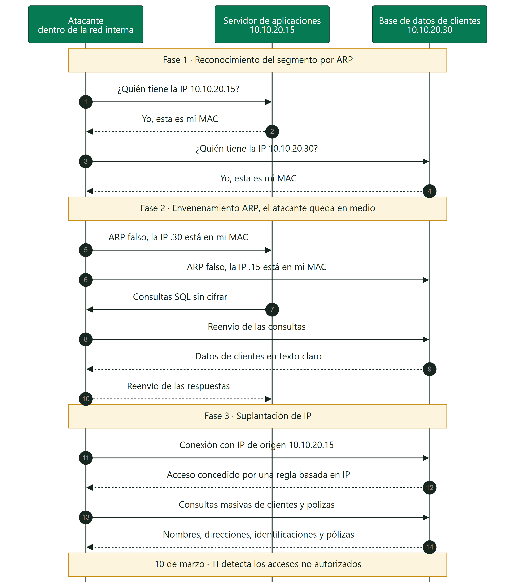{ width=5.85in }

*Figura 1.* Anatomía del ataque en tres fases: reconocimiento del segmento, envenenamiento ARP con interceptación del tráfico y suplantación de la IP del servidor de aplicaciones. Las direcciones son ilustrativas.

Las dos técnicas explican los dos daños del caso. La interceptación viene del envenenamiento ARP, que solo rinde si el tráfico va sin cifrar. El acceso directo a la base de datos viene de la suplantación de IP, que solo rinde si la autorización depende de la dirección. Las dos explotan decisiones de diseño de la red, sin necesidad de vulnerar una contraseña ni de aprovechar un fallo de programación.

## 3.3 Cronología reconstruida

La guía solo da una fecha, el 10 de marzo, que es la de la detección. La Figura 2 ordena lo que tuvo que ocurrir antes, que es una reconstrucción, y lo que la ley obliga a hacer después, que son plazos ciertos.

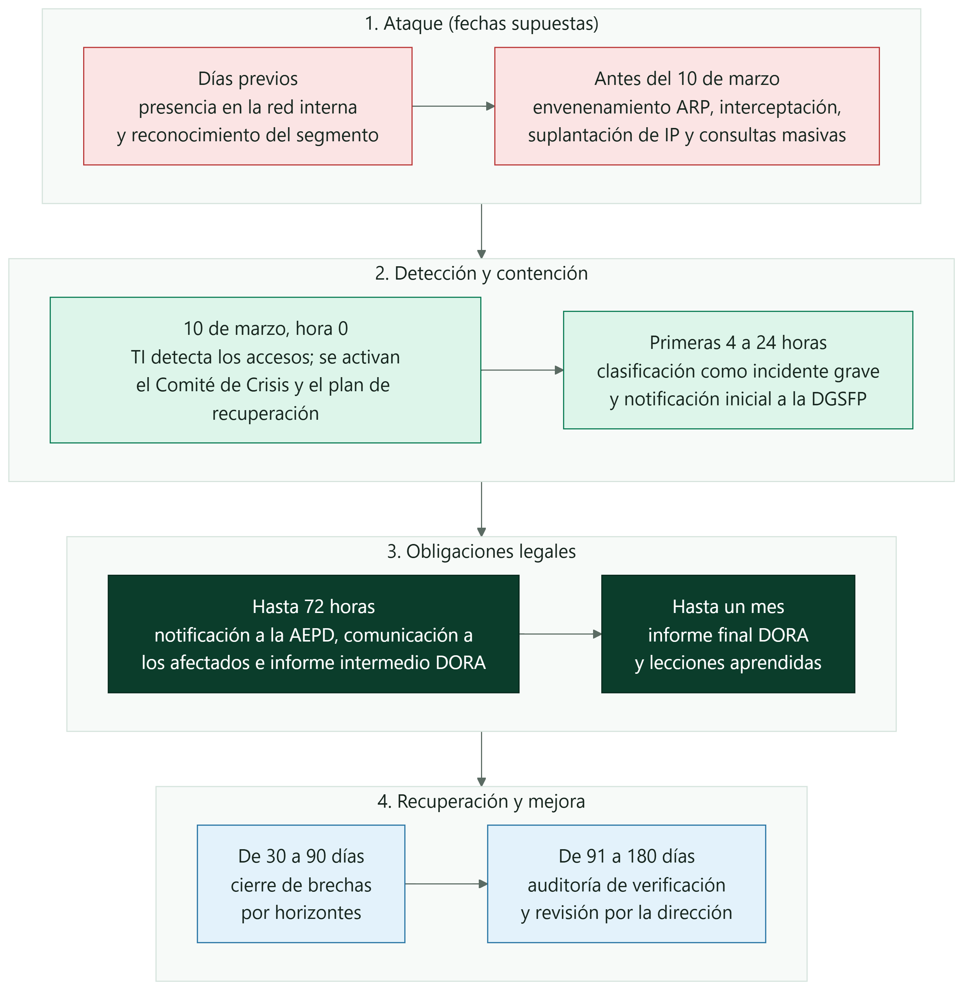{ width=6.30in }

*Figura 2.* Cronología reconstruida del incidente. Las fechas previas a la detección son supuestas; los plazos posteriores provienen del RGPD y del Reglamento Delegado (UE) 2025/301.

## 3.4 El incidente en las ocho preguntas del caso de clase

En clase se trabajó un caso de fuga de datos con ocho preguntas de auditor (Ochoa Agudelo, 2026c). Aplicadas al incidente de Mapfre dan el mapa de este informe, que la Tabla 3 recoge junto con el capítulo donde se desarrolla cada respuesta.

| Pregunta | Respuesta breve | Se desarrolla en |
|---------------------------|---------------------------------------------------------|----------------|
| ¿Qué activo estaba en riesgo? | La base de datos de clientes y pólizas de vida (A1) y el núcleo asegurador que la usa (A2). | Capítulos 4 y 5 |
| ¿Qué amenaza ocurrió? | Un atacante con presencia en la red interna interceptó el tráfico y suplantó a un servidor de confianza. | Capítulo 3 |
| ¿Qué vulnerabilidad permitió el ataque? | Red sin segmentar ni proteger en capa 2, tráfico sin cifrar y autorización basada en la dirección IP (V1 a V5). | Capítulo 6 |
| ¿Qué principio se afectó? | La confidencialidad de forma directa; la autenticidad como vía de entrada; la integridad y la disponibilidad quedaron comprometidas. | Apartado 3.5 |
| ¿Qué controles deberían existir? | Segmentación, protecciones de capa 2, cifrado con autenticación mutua, mínimo privilegio y monitoreo (C1 a C16). | Capítulo 9 |
| ¿Qué debería hacer el sistema de gestión? | Tratar estos riesgos con un plan aprobado, medir los controles y auditarlos. | Capítulos 8 y 17 |
| ¿Qué evidencias debería conservar la empresa? | Registros de red y de base de datos, tablas ARP, capturas de tráfico, imágenes forenses y la cadena de custodia. | Capítulos 11, 15 y 16 |
| ¿Qué debería revisar después del incidente? | La eficacia de cada control, el plan de recuperación, los tiempos de notificación y la declaración de aplicabilidad. | Capítulos 10 y 17 |

*Tabla 3.* El incidente analizado con las ocho preguntas del caso de clase.

## 3.5 Principios de seguridad afectados

La confidencialidad fue el principio dañado de forma directa. Información que solo debía conocer personal autorizado, incluidos documentos de identidad y detalles de pólizas, llegó a terceros. El material del curso define la confidencialidad como la garantía de que la información no sea conocida por personas, organizaciones o procesos sin autorización (Merino Bada, s. f.), y eso es lo que falló.

La vía de entrada fue un fallo de autenticidad. Esa dimensión, que el mismo material añade a la tríada clásica, garantiza la identidad de quien origina una información. Tanto la respuesta ARP falsa como el paquete con IP suplantada son mentiras sobre la identidad de un equipo, y la red las creyó porque no tenía forma de comprobarlas.

La integridad no consta como alterada en el enunciado, pero quedó comprometida. Quien está en medio de una conversación puede modificarla, y quien entra a la base de datos como si fuera la aplicación puede cambiar un beneficiario o una cuenta de cobro igual que puede leerlos. El docente puso en clase el ejemplo del atacante que cambia el salario de un empleado en la base de datos como problema típico de integridad (Ochoa Agudelo, 2026c). Por eso la actividad 13 se toma en serio aunque el caso no describa cambios.

La disponibilidad se afectó por la respuesta y no por el ataque: la operación se interrumpió mientras se contenía el problema y se auditaban los sistemas. Por último, la trazabilidad, la capacidad de determinar quién hizo qué y cuándo, quedó en entredicho. Si los accesos se detectaron después de producirse y no antes, los registros no estaban generando alertas a tiempo, y sin buenos registros tampoco se puede acotar con certeza qué datos salieron.

# 4. Actividad 1: identificación de activos

La guía pide listar al menos cinco activos críticos y justificar su importancia para la operación. El material del curso define la identificación como el proceso de reconocer todos los activos de información de la organización, "como servidores, bases de datos, aplicaciones y dispositivos de red" (Ochoa Agudelo, 2026d), y el análisis de riesgos parte siempre de ahí: de los elementos que tienen valor para la organización y que por eso hay que proteger (Universidad Internacional de La Rioja [UNIR], s. f.). La norma lo convierte en un control concreto, el 5.9 del Anexo A, que exige un inventario de la información y de los activos asociados, cada uno con un propietario (ISO/IEC, 2022b).

Para el servicio de pólizas de vida identifico diez activos. Los cinco primeros son los que el incidente tocó de forma directa; los otros cinco sostienen la detección, la recuperación y la confianza, y sin ellos el análisis de riesgos quedaría cojo. Cada activo tiene un propietario, que es el cargo que responde por su protección y que más adelante acepta el riesgo residual.

| ID | Activo | Tipo | Propietario | Por qué es crítico para la operación |
|-----|---------------------------|-----------------|---------------|------------------------------------|
| A1 | Base de datos de clientes y pólizas de vida | Información | Dirección de Negocio Vida | Guarda la identidad de los clientes, sus pólizas, beneficiarios y datos de cobro. Sin ella no se puede emitir, cobrar ni pagar una prestación. Fue el objetivo del ataque. |
| A2 | Sistema central de gestión de pólizas (núcleo asegurador) | Aplicación | Dirección de Operaciones | Ejecuta la emisión, los cobros y la tramitación de siniestros. Es el único camino legítimo para leer y modificar A1. |
| A3 | Aplicaciones y canales digitales (servidores de aplicación, portal y aplicación móvil, interfaces de mediadores) | Aplicación y servicio | Dirección de Tecnología | Por ellos entra la mayor parte de las operaciones y son lo que el cliente y el mediador ven de la compañía. |
| A4 | Red interna del centro de datos (conmutadores, encaminadores, cortafuegos, VLAN) | Infraestructura | Área de Redes | Une las aplicaciones con los datos y su diseño decide quién puede hablar con la base de datos. Fue el medio del ataque. |
| A5 | Identidades y credenciales (directorio, cuentas de servicio y de administración) | Información y servicio | Dirección de Seguridad (CISO) | Abren la base de datos. Quien las obtiene actúa con los permisos de la aplicación o del administrador. |
| A6 | Registros de auditoría y plataforma de monitoreo | Información | Centro de operaciones de seguridad (SOC) | Permiten detectar el ataque, acotar su alcance y demostrar al regulador qué ocurrió. |
| A7 | Copias de seguridad y centro de respaldo | Información e infraestructura | Dirección de Tecnología | Son la vía de recuperación si los datos se alteran o el centro principal queda aislado. Contienen los mismos datos personales que A1. |
| A8 | Centro de proceso de datos e instalaciones (salas técnicas, cableado, tomas de red) | Instalación | Seguridad Corporativa | Aloja servidores, conmutadores y cableado. El acceso físico a una toma de red basta para iniciar un ataque como el del caso. |
| A9 | Personas (equipos de TI y seguridad, empleados y red de mediadores) | Personas | Recursos Humanos | Aplican o incumplen las políticas y son quienes responden cuando ocurre un incidente. |
| A10 | Marca y confianza de clientes y supervisores | Intangible | Dirección General | Un seguro de vida es una promesa a muchos años. El cliente que duda de la custodia de sus datos cancela o no contrata. |

*Tabla 4.* Inventario de activos críticos del servicio de pólizas de vida, con su propietario y su justificación.

El inventario mezcla a propósito activos de naturaleza distinta. La norma de gestión de riesgos distingue los activos primarios, que son la información y los procesos de negocio, de los activos de soporte, que son el hardware, el software, las redes, las personas y los emplazamientos (ISO/IEC, 2022c). Quedarse solo con servidores y bases de datos, como invita a hacer la primera lectura del caso, dejaría fuera dos cosas que el incidente dañó: la capacidad de reconstruir lo ocurrido (A6) y la confianza del cliente (A10).

Los activos dependen unos de otros y esa cadena explica el alcance del daño. La base de datos (A1) solo es tan segura como la red que la conecta (A4) y como las credenciales que la abren (A5). El ataque entró por el eslabón de soporte, la red, y terminó afectando al activo primario, los datos, y al intangible, la marca. Un inventario que registra esas dependencias permite ver que proteger A1 exige invertir en A4 y A5, que es justo lo que proponen los controles del capítulo 9.

Ante un auditor, este control se demuestra con el inventario vigente, en el que cada fila tiene propietario, ubicación y clasificación, y con el acta de su última revisión. La guía de implantación del curso lo recomendaba ya para la versión anterior de la norma: si la evaluación de riesgos recorre de forma sistemática la lista de activos y asigna un responsable a cada uno, se cumplen dos requisitos en un mismo ejercicio (NQA, s. f.).

# 5. Actividad 2: clasificación de activos

La guía pide clasificar cada activo según su confidencialidad, integridad y disponibilidad, con un valor alto, medio o bajo en función del impacto en el negocio si se ve comprometido. Es el enfoque cualitativo que describe el material del curso: los parámetros se expresan con términos como alto, medio o bajo y se apoyan en el conocimiento de quienes participan en el análisis (UNIR, s. f.). El docente lo resume así: los activos se clasifican "según su nivel de sensibilidad y su valor para la organización", y esa clasificación "facilita la aplicación de controles adecuados" (Ochoa Agudelo, 2026d).

## 5.1 Escala de valoración

Una valoración cualitativa solo es útil si quien la lee sabe qué significa cada nivel. La Tabla 5 fija el criterio que uso en este ejercicio. La pregunta es siempre la misma: qué le pasa al negocio si esa dimensión del activo se pierde.

| Valor | Impacto en el negocio si la dimensión se pierde |
|-----------|-----------------------------------------------------------------------------------------|
| Alto (3) | Daño grave. Afecta a los derechos de muchos clientes, detiene un proceso esencial más de cuatro horas o expone a la compañía a sanción y a pérdidas superiores al millón de euros. |
| Medio (2) | Daño apreciable pero acotado. Afecta a un proceso o a un grupo limitado de personas, se recupera en la misma jornada y no hace previsible una sanción. |
| Bajo (1) | Molestia interna. No alcanza a los clientes ni al cumplimiento normativo. |

*Tabla 5.* Escala de valoración de los activos por impacto en el negocio.

## 5.2 Valoración de los diez activos

A las tres dimensiones de la guía añado dos que trae el material de análisis de riesgos del curso: la autenticidad, que garantiza la identidad de quien origina una información, y la trazabilidad, que permite determinar quién hizo qué y cuándo (Merino Bada, s. f.). Las incluyo porque el caso las pone en primer plano: la suplantación de IP y de ARP es un ataque a la autenticidad, y la auditoría de registros que pide la actividad 13 es trazabilidad. La columna de valor suma las tres dimensiones de la guía y sirve para ordenar los activos; la etiqueta indica cómo debe manejarse la información asociada.

| ID | Activo | C | I | D | A | T | Valor (C+I+D) | Etiqueta |
|-----|----------------------------------------|-------|-------|-------|-------|-------|-------------|--------------|
| A1 | Base de datos de clientes y pólizas | Alto | Alto | Alto | Alto | Alto | 9 | Restringida |
| A2 | Núcleo asegurador | Alto | Alto | Alto | Alto | Alto | 9 | Restringida |
| A5 | Identidades y credenciales | Alto | Alto | Alto | Alto | Alto | 9 | Reservada |
| A7 | Copias de seguridad y centro de respaldo | Alto | Alto | Alto | Medio | Medio | 9 | Restringida |
| A3 | Aplicaciones y canales digitales | Medio | Alto | Alto | Alto | Medio | 8 | Uso interno |
| A4 | Red interna del centro de datos | Medio | Alto | Alto | Alto | Medio | 8 | Uso interno |
| A6 | Registros de auditoría y monitoreo | Medio | Alto | Medio | Alto | Alto | 7 | Restringida |
| A8 | Centro de datos e instalaciones | Medio | Medio | Alto | Medio | Medio | 7 | Uso interno |
| A9 | Personas | Medio | Medio | Alto | Medio | Medio | 7 | Uso interno |
| A10 | Marca y confianza | Bajo | Alto | Alto | Alto | Bajo | 7 | Pública |

*Tabla 6.* Clasificación de los activos por confidencialidad (C), integridad (I), disponibilidad (D), autenticidad (A) y trazabilidad (T), ordenados por valor.

Cuatro activos alcanzan el valor máximo. La base de datos (A1) es alta en todo: su divulgación afecta a los derechos de los clientes, su alteración puede desviar el pago de una prestación a quien no corresponde y su caída detiene la compañía. El núcleo asegurador (A2) hereda esos valores porque es la puerta de la base de datos. Las credenciales (A5) valen lo que valen los sistemas que abren, y por eso reciben la etiqueta más estricta. Las copias de seguridad (A7) suelen pasarse por alto y contienen exactamente los mismos datos personales que la base de datos de producción.

La red (A4) merece un comentario. Su confidencialidad es media, porque el plano de la red no es un secreto comercial, pero su integridad y su autenticidad son altas: si alguien puede alterar las tablas que dicen qué equipo es cuál, todo lo que circula por ella queda expuesto. El incidente lo demostró. Un inventario que hubiera valorado la red solo por su disponibilidad no habría justificado las protecciones de capa 2 que faltaban.

Los registros de auditoría (A6) tienen disponibilidad media, ya que la operación puede seguir unas horas sin ellos, y en cambio integridad y trazabilidad altas. Un registro que puede modificarse no prueba nada, ni ante el equipo que investiga ni ante el regulador. La marca (A10) se valora baja en confidencialidad porque es pública por definición, y alta en integridad y disponibilidad: lo que la compañía dice de sí misma tiene que ser cierto, y perder la confianza equivale a no poder vender.

## 5.3 De la clasificación al manejo

La clasificación tiene que cambiar la forma de tratar el activo. El material del curso incluye el esquema de cuatro niveles de una gran empresa española, que liga cada nivel a la valoración de la confidencialidad y pide reflejar la etiqueta en el propio documento (Grupo Renfe, s. f.). Propongo para Mapfre un esquema equivalente, resumido en la Tabla 7, que debería quedar recogido en una norma interna de clasificación conforme a los controles 5.12 y 5.13 del Anexo A (ISO/IEC, 2022b).

| Etiqueta | Quién accede | Cómo se protege |
|--------------|--------------------------|------------------------------------------------------------|
| Reservada | Personas designadas por nombre | Custodia en un gestor de secretos, cifrado obligatorio, rotación periódica. Nunca viaja por correo ni se anota en claro. |
| Restringida | Quien lo necesita para su función | Cifrado en tránsito y en reposo, acceso registrado, enmascaramiento en entornos que no sean de producción. |
| Uso interno | Empleados y colaboradores autorizados | No se publica ni se comparte con terceros sin acuerdo de confidencialidad. |
| Pública | Cualquiera | Sin restricción de lectura. Se protege su integridad para que nadie la altere. |

*Tabla 7.* Niveles de clasificación propuestos y reglas de manejo asociadas.

Con esta escala, los datos que el atacante interceptó eran información restringida que viajaba por la red sin cifrar. La clasificación, si hubiera existido y se hubiera aplicado, habría señalado por sí sola el incumplimiento.

# 6. Actividad 3: identificación de vulnerabilidades

La guía pregunta qué vulnerabilidades de la infraestructura pudieron explotarse con la suplantación de IP y el ARP spoofing, y pide al menos tres con su mitigación. El material del curso llama vulnerabilidades explotadas a las "debilidades en los sistemas de información que los atacantes pueden aprovechar para comprometer la seguridad" (Ochoa Agudelo, 2026d).

El enunciado no las enumera, así que hay que deducirlas del propio ataque. Uso dos grados de certeza. Las vulnerabilidades V1 a V5 son condiciones necesarias: sin ellas el ataque que describe la guía no habría funcionado. Las V6 a V9 son probables: no son imprescindibles para el ataque, pero explican cómo llegó el atacante a la red interna, por qué tardó en detectarse y por qué el daño fue tan amplio.

| ID | Vulnerabilidad | Cómo la aprovechó el ataque | Cómo se habría mitigado | Control |
|-----|-------------------|---------------------------------|---------------------------------|----------|
| V1 | Segmentación insuficiente | La base de datos compartía red local con equipos menos confiables. Desde uno de ellos el atacante alcanzó por ARP al servidor de aplicaciones y a la base de datos. | Zona de datos aislada tras un cortafuegos interno, alcanzable solo desde los servidores de aplicación. | C1 |
| V2 | Conmutadores sin protecciones de capa 2 | Los conmutadores aceptaron y propagaron respuestas ARP falsas sin contrastarlas con nada. | DHCP snooping, inspección dinámica de ARP, IP Source Guard y seguridad de puertos: el conmutador descarta la respuesta ARP que no coincide con su tabla de asignaciones. | C2 |
| V3 | Autorización basada en la dirección IP | La base de datos concedió acceso a quien se presentó con la dirección del servidor de aplicaciones. | Autenticación de cada servicio y de cada administrador con certificado, y retirada de las reglas de confianza por dirección. | C5 |
| V4 | Tráfico interno sin cifrar ni autenticar | El intermediario leyó consultas y respuestas con datos personales y pudo capturar credenciales. | TLS con autenticación mutua entre la aplicación y la base de datos. | C4 |
| V5 | Sin filtrado antisuplantación | Encaminadores y cortafuegos internos dejaron circular paquetes con una dirección de origen falsa. | Verificación de ruta inversa (uRPF) y filtros de entrada por interfaz, según la práctica BCP 38 (Ferguson y Senie, 2000). | C3 |
| V6 | Sin control de acceso a la red y con tomas activas sin vigilar | Un equipo no autorizado o comprometido operó dentro del segmento. | Autenticación 802.1X de cada equipo, tomas sin uso deshabilitadas y armarios de red cerrados. | C6, C14 |
| V7 | Registro y monitoreo insuficientes | Ni el envenenamiento ARP ni las consultas masivas generaron una alerta a tiempo. La detección llegó después del acceso. | Sensor de red con reglas de ARP, monitoreo de la actividad de la base de datos, casos de uso en el SIEM y relojes sincronizados. | C8, C9 |
| V8 | Privilegios excesivos y datos legibles | La cuenta de la aplicación podía consultar toda la base y los datos estaban en claro. | Mínimo privilegio por función, cifrado por campo y enmascaramiento. | C5, C7 |
| V9 | Debilidades de gobierno | Las normas de red y de acceso no se verificaban. Una prueba interna de intrusión habría encontrado V1 a V5. | Normas internas vigentes, pruebas de intrusión internas periódicas y auditoría interna. | C10, C15 |

*Tabla 8.* Vulnerabilidades de la infraestructura, forma en que el ataque las aprovechó y mitigación propuesta. La columna de control remite al capítulo 9.

## 6.1 Tres barreras que faltaban a la vez

El ataque necesitó que fallaran varias cosas al mismo tiempo, y esa es la lectura más útil de la tabla. La inspección dinámica de ARP (V2) habría impedido que el atacante se colocara en medio, y sin esa posición la suplantación de IP sobre una conexión TCP no se sostiene. La autenticación con certificado en los dos extremos (V3 y V4) habría dejado al atacante con tráfico cifrado e incapaz de identificarse ante la base de datos, aunque hubiera logrado desviar el tráfico. La segmentación (V1) le habría quitado el acceso al segmento donde hablan la aplicación y la base de datos. Cualquiera de las tres barreras habría cortado la cadena. El principio de defensa en profundidad consiste en no depender de una sola.

El material de redes del curso describía ya las tres piezas. La segmentación "aísla los sistemas críticos, como servidores de bases de datos, de los usuarios finales, reduciendo el riesgo de acceso no autorizado o ataques laterales"; los certificados digitales verifican la identidad del servidor o del cliente para que la comunicación se haga "con la parte correcta"; e IPsec aporta "autenticación mutua entre las partes" en la capa de red (Ochoa Agudelo, 2026a). El incidente es, en buena medida, la consecuencia de no haber aplicado dentro del centro de datos lo que sí se aplica hacia Internet.

## 6.2 Debilidades de diseño y de configuración

Ninguna de las cinco condiciones necesarias es un fallo de programación con un parche pendiente. Son decisiones de diseño y de configuración: una red plana, unas funciones de seguridad del conmutador que vienen desactivadas de fábrica, una regla de acceso que se fía de la dirección. El catálogo de debilidades las tiene descritas desde hace años, como la transmisión de información sensible en claro (CWE-319) o la confianza en la dirección IP para autenticar (CWE-291), y el catálogo de técnicas de ataque recoge tanto el envenenamiento ARP (T1557.002) como la escucha de red (T1040) (MITRE, s. f.).

Esto cambia la forma de mitigarlas. El material del curso cita como medidas típicas los parches de seguridad y el refuerzo de contraseñas con autenticación multifactor (Ochoa Agudelo, 2026d), que siguen siendo necesarias para otras vulnerabilidades. Aquí el trabajo corresponde a dos controles distintos del Anexo A: la gestión de la configuración (8.9), que fija una línea base segura para conmutadores, cortafuegos y bases de datos y vigila que nadie la altere, y la gestión de vulnerabilidades técnicas (8.8), que debe hacerse de forma proactiva y no cuando el incidente ya ocurrió (ISO/IEC, 2022b).

## 6.3 Cómo se habrían encontrado antes

Una prueba de intrusión interna que incluyera la capa 2 habría reproducido el ataque en una tarde con herramientas de uso común, y una revisión de la configuración de los conmutadores contra una línea base habría mostrado las protecciones desactivadas sin necesidad de atacar nada. El ejemplo que el curso pone de la banca va en esa dirección: identificar los activos, clasificarlos por sensibilidad y hacer pruebas de penetración periódicas para detectar las vulnerabilidades y corregirlas (Ochoa Agudelo, 2026d).

Un auditor que quisiera comprobar hoy si estas vulnerabilidades siguen abiertas pediría cuatro cosas: la configuración vigente de los conmutadores del centro de datos, las reglas del cortafuegos interno, los parámetros de autenticación y cifrado de la base de datos y el informe de la última prueba de intrusión interna con el estado de sus hallazgos.

# 7. Actividad 4: modelo normativo de seguridad

La guía pide un modelo normativo que contemple las mejores prácticas y los estándares internacionales, y que explique cómo las políticas y normativas internas ayudan a prevenir incidentes similares. El material del curso define el modelo normativo como "el conjunto de marcos regulatorios y normas que guían las políticas de seguridad de la información en una organización" (Ochoa Agudelo, 2026d).

El modelo que propongo tiene dos mitades, que la Figura 3 muestra una junto a la otra. La mitad externa reúne lo que la compañía debe cumplir o decide seguir. La mitad interna es lo que la compañía escribe y aplica en su casa para cumplirlo: una política, unas normas, unos procedimientos y los registros que prueban que todo eso se hace.

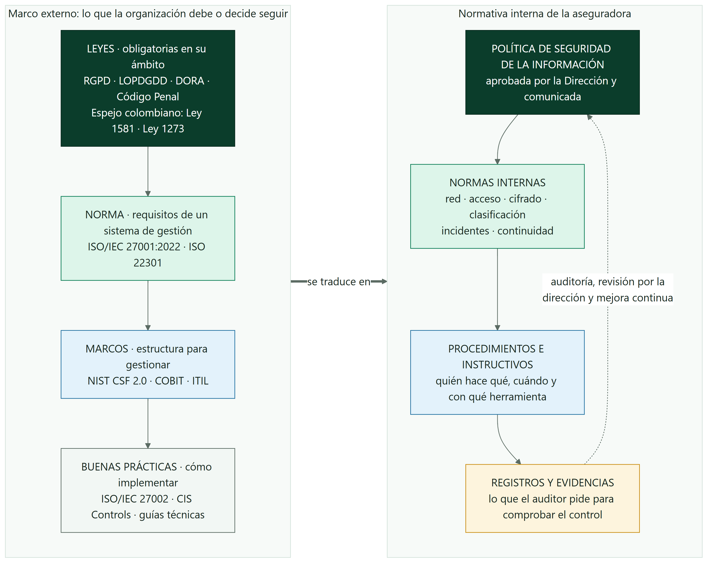{ width=6.30in }

*Figura 3.* Modelo normativo propuesto: el marco externo de leyes, norma, marcos y buenas prácticas se traduce en una normativa interna que termina en evidencias auditables.

## 7.1 Ley, norma, marco y buena práctica

En clase el docente insistió en no meter todo en el mismo saco, porque una de las confusiones más frecuentes en ciberseguridad es tratar como equivalentes cosas que cumplen funciones distintas (Ochoa Agudelo, 2026c). La Tabla 9 ordena el marco externo con esa distinción y con las palabras con que se explicó.

| Capa | Qué es | Instrumentos para Mapfre | Qué aporta al caso |
|----------|------------------------|-------------------------------------|-----------------------------|
| Ley | "Es obligatoria dentro de su ámbito de aplicación." | RGPD, LOPDGDD, Reglamento DORA, Real Decreto-ley 12/2018, Real Decreto 43/2021, Código Penal | Fija el deber de proteger, los plazos de notificación y las sanciones. |
| Norma | "Establece requisitos para un sistema de gestión." Se puede certificar. | ISO/IEC 27001:2022 para la seguridad de la información; ISO 22301 para la continuidad | Ordena la gestión: contexto, riesgo, controles, medición, auditoría y mejora. |
| Marco | "Proporciona una estructura para gestionar." | NIST CSF 2.0 para el riesgo de ciberseguridad; COBIT 2019 para el gobierno y la gestión de TI; ITIL 4 para la gestión de servicios | Organiza capacidades, reparte responsabilidades e integra la seguridad en la operación diaria. |
| Buena práctica | Indica cómo implementar. | ISO/IEC 27002:2022, CIS Controls, BCP 38, guías de los fabricantes | Baja al detalle técnico: qué activar en un conmutador o en la base de datos. |

*Tabla 9.* Las cuatro capas del marco externo, con la definición dada en clase.

Las cuatro capas pueden trabajar juntas sin ser equivalentes, y "una empresa madura puede utilizar varios de estos elementos simultáneamente" (Ochoa Agudelo, 2026c). La ley dice qué resultado se exige. La norma dice cómo organizarse para lograrlo de forma demostrable. El marco y la buena práctica dicen con qué piezas.

## 7.2 Las leyes y sus artículos

Hablar con propiedad de la normativa exige citar la ley y el artículo. La Tabla 10 recoge las normas que aplican a una aseguradora española con el incidente descrito.

| Norma | Artículos | Qué exige | Relación con el incidente |
|--------------|---------------|-------------------------------------------------|----------------------|
| Reglamento (UE) 2016/679, RGPD | 5.1.f y 5.2; 24, 25 y 32; 33 y 34; 35; 82 y 83 | Integridad y confidencialidad de los datos y capacidad de demostrarlo. Medidas técnicas y organizativas apropiadas al riesgo, entre ellas el cifrado y la verificación periódica de su eficacia. Notificación a la autoridad en 72 horas y comunicación a los afectados si el riesgo es alto. Evaluación de impacto. Indemnización y multas de hasta 20 millones de euros o el 4 % del volumen de negocio. | Datos sin cifrar en tránsito y acceso autorizado por dirección IP son difíciles de defender como medidas apropiadas al riesgo. |
| Ley Orgánica 3/2018, LOPDGDD | 72.1.a; 73 d, f, g, r y s; 74 m y n; 78 | Tipifica como muy grave tratar datos vulnerando los principios del artículo 5 del RGPD. Como graves, no adoptar las medidas de seguridad del artículo 32, quebrantarlas por falta de diligencia, no notificar la violación a la autoridad y no comunicarla al afectado cuando se requiere. Como leves, notificar tarde o de forma incompleta y no documentar la violación. | Concreta a qué tipo de infracción se expone la compañía y en cuánto tiempo prescribe. |
| Reglamento (UE) 2022/2554, DORA, y Reglamento Delegado (UE) 2025/301 | 5 a 16; 17 a 19; 24 a 27; 28 a 30; artículo 5 del delegado | Marco de gestión del riesgo tecnológico aprobado por el órgano de dirección: identificar, proteger, detectar, responder y recuperar. Clasificación de incidentes y notificación de los graves a la autoridad competente: inicial en 4 horas desde la clasificación y a más tardar 24 horas desde que se conoce, intermedia a las 72 horas y final en un mes. Pruebas de resiliencia. Gestión del riesgo de proveedores. | La aseguradora debe notificar a la Dirección General de Seguros y Fondos de Pensiones y demostrar que su marco funciona. |
| Real Decreto-ley 12/2018 y Real Decreto 43/2021 | 16 y 19 del real decreto-ley; 6 y 7 del real decreto | Medidas de seguridad en diez frentes (riesgos, proveedores, catálogo de medidas organizativas, tecnológicas y físicas, personal, incidentes, continuidad, mejora continua, interconexión y registro de la actividad de los usuarios). Declaración de aplicabilidad firmada por el responsable de seguridad e incluida en la política que aprueba la Dirección. Notificación de incidentes al CSIRT de referencia. | Aplican si la compañía está designada operador de servicios esenciales. Su estructura coincide con la de un sistema de gestión. |
| Ley Orgánica 10/1995, Código Penal | 197 bis.1 y 197 bis.2; 249; 264; 197 quinquies | Castiga el acceso a un sistema vulnerando sus medidas de seguridad con prisión de seis meses a dos años, y la interceptación de transmisiones no públicas de datos con prisión de tres meses a dos años o multa. Tipifica las estafas por medios informáticos y los daños informáticos. Prevé la responsabilidad de las personas jurídicas. | Califica la conducta de los atacantes. La compañía es víctima y debe denunciar. |
| Reglamento (UE) 596/2014, abuso de mercado | 17 | Obliga al emisor cotizado a difundir la información privilegiada tan pronto como sea posible. | Solo aplica si el incidente puede influir de forma apreciable en la cotización. |

*Tabla 10.* Leyes aplicables en España y la Unión Europea, con los artículos que interesan al caso.

Dos precisiones sobre vigencia. La Directiva NIS 2 debía transponerse antes del 17 de octubre de 2024 y a finales de octubre de 2026 España seguía sin ley de transposición, por lo que el Real Decreto-ley 12/2018 continúa en vigor (Cuatrecasas, 2026). Y las directrices de seguridad tecnológica que el supervisor europeo de seguros había dictado bajo Solvencia II quedaron revocadas el 17 de enero de 2025 porque DORA cubre por completo sus objetivos (EIOPA, 2024). Para una aseguradora, el texto de referencia en resiliencia digital es hoy DORA.

## 7.3 El mismo incidente bajo la ley colombiana

El diplomado se cursa en Colombia y el docente recordó que estas normas europeas "las traemos y las aplicamos" aquí (Ochoa Agudelo, 2026c). Si la base de datos afectada fuera la de una filial colombiana, el análisis cambiaría de artículos pero no de lógica, como muestra la Tabla 11.

| Aspecto | España y Unión Europea | Colombia |
|-----------------|---------------------------------|--------------------------------------------------|
| Ley de protección de datos | RGPD y LOPDGDD | Ley 1581 de 2012; Ley 1266 de 2008 para la información financiera y crediticia |
| Autoridad | Agencia Española de Protección de Datos | Superintendencia de Industria y Comercio (SIC) |
| Deber de seguridad | Artículo 32 del RGPD | Artículos 4 g y 17 d de la Ley 1581: impedir la adulteración, pérdida, consulta, uso o acceso no autorizado o fraudulento |
| Aviso a la autoridad | 72 horas (artículo 33 del RGPD) | Artículo 17 n de la Ley 1581; reporte al Registro Nacional de Bases de Datos en 15 días hábiles |
| Aviso a los afectados | Sin dilación indebida si el riesgo es alto (artículo 34 del RGPD) | A los titulares, en un plazo razonable (Ochoa Agudelo, 2026b) |
| Sanción administrativa | Hasta 20 millones de euros o el 4 % del volumen de negocio | Multas de hasta 2.000 salarios mínimos mensuales, suspensión de hasta seis meses y cierre (artículo 23 de la Ley 1581) |
| Supervisor financiero | Dirección General de Seguros y Fondos de Pensiones, con DORA | Superintendencia Financiera, con las Circulares Externas 007 de 2018 y 033 de 2020 |
| Delito de acceso | Artículo 197 bis.1 del Código Penal | Artículo 269A de la Ley 1273 de 2009: prisión de 48 a 96 meses y multa de 100 a 1.000 salarios mínimos |
| Delito de interceptación | Artículo 197 bis.2 del Código Penal | Artículo 269C de la Ley 1273 de 2009 |

*Tabla 11.* Correspondencia entre el marco español y europeo y el colombiano para el mismo incidente.

La comparación deja dos diferencias. El plazo colombiano de aviso a la autoridad es mucho más largo que el europeo, de modo que un procedimiento interno diseñado para cumplir las 72 horas cumple de sobra el otro. En cambio, las penas de prisión colombianas por acceso abusivo son más altas, hasta ocho años, como se leyó en clase al revisar el artículo 269A (Ochoa Agudelo, 2026c).

## 7.4 La norma y los marcos, cada uno en su papel

ISO/IEC 27001 es la columna del modelo. Es la norma que establece cómo implantar, mantener y mejorar un sistema de gestión de seguridad de la información, y "no pregunta únicamente qué controles tiene, sino cómo gestionas sistemáticamente el riesgo y cómo puedes demostrarlo" (Ochoa Agudelo, 2026c). Sus numerales 4 a 10 marcan el recorrido de este informe: el contexto de la organización está en el capítulo 2; el liderazgo se concreta en la política que aprueba la Dirección; la planificación es el análisis de riesgos del capítulo 8 y la declaración de aplicabilidad del capítulo 9; el soporte incluye la formación; la operación son los controles y el cierre de brechas; la evaluación del desempeño corresponde al monitoreo, los indicadores y la auditoría interna, y la mejora es el plan del capítulo 17. La versión vigente es la de 2022, con 93 controles en cuatro grupos. La guía de implantación del curso describe la de 2013, con 114 controles en 14 dominios (NQA, s. f.), y la estructura de los numerales 4 a 10 es la misma en ambas.

El marco de ciberseguridad del NIST organiza las capacidades por funciones. En clase se citaron las cinco clásicas, identificar, proteger, detectar, responder y recuperar; la versión 2.0, que es la que está en la plataforma del curso, antepone una sexta, gobernar (NIST, 2024). Sirve para comprobar que no queda ninguna función vacía. En el caso, la compañía tenía capacidad de protección hacia el exterior y de respuesta, y un hueco en la detección dentro de la red. El video comparativo visto en clase lo sitúa bien: ISO se certifica y sirve para demostrar cumplimiento ante clientes y reguladores; NIST es gratuito y muy práctico para diseñar la respuesta, y los dos pueden coexistir (ErgoHackers, s. f.).

COBIT se ocupa del gobierno: quién decide, quién responde y cómo se rinden cuentas sobre la tecnología (ISACA, 2018). Aporta lo que el incidente echó en falta, un responsable claro del riesgo de la red interna. ITIL ordena la prestación de los servicios de TI (AXELOS, 2019), y dos de sus prácticas tocan el caso de lleno: la gestión de cambios, para que nadie desactive una protección sin aprobación ni registro, y la gestión de incidentes, que conecta la mesa de servicio con el equipo de respuesta.

## 7.5 La normativa interna

La mitad interna del modelo es una jerarquía documental de cuatro niveles. La política general enuncia el compromiso y los principios. Las normas internas fijan reglas obligatorias por materia. Los procedimientos dicen quién hace qué, cuándo y con qué herramienta. Los registros dejan la evidencia. La Tabla 12 propone el juego de documentos y señala qué habría evitado cada uno.

| Política o norma interna | Qué establece | Anexo A | Qué habría evitado |
|--------------------|----------------------------------------|---------------|-------------------------|
| Política de seguridad de la información | Compromiso de la Dirección, objetivos, funciones y revisión anual | 5.1, 5.2, 5.4 | Que la red interna no tuviera un responsable definido |
| Norma de clasificación y manejo | Cuatro etiquetas y sus reglas de tratamiento | 5.10, 5.12, 5.13 | Que información restringida viajara sin cifrar |
| Norma de control de acceso e identidades | Mínimo privilegio, autenticación fuerte, prohibición de autorizar por dirección IP, revisión trimestral | 5.15 a 5.18, 8.2, 8.3, 8.5 | V3 y V8 |
| Norma de seguridad de redes | Zonas, protecciones de capa 2 obligatorias, filtrado antisuplantación, control de acceso a la red | 8.20, 8.21, 8.22 | V1, V2, V5 y V6 |
| Norma de criptografía | Cifrado en tránsito y en reposo, gestión de certificados y claves | 8.24 | V4 |
| Norma de registro y monitoreo | Qué se registra, cuánto se conserva, sincronización de relojes y revisión | 8.15, 8.16, 8.17 | V7 |
| Procedimiento de gestión de incidentes | Clasificación, funciones, plazos legales y plantillas de notificación | 5.24 a 5.28, 6.8 | Notificaciones tardías |
| Plan de continuidad y recuperación | Análisis de impacto, tiempos objetivo y pruebas | 5.29, 5.30, 8.13, 8.14 | Interrupción prolongada |
| Norma de cambios y configuración | Línea base segura, aprobación y trazabilidad de cada cambio | 8.9, 8.32 | Protecciones desactivadas sin que nadie lo sepa |
| Norma de seguridad con proveedores | Cláusulas, evaluación y acceso de terceros | 5.19 a 5.22 | Accesos de terceros sin control |
| Norma de seguridad física | Acceso a salas técnicas, cableado y tomas de red | 7.1 a 7.4, 7.8, 7.12 | V6 |
| Plan de formación y concienciación | Formación por perfil y simulaciones | 6.3 | Errores de configuración y de manejo |

*Tabla 12.* Políticas y normas internas propuestas, con los controles del Anexo A que desarrollan y la debilidad que habrían evitado. El Anexo B de este informe contiene el texto modelo de la política general.

## 7.6 Cómo previenen las políticas un incidente como este

Una política previene por cuatro vías, y las cuatro se ven en el caso.

La primera es que convierte una buena práctica en una obligación interna que se puede verificar. Activar la inspección de ARP es hoy una recomendación del fabricante que un administrador puede seguir o no. Si la norma de seguridad de redes la declara obligatoria en todos los conmutadores del centro de datos, su ausencia pasa a ser un incumplimiento que una auditoría detecta.

La segunda es que asigna responsables. Las definiciones del curso lo recogen: las políticas son "documentos formales que definen los procedimientos, normas y reglas que deben seguir los usuarios y los sistemas", y los controles administrativos "involucran a personas y sus responsabilidades" (Ochoa Agudelo, 2026d). Con un propietario de la red y otro del dato, la decisión de dejar una regla de acceso basada en la dirección IP tiene nombre y firma.

La tercera es que obliga a revisar. Una norma que exige revisar los accesos cada trimestre y probar la red una vez al año encuentra la desviación antes que el atacante.

La cuarta es que enlaza con la ley. El Real Decreto 43/2021 pide que la relación de medidas se formalice en una declaración de aplicabilidad incluida en la política de seguridad que aprueba la Dirección, y DORA exige que el órgano de dirección apruebe el marco de gestión del riesgo tecnológico. La política es el documento donde la obligación legal se vuelve decisión de la empresa.

Hay un límite que el caso también enseña. Una política guardada en un cajón no protege a nadie. En palabras del docente, la política "debe establecerse, comunicarse y mantenerse", y no basta con tenerla en un PDF que nadie conoce (Ochoa Agudelo, 2026c). Es muy probable que una compañía del tamaño de Mapfre tuviera una política de seguridad el 10 de marzo. Lo que faltaba era la comprobación de que la configuración real de la red la cumplía.

## 7.7 De la exigencia legal al control y a la evidencia

El docente propuso en clase conectar cada exigencia de la ley con el control tecnológico que la cumple, porque "la norma establece la responsabilidad y la tecnología ayuda a demostrar y ejecutar el control" (Ochoa Agudelo, 2026c). La Tabla 13 aplica esa tabla al caso y le añade lo que pediría un auditor.

| Exigencia | Dónde se exige | Control en Mapfre | Evidencia para el auditor |
|--------------------|-------------------------|-----------------------------|---------------------------|
| Protección de la información | Art. 32.1.a del RGPD; art. 4 g de la Ley 1581 | Cifrado en tránsito y en reposo (C4, C7) | Parámetros de cifrado e inventario de certificados |
| Acceso autorizado | Art. 32 del RGPD; art. 9 de DORA | Gestión de identidades y accesos (C5) | Altas y bajas aprobadas; revisión trimestral |
| Control de usuarios | Art. 5.1.f del RGPD | Roles con mínimo privilegio (C5) | Matriz de roles vigente |
| Trazabilidad | Art. 33.5 del RGPD; art. 6 del RD 43/2021 | Registros de auditoría protegidos (C8, C9) | Registros, retención y verificación de integridad |
| Prevención de accesos | Art. 32 del RGPD | Doble factor y bastión para administradores (C5) | Informe de cobertura del doble factor |
| Protección de la infraestructura | Art. 9 de DORA; art. 6 del RD 43/2021 | Cortafuegos interno, segmentación y capa 2 (C1, C2, C3) | Reglas y configuración vigentes |
| Recuperación | Art. 32.1.c del RGPD; arts. 11 y 12 de DORA | Copias de seguridad y plan de recuperación (C12) | Informes de pruebas de restauración |
| Detección | Art. 10 de DORA | SIEM, sensor de red y monitoreo de la base de datos (C8) | Alertas generadas y atendidas |
| Gestión de riesgos | Art. 6 de DORA; numeral 6 de ISO/IEC 27001 | Metodología de riesgos y marco NIST | Registro de riesgos aprobado |
| Evidencia | Arts. 5.2 y 24 del RGPD | Auditoría interna e independiente (C15) | Informes de auditoría y plan de acciones |

*Tabla 13.* De la exigencia legal al control tecnológico y a su evidencia, siguiendo la tabla dictada en clase.

# 8. Actividad 5: gestión de riesgos de seguridad

La guía pide un análisis de riesgos para los activos críticos a partir del incidente de acceso no autorizado: definir los riesgos, evaluar su probabilidad y su impacto, priorizarlos y recomendar su mitigación. En clase se dijo que aquí está "el corazón de la ISO 27001", porque la norma no dice qué productos comprar, dice "identifique sus riesgos y determine cómo tratarlos" (Ochoa Agudelo, 2026c). El material del curso divide la gestión de riesgos en dos fases, el análisis y el tratamiento (UNIR, s. f.), y este capítulo sigue ese orden.

## 8.1 Método y escalas

Sigo el proceso de la norma ISO/IEC 27005:2022, que desarrolla para la seguridad de la información el esquema general de ISO 31000: establecer el contexto, identificar los riesgos, analizarlos, evaluarlos frente a un criterio y tratarlos (ISO/IEC, 2022c; ISO, 2018). El enfoque es cualitativo, como pide la guía. Para poder priorizar, cada nivel cualitativo lleva un número del 1 al 5 y el nivel de riesgo es el producto de la probabilidad por el impacto. La Tabla 14 define ambos ejes.

| Valor | Probabilidad | Impacto |
|--------|-----------------------------------|---------------------------------------------------------|
| 1 | Muy baja. No se espera en cinco años. | Muy bajo. Sin efecto en los clientes ni en el servicio. |
| 2 | Baja. Podría ocurrir una vez en cinco años. | Bajo. Molestia interna que se resuelve en horas. |
| 3 | Media. Podría ocurrir una vez al año. | Medio. Afecta a un proceso o a miles de clientes, sin sanción previsible. |
| 4 | Alta. Puede ocurrir varias veces al año o ya hay indicios. | Alto. Afecta a los derechos de decenas de miles de clientes, detiene procesos esenciales o hace probable una sanción. |
| 5 | Muy alta. Ya ocurrió o es inminente. | Muy alto. Afecta a cientos de miles de clientes, compromete la continuidad o acarrea sanciones de varios millones. |

*Tabla 14.* Escalas de probabilidad e impacto. El nivel de riesgo es su producto: de 1 a 4 bajo, de 5 a 9 medio, de 10 a 16 alto y de 17 a 25 crítico.

El criterio de aceptación es que ningún riesgo quede por encima de 9 después del tratamiento. Un riesgo residual de nivel medio o bajo lo acepta por escrito su propietario; uno mayor exige más controles o una decisión expresa de la Dirección.

## 8.2 Identificación de los riesgos

En clase se dio la cadena con que debe describirse un riesgo: activo, amenaza, vulnerabilidad, consecuencia y riesgo. El ejemplo fue una base de datos de clientes amenazada por un programa de secuestro, con copias de seguridad conectadas de forma permanente a la red, cuya consecuencia es la pérdida de disponibilidad y cuyo riesgo es la interrupción del servicio (Ochoa Agudelo, 2026c). La Tabla 15 aplica esa misma cadena a los diez riesgos que se desprenden del incidente. Los activos y las vulnerabilidades remiten a los capítulos 4 y 6.

| ID | Riesgo | Activo | Amenaza | Vulnerabilidad | Consecuencia |
|-----|--------------------------|---------|-------------------|-------------------|----------------------|
| R1 | Interceptación de datos personales en tránsito por un intermediario | A1, A4 | ARP spoofing | V1, V2, V4 | Pérdida de confidencialidad y violación de datos personales |
| R2 | Acceso no autorizado a la base de datos con la IP de un servidor de confianza | A1, A2 | Suplantación de IP | V3, V5 | Consulta y extracción masiva de datos |
| R3 | Fraude a clientes con los datos sustraídos | A1, A10 | Uso fraudulento de los datos | V8 | Pérdidas económicas e indemnizaciones |
| R4 | Modificación no autorizada de datos de pólizas | A1, A2 | Manipulación de beneficiarios, cuentas o capitales | V3, V7, V8 | Pérdida de integridad y pagos indebidos |
| R5 | Interrupción de la operación durante la contención y las auditorías | A2, A3, A4 | Indisponibilidad | V9 | Emisión, cobros y siniestros detenidos |
| R6 | Sanción regulatoria y reclamaciones | A10 | Incumplimiento de medidas o de plazos | V7, V9 | Multas e indemnizaciones |
| R7 | Daño reputacional y pérdida de clientes y mediadores | A10 | Divulgación pública de la brecha | V9 | Cancelaciones y menor nueva producción |
| R8 | Robo de credenciales de servicio o de administración en tránsito | A5 | Captura de credenciales | V4, V8 | Movimiento lateral y persistencia del atacante |
| R9 | Detección tardía e imposibilidad de reconstruir lo ocurrido | A6 | Registros insuficientes o alterables | V7 | Pérdida de trazabilidad y alcance indeterminado |
| R10 | Conexión de un equipo no autorizado a la red interna | A4, A8 | Acceso físico o equipo comprometido | V6 | Punto de partida de nuevos ataques |

*Tabla 15.* Identificación de los riesgos con la cadena activo, amenaza, vulnerabilidad y consecuencia.

## 8.3 Valoración y priorización

La Tabla 16 valora cada riesgo tal como estaba el día del incidente, antes de aplicar controles. Es el riesgo inherente. El orden de la tabla es el orden de prioridad.

| Prioridad | ID | Riesgo | P | I | Riesgo inherente |
|-------------|-----|-------------------------------------------|-----|-----|----------------|
| 1 | R1 | Interceptación de datos en tránsito | 5 | 5 | 25 Crítico |
| 2 | R2 | Acceso a la base de datos con IP suplantada | 5 | 5 | 25 Crítico |
| 3 | R3 | Fraude a clientes con los datos sustraídos | 4 | 5 | 20 Crítico |
| 4 | R7 | Daño reputacional y pérdida de clientes | 4 | 5 | 20 Crítico |
| 5 | R5 | Interrupción de la operación | 4 | 4 | 16 Alto |
| 6 | R6 | Sanción regulatoria y reclamaciones | 4 | 4 | 16 Alto |
| 7 | R8 | Robo de credenciales en tránsito | 4 | 4 | 16 Alto |
| 8 | R9 | Detección tardía y pérdida de trazabilidad | 4 | 4 | 16 Alto |
| 9 | R4 | Modificación no autorizada de pólizas | 3 | 5 | 15 Alto |
| 10 | R10 | Equipo no autorizado en la red interna | 3 | 4 | 12 Alto |

*Tabla 16.* Valoración del riesgo inherente y orden de prioridad.

Los dos primeros riesgos reciben la probabilidad máxima porque ya se materializaron: son el incidente. El fraude (R3) y el daño reputacional (R7) también ocurrieron según el enunciado; se valoran con probabilidad 4 porque lo que se mide es que sigan produciéndose mientras los datos estén en manos de terceros. La modificación de datos (R4) es el único riesgo del grupo alto que no consta como ocurrido. Se le asigna probabilidad media y el impacto más alto, porque un beneficiario cambiado en una póliza de vida solo se descubre cuando hay que pagar la prestación, y entonces el daño ya no tiene arreglo sencillo.

Ningún riesgo queda en nivel medio o bajo. Cuatro son críticos y seis altos, de modo que los diez requieren tratamiento y ninguno puede aceptarse tal como está. La parte izquierda de la Figura 4 muestra esa concentración en la esquina superior derecha de la matriz.

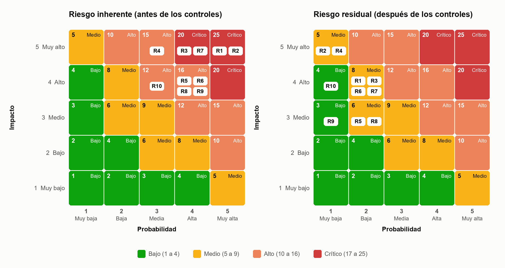{ width=6.30in }

*Figura 4.* Mapa de calor de los riesgos R1 a R10 antes y después de los controles propuestos.

## 8.4 Tratamiento y riesgo residual

Terminado el análisis hay que elegir una opción de tratamiento para cada riesgo. Las cuatro que se vieron en clase son evitar, que es dejar de hacer la actividad que genera el riesgo; mitigar, que es reducirlo con controles; transferir, que es compartirlo con un tercero mediante un seguro o un contrato, y aceptar, que es asumirlo dentro de los criterios fijados (Ochoa Agudelo, 2026c). La Tabla 17 indica la opción elegida, la recomendación de mitigación y el riesgo que queda después.

| ID | Opción | Recomendación de mitigación | P | I | Riesgo residual | Lo acepta |
|-----|-------------|-----------------------------------------|-----|-----|------------|-------------------|
| R1 | Mitigar | Segmentar, proteger la capa 2, cifrar con autenticación mutua y vigilar la red (C1, C2, C4, C8) | 2 | 4 | 8 Medio | Dirección de Tecnología |
| R2 | Evitar y mitigar | Eliminar la autorización por dirección IP y el acceso directo a la base de datos; filtrado antisuplantación y autenticación con certificado (C3, C5, C1) | 1 | 5 | 5 Medio | CISO |
| R3 | Mitigar y transferir | Cifrar y enmascarar los datos, avisar pronto a los afectados y contratar cobertura de ciberriesgo (C7, C11, C16) | 2 | 4 | 8 Medio | Dirección de Negocio Vida |
| R4 | Mitigar | Mínimo privilegio, auditoría de cambios con doble validación y copias verificadas (C5, C9, C12) | 1 | 5 | 5 Medio | Dirección de Operaciones |
| R5 | Mitigar | Plan de recuperación probado y procedimiento de incidentes (C12, C11) | 2 | 3 | 6 Medio | Dirección de Operaciones |
| R6 | Mitigar y transferir | Normativa interna aplicada, notificación en plazo y cláusulas con proveedores (C10, C11, C16) | 2 | 4 | 8 Medio | Delegado de protección de datos y Asesoría Jurídica |
| R7 | Mitigar | Comunicación transparente y formación (C11, C13) | 2 | 4 | 8 Medio | Dirección General |
| R8 | Mitigar | Cifrado del tráfico, credenciales con rotación y bastión, detección de usos anómalos (C4, C5, C8) | 2 | 3 | 6 Medio | CISO |
| R9 | Mitigar y aceptar el residual | Registros protegidos, relojes sincronizados y casos de uso de detección (C8, C9) | 1 | 3 | 3 Bajo | SOC |
| R10 | Mitigar y aceptar el residual | Control de acceso a la red, seguridad física y protecciones de capa 2 (C6, C14, C2) | 1 | 4 | 4 Bajo | Área de Redes |

*Tabla 17.* Opción de tratamiento, recomendación de mitigación y riesgo residual de cada riesgo.

Las cuatro opciones aparecen en el plan. Se evita el riesgo R2 en su origen, porque la compañía deja de autorizar conexiones por dirección IP y retira el acceso directo a la base de datos desde otros segmentos: la actividad que generaba el riesgo desaparece. Se mitigan los diez con los controles del capítulo 9. Se transfiere una parte de R3 y de R6 con una póliza de ciberriesgo y con cláusulas que reparten la responsabilidad con los proveedores. Y se aceptan los residuales de R9 y R10, que quedan en nivel bajo.

Con los controles aplicados, la suma de las puntuaciones baja de 181 a 61, una reducción del 66 %. Ocho riesgos quedan en nivel medio y dos en bajo, todos dentro del criterio de aceptación. El residual no desaparece. Como se explicó en clase, un riesgo que pasa de alto a medio sigue latente, y por eso la norma pide que los responsables lo acepten de forma expresa (Ochoa Agudelo, 2026c). En R2 y R4 el impacto sigue siendo el máximo aunque la probabilidad sea mínima, porque si un atacante vuelve a entrar a la base de datos el daño es el mismo; lo que cambian los controles es lo difícil que resulta llegar.

Ante un auditor, este capítulo se sostiene con cuatro documentos: la metodología de riesgos aprobada, el registro de riesgos con un propietario por riesgo, el plan de tratamiento con fechas y el acta en que cada propietario acepta su residual. El registro se revisa una vez al año y siempre que cambien los sistemas o haya un incidente, que son los supuestos que la guía de implantación del curso señala para repetir la evaluación (NQA, s. f.).

# 9. Actividad 6: controles de seguridad

La guía pide al menos tres controles, que pueden ser técnicos, administrativos o físicos, y la justificación de por qué cada uno es apropiado. El material del curso clasifica los controles de dos maneras. Por su función son preventivos, detectivos o correctivos. Por su naturaleza son administrativos, cuando definen cómo se gestiona la seguridad e involucran a personas y responsabilidades; técnicos, cuando son herramientas que operan de forma automática, y físicos, cuando protegen el entorno donde están los equipos (Ochoa Agudelo, 2026d). Uso las dos clasificaciones a la vez.

## 9.1 Del riesgo al control

Los controles de este capítulo no salen de un catálogo. Cada uno responde a un riesgo del capítulo 8 y a una vulnerabilidad del capítulo 6, que es el criterio que se dio en clase: primero se identifican los riesgos y después se decide qué controles hacen falta según el sistema, el tamaño y las dependencias de la empresa, porque eso es lo que luego se audita (Ochoa Agudelo, 2026c). El video sobre los controles tecnológicos visto en la misma sesión añade dos advertencias que he seguido. La norma no impone una herramienta ni una marca, de modo que cada control se describe por lo que hace y no por el producto que lo implementa. Y los controles físicos son "los grandes olvidados", aunque en un ataque que empieza en una toma de red son parte de la solución.

La Tabla 18 presenta los dieciséis controles propuestos con su clasificación, los controles del Anexo A de 2022 que desarrollan, la función del marco NIST a la que contribuyen y los riesgos que tratan.

| ID | Control | Naturaleza | Función | Anexo A | NIST CSF | Riesgos |
|-----|---------------------------------|-----------------|------------|------------|----------|----------|
| C1 | Segmentación del centro de datos: base de datos en una zona aislada tras un cortafuegos interno | Técnico | Preventivo | 8.22, 8.20 | PR.IR | R1, R2 |
| C2 | Protecciones de capa 2: DHCP snooping, inspección dinámica de ARP, IP Source Guard y seguridad de puertos | Técnico | Preventivo | 8.20, 8.21, 8.9 | PR.IR | R1, R10 |
| C3 | Filtrado antisuplantación (uRPF y filtros de entrada y salida) | Técnico | Preventivo | 8.20, 8.21 | PR.IR | R2 |
| C4 | Cifrado y autenticación mutua de las comunicaciones internas | Técnico | Preventivo | 8.24, 8.21, 5.14 | PR.DS | R1, R2, R8 |
| C5 | Autenticación fuerte y mínimo privilegio, sin confianza por dirección IP | Técnico y administrativo | Preventivo | 5.15 a 5.18, 8.2, 8.3, 8.5 | PR.AA | R2, R4, R8 |
| C6 | Control de acceso a la red (802.1X) y cierre de tomas sin uso | Técnico | Preventivo | 8.20, 8.1 | PR.AA | R10 |
| C7 | Protección del dato: cifrado en reposo y por campo, enmascaramiento y prevención de fuga | Técnico | Preventivo | 8.11, 8.12, 8.24, 5.34 | PR.DS | R1, R3 |
| C8 | Registro, monitoreo y detección | Técnico | Detectivo | 8.15, 8.16, 8.17 | DE.CM, DE.AE | R1, R2, R4, R8, R9 |
| C9 | Auditoría de cambios en datos críticos con doble validación | Técnico y administrativo | Detectivo y correctivo | 8.15, 5.3, 5.33, 8.32 | DE.CM, PR.DS | R4, R9 |
| C10 | Gobierno y normativa interna: política, normas, inventario y declaración de aplicabilidad | Administrativo | Preventivo | 5.1, 5.2, 5.9, 5.12, 5.31 | GV.PO, GV.RR, ID.AM | R6 |
| C11 | Gestión de incidentes y notificación | Administrativo | Correctivo | 5.24 a 5.28, 6.8 | RS.MA, RS.CO | R3, R5, R6, R7 |
| C12 | Continuidad y recuperación: análisis de impacto, plan, copias y pruebas | Administrativo y técnico | Correctivo | 5.29, 5.30, 8.13, 8.14 | RC.RP | R4, R5 |
| C13 | Formación y concienciación por perfil | Administrativo | Preventivo | 6.3, 6.2, 6.4 | PR.AT | R7 |
| C14 | Seguridad física del centro de datos y del cableado | Físico | Preventivo y detectivo | 7.1, 7.2, 7.4, 7.8, 7.12 | PR.AA | R10 |
| C15 | Gestión de vulnerabilidades y verificación independiente | Administrativo y técnico | Detectivo y correctivo | 8.8, 8.9, 5.35, 5.36, 8.34 | ID.RA, ID.IM | Todos |
| C16 | Gestión de terceros y transferencia del riesgo | Administrativo | Preventivo y correctivo | 5.19 a 5.22 | GV.SC | R3, R6 |

*Tabla 18.* Controles propuestos, clasificados por naturaleza y por función, con su correspondencia en el Anexo A de ISO/IEC 27001:2022 y en el marco NIST CSF 2.0.

## 9.2 Por qué cada control es apropiado y cómo se demuestra

En seguridad de la información "no basta con decir que un control existe, hay que poder demostrar que está implementado y que funciona" (Ochoa Agudelo, 2026c). La Tabla 19 justifica cada control frente al caso, indica la evidencia que pediría un auditor y propone un indicador para medirlo.

| ID | Por qué es apropiado en este caso | Evidencia para el auditor | Indicador |
|-----|-------------------------------------|------------------------------|----------------------------|
| C1 | El atacante alcanzó la base de datos porque estaba en su mismo segmento. Aislarla reduce a un puñado los equipos que pueden hablarle. | Diagrama de red vigente, reglas del cortafuegos y prueba de alcance entre zonas | Porcentaje de flujos hacia la base de datos que pasan por el cortafuegos interno |
| C2 | Es la respuesta directa al ARP spoofing: el conmutador descarta las respuestas ARP que no cuadran con su tabla. | Configuración de los conmutadores y contadores de paquetes ARP descartados | Porcentaje de puertos de acceso con las cuatro protecciones activas |
| C3 | Impide que circulen paquetes con una dirección de origen que no corresponde a la interfaz por la que entran. | Configuración de las interfaces y registros de descartes | Paquetes con origen inválido descartados al mes |
| C4 | Aunque alguien desvíe el tráfico, solo ve datos cifrados y no puede hacerse pasar por ningún extremo. | Parámetros del servidor, inventario de certificados y captura de tráfico cifrado | Porcentaje de conexiones a la base de datos con TLS mutuo |
| C5 | Quita valor a la dirección IP como credencial y limita lo que puede hacer una cuenta comprometida. | Matriz de roles aprobada, revisión trimestral de accesos y configuración de autenticación | Porcentaje de cuentas privilegiadas con doble factor; cuentas con privilegios excesivos |
| C6 | Un equipo desconocido no obtiene red hasta autenticarse, lo que cierra la vía de entrada más probable. | Política de acceso a la red, lista de tomas deshabilitadas y registros de autenticación | Equipos no autorizados bloqueados al mes |
| C7 | Si los datos vuelven a salir, los campos sensibles son ilegibles, y eso reduce el daño a los clientes. | Esquema de cifrado, política de enmascaramiento e informes de prevención de fuga | Porcentaje de campos sensibles cifrados o enmascarados |
| C8 | El ataque no generó alertas a tiempo. Este control acorta la detección de días a minutos. | Casos de uso documentados, alertas atendidas y retención de registros | Tiempo medio de detección y de respuesta |
| C9 | Detecta y permite revertir un cambio indebido de beneficiario, cuenta o capital. | Registro de auditoría, tiques de cambio y acta de conciliación | Cambios críticos sin tique de autorización |
| C10 | Sin responsable ni norma, las protecciones técnicas dependen de la iniciativa de cada administrador. | Política firmada, inventario vigente, declaración de aplicabilidad y actas del comité | Porcentaje de activos con propietario y clasificación |
| C11 | Los plazos legales son de horas. Sin procedimiento ensayado no se cumplen. | Procedimiento aprobado, registro de incidentes, actas de simulacros y justificantes de notificación | Porcentaje de incidentes notificados dentro de plazo |
| C12 | La operación se interrumpió. Un plan probado acota la parada y permite restaurar datos íntegros. | Análisis de impacto, plan aprobado e informes de pruebas de restauración | Tiempos de recuperación alcanzados en la última prueba |
| C13 | Quienes configuran la red y quienes atienden al cliente deben conocer la norma y saber qué hacer ante un incidente. | Plan de formación, asistencia y resultados de simulaciones | Porcentaje de personal formado |
| C14 | El envenenamiento ARP exige estar en la red local. Controlar salas, armarios y tomas quita la oportunidad. | Registros de acceso físico, grabaciones e inventario de tomas | Accesos físicos no autorizados detectados |
| C15 | Una prueba interna habría encontrado las vulnerabilidades antes que el atacante, y confirma que el cierre es real. | Informes de escaneo y de pruebas de intrusión, plan de acciones e informe de auditoría | Porcentaje de hallazgos críticos cerrados en plazo |
| C16 | Parte del riesgo viene de terceros y parte del costo puede cubrirse con un seguro. | Contratos con cláusulas de seguridad, evaluaciones de proveedores y póliza vigente | Porcentaje de proveedores críticos evaluados en el año |

*Tabla 19.* Justificación de cada control frente al caso, evidencia que lo demuestra e indicador de seguimiento.

Por naturaleza, once controles tienen componente técnico, ocho administrativo y uno es físico. Por función, once previenen, cuatro detectan y cinco corrigen (algunos cumplen dos funciones). El reparto busca que la prevención no sea la única línea, que es lo que falló en el caso: había protección y no había detección dentro de la red.

## 9.3 La arquitectura que resulta

La Figura 5 muestra cómo quedan los controles técnicos sobre la red. Un equipo solo entra si se autentica. El conmutador al que se conecta valida las respuestas ARP. Las aplicaciones llegan a la base de datos por una única ruta, a través del cortafuegos interno y con TLS mutuo. Los administradores entran por un bastión con doble factor y su sesión queda registrada. Todo deja registros en la plataforma de monitoreo.

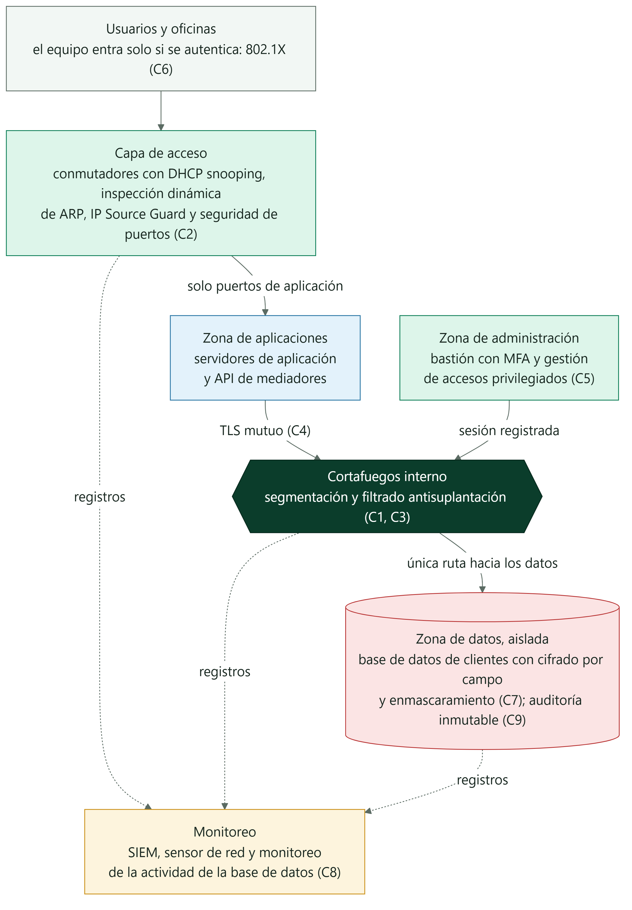{ width=4.59in }

*Figura 5.* Arquitectura de red propuesta. Entre paréntesis, el control de la Tabla 18 que actúa en cada punto.

Como ilustración de lo que significa el control C2 en la práctica, este es un extracto de configuración de referencia para un conmutador de acceso. La sintaxis corresponde a un fabricante concreto y es solo un ejemplo; el control vale igual con cualquier otro.

```
ip dhcp snooping
ip dhcp snooping vlan 20
ip arp inspection vlan 20
ip arp inspection validate src-mac dst-mac ip
!
interface range GigabitEthernet1/0/2 - 48
 switchport mode access
 switchport access vlan 20
 switchport port-security
 switchport port-security maximum 2
 switchport port-security violation restrict
 ip verify source port-security
 ip arp inspection limit rate 15
```

La evidencia de que funciona no es el archivo de configuración. Es el contador de paquetes ARP descartados que el propio conmutador mantiene y que debe llegar al SIEM.

## 9.4 Declaración de aplicabilidad

La declaración de aplicabilidad es el documento que indica qué controles del Anexo A necesita la organización, con su justificación, y cuáles excluye y por qué. En clase se presentó como uno de los conceptos que hay que aprender sí o sí, porque no significa implementar de forma indiscriminada los más de noventa controles de la norma, sino los que el análisis de riesgos justifica (Ochoa Agudelo, 2026c). En España tiene además respaldo legal: el Real Decreto 43/2021 pide que las medidas adoptadas se formalicen en una declaración de aplicabilidad suscrita por el responsable de seguridad de la información e incluida en la política que aprueba la Dirección. La Tabla 20 resume la que corresponde al alcance de este trabajo.

| Controles del Anexo A | ¿Aplica? | Justificación | Se implementa con |
|------------------------------------|------------|--------------------------------------|--------------|
| 5.1, 5.2, 5.4 Políticas, funciones y responsabilidades de la dirección | Sí | La red interna y el dato necesitan responsables y reglas aprobadas | C10 |
| 5.9, 5.12, 5.13 Inventario, clasificación y etiquetado | Sí | Sin clasificación no hay criterio para exigir cifrado | C10 |
| 5.15 a 5.18 Control de acceso, identidades y autenticación | Sí | R2, R4 y R8 | C5 |
| 5.19 a 5.22 Seguridad con proveedores | Sí | Terceros con acceso a la red y a los datos | C16 |
| 5.24 a 5.28 Gestión de incidentes y recogida de evidencias | Sí | Plazos legales de 4 a 72 horas | C11 |
| 5.29, 5.30 Seguridad durante la interrupción y preparación de las TIC | Sí | R5 | C12 |
| 5.31, 5.34 Requisitos legales y protección de datos personales | Sí | RGPD, LOPDGDD y DORA | C7, C10 |
| 5.35, 5.36 Revisión independiente y cumplimiento | Sí | Verificar que el cierre de brechas es real | C15 |
| 6.3, 6.8 Formación y notificación de eventos | Sí | Personas que configuran, operan y atienden | C13, C11 |
| 7.1, 7.2, 7.4, 7.8, 7.12 Perímetro, acceso físico, vigilancia, ubicación de equipos y cableado | Sí | El ataque exige presencia en la red local | C14 |
| 8.2, 8.3, 8.5 Privilegios, restricción de acceso y autenticación segura | Sí | V3 y V8 | C5 |
| 8.8, 8.9 Vulnerabilidades técnicas y gestión de la configuración | Sí | Las debilidades eran de configuración | C15, C2 |
| 8.11, 8.12, 8.24 Enmascaramiento, prevención de fuga y criptografía | Sí | V4 y V8 | C4, C7 |
| 8.13, 8.14 Copias de seguridad y redundancia | Sí | R4 y R5 | C12 |
| 8.15, 8.16, 8.17 Registro, monitoreo y sincronización de relojes | Sí | V7 | C8, C9 |
| 8.20, 8.21, 8.22 Seguridad, servicios y segregación de redes | Sí | V1, V2 y V5: el origen del incidente | C1, C2, C3, C6 |
| 8.32 Gestión de cambios | Sí | Evitar que una protección se desactive sin aprobación | C9, C10 |
| 8.4, 8.25 a 8.31, 8.33 Código fuente, desarrollo seguro y datos de prueba | No, en este alcance | El alcance es la operación del servicio de pólizas; el desarrollo de software tiene su propio alcance | No procede |
| 7.9 Seguridad de los activos fuera de las instalaciones | No, en este alcance | Los activos del alcance no salen del centro de datos | No procede |
| 8.23 Filtrado web | No, en este alcance | Corresponde al alcance de puesto de trabajo, no al del centro de datos | No procede |

*Tabla 20.* Resumen de la declaración de aplicabilidad para el servicio de pólizas de vida, con las inclusiones y las exclusiones justificadas.

Cada exclusión remite al alcance definido en el apartado 2.2 y dejaría de valer si ese alcance cambiara.

# 10. Actividad 7: cierre de brechas de seguridad

La guía parte de que la empresa ya fue atacada y pregunta cómo deben cerrarse las brechas detectadas y cómo lograr que los sistemas resistan nuevos ataques. El material del curso define el cierre de brechas como "la identificación de vulnerabilidades en los sistemas tecnológicos y la implementación de medidas correctivas para prevenir que los atacantes exploten esas debilidades", y describe un proceso de tres pasos: análisis de la vulnerabilidad, desarrollo de la solución y validación de que la solución resolvió el problema (Ochoa Agudelo, 2026d). De los tipos de brecha que enumera, el caso reúne dos: una brecha de acceso, por la red sin segmentar, y una deficiencia en el sistema de autenticación, por fiarse de la dirección IP.

## 10.1 El proceso de cierre

Cada vulnerabilidad del capítulo 6 se cierra con los mismos tres pasos, a los que añado un cuarto que el caso hace necesario.

El análisis determina qué permitió exactamente el ataque y hasta dónde llega el problema. No basta con arreglar el conmutador donde se detectó el envenenamiento; hay que revisar todos los del centro de datos, porque la misma configuración de fábrica estará en todos.

La solución se diseña y se aplica como un cambio controlado. Cada modificación de la red o de la base de datos pasa por la gestión de cambios, con alguien que la pide, alguien que la aprueba y un plan de marcha atrás, que es lo que exige el control 8.32 del Anexo A (ISO/IEC, 2022b).

La validación comprueba que la brecha ya no se puede explotar. Es el paso que distingue cerrar una brecha de creer que se cerró, y se hace intentando de nuevo el ataque en condiciones controladas.

El cuarto paso es dejar evidencia. Una brecha se da por cerrada cuando existe la prueba de su validación y el propietario del activo la firma. Es la misma secuencia que la norma pide para cualquier no conformidad: se identifica, se corrige, se analiza la causa, se aplica la acción correctiva y se verifica su eficacia (Ochoa Agudelo, 2026c).

## 10.2 Plan de cierre por horizontes

Las brechas no se cierran todas a la vez. Unas medidas pueden activarse en horas y otras exigen compras, pruebas y ventanas de mantenimiento. La Tabla 21 ordena el trabajo en cuatro horizontes, y la Figura 6 lo sitúa en el calendario a partir del 10 de marzo.

| Horizonte | Acciones | Brechas | Responsable | Criterio de cierre |
|-----------------|----------------------------------|---------------|---------------|-------------------|
| Contención, 0 a 7 días | Aislar la base de datos con listas de acceso provisionales. Rotar todas las credenciales de servicio y de administración. Activar la inspección de ARP y la seguridad de puertos en los conmutadores del centro de datos. Preservar las evidencias. Notificar a las autoridades y a los afectados. | V2 y, de forma provisional, V1 y V8 | Área de Redes y CISO | Contadores de descartes ARP activos; credenciales anteriores revocadas; justificantes de las notificaciones |
| Corrección, 8 a 30 días | TLS mutuo entre la aplicación y la base de datos. Retirar la autorización por dirección IP. Casos de uso de detección en el SIEM y relojes sincronizados. | V3, V4 y V7 | Dirección de Tecnología y SOC | Captura que muestra el tráfico cifrado; conexión sin certificado rechazada; alerta de prueba generada y atendida |
| Refuerzo, 31 a 90 días | Segmentación definitiva con cortafuegos interno y filtrado antisuplantación. Control de acceso a la red y cierre de tomas sin uso. Cifrado por campo y enmascaramiento. Auditoría de cambios con doble validación. | V1, V5, V6 y V8 | Área de Redes, Dirección de Tecnología y Dirección de Operaciones | Prueba de alcance entre zonas; equipo no registrado sin acceso a la red; campos sensibles ilegibles en una consulta directa |
| Consolidación, 91 a 180 días | Prueba de intrusión interna que reproduzca el ataque. Simulacro del plan de recuperación y de crisis. Auditoría interna y revisión por la Dirección. Actualización de las normas internas y de la declaración de aplicabilidad. | V9 | CISO, Auditoría Interna y Dirección General | Informe de la prueba sin hallazgos críticos; actas de la auditoría y de la revisión |

*Tabla 21.* Plan de cierre de brechas por horizontes, con responsable y criterio de cierre.

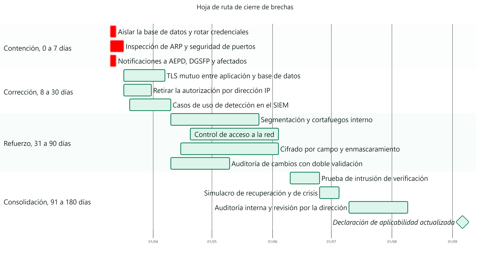{ width=6.30in }

*Figura 6.* Hoja de ruta de cierre de brechas. Las tareas en rojo son las de contención de la primera semana.

El orden responde a dos criterios. Primero va lo que corta el ataque con menos cambios: activar funciones que los conmutadores ya tienen y cambiar credenciales que hay que dar por comprometidas. Después va lo que elimina la causa, que es el cifrado con autenticación mutua y la retirada de la confianza por dirección. La segmentación definitiva y el control de acceso a la red llegan en el tercer horizonte porque tocan la arquitectura y necesitan pruebas previas para no interrumpir el servicio.

## 10.3 Validar que el cierre es real

Cada horizonte termina con una comprobación y no con una declaración. Tres técnicas se complementan. La primera es repetir el ataque: un equipo de pruebas intenta envenenar ARP y suplantar la dirección del servidor de aplicaciones, y el resultado esperado es que el conmutador descarte los paquetes y la base de datos rechace la conexión. La segunda es auditar la configuración de todos los equipos contra la línea base aprobada, porque basta un conmutador sin proteger para reabrir la brecha. La tercera es mirar los indicadores del capítulo 9 durante varias semanas: si el porcentaje de conexiones con TLS mutuo no llega al cien por cien, queda algún sistema fuera.

El precedente de la propia compañía muestra que este trabajo es posible bajo presión. Tras el ataque de agosto de 2020, Mapfre extendió en tres días el doble factor a todos los accesos remotos, reforzó la protección de sus copias de seguridad y ejecutó un plan de fortificación de su entorno, medidas que la AEPD valoró al archivar el expediente (AEPD, 2021).

## 10.4 Mitigar futuras brechas y ganar resiliencia

Cerrar las brechas del incidente no impide que aparezcan otras. Cuatro prácticas mantienen el cierre en el tiempo.

La línea base de configuración, con detección de desviaciones, evita que un cambio posterior desactive una protección sin que nadie lo note. La gestión de vulnerabilidades, hecha de forma proactiva, revisa de manera periódica los sistemas en busca de debilidades nuevas, tanto de software como de configuración. Las pruebas periódicas confirman desde fuera lo que la organización cree de sí misma; DORA dedica sus artículos 24 a 27 a las pruebas de resiliencia operativa digital y prevé pruebas de penetración basadas en amenazas para las entidades de mayor tamaño. Y las auditorías periódicas, que el material del curso señala como necesarias "para detectar nuevas brechas de seguridad" (Ochoa Agudelo, 2026d), comprueban que las normas internas se cumplen.

La resiliencia va un paso más allá de cerrar brechas. El curso la define como la capacidad de una organización para "resistir, absorber, recuperarse y adaptarse a eventos adversos", y propone un marco de tres momentos (Ochoa Agudelo, 2026e). La anticipación comprende el análisis de riesgos del capítulo 8 y los simulacros de mesa. La respuesta aguda es la toma de decisiones bajo presión, que se entrena con el plan de recuperación del capítulo 14. La evolución es "la adaptación de la arquitectura de red tras la crisis", que en este caso es literal: la red que salga del plan de cierre no será la misma que tenía la compañía el 10 de marzo. La pregunta que ese marco propone ya no es si habrá otro ataque, es cuándo llegará y cómo lo superará la organización.

# 11. Actividad 8: monitoreo de seguridad

La guía pide diseñar un plan de monitoreo que tenga en cuenta el incidente y que proponga herramientas y técnicas para detectar accesos no autorizados y actividades maliciosas. El punto de partida es lo que el caso deja ver: el equipo de TI detectó los accesos cuando ya se habían producido. La compañía tenía capacidad de vigilancia, y la resolución de la AEPD describe un Centro de Control General que en 2020 detectó por monitorización el fallo de sus aplicaciones siete minutos después de iniciarse el cifrado (AEPD, 2021). Lo que el incidente de marzo revela es un punto ciego concreto: el tráfico entre equipos dentro del centro de datos y la actividad de la base de datos.

## 11.1 Objetivos del plan

El plan se propone detectar cinco cosas que el 10 de marzo no se detectaron a tiempo: el envenenamiento ARP y la suplantación de IP en el momento en que ocurren; los accesos a la base de datos que se salen del patrón normal; el uso anómalo de cuentas de servicio y de administración; los cambios no autorizados en los datos y en la configuración, y la presencia de equipos desconocidos en la red. Fija además dos metas medibles: detectar en menos de quince minutos cualquiera de los casos críticos y contenerlo en menos de una hora.

## 11.2 Arquitectura de monitoreo

La Figura 7 muestra el recorrido de un evento. Las fuentes generan registros, que viajan cifrados y con la hora sincronizada a un almacén que no admite modificaciones. El SIEM los correlaciona con los casos de uso definidos y, cuando una condición se cumple, lanza una alerta que atiende el centro de operaciones de seguridad. Si la alerta se confirma, pasa al equipo de respuesta, y si hay datos personales afectados, al delegado de protección de datos y a la Asesoría Jurídica, que tienen los plazos de notificación en la mano.

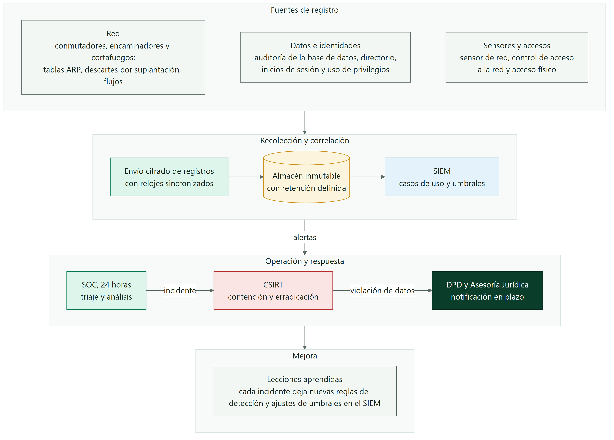{ width=6.30in }

*Figura 7.* Arquitectura del plan de monitoreo: fuentes de registro, recolección, correlación, operación y mejora.

Tres controles del Anexo A sostienen esta arquitectura. El 8.15 exige generar, proteger, almacenar y analizar los registros. El 8.16 pide vigilar las redes y los sistemas para detectar comportamientos anómalos. El 8.17 obliga a sincronizar los relojes con una fuente de tiempo fiable para que todos los registros compartan la misma hora (ISO/IEC, 2022b). El último parece menor y no lo es: sin relojes sincronizados no se puede reconstruir en qué orden ocurrieron un envenenamiento ARP en un conmutador y una sesión en la base de datos.

## 11.3 Herramientas y técnicas

La norma no impone productos, así que la Tabla 22 describe cada herramienta por su función. La tercera columna indica qué habría visto en el incidente.

| Herramienta o técnica | Qué vigila | Qué habría visto en el caso |
|-------------------------------|--------------------------------|------------------------------------|
| Inspección dinámica de ARP con registro en los conmutadores | Respuestas ARP que no coinciden con la tabla de asignaciones | El envenenamiento en el instante de producirse, con el puerto de origen |
| Sensor de red en el segmento de datos, con vigilancia de las parejas IP y MAC | Cambios de la dirección física asociada a una IP crítica y direcciones duplicadas | La IP de la base de datos anunciándose desde otra tarjeta de red |
| Registros del cortafuegos interno y del filtrado antisuplantación | Flujos denegados y paquetes con origen inválido | Paquetes con la IP del servidor de aplicaciones llegando por una interfaz que no le corresponde |
| Monitoreo de la actividad de la base de datos (auditoría nativa) | Quién consulta qué, cuánto, a qué hora y con qué programa | Consultas masivas fuera de patrón y un cliente distinto de la aplicación |
| SIEM con reglas de correlación | La relación entre eventos de fuentes distintas | Una anomalía ARP seguida de una sesión nueva en la base de datos desde esa misma dirección |
| Análisis de comportamiento de cuentas | Usos inusuales de cuentas de servicio y de administración | La cuenta de la aplicación activa de madrugada |
| Control de integridad de la configuración | Cambios en conmutadores, cortafuegos y base de datos respecto a la línea base | Una protección desactivada |
| Control de acceso a la red y registros de acceso físico | Equipos nuevos en la red y entradas a las salas técnicas | Un equipo desconocido en el segmento del centro de datos |
| Registros señuelo en la base de datos | Lecturas de pólizas ficticias que ninguna operación legítima consulta | Una extracción masiva, que inevitablemente los toca |

*Tabla 22.* Herramientas y técnicas de monitoreo propuestas y lo que cada una habría detectado en el incidente.

El SIEM es la pieza que une las demás. El video visto en clase advierte que la norma no obliga a tenerlo y que un control de registro puede evidenciarse de otras formas, aunque añade que una herramienta así, bien implantada, facilita mucho el cumplimiento de los controles 8.15 y 8.16. En una aseguradora con centro de control propio y obligación de detectar bajo el artículo 10 de DORA, la cuestión es qué casos de uso tiene cargados.

## 11.4 Casos de uso de detección

Sin casos de uso, un SIEM solo almacena registros. La Tabla 23 define los ocho que cubren el ataque del caso, con la condición que dispara la alerta, su severidad y la primera acción.

| Caso de uso | Fuente | Condición de alerta | Severidad | Respuesta inicial |
|-------------------------|--------------|-------------------------------|-------------|-----------------|
| Cambio de la dirección física asociada a la IP de un servidor crítico | Sensor de red y conmutador | La pareja IP y MAC de la base de datos o del servidor de aplicaciones cambia | Crítica | Aislar el puerto de origen y abrir incidente |
| Descartes de la inspección de ARP | Conmutador | Más de diez descartes por minuto en un puerto | Alta | Bloquear el puerto y revisar el equipo conectado |
| Paquetes con origen inválido | Encaminador y cortafuegos | Cualquier descarte con una dirección de origen de la zona de datos | Alta | Localizar la interfaz de entrada e investigar |
| Conexión a la base de datos sin certificado válido o desde fuera de la zona de aplicaciones | Base de datos y cortafuegos | Intento rechazado | Alta | Bloquear el origen y analizarlo |
| Consulta masiva o fuera de horario | Monitoreo de la base de datos | Más registros de clientes de los que usa una operación normal, o actividad de una cuenta de servicio entre las 22:00 y las 6:00 | Crítica | Suspender la sesión y avisar al propietario del dato |
| Cambio en un campo crítico sin tique | Registro de auditoría de cambios | Tique de cambio vacío | Crítica | Revertir con el valor anterior y escalar (capítulo 16) |
| Equipo no registrado en la red del centro de datos | Control de acceso a la red | Autenticación fallida repetida en una toma | Media | Localizar la toma y revisar el acceso físico |
| Hueco en la cadena del registro de auditoría | Almacén de registros | La verificación de integridad falla | Crítica | Preservar la copia íntegra e investigar quién lo alteró |

*Tabla 23.* Casos de uso de detección derivados del incidente.

El primero y el quinto habrían bastado para detectar el ataque el mismo día. El primero es propio de este tipo de ataque: la dirección física de un servidor de base de datos no cambia casi nunca, así que cualquier cambio merece una alerta crítica con muy pocos falsos positivos.

## 11.5 Indicadores y organización

Para saber si el monitoreo funciona hay que medirlo. En clase se puso el ejemplo del doble factor, que se mide con el porcentaje de cuentas cubiertas, los accesos bloqueados, los incidentes de credenciales, los usuarios con privilegios excesivos y el tiempo de respuesta (Ochoa Agudelo, 2026c). La Tabla 24 aplica la misma lógica al plan.

| Indicador | Meta | Revisión |
|-------------------------------------------------|---------------------------------|------------|
| Tiempo medio de detección de los casos críticos | Menos de 15 minutos | Mensual |
| Tiempo medio de contención | Menos de 1 hora | Mensual |
| Activos críticos que envían registros al SIEM | 100 % | Mensual |
| Alertas críticas atendidas dentro de plazo | 95 % o más | Mensual |
| Simulaciones de ataque detectadas | 100 % de las pruebas trimestrales | Trimestral |
| Registros conservados durante el periodo definido | 100 % | Semestral |

*Tabla 24.* Indicadores del plan de monitoreo.

La operación se reparte en tres niveles. El centro de operaciones de seguridad atiende las alertas las 24 horas y hace el primer análisis. El equipo de respuesta a incidentes, el CSIRT que el curso sitúa en la fase de preparación (Ochoa Agudelo, 2026e), se ocupa de la contención y la erradicación. El delegado de protección de datos y la Asesoría Jurídica deciden las notificaciones. Los casos de uso se revisan cada mes y después de cada incidente, y cada trimestre se lanza un ataque simulado para comprobar que las alertas saltan. Lo que un auditor pediría es el plan aprobado, la lista de casos de uso, una muestra de alertas con su tratamiento y los resultados de esas simulaciones.

# 12. Actividad 9: afectación financiera

La guía pide estimar el impacto financiero del incidente, con los costos de recuperación y las multas, y listar los costos directos e indirectos. El enunciado habla de "pérdidas económicas significativas debido al fraude" sin dar cifras, y Mapfre no ha publicado ninguna porque el caso es un escenario de estudio. La estimación que sigue es propia. No pretende acertar un importe: busca el orden de magnitud y, sobre todo, saber qué partidas pesan más, que es lo que orienta dónde invertir.

## 12.1 Cómo se construye la estimación

El modelo trabaja con tres escenarios definidos por dos variables que el caso deja abiertas: cuántos clientes resultaron afectados y cuántos días duró la degradación del servicio (supuestos S5 y S7). El escenario bajo supone 50.000 afectados y un día; el base, 250.000 y tres días; el alto, un millón y siete días. Cada partida se calcula con un supuesto explícito, que figura en la tabla para que cualquiera pueda discutirlo o cambiarlo.

Llamo costos directos a los desembolsos que el incidente obliga a hacer de inmediato: la respuesta, las notificaciones, las compensaciones, el refuerzo técnico y las multas. Llamo indirectos a los efectos sobre el negocio, que llegan después y son más difíciles de atribuir: lo que se deja de ganar durante la parada, los clientes que se van y lo que cuesta recuperarlos.

## 12.2 Costos directos e indirectos

| Código | Concepto | Supuesto de cálculo | Bajo | Base | Alto |
|---------|----------------------------|-----------------------------------------|-------|-------|--------|
| D1 | Respuesta al incidente y análisis forense | Equipo externo de respuesta y peritaje | 250 | 600 | 1.500 |
| D2 | Asesoría jurídica y gestión regulatoria | Notificaciones, requerimientos y defensa | 100 | 300 | 900 |
| D3 | Notificación a los afectados | 1,2 euros por afectado | 60 | 300 | 1.200 |
| D4 | Refuerzo del centro de atención al cliente | Personal y líneas adicionales | 150 | 400 | 1.000 |
| D5 | Servicio antifraude ofrecido a los clientes | 6 euros por cliente que lo acepta (10, 15 y 20 %) | 30 | 225 | 1.200 |
| D6 | Reembolso de fraudes a clientes | 0,05, 0,1 y 0,2 % de los afectados, con 1.800 euros de pérdida media | 45 | 450 | 3.600 |
| D7 | Refuerzo técnico urgente (red, cifrado y monitoreo) | Equipos, licencias y servicios de implantación | 400 | 1.200 | 3.000 |
| D8 | Auditorías de seguridad extraordinarias | Auditoría independiente y prueba de intrusión | 80 | 200 | 500 |
| D9 | Multa administrativa | Archivo, sanción media y sanción del orden de la impuesta a Generali | 0 | 1.500 | 5.000 |
| D10 | Franquicia y encarecimiento del ciberseguro | Franquicia del siniestro y subida de la prima | 50 | 250 | 750 |
| | **Subtotal de costos directos** | | **1.165** | **5.425** | **18.650** |
| I1 | Interrupción operativa | Margen no realizado por día de servicio degradado (1, 3 y 7 días) | 150 | 450 | 1.400 |
| I2 | Pérdida de clientes | Bajas del 0,5, 1,5 y 3 % de los afectados, con 120 euros de margen anual durante 3 años | 90 | 1.350 | 10.800 |
| I3 | Recaptación comercial y campaña de reputación | Campañas, incentivos a mediadores y comunicación | 100 | 600 | 2.500 |
| I4 | Reclamaciones e indemnizaciones | Indemnizaciones del artículo 82 del RGPD y litigios | 0 | 300 | 2.000 |
| | **Subtotal de costos indirectos** | | **340** | **2.700** | **16.700** |
| | **Total estimado** | | **1.505** | **8.125** | **35.350** |

*Tabla 25.* Costos directos e indirectos del incidente en tres escenarios, en miles de euros. Estimación propia con supuestos explícitos; no son cifras de la compañía.

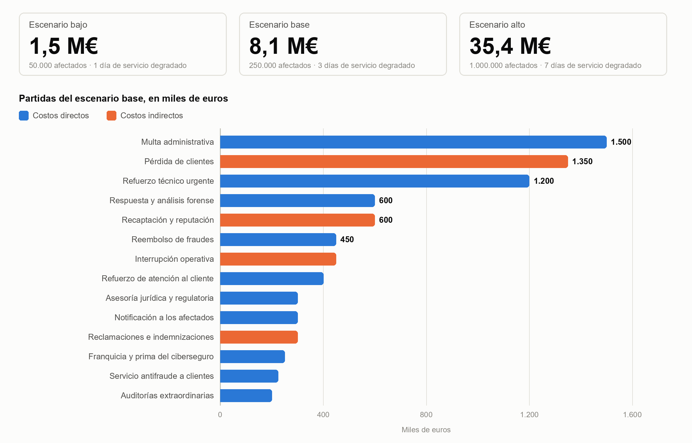{ width=6.30in }

*Figura 8.* Costo total estimado por escenario y partidas del escenario base ordenadas de mayor a menor.

## 12.3 Qué dicen las cifras

El incidente cuesta entre 1,5 y 35,4 millones de euros según su alcance, con 8,1 millones en el escenario base. Equivale a entre 30 y 35 euros por cliente afectado en los tres escenarios. Como referencia externa, el informe anual de IBM sitúa en 4,99 millones de dólares el costo medio mundial de una brecha de datos y en 6,3 millones el del sector financiero, el segundo más alto de los que analiza (IBM, 2026). El escenario base queda en ese mismo orden de magnitud, lo que da cierta confianza en los supuestos.

Tres partidas concentran la mitad del escenario base: la multa (1,5 millones), la pérdida de clientes (1,35 millones) y el refuerzo técnico urgente (1,2 millones). Ninguna de las tres es el costo de responder al ataque. Son la sanción por no haber tenido medidas adecuadas, el precio de la confianza perdida y la inversión que se había aplazado.

El peso de los costos indirectos crece con la gravedad: representan el 23 % en el escenario bajo, el 33 % en el base y el 47 % en el alto. En el escenario alto la pérdida de clientes sola, con 10,8 millones, supera a cualquier otra partida y duplica la multa. Cuanto mayor es la brecha, más se parece el problema financiero a un problema de reputación, y por eso el capítulo siguiente trata la comunicación como una medida de contención de costos.

## 12.4 Costos de recuperación

La recuperación técnica en sentido estricto reúne tres partidas: la respuesta y el análisis forense, el refuerzo técnico urgente y las auditorías extraordinarias. Suman 730.000 euros en el escenario bajo, 2 millones en el base y 5 millones en el alto, cerca de una cuarta parte del total en el escenario base. Si se añade lo que cuesta atender a los afectados (notificación, centro de atención, servicio antifraude y reembolsos), la cifra del escenario base sube a 3,4 millones.

El refuerzo técnico urgente merece una observación. Es, en esencia, el plan de cierre de brechas del capítulo 10 ejecutado con prisa. Aun suponiendo que prevenir hubiera costado lo mismo, 1,2 millones, el incidente del escenario base cuesta casi siete veces más. El mismo informe de IBM calcula que las organizaciones que usan de forma amplia la automatización y la inteligencia artificial en sus operaciones de seguridad ahorran cerca de 2 millones de dólares por brecha (IBM, 2026), un dato que respalda la inversión en detección del capítulo 11.

## 12.5 Multas

El RGPD fija dos techos. Las infracciones de las obligaciones del responsable, entre ellas las medidas de seguridad del artículo 32 y las notificaciones de los artículos 33 y 34, pueden sancionarse con hasta 10 millones de euros o el 2 % del volumen de negocio anual mundial, la cifra que sea mayor (artículo 83.4). Las infracciones de los principios del artículo 5, incluido el de integridad y confidencialidad, llegan a 20 millones o el 4 % (artículo 83.5). Para un grupo que ingresó unos 34.500 millones de euros en 2025 (MAPFRE, 2026c), esos porcentajes equivalen a unos 690 y 1.380 millones. Son techos teóricos. Las sanciones reales en España quedan muy por debajo, como muestra la Tabla 26.

| Referencia | Hechos | Resultado |
|--------------|--------------------------|------------------------------------------------------------|
| Techo legal del RGPD | Infracción del artículo 5 o de los artículos 25, 32, 33 y 34 | Hasta 20 millones de euros o el 4 % del volumen de negocio; hasta 10 millones o el 2 % |
| Generali España | Ciberataque de 2022 con filtración de datos de antiguos clientes | Multa de 5 millones de euros, reducida a 4 millones por pronto pago, por infringir entre otros el artículo 5.1.f del RGPD, que exige una seguridad adecuada de los datos (Europa Press, 2025). La compañía la ha recurrido |
| Mapfre España | Ataque con programa de secuestro en agosto de 2020 | Archivo de las actuaciones sin sanción: la compañía tenía medidas razonables y reaccionó con diligencia (AEPD, 2021) |

*Tabla 26.* Techo legal y dos precedentes españoles en el sector asegurador.

Los dos precedentes son del mismo sector y tienen resultados opuestos. La diferencia no está en la gravedad del ataque. Está en lo que la autoridad encontró al investigar: medidas previas adecuadas, detección rápida, notificación en plazo y transparencia en un caso; deficiencias en la seguridad de los datos en el otro. Por eso el modelo usa 0, 1,5 y 5 millones como multa de cada escenario. La ley orgánica española añade criterios para graduar la sanción, como el carácter continuado de la infracción o la vinculación de la actividad del infractor con el tratamiento de datos (artículo 76 de la LOPDGDD), y este último pesa en contra de una aseguradora, cuyo negocio consiste en tratar datos personales.

Si la base de datos fuera de una filial colombiana, la Superintendencia de Industria y Comercio podría imponer multas de hasta 2.000 salarios mínimos mensuales, sucesivas mientras persista el incumplimiento, además de suspender las actividades de tratamiento hasta por seis meses (artículo 23 de la Ley 1581 de 2012).

## 12.6 Lo que el modelo no cuantifica

Cuatro efectos quedan fuera de la tabla porque no hay base razonable para ponerles cifra. El primero es la reacción de la cotización, que afecta al valor de la compañía y no a su cuenta de resultados. El segundo es el costo de oportunidad: durante meses, la dirección y los equipos de tecnología dedican a la crisis el tiempo que tenían para otros proyectos. El tercero es el mayor escrutinio del supervisor, con requerimientos e inspecciones que consumen recursos durante años. El cuarto es el efecto sobre los mediadores, que pueden desviar negocio hacia otras compañías si sus clientes desconfían. Todos empujan el costo real por encima de la estimación.

# 13. Actividad 10: afectación reputacional

La guía pide analizar cómo el daño reputacional puede afectar a Mapfre, qué acciones correctivas podrían restaurar la confianza de los clientes y qué estrategias de comunicación y transparencia debería aplicar la empresa. El material del curso recuerda que un incidente de seguridad "no es simplemente una falla técnica", porque toca la reputación institucional y la confianza del cliente, y que la gestión de la crisis involucra la reputación, la legalidad y la continuidad del negocio al más alto nivel de la organización (Ochoa Agudelo, 2026e).

## 13.1 Cómo afecta el daño reputacional a una aseguradora

Una póliza de vida es un contrato a muchos años en el que el cliente entrega datos íntimos y confía en que, llegado el momento, la compañía pagará a quien él designó. La reputación es parte del producto. Cuando se sabe que terceros accedieron a esos datos, el daño se reparte por varios frentes.

Los clientes afectados cancelan o no renuevan, y los que estaban por contratar eligen otra compañía. Es la partida que más pesa en el modelo financiero: entre el 0,5 y el 3 % de bajas adicionales según el escenario. Los mediadores y agentes pierden su argumento de venta y dedican tiempo a dar explicaciones; los corredores, que trabajan con varias aseguradoras, pueden recomendar a otra. Los socios de distribución y los reaseguradores revisan sus acuerdos y piden garantías. El supervisor mira a la compañía con más atención durante años. El mercado descuenta la incertidumbre en la cotización. Los empleados también lo sufren: quien atiende al público recibe la queja, y el personal técnico trabaja bajo sospecha.

Hay además un efecto de segunda ronda que agrava todo lo anterior. Los delincuentes aprovechan la noticia para enviar a los clientes mensajes que se hacen pasar por la compañía y que piden "verificar" sus datos. Cada fraude nuevo se atribuye, con razón o sin ella, a la brecha original.

## 13.2 Principios de la comunicación en crisis

La comunicación no repara por sí sola el daño. Lo que sí hace es evitar que aumente, y para eso tiene que cumplir cinco condiciones. Debe ser rápida, para que la compañía cuente lo ocurrido antes de que lo cuenten otros. Debe ser veraz, y ceñirse a hechos confirmados sin minimizar ni especular. Debe ser útil, lo que significa decirle al cliente qué riesgo corre y qué puede hacer. Debe ser coherente, con un solo portavoz y el mismo relato para todos los públicos. Y debe ser sostenida, con actualizaciones hasta el cierre del incidente.

Esas condiciones coinciden con lo que la ley exige. El artículo 34 del RGPD obliga a comunicar la violación a los interesados en un lenguaje claro y sencillo cuando sea probable un alto riesgo para sus derechos, y a explicar la naturaleza de lo ocurrido, las consecuencias probables, las medidas adoptadas y un punto de contacto.

El precedente de la propia compañía muestra que la transparencia también cuenta ante el regulador. En agosto de 2020, Mapfre publicó un comunicado oficial en su página web al día siguiente del ataque y contactó esa misma noche con los equipos de seguridad de sus principales socios. Al archivar el expediente, la AEPD valoró que "la rapidez para hacer público el ciberataque permitió la eficaz actuación de clientes, trabajadores, colaboradores y proveedores, minimizando los efectos del ciberataque" (AEPD, 2021). En el caso de marzo, el enunciado dice que la brecha se divulgó públicamente y no aclara quién lo hizo. Si la noticia salió de terceros, la compañía perdió la iniciativa, y recuperarla es el primer objetivo del plan.

El curso ofrece un ejemplo del mismo mecanismo en la banca: mientras el equipo técnico mitiga un ataque de denegación de servicio, el Comité de Crisis activa el protocolo de comunicación para informar a los usuarios de que sus fondos están seguros y evita así el pánico y la pérdida de confianza (Ochoa Agudelo, 2026e).

## 13.3 A quién hay que hablarle

Cada público necesita un mensaje distinto, por un canal distinto y de un responsable distinto. La Tabla 27 los ordena.

| Público | Qué necesita saber | Canal | Responsable | Cuándo |
|----------------|----------------------------|---------------------|------------------|-----------------|
| Clientes afectados | Qué datos suyos se vieron expuestos, qué riesgo corren, qué pueden hacer y qué está haciendo la compañía | Carta o correo personal, área privada de clientes y teléfono dedicado | Delegado de protección de datos y Dirección de Clientes | Sin dilación indebida, dentro de las primeras 72 horas |
| Resto de clientes y público | Que hubo un incidente, su alcance y las medidas tomadas | Página web, preguntas frecuentes y redes sociales | Dirección de Comunicación | Primer día |
| Empleados y mediadores | Los hechos, qué responder al cliente y qué no deben hacer | Comunicado interno y sesiones con la red comercial | Recursos Humanos y Dirección Comercial | Antes del comunicado público o a la vez |
| Autoridades (AEPD y Dirección General de Seguros) | Las notificaciones formales del capítulo 15 | Canales oficiales de cada autoridad | Delegado de protección de datos y Asesoría Jurídica | Entre 4 y 72 horas, según la norma |
| Medios de comunicación | Una declaración y un portavoz disponible | Nota de prensa y portavoz único | Dirección de Comunicación | Primer día |
| Accionistas y mercado | El impacto estimado, si es relevante para la cotización | Comunicación al supervisor de valores | Dirección Financiera | Tan pronto como sea posible |
| Socios y proveedores | Si el incidente les afecta y qué medidas deben tomar | Contacto directo entre equipos de seguridad | CISO | Primeras horas |

*Tabla 27.* Mapa de públicos del plan de comunicación.

El orden importa. Los empleados y los mediadores deben enterarse por la compañía y no por la prensa, porque son quienes van a recibir las preguntas de los clientes. Un agente que no sabe qué contestar transmite más inseguridad que el propio incidente.

## 13.4 Las primeras 72 horas y los meses siguientes

| Momento | Acciones de comunicación |
|---------------|-------------------------------------------------------------------------------------|
| De la hora 0 a la 4 | El Comité de Crisis se reúne con Comunicación y Asesoría Jurídica desde el principio. Se nombra un portavoz único. Se envía un primer mensaje interno con los hechos confirmados y la instrucción de no especular. Se avisa a los socios críticos. |
| De la hora 4 a la 24 | Primera declaración pública, breve y sin tecnicismos. Página web con preguntas frecuentes. Argumentario para el centro de atención y la red de mediadores. |
| De la hora 24 a la 72 | Comunicación individual a los afectados. Línea telefónica dedicada en funcionamiento. Segunda actualización pública con lo que se haya confirmado. |
| Del día 4 al 30 | Actualizaciones periódicas. Oferta del servicio antifraude. Avisos contra los mensajes fraudulentos que usan el nombre de la compañía. Respuesta a medios y a reclamaciones. |
| Del día 30 al 180 | Informe público de cierre: qué pasó, qué se cambió y qué comprobó la auditoría independiente. Seguimiento de la confianza con encuestas y con la tasa de cancelación. |

*Tabla 28.* Cronograma de comunicación, desde la detección hasta el cierre.

## 13.5 Acciones correctivas para restaurar la confianza

La confianza se recupera con hechos que el cliente pueda comprobar. Propongo cinco líneas de acción.

Acompañar al afectado es la primera. Incluye un servicio gratuito de vigilancia contra el fraude, un canal de atención con personas formadas para este caso y el compromiso expreso de reembolsar los fraudes que deriven de la brecha. En el modelo financiero estas partidas suman cerca de 1,1 millones de euros en el escenario base, menos de lo que cuesta la pérdida de clientes que ayudan a evitar.

La segunda es demostrar el cambio. La compañía publica qué medidas ha tomado, encarga una auditoría independiente y certifica bajo ISO/IEC 27001 el servicio afectado. En clase se dijo que, cuando una empresa quiere demostrar a sus clientes que gestiona bien la seguridad, la norma ISO es la que se audita y garantiza el cumplimiento (Ochoa Agudelo, 2026c). Una certificación emitida por un tercero vale más ante el cliente que cualquier declaración propia.

La tercera es rendir cuentas con un informe de cierre firmado por la Dirección, que explique sin eufemismos qué falló y qué se corrigió.

La cuarta consiste en convertir la crisis en relación: avisos periódicos a los clientes sobre cómo reconocer un fraude y formación específica para los mediadores.

La quinta es medir. La tasa de cancelación, las reclamaciones, las menciones en medios y las encuestas de confianza indican si el plan funciona y cuándo puede darse por cerrado.

Hay también cosas que no deben hacerse: guardar silencio a la espera de que pase, minimizar lo ocurrido, culpar a un empleado o al propio cliente, esconderse tras el lenguaje técnico y prometer lo que todavía no se sabe.

## 13.6 Modelo de comunicación al cliente afectado

El siguiente texto ilustra el tono y el contenido que pide el artículo 34 del RGPD. Los datos de contacto son ficticios.

> Estimado cliente: El 10 de marzo detectamos un acceso no autorizado a uno de nuestros sistemas. Hemos comprobado que entre los datos expuestos están su nombre, su dirección, su número de documento y los datos de su póliza de vida. No tenemos constancia de que su póliza haya sido modificada.
>
> Con esos datos alguien podría intentar suplantarle o contactarle haciéndose pasar por nosotros. Nunca le pediremos claves ni datos bancarios por teléfono, correo o mensaje. Si recibe una petición así, no responda y avísenos.
>
> Hemos cerrado el acceso, hemos informado a la Agencia Española de Protección de Datos y hemos presentado denuncia. Ponemos a su disposición, sin costo, un servicio de vigilancia contra el fraude durante doce meses, y le reembolsaremos cualquier perjuicio económico que se derive de este incidente.
>
> Puede escribir a nuestro delegado de protección de datos en dpd@ejemplo-aseguradora.es o llamar al 900 000 000, de lunes a domingo. Lamentamos lo ocurrido y le mantendremos informado.

# 14. Actividad 11: afectación a la operación del negocio

La guía pide analizar cómo afectó el ataque a la operación, qué acciones de contingencia debieron tomarse y proponer un plan de recuperación ante desastres (DRP) que asegure la continuidad operativa.

## 14.1 Cómo afectó el ataque a la operación

El enunciado dice que la operación se interrumpió "mientras se solucionaba el problema y se realizaban auditorías de seguridad". La parada no la causó el atacante, que no borró ni cifró nada. La causó la respuesta: para contener un acceso de este tipo hay que aislar el segmento de la base de datos, cambiar las credenciales con que se conectan las aplicaciones y conservar los equipos para el análisis forense, y mientras tanto las aplicaciones que dependen de esos datos no funcionan o funcionan a medias.

Con la base de datos de clientes fuera de servicio se detienen o se ralentizan la emisión y modificación de pólizas, el cobro de recibos, la tramitación de siniestros y el pago de prestaciones, el portal y la aplicación de clientes y las herramientas de los mediadores. El efecto se nota en tres plazos. De inmediato, colas en el centro de atención y ventas que no se cierran. En los días siguientes, prestaciones que se pagan tarde a familias que las esperan. Después, semanas de trabajo para cargar en el sistema lo que se tramitó a mano y para revisar que los datos están como deben.

La duración de la parada depende de una decisión de diseño anterior al incidente. Con una red segmentada se aísla solo la zona afectada. Con una red plana, la única forma de estar seguro es apagar mucho más de lo necesario. El curso plantea esa misma disyuntiva como ejemplo de decisión bajo presión: "¿apagamos todo el centro de datos o solo una sucursal?" (Ochoa Agudelo, 2026e).

## 14.2 Contingencias que debieron tomarse

El incidente real de 2020 sirve de comparación. Aquella noche, la compañía activó el Comité de Crisis dieciséis minutos después de iniciarse el cifrado y los planes de continuidad veintiséis minutos después; en tres horas y media empezó a reforzar con personal los centros de atención, y el lunes siguiente abrió sus oficinas con normalidad (AEPD, 2021). Con ese listón, las contingencias que el caso de marzo exigía son ocho:

1. Declarar el incidente y reunir al Comité de Crisis en la primera hora, con poder para decidir qué se aísla.

2. Aislar la zona de datos y no el centro de datos completo.

3. Preservar las evidencias antes de restaurar nada. El curso recuerda el orden: primero lo más volátil, la memoria, después los discos, con imagen forense, cálculo de hash y cadena de custodia (Ochoa Agudelo, 2026e).

4. Dar por comprometidas todas las credenciales que circularon por el segmento y cambiarlas.

5. Levantar el servicio en un entorno de recuperación limpio, con credenciales nuevas y la configuración de red ya corregida.

6. Activar los procedimientos manuales para lo que no puede esperar, que en una aseguradora de vida son los siniestros y el pago de prestaciones.

7. Reforzar el centro de atención y dar instrucciones a la red de mediadores.

8. Validar la integridad de los datos antes de reabrir, porque quien pudo leer la base de datos también pudo modificarla.

## 14.3 Análisis de impacto en el negocio

El plan de recuperación parte de un análisis de impacto en el negocio (BIA), que fija para cada proceso cuánto tiempo puede estar detenido y cuántos datos puede permitirse perder. El tiempo objetivo de recuperación (RTO) es el plazo máximo para restablecer el proceso. El punto objetivo de recuperación (RPO) es la antigüedad máxima de los datos que se recuperan. La Tabla 29 propone los valores para el servicio de pólizas de vida.

| Proceso | Impacto si se detiene | RTO | RPO | Alternativa manual |
|---------------------------|--------------------------|--------|---------|-------------------------------|
| Pago de prestaciones y tramitación de siniestros | Familias que esperan un capital; reclamaciones | 4 horas | 15 minutos | Expediente en papel con doble firma y pago autorizado a mano |
| Atención al cliente (teléfono y oficinas) | Clientes sin respuesta en plena crisis | 2 horas | No aplica | Guion de atención y registro manual de solicitudes |
| Emisión y modificación de pólizas | Ventas detenidas; mediadores sin herramienta | 8 horas | 1 hora | Solicitud en formulario y emisión diferida |
| Portal y aplicación de clientes | Imagen pública; más carga sobre el teléfono | 8 horas | 1 hora | Derivación al teléfono y a las oficinas |
| Cobro de primas y recibos | Tesorería y devoluciones | 24 horas | 1 hora | Aplazamiento de las remesas |
| Información al supervisor y cierre contable | Incumplimiento de plazos regulatorios | 72 horas | 24 horas | Comunicación previa del retraso |

*Tabla 29.* Análisis de impacto en el negocio: procesos, tiempos objetivo y alternativa manual.

El orden de la tabla es el orden de recuperación. El pago de prestaciones va primero aunque no sea el proceso con más volumen, porque es la promesa que la compañía vende.

## 14.4 Plan de recuperación ante desastres

### Objetivo y alcance

Restablecer el servicio de pólizas de vida dentro de los tiempos de la Tabla 29 tras cualquier incidente que deje inservible o no fiable la base de datos de clientes, el núcleo asegurador o la red que los une.

### Activación

El plan se activa cuando un incidente afecta a los activos A1 o A2 durante más de una hora, o cuando la contención exige aislar la zona de datos. Lo declara el Comité de Crisis a propuesta del responsable de seguridad.

### Funciones

El curso enumera la composición del Comité de Crisis: Dirección General, área legal, tecnología, recursos humanos y comunicación (Ochoa Agudelo, 2026e). La Tabla 30 reparte las responsabilidades.

| Función | Quién | Responsabilidad en el plan |
|-------------------|----------------------------------------|-----------------------------------------|
| Comité de Crisis | Dirección General, Asesoría Jurídica, Tecnología, Recursos Humanos y Comunicación | Declara el desastre, fija prioridades, autoriza gastos y aprueba los mensajes |
| Dirección de la recuperación | Dirección de Tecnología | Coordina la ejecución técnica y reporta al Comité |
| Seguridad y respuesta | CISO y equipo de respuesta a incidentes | Contiene, preserva las evidencias y certifica que el entorno recuperado está limpio |
| Equipos de recuperación | Redes, bases de datos y aplicaciones | Ejecutan los procedimientos de restauración |
| Protección de datos | Delegado de protección de datos | Evalúa la violación y gestiona las notificaciones |
| Negocio | Responsables de siniestros, emisión y atención | Activan los procedimientos manuales y validan los datos recuperados |

*Tabla 30.* Funciones y responsabilidades en el plan de recuperación.

### Estrategias de recuperación

Son cinco. Copias de seguridad cifradas con la regla de tres copias en dos soportes y una fuera del centro principal, una de ellas sin conexión permanente a la red; el ejemplo de clase era justamente el de unas copias conectadas de forma permanente, que un atacante alcanza igual que alcanza los datos de producción (Ochoa Agudelo, 2026c). Réplica de la base de datos en un centro de respaldo. Un entorno de recuperación aislado, con sus propias credenciales, donde levantar el servicio sin arrastrar lo que estuviera comprometido. Recuperación a un punto en el tiempo, que permite volver al estado anterior a una modificación indebida. Y acuerdos con los proveedores que garanticen su apoyo en los plazos del plan.

### Fases

La Figura 9 muestra las seis fases de la recuperación tecnológica y las dos líneas que corren en paralelo, la continuidad del negocio y la comunicación.

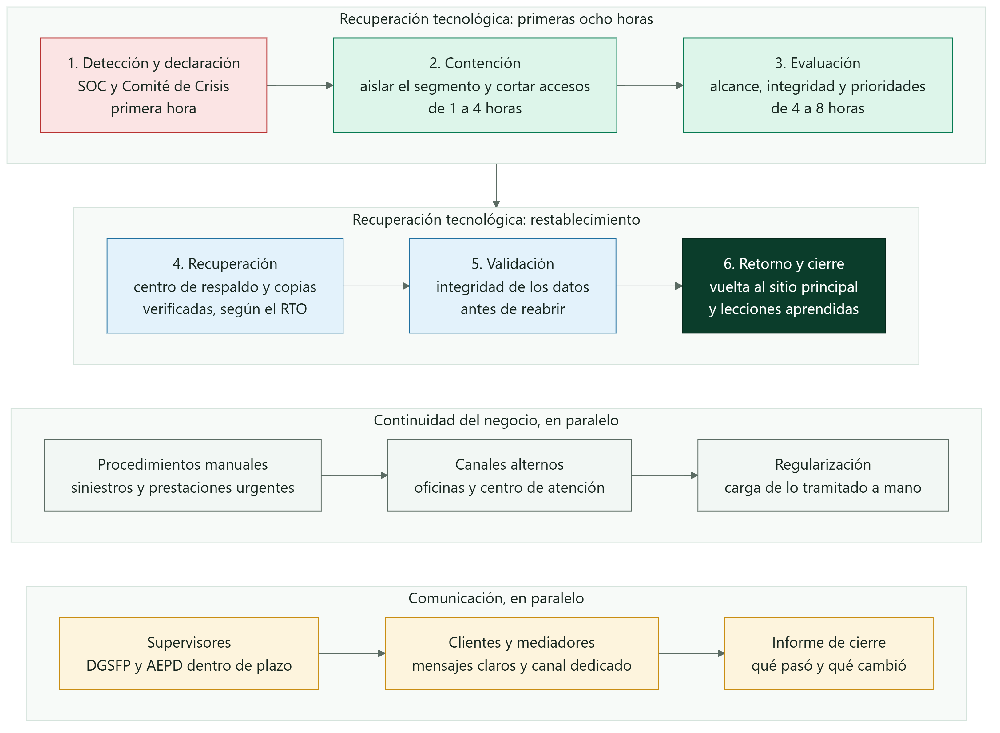{ width=6.30in }

*Figura 9.* Fases del plan de recuperación ante desastres y líneas paralelas de continuidad del negocio y de comunicación.

La quinta fase, la validación, es la que este caso hace imprescindible. Reabrir el servicio con datos que pudieron ser alterados cambiaría una parada de días por un problema de meses. Antes de reabrir se comparan los datos recuperados con la última copia de confianza y se revisa el registro de cambios del capítulo 16.

### Pruebas y mantenimiento

Propongo una restauración de copias cada trimestre, con medición del tiempo real; un simulacro de mesa cada semestre, que el curso incluye en la fase de anticipación (Ochoa Agudelo, 2026e), y una prueba de conmutación al centro de respaldo una vez al año. El plan se revisa tras cada prueba, tras cada incidente y cuando cambia la arquitectura. DORA respalda esta exigencia: sus artículos 11 y 12 obligan a tener una política de continuidad de las TIC, planes de respuesta y recuperación probados de forma periódica y políticas de copia de seguridad.

### Evidencias

Un auditor pediría el análisis de impacto aprobado, el plan vigente, los informes de las pruebas con los tiempos alcanzados frente a los objetivos y el registro de las mejoras introducidas después de cada una. Los controles del Anexo A que este plan desarrolla son el 5.29, el 5.30, el 8.13 y el 8.14 (ISO/IEC, 2022b), y la norma de referencia para el sistema de continuidad completo es ISO 22301 (ISO, 2019).

# 15. Actividad 12: divulgación de acceso no autorizado a información confidencial

La guía pregunta qué pasos legales y operativos deben darse cuando se ha divulgado un acceso no autorizado a información confidencial, y pide explicar los procedimientos legales y cómo puede la empresa protegerse de futuras filtraciones.

## 15.1 Qué es, en términos jurídicos, lo que ocurrió

El incidente tiene tres calificaciones simultáneas y cada una abre un procedimiento distinto.

Es una violación de la seguridad de los datos personales, que el RGPD define como toda violación de la seguridad que ocasione la destrucción, pérdida o alteración de datos personales, o la comunicación o el acceso no autorizados a ellos (artículo 4.12). Esa calificación activa las obligaciones de los artículos 33 y 34.

Es también, con mucha probabilidad, un incidente grave relacionado con las TIC en el sentido de DORA, por el número de clientes afectados, la pérdida de confidencialidad de los datos y el impacto económico. Esa calificación obliga a notificar al supervisor de seguros.

Y es un delito del que la compañía es víctima: acceso ilícito a un sistema de información e interceptación de transmisiones de datos, tipificados en el artículo 197 bis del Código Penal.

## 15.2 Pasos legales

La Tabla 31 ordena los pasos, con su destinatario, su plazo y la norma que los impone. La Figura 10 muestra las decisiones que llevan a cada uno.

| Paso | Ante quién | Plazo | Norma |
|--------------------------------|------------------|---------------------------------|-----------------|
| 1. Registrar la violación, sus efectos y las medidas, y evaluar el riesgo para las personas | Registro interno, a cargo del delegado de protección de datos | Inmediato | Artículo 33.5 del RGPD |
| 2. Notificar la violación: naturaleza, categorías y número aproximado de afectados y de registros, consecuencias probables, medidas adoptadas y contacto del delegado | Agencia Española de Protección de Datos | 72 horas desde que se tiene constancia; puede hacerse por fases si falta información | Artículo 33 del RGPD |
| 3. Comunicar la violación a los afectados en lenguaje claro | Clientes afectados | Sin dilación indebida, si es probable un alto riesgo | Artículo 34 del RGPD |
| 4. Notificar el incidente grave | Dirección General de Seguros y Fondos de Pensiones | Notificación inicial en 4 horas desde la clasificación y a más tardar 24 horas desde que se conoce; informe intermedio a las 72 horas de la inicial; informe final en un mes | Artículo 19 de DORA y artículo 5 del Reglamento Delegado (UE) 2025/301 |
| 5. Denunciar los hechos y aportar las evidencias | Policía Nacional o Guardia Civil | Cuanto antes | Artículos 197 bis y 249 del Código Penal |
| 6. Avisar al equipo de respuesta de referencia | INCIBE-CERT | Obligatorio si la compañía es operador de servicios esenciales; voluntario en otro caso | Artículo 19 del Real Decreto-ley 12/2018 |
| 7. Valorar si el incidente es información privilegiada y, en su caso, difundirla | Supervisor del mercado de valores | Tan pronto como sea posible | Artículo 17 del Reglamento (UE) 596/2014 |
| 8. Avisar a los terceros con obligación contractual | Encargados del tratamiento, reaseguradores y aseguradora del ciberriesgo | Según cada contrato | Artículos 28 y 33.2 del RGPD |
| 9. Atender las solicitudes y reclamaciones de los afectados | Clientes | Un mes para responder al ejercicio de derechos | Artículos 12 y 82 del RGPD |

*Tabla 31.* Pasos legales tras la violación de datos, con destinatario, plazo y norma.

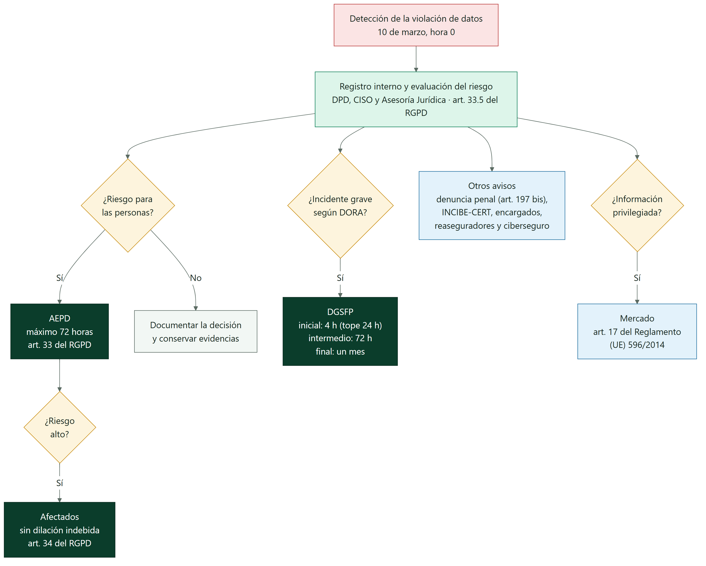{ width=6.30in }

*Figura 10.* Decisiones y plazos de notificación tras detectar la violación de datos.

Tres observaciones sobre la tabla.

Los relojes son distintos y corren a la vez. El plazo más corto es el del supervisor financiero: cuatro horas desde que el incidente se clasifica como grave, muy por debajo de las 72 horas de protección de datos. Un procedimiento interno que solo tenga presente el plazo de 72 horas llega tarde a la primera obligación.

La comunicación a los clientes del paso 3 admite una excepción que interesa para el futuro. No es necesaria si el responsable había aplicado medidas que hacen los datos ininteligibles para quien no esté autorizado, como el cifrado (artículo 34.3.a). En el caso los datos viajaban en claro, de modo que la excepción no aplica y hay que comunicar.

No cumplir estos pasos es en sí una infracción. La ley orgánica española tipifica como grave no notificar la violación a la autoridad o no comunicarla al afectado cuando procede, y como leve notificarla tarde o de forma incompleta (artículos 73 y 74 de la LOPDGDD). El precedente de 2020 enseña el camino contrario: la compañía avisó al supervisor de seguros y a los equipos nacionales de respuesta al día siguiente del ataque, notificó a la Agencia al segundo día y presentó denuncia al tercero, y la resolución calificó esa actuación de "diligente reacción" (AEPD, 2021).

En Colombia los pasos equivalentes serían informar a la Superintendencia de Industria y Comercio (artículo 17 n de la Ley 1581 de 2012) mediante el reporte del incidente en el Registro Nacional de Bases de Datos dentro de los quince días hábiles siguientes a su detección, avisar a los titulares, denunciar ante la Fiscalía los delitos de acceso abusivo, interceptación de datos informáticos y violación de datos personales (artículos 269A, 269C y 269F de la Ley 1273 de 2009) y reportar el incidente a la Superintendencia Financiera conforme a sus circulares de ciberseguridad.

## 15.3 Pasos operativos

Los pasos legales dependen de que la operación haga bien los suyos. Son siete.

1. Contener sin destruir la evidencia. Se aísla el segmento y no se apagan ni se reinstalan los equipos hasta tener su imagen forense. La adquisición sigue el orden de volatilidad, calcula el hash de cada imagen y abre la cadena de custodia desde el primer momento (Ochoa Agudelo, 2026e). Sin esa cadena, la denuncia del paso 5 pierde valor.

2. Determinar el alcance. Hay que saber qué datos se vieron, de cuántos clientes y desde cuándo. Esa información la piden tanto la Agencia como el supervisor de seguros, y sale de los registros de la red y de la base de datos. Es el momento en que se paga o se cobra la calidad del monitoreo.

3. Cambiar credenciales y certificados y cerrar las sesiones abiertas de todas las cuentas que circularon por el segmento.

4. Proteger a los clientes del uso de sus datos. El atacante conoce nombre, dirección, documento y póliza, que son justo los datos con que un centro de atención suele verificar la identidad de quien llama. Mientras dure el riesgo, las operaciones sensibles, como un cambio de beneficiario o de cuenta de cobro, exigen una verificación reforzada por un segundo canal.

5. Vigilar la aparición de los datos en foros y mercados ilegales y las campañas de fraude que usen el nombre de la compañía.

6. Documentar cada decisión en la bitácora del incidente, con hora y responsable. Es el registro que exige el artículo 33.5 y la base del informe final a los supervisores.

7. Cerrar con lecciones aprendidas, la última fase del procedimiento de respuesta que enseña el curso, con el análisis de lo que faltó para evitar la reincidencia.

## 15.4 Cómo protegerse de futuras filtraciones

La protección tiene una parte técnica, una organizativa y una jurídica.

En lo técnico, los controles del capítulo 9 atacan la filtración en tres puntos. Impiden que el atacante llegue a los datos (segmentación, control de acceso a la red y mínimo privilegio). Impiden que los lea si llega (cifrado en tránsito, cifrado por campo y enmascaramiento). Y detectan la salida (monitoreo de la base de datos y prevención de fuga). El segundo punto tiene además el efecto legal ya comentado: con los datos cifrados, la violación puede no requerir comunicación a los afectados.

En lo organizativo, la medida más barata es tener menos datos. El principio de limitación del plazo de conservación obliga a suprimir los datos que ya no son necesarios, y el control 8.10 del Anexo A pide un procedimiento para hacerlo. El precedente de Generali es ilustrativo, porque los datos filtrados eran de antiguos clientes (Europa Press, 2025). A eso se suman la evaluación de impacto del tratamiento de datos de vida (artículo 35 del RGPD), la protección de datos desde el diseño en cada sistema nuevo (artículo 25) y la formación de quienes manejan los datos.

En lo jurídico, tres piezas. Contratos de encargado del tratamiento con cláusulas de seguridad, derecho de auditoría y obligación de avisar sin demora (artículo 28 del RGPD). Un procedimiento de notificación con plantillas preparadas y ensayado en simulacros, para que los plazos de 4, 24 y 72 horas se cumplan sin improvisar. Y una póliza de ciberriesgo que cubra los costos de respuesta y las reclamaciones.

Ante un auditor, este capítulo se acredita con el registro interno de violaciones, los justificantes de cada notificación con su hora, el informe forense con la cadena de custodia y las actas del Comité de Crisis.

# 16. Actividad 13: modificación no autorizada de datos

La guía pide proponer cómo debe tratarse la modificación no autorizada de datos, qué mecanismos de auditoría y control pueden implementarse, y dar un ejemplo de auditoría de registros que identifique cambios no autorizados en los datos almacenados.

## 16.1 Por qué hay que tratarla aunque el caso no la describa

El enunciado habla de interceptación y de acceso, no de cambios. Pero quien se coloca en medio de una conversación puede alterarla, y quien entra a la base de datos con la identidad de la aplicación puede escribir igual que leer. El material del curso define la integridad como la garantía de que la información "no se ha transformado ni modificado de forma no autorizada durante su procesamiento, transporte o almacenamiento", y añade que debe ser posible "detectar fácilmente las posibles modificaciones" (Merino Bada, s. f.). La segunda parte de la definición es la que ocupa este capítulo.

En un seguro de vida la modificación más dañina es también la más discreta: cambiar el beneficiario de una póliza, la cuenta donde se cobra o el capital asegurado. Nadie lo nota hasta el día en que hay que pagar, que puede llegar años después. Las normas lo contemplan de forma expresa. El RGPD cuenta la alteración entre las formas de violación de la seguridad de los datos (artículo 4.12) y exige que los datos sean exactos (artículo 5.1.d). La ley colombiana obliga a conservar la información en condiciones que impidan "su adulteración" (artículo 17 d de la Ley 1581 de 2012). El catálogo MITRE ATT&CK lo recoge como manipulación de datos almacenados, técnica T1565.001 (MITRE, s. f.).

## 16.2 Cómo se trata una modificación no autorizada

Propongo un procedimiento de ocho pasos, que es una especialización del procedimiento general de incidentes.

1. Detectar y confirmar. La alerta llega por una regla de monitoreo, por la conciliación diaria o por la queja de un cliente. Se confirma comparando el cambio con la solicitud que debería respaldarlo.

2. Contener. Se suspende la cuenta o la sesión que hizo el cambio y se bloquean los pagos y las operaciones sobre las pólizas afectadas hasta aclarar su estado.

3. Preservar la evidencia. Se copia el registro de auditoría y se abre la cadena de custodia antes de tocar ningún dato.

4. Determinar el alcance con el registro: qué campos, de qué pólizas, desde cuándo y con qué cuenta.

5. Restaurar los valores correctos a partir del valor anterior que guarda el registro o, si el daño es amplio, de una copia a un punto en el tiempo. La corrección se hace con un tique de incidente y con la validación de una segunda persona.

6. Confirmar con el cliente, por un canal seguro, los datos sensibles restaurados cuando haya duda sobre cuál era el valor legítimo.

7. Notificar. Una alteración ilícita de datos personales es una violación de la seguridad de los datos, de modo que se aplican los pasos del capítulo 15.

8. Corregir la causa y registrar las lecciones aprendidas.

## 16.3 Mecanismos de auditoría y control

Ningún mecanismo basta por sí solo. La Tabla 32 reúne los que propongo, con su función y el control del Anexo A que desarrollan.

| Mecanismo | Función | Qué aporta | Anexo A |
|-----------------------------------|-------------|-------------------------------------------|---------|
| Registro de auditoría de cambios, por disparadores o con la auditoría nativa del gestor | Detectivo | Quién cambió qué, cuándo, desde dónde, con qué programa, y el valor anterior y el nuevo | 8.15 |
| Registro de solo anexado, encadenado por hash y con copia en un almacén inmutable | Preventivo y detectivo | Impide y delata la manipulación del propio registro | 8.15, 5.33 |
| Tique de cambio obligatorio y doble validación en los campos críticos | Preventivo | Ningún cambio de beneficiario, cuenta o capital depende de una sola persona | 5.3, 8.32 |
| Segregación de funciones y mínimo privilegio | Preventivo | La cuenta de la aplicación no sirve fuera de la aplicación; quien administra la base de datos no administra el registro | 5.3, 8.2, 8.3 |
| Reglas de detección en el SIEM | Detectivo | Alerta en minutos ante cambios sin tique, fuera de horario o con un cliente no autorizado | 8.16 |
| Conciliación diaria entre cambios registrados y solicitudes de clientes | Detectivo | Descubre lo que escapó a las reglas automáticas | 5.36 |
| Confirmación al cliente de cada cambio sensible por un canal independiente | Detectivo | El titular es el último control sobre sus propios datos | 5.34 |
| Copias con recuperación a un punto en el tiempo | Correctivo | Permite volver al estado anterior a la modificación | 8.13 |
| Relojes sincronizados | Soporte | Hace fiable el orden de los hechos | 8.17 |
| Revisión periódica del registro por auditoría interna | Detectivo | Comprueba que el mecanismo sigue funcionando | 5.35 |

*Tabla 32.* Mecanismos de auditoría y control frente a la modificación no autorizada de datos.

Estos mecanismos realizan la dimensión de trazabilidad que el curso añade a la tríada clásica: poder determinar en todo momento quién hizo qué y en qué momento lo hizo (Merino Bada, s. f.).

## 16.4 Ejemplo de auditoría de registros

Para que el ejemplo no se quede en una descripción, lo construí y lo ejecuté. Es una base de datos de demostración con cuatro pólizas ficticias y un registro de auditoría alimentado por disparadores, que anota cada cambio en los campos críticos junto con el contexto de la sesión. El programa completo y la forma de reproducirlo están en el Anexo C. Las tres figuras siguientes son la salida real de esa ejecución.

El escenario reproduce lo que pudo pasar en Mapfre. El día 9 y la mañana del 10 de marzo la aplicación hace tres cambios legítimos, cada uno con su tique. En la madrugada del 10, un atacante que ha capturado la cuenta de servicio de la aplicación y que suplanta la dirección IP de su servidor cambia el beneficiario y la cuenta de cobro de una póliza y multiplica por cuatro el capital de otra. La Figura 11 muestra el registro de auditoría con los seis cambios.

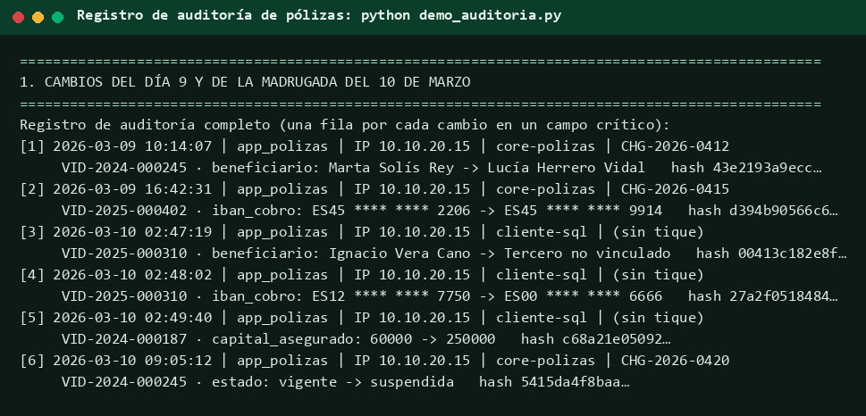{ width=6.30in }

*Figura 11.* Registro de auditoría tras los cambios. Los registros 3, 4 y 5 son los no autorizados: mismo usuario y misma dirección IP que los legítimos, pero de madrugada, con otro programa cliente y sin tique.

A simple vista, los seis registros tienen el mismo usuario y la misma dirección IP. Esa es la lección que enlaza el ejemplo con el caso: cuando la dirección está suplantada y la credencial está robada, ni una ni otra distinguen al atacante. La Figura 12 muestra las dos consultas de auditoría que sí lo distinguen.

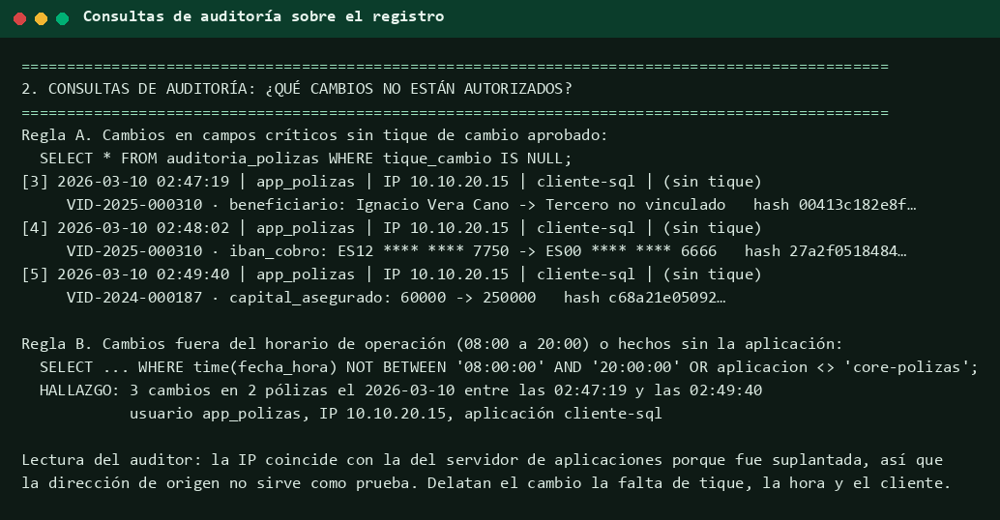{ width=6.30in }

*Figura 12.* Consultas de auditoría. La regla A busca cambios sin tique de autorización; la regla B, cambios fuera del horario de operación o hechos sin la aplicación.

La regla A devuelve exactamente los tres cambios indebidos, porque ninguno tiene tique. La regla B los agrupa en un hallazgo: tres cambios en dos pólizas entre las 02:47:19 y las 02:49:40, hechos con un cliente SQL que no es la aplicación. El auditor concluye lo que el propio programa imprime: la dirección de origen no sirve como prueba, y lo que delata el cambio es la falta de tique, la hora y el programa usado. Por eso el registro tiene que guardar ese contexto y no solo el usuario y la dirección.

Queda un problema. Un atacante con suficientes privilegios puede intentar borrar sus huellas. La Figura 13 muestra cómo responde el registro.

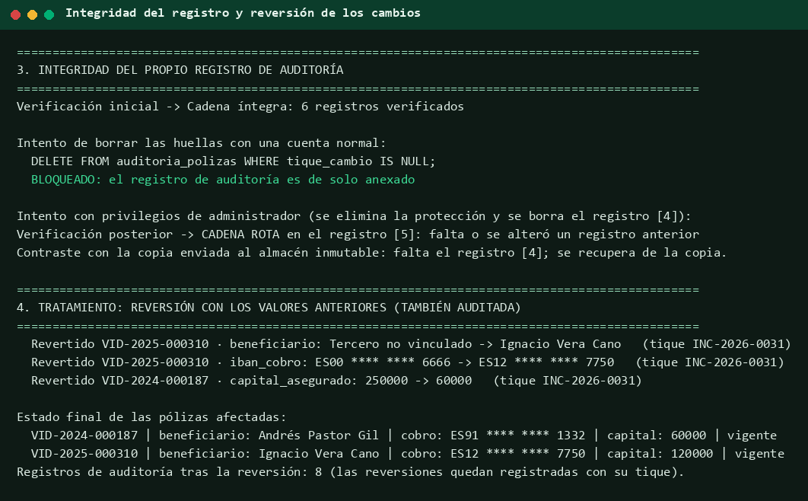{ width=6.30in }

*Figura 13.* Integridad del registro de auditoría y reversión de los cambios indebidos.

La verificación inicial recorre la cadena de hash y la encuentra íntegra. El intento de borrar los registros con una cuenta normal queda bloqueado, porque el registro es de solo anexado. Cuando el borrado se hace con privilegios de administrador, tras eliminar la protección, la verificación siguiente falla en el registro 5: cada registro incluye el hash del anterior, y al faltar el 4 la cadena ya no cuadra. El contraste con la copia enviada al almacén inmutable indica qué registro falta y permite recuperarlo. Es el mismo principio que el curso presenta al hablar de blockchain, un libro al que solo se puede añadir y que resulta extremadamente difícil de cambiar (Yepes, s. f.).

La última parte de la figura es el tratamiento. Los tres cambios indebidos se revierten con el valor anterior que el registro había guardado, bajo el tique de incidente INC-2026-0031, y las propias reversiones quedan registradas. El registro termina con ocho anotaciones y las pólizas afectadas vuelven a su estado legítimo.

En un sistema de producción el contexto de la sesión lo aporta la auditoría nativa del gestor de base de datos, el registro se envía en tiempo real a un almacén que el administrador de la base de datos no controla y las dos reglas del ejemplo son casos de uso del SIEM, como el sexto de la Tabla 23. Un auditor comprobaría el mecanismo de la forma más directa: haciendo un cambio de prueba sin tique y midiendo cuánto tarda en saltar la alerta.

# 17. Plan integrado de mejora y tratamiento de riesgos

Los capítulos anteriores responden cada actividad por separado. Este los une en un solo plan, con responsables, plazos e indicadores, y lo somete al ciclo de mejora que exige la norma.

## 17.1 Seis preguntas para saber si hay un sistema de gestión

Al cerrar la clase sobre ISO/IEC 27001, el docente dejó una pregunta que sirve de criterio de evaluación: "¿la organización conoce sus riesgos, ha decidido cómo tratarlos, ha implementado controles adecuados, puede demostrar que funcionan, los audita y los mejora?" (Ochoa Agudelo, 2026c). La Tabla 33 compara la situación que el caso deja entrever el 10 de marzo con la que resulta del plan. La columna central es una inferencia a partir del enunciado.

| Pregunta | Situación el 10 de marzo | Con el plan | Capítulo |
|----------------------|---------------------------------|----------------------------------|------------|
| ¿Conoce sus riesgos? | El riesgo de la red interna no estaba valorado | Registro de diez riesgos, cada uno con propietario | 8 |
| ¿Ha decidido cómo tratarlos? | Sin plan de tratamiento para esos riesgos | Opción de tratamiento y controles por riesgo, con residual aceptado | 8 |
| ¿Ha implementado controles adecuados? | Protección hacia el exterior; el interior de la red sin proteger | Dieciséis controles y una declaración de aplicabilidad | 9 y 10 |
| ¿Puede demostrar que funcionan? | La detección fue posterior al acceso | Evidencia e indicador para cada control | 9 y 11 |
| ¿Los audita? | Las vulnerabilidades V1 a V5 no se habían encontrado | Pruebas de intrusión internas y auditoría interna | 10 |
| ¿Los mejora? | Sin datos | Ciclo de mejora con revisión por la Dirección | 17 |

*Tabla 33.* Las seis preguntas de un sistema de gestión, antes y después del plan.

## 17.2 Líneas de mejora

La Tabla 34 agrupa las propuestas del informe en nueve líneas. Los plazos se cuentan desde la detección del incidente.

| Línea | Acciones | Responsable | Plazo | Indicador de éxito |
|---------------|------------------------------|---------------|-----------------|-----------------------|
| 1. Gobierno | Aprobar la política y las normas internas, designar propietarios de activos y de riesgos y reunir un comité de seguridad cada trimestre | Dirección General y CISO | 30 días | Política aprobada y comunicada a toda la plantilla |
| 2. Red interna | Ejecutar el plan de cierre de brechas: capa 2, segmentación, filtrado antisuplantación y control de acceso a la red | Área de Redes | 90 días | Todos los puertos protegidos; prueba de intrusión sin hallazgos críticos |
| 3. Identidad y datos | Autenticación con certificado, mínimo privilegio, cifrado por campo y enmascaramiento | Dirección de Tecnología | 90 días | Todas las conexiones a la base de datos con TLS mutuo; ninguna cuenta con privilegios excesivos |
| 4. Detección | Casos de uso en el SIEM, almacén inmutable de registros y relojes sincronizados | SOC | 30 días | Detección de los casos críticos en menos de 15 minutos |
| 5. Respuesta y notificación | Procedimiento de incidentes, plantillas para cada autoridad y simulacros | CISO y delegado de protección de datos | 60 días | Todas las notificaciones dentro de plazo en los simulacros |
| 6. Continuidad | Análisis de impacto, plan de recuperación y calendario de pruebas | Dirección de Operaciones y Dirección de Tecnología | 120 días | Tiempos objetivo alcanzados en la prueba |
| 7. Integridad de los datos | Auditoría de cambios con doble validación, conciliación diaria y confirmación al cliente | Dirección de Operaciones | 90 días | Ningún cambio crítico sin tique |
| 8. Personas y terceros | Formación por perfil, cláusulas de seguridad con proveedores y póliza de ciberriesgo | Recursos Humanos y Asesoría Jurídica | 180 días | Personal formado y proveedores críticos evaluados |
| 9. Verificación | Auditoría interna, revisión por la Dirección, actualización de la declaración de aplicabilidad y certificación del alcance | Auditoría Interna | 180 días para la auditoría; 12 meses para la certificación | Certificación ISO/IEC 27001 del servicio |

*Tabla 34.* Plan integrado de mejora, con responsable, plazo e indicador de éxito.

Las líneas 1 y 4 van primero porque condicionan a las demás. Sin propietarios no hay quien apruebe los cambios ni quien acepte el riesgo residual, y sin detección no se puede comprobar que los controles nuevos funcionan.

## 17.3 El ciclo de mejora

La norma ISO/IEC 27001 se apoya en el ciclo de planificar, hacer, verificar y actuar (NQA, s. f.), y el plan lo sigue.

Planificar es lo que hacen el análisis de riesgos, la declaración de aplicabilidad y este plan. Hacer es implantar los controles y cerrar las brechas en los plazos fijados. Verificar tiene tres instrumentos, que son los del numeral 9 de la norma: el seguimiento y la medición con los indicadores de los capítulos 9 y 11, que se revisan cada mes; la auditoría interna, una vez al año, y la revisión por la Dirección, semestral durante el primer año. Actuar es tratar cada desviación como una no conformidad: se identifica, se corrige, se analiza su causa, se aplica una acción correctiva y se comprueba su eficacia.

Sobre la auditoría interna conviene retener lo que se dijo en clase: no consiste en buscar culpables, consiste en obtener evidencia para determinar si el sistema cumple los requisitos y funciona, con objetividad e imparcialidad (Ochoa Agudelo, 2026c). Si la auditoría se vive como una caza de responsables, los equipos ocultan los problemas, y un problema oculto en la configuración de la red es exactamente lo que originó este incidente.

## 17.4 Lo que el plan consigue y lo que deja pendiente

El plan baja la suma de las puntuaciones de riesgo de 181 a 61 y deja los diez riesgos dentro del criterio de aceptación. En términos económicos, su costo técnico es del orden de la partida de refuerzo urgente del capítulo 12, mientras que el incidente cuesta varias veces más en cualquiera de los escenarios.

Quedan ocho riesgos residuales de nivel medio. Sus propietarios los aceptan por escrito y se revisan al año, o antes si cambia la arquitectura o hay otro incidente. La revisión por la Dirección decide entonces si el nivel sigue siendo asumible. Queda también abierto el alcance: este trabajo cubre el servicio de pólizas de vida, y la misma red plana puede existir en otros servicios de la compañía. La primera recomendación a la Dirección es extender el análisis al resto del centro de datos.

# 18. Conclusiones

El incidente de Mapfre no necesitó una técnica avanzada. El envenenamiento ARP tiene más de dos décadas y la suplantación de IP es aún más antigua. Funcionaron porque dentro del centro de datos coincidían tres decisiones de diseño: una red sin segmentar ni proteger en capa 2, un tráfico sin cifrar entre la aplicación y la base de datos y una regla de acceso que se fiaba de la dirección de origen. Cualquiera de las tres barreras, por separado, habría cortado el ataque. Esa es la primera conclusión, y es técnica: la protección que la compañía aplicaba hacia Internet no existía entre sus propios servidores.

La segunda es de gestión. El expediente de 2020 muestra una compañía capaz de detectar un ataque en siete minutos y de reunir a su Comité de Crisis en dieciséis. Tenía herramientas y tenía procedimientos. Lo que el caso de marzo revela es que el riesgo de la red interna no figuraba en el registro de nadie: no tenía propietario, no estaba valorado y ninguna auditoría lo había buscado. La norma ISO/IEC 27001 existe para ese tipo de hueco. Su recorrido, del contexto al riesgo, del riesgo al control y del control a la evidencia, es el mismo que ha seguido este informe.

La tercera se refiere a las leyes. Una aseguradora española responde ante dos supervisores con relojes distintos, cuatro horas para el de seguros y setenta y dos para el de protección de datos, además de la comunicación a los clientes. Esos plazos solo se cumplen con un procedimiento ensayado de antemano. Los dos precedentes del sector enseñan cuánto vale: el mismo regulador archivó el caso de Mapfre en 2020 y multó a Generali con cinco millones de euros, y la diferencia estuvo en las medidas previas y en la reacción, no en la gravedad del ataque.

La cuarta es económica. El escenario base cuesta 8,1 millones de euros, y la mitad se va en tres partidas que no son la respuesta al ataque: la multa, los clientes perdidos y el refuerzo técnico que se había aplazado. A medida que el incidente crece, los costos indirectos pasan del 23 al 47 % del total. La reputación es el mayor de los costos de un incidente grave, y la comunicación transparente es la forma más barata de contenerlo.

La quinta sale de la demostración de auditoría. Cuando la dirección IP está suplantada y la credencial robada, ninguna de las dos identifica a nadie. Lo que distinguió los cambios indebidos fue el contexto: la ausencia de tique, la hora y el programa usado. Un registro de auditoría sirve si guarda ese contexto, si no se puede alterar sin que se note y si conserva el valor anterior para poder deshacer el daño.

El plan propuesto reúne dieciséis controles, reduce en un 66 % la puntuación total de riesgo y deja los diez riesgos en niveles que sus propietarios pueden aceptar. No elimina el riesgo. Lo que cambia es que la compañía pasa a conocerlo, a tener decidido cómo tratarlo y a poder demostrarlo.

De este trabajo me llevo dos hábitos. El primero es no meter en el mismo saco la ley, la norma, el marco y la buena práctica, porque cada una responde a una pregunta distinta y confundirlas lleva a citar una ISO donde hacía falta un artículo. El segundo es mirar cada control como lo miraría un auditor: antes de escribir que algo existe, preguntarme con qué documento, registro o medición se demostraría.

# 19. Referencias

## Material del curso y fuentes consultadas

- Agencia Española de Protección de Datos. (2021). *Resolución de archivo de actuaciones. Procedimiento n.º E/09159/2020*. https://www.aepd.es/documento/e-09159-2020.pdf

- AXELOS. (2019). *ITIL Foundation: ITIL 4 edition*. TSO.

- Cuatrecasas. (2026, 26 de octubre). *Ciberataques en sectores críticos: a la espera de NIS2*. https://www.cuatrecasas.com/es/spain/propiedad-intelectual/art/ciberataques-sectores-criticos-espera-nis2

- ErgoHackers. (s. f.). *ISO 27001 vs NIST CSF: ¿cuál es mejor?* [Video]. YouTube. Material del Diplomado en Ciberseguridad.

- Europa Press. (2025, 13 de mayo). Protección de Datos multa con 5,6 millones a Generali e ING. *Forbes España*. https://forbes.es/economia/708541/proteccion-de-datos-multa-con-56-millones-a-generali-e-ing/

- European Insurance and Occupational Pensions Authority. (2024, 19 de diciembre). *EIOPA revokes previous guidelines to avoid duplicities and overlaps with DORA*. https://www.eiopa.europa.eu/eiopa-revokes-previous-guidelines-avoid-duplicities-and-overlaps-dora-2024-12-19_en

- Ferguson, P. y Senie, D. (2000). *Network ingress filtering: Defeating denial of service attacks which employ IP source address spoofing* (RFC 2827, BCP 38). Internet Engineering Task Force. https://www.rfc-editor.org/rfc/rfc2827

- Grupo Renfe. (s. f.). *Temario de seguridad informática* [Material de formación]. Material del Diplomado en Ciberseguridad.

- IBM. (2026, 29 de julio). *IBM study: One in four malicious breaches are AI-enabled, costing companies $6 million on average* [Comunicado de prensa sobre el informe Cost of a Data Breach 2026]. https://newsroom.ibm.com/2026-07-29-ibm-study-one-in-four-malicious-breaches-are-ai-enabled,-costing-companies-6-million-on-average

- ISACA. (2018). *COBIT 2019 framework: Introduction and methodology*. ISACA.

- ISO. (2018). *ISO 31000:2018. Risk management: Guidelines*. International Organization for Standardization.

- ISO. (2019). *ISO 22301:2019. Security and resilience: Business continuity management systems. Requirements*. International Organization for Standardization.

- ISO/IEC. (2022a). *ISO/IEC 27001:2022. Information security, cybersecurity and privacy protection: Information security management systems. Requirements*. International Organization for Standardization.

- ISO/IEC. (2022b). *ISO/IEC 27002:2022. Information security, cybersecurity and privacy protection: Information security controls*. International Organization for Standardization.

- ISO/IEC. (2022c). *ISO/IEC 27005:2022. Information security, cybersecurity and privacy protection: Guidance on managing information security risks*. International Organization for Standardization.

- MAPFRE. (2026a). *Informe consolidado 2025*. https://www.mapfre.com/media/2026/03/Informe-Consolidado-ESP.pdf

- MAPFRE. (2026b). *Informe sobre la situación financiera y de solvencia del Grupo MAPFRE 2025*. https://www.mapfre.com/media/2026/05/2025-sfcr-grupo-mapfre.pdf

- MAPFRE. (2026c). *Resultados 2025*. https://www.mapfre.com/media/2026/02/RESULTADOS-2025-ESP.pdf

- Merino Bada, C. (s. f.). *Análisis de riesgos* [Diapositivas]. Universidad Internacional de La Rioja. Material del Diplomado en Ciberseguridad.

- MITRE. (s. f.). *Adversary-in-the-Middle: ARP cache poisoning (T1557.002)*. MITRE ATT&CK. https://attack.mitre.org/techniques/T1557/002/

- National Institute of Standards and Technology. (2024). *The NIST Cybersecurity Framework (CSF) 2.0* (NIST CSWP 29). https://doi.org/10.6028/NIST.CSWP.29

- NQA. (s. f.). *ISO 27001:2013. Guía de implantación para la seguridad de la información*. NQA. Material del Diplomado en Ciberseguridad.

- Ochoa Agudelo, E. A. (2026a). *Arquitectura de sistemas y redes en ciberseguridad* [Diapositivas de la Unidad 2 del Módulo 1]. Diplomado en Ciberseguridad, Politécnico Colombiano Jaime Isaza Cadavid.

- Ochoa Agudelo, E. A. (2026b). *Marco normativo colombiano en ciberseguridad: Ley 1581 de 2012* [Diapositivas del Tema 10]. Diplomado en Ciberseguridad, Politécnico Colombiano Jaime Isaza Cadavid.

- Ochoa Agudelo, E. A. (2026c, 4 y 6 de noviembre). *Normativas, cumplimiento y auditoría en ciberseguridad* [Clases grabadas]. Diplomado en Ciberseguridad, Politécnico Colombiano Jaime Isaza Cadavid.

- Ochoa Agudelo, E. A. (2026d). *Políticas, controles y cultura organizacional* [Diapositivas de la Unidad 3 del Módulo 1]. Diplomado en Ciberseguridad, Politécnico Colombiano Jaime Isaza Cadavid.

- Ochoa Agudelo, E. A. (2026e). *Respuesta ante incidentes: fases y procedimiento* [Diapositivas de la Unidad Temática 3 del Módulo 2]. Diplomado en Ciberseguridad, Politécnico Colombiano Jaime Isaza Cadavid.

- Plummer, D. C. (1982). *An Ethernet address resolution protocol* (RFC 826). Internet Engineering Task Force. https://www.rfc-editor.org/rfc/rfc826

- Universidad Internacional de La Rioja. (s. f.). *Tema 4: Analizando los riesgos de las infraestructuras críticas* [Diapositivas]. Material del Diplomado en Ciberseguridad.

- Yepes, J. (s. f.). *Blockchain como herramienta de seguridad digital* [Diapositivas]. Material del Diplomado en Ciberseguridad.

## Normativa

- Ley 1266 de 2008, por la cual se dictan las disposiciones generales del hábeas data y se regula el manejo de la información contenida en bases de datos personales, en especial la financiera, crediticia, comercial, de servicios y la proveniente de terceros países. *Diario Oficial*, 47.219. Congreso de la República de Colombia.

- Ley 1273 de 2009, por medio de la cual se modifica el Código Penal y se crea un nuevo bien jurídico tutelado denominado "de la protección de la información y de los datos". *Diario Oficial*, 47.223. Congreso de la República de Colombia.

- Ley Estatutaria 1581 de 2012, por la cual se dictan disposiciones generales para la protección de datos personales. *Diario Oficial*, 48.587. Congreso de la República de Colombia.

- Ley Orgánica 10/1995, de 23 de noviembre, del Código Penal. *Boletín Oficial del Estado*, 281. https://www.boe.es/buscar/act.php?id=BOE-A-1995-25444

- Ley Orgánica 3/2018, de 5 de diciembre, de Protección de Datos Personales y garantía de los derechos digitales. *Boletín Oficial del Estado*, 294. https://www.boe.es/buscar/act.php?id=BOE-A-2018-16673

- Real Decreto 43/2021, de 26 de enero, por el que se desarrolla el Real Decreto-ley 12/2018, de 7 de septiembre, de seguridad de las redes y sistemas de información. *Boletín Oficial del Estado*, 24. https://www.boe.es/buscar/act.php?id=BOE-A-2021-1192

- Real Decreto-ley 12/2018, de 7 de septiembre, de seguridad de las redes y sistemas de información. *Boletín Oficial del Estado*, 218. https://www.boe.es/buscar/act.php?id=BOE-A-2018-12257

- Reglamento (UE) 2016/679 del Parlamento Europeo y del Consejo, de 27 de abril de 2016, relativo a la protección de las personas físicas en lo que respecta al tratamiento de datos personales y a la libre circulación de estos datos (Reglamento General de Protección de Datos). *Diario Oficial de la Unión Europea*, L 119. https://eur-lex.europa.eu/eli/reg/2016/679/oj

- Reglamento (UE) 2022/2554 del Parlamento Europeo y del Consejo, de 14 de diciembre de 2022, sobre la resiliencia operativa digital del sector financiero. *Diario Oficial de la Unión Europea*, L 333. https://eur-lex.europa.eu/eli/reg/2022/2554/oj

- Reglamento (UE) n.º 596/2014 del Parlamento Europeo y del Consejo, de 16 de abril de 2014, sobre el abuso de mercado. *Diario Oficial de la Unión Europea*, L 173. https://eur-lex.europa.eu/eli/reg/2014/596/oj

- Reglamento Delegado (UE) 2025/301 de la Comisión, de 23 de octubre de 2024, sobre el contenido y los plazos de la notificación inicial y de los informes intermedio y final de los incidentes graves relacionados con las TIC. *Diario Oficial de la Unión Europea*, serie L, 20 de febrero de 2025. https://eur-lex.europa.eu/eli/reg_del/2025/301/oj

- Superintendencia de Industria y Comercio. (s. f.). *Circular Única, Título V: protección de datos personales. Registro Nacional de Bases de Datos*. https://sedeelectronica.sic.gov.co

- Superintendencia Financiera de Colombia. (2018). *Circular Externa 007 de 2018: requerimientos mínimos para la gestión del riesgo de ciberseguridad*.

- Superintendencia Financiera de Colombia. (2020). *Circular Externa 033 de 2020: taxonomía única de incidentes cibernéticos y reporte de métricas de seguridad de la información y ciberseguridad*.

# Anexo A. Trazabilidad con la guía, la rúbrica y las indicaciones de clase

| Exigencia | Dónde se responde |
|---------------------------------------------------|-------------------------------------------------|
| Actividad 1. Al menos 5 activos críticos, con su justificación | Capítulo 4: diez activos (A1 a A10) con propietario y justificación |
| Actividad 2. Clasificación por confidencialidad, integridad y disponibilidad, con valor alto, medio o bajo | Capítulo 5: escala, valoración de los diez activos, dos dimensiones añadidas y etiquetas de manejo |
| Actividad 3. Al menos 3 vulnerabilidades y cómo mitigarlas | Capítulo 6: nueve vulnerabilidades (V1 a V9) con su mitigación |
| Actividad 4. Modelo normativo con mejores prácticas y estándares; cómo previenen las políticas internas | Capítulo 7, en especial los apartados 7.5 y 7.6, y Anexo B |
| Actividad 5. Riesgos con probabilidad e impacto, priorización y recomendaciones | Capítulo 8: diez riesgos, riesgo inherente y residual, opción de tratamiento |
| Actividad 6. Al menos 3 controles técnicos, administrativos o físicos, justificados | Capítulo 9: dieciséis controles, su justificación y la declaración de aplicabilidad |
| Actividad 7. Cierre de brechas y resiliencia | Capítulo 10: proceso, plan por horizontes y validación |
| Actividad 8. Plan de monitoreo con herramientas y técnicas | Capítulo 11: arquitectura, herramientas, ocho casos de uso e indicadores |
| Actividad 9. Impacto financiero, costos de recuperación y multas; costos directos e indirectos | Capítulo 12: catorce partidas en tres escenarios y precedentes de sanción |
| Actividad 10. Daño reputacional, acciones correctivas, comunicación y transparencia | Capítulo 13: mapa de públicos, cronograma y modelo de comunicación |
| Actividad 11. Afectación a la operación, contingencias y plan de recuperación ante desastres | Capítulo 14: análisis de impacto, funciones, estrategias, fases y pruebas |
| Actividad 12. Pasos legales y operativos y protección ante futuras filtraciones | Capítulo 15: nueve pasos legales con plazo y norma, siete operativos |
| Actividad 13. Tratamiento de la modificación no autorizada, mecanismos y ejemplo de auditoría de registros | Capítulo 16 y Anexo C: procedimiento, diez mecanismos y demostración ejecutada |
| Rúbrica. Identificación y clasificación de activos | Capítulos 4 y 5 |
| Rúbrica. Identificación de vulnerabilidades y riesgos | Capítulos 6 y 8 |
| Rúbrica. Propuesta de controles de seguridad | Capítulo 9 |
| Rúbrica. Análisis de impacto financiero, reputacional y operativo | Capítulos 12, 13 y 14 |
| Rúbrica. Propuestas de mejora y tratamiento de riesgos | Capítulos 8, 10 y 17 |
| Clase. Mapear la empresa con siete preguntas antes de proponer | Capítulo 2 |
| Clase. Citar leyes y artículos, de Colombia y de Europa | Apartados 7.2 y 7.3; capítulo 15 |
| Clase. Distinguir ley, norma, marco y buena práctica | Apartado 7.1 |
| Clase. Conectar la exigencia legal con el control y la evidencia | Apartado 7.7 |
| Clase. Cadena activo, amenaza, vulnerabilidad, consecuencia y riesgo | Apartado 8.2 |
| Clase. Cuatro opciones de tratamiento y riesgo residual | Apartado 8.4 |
| Clase. Declaración de aplicabilidad con el Anexo A de 2022 | Apartado 9.4 |
| Clase. Pensar como auditor: evidencia e indicadores | Apartado 9.2 y cierre de cada capítulo |
| Clase. Analizar el incidente con las ocho preguntas del caso visto | Apartado 3.4 |

*Tabla 35.* Correspondencia entre lo que piden la guía, la rúbrica y las clases, y el lugar del informe donde se atiende.

# Anexo B. Política de seguridad de la información (modelo)

Texto modelo de la política general que encabeza la normativa interna propuesta en el apartado 7.5. Sigue los requisitos del numeral 5.2 de ISO/IEC 27001:2022: ser adecuada al propósito de la organización, incluir objetivos, comprometerse con los requisitos aplicables y con la mejora continua, y estar documentada, comunicada y disponible.

## 1. Objeto

Esta política establece los principios con que la compañía protege la información de sus clientes, empleados y socios, y los sistemas que la tratan. Su fin es preservar la confidencialidad, la integridad, la disponibilidad, la autenticidad y la trazabilidad de esa información.

## 2. Alcance

Aplica a todas las personas que trabajan para la compañía o en su nombre, incluidos mediadores y proveedores, y a toda la información que la compañía trata, en cualquier soporte y ubicación.

## 3. Compromiso de la Dirección

La Dirección aprueba esta política, asigna los recursos necesarios para cumplirla, revisa su eficacia al menos una vez al año y responde de ella ante los supervisores.

## 4. Principios

1. La información tiene un propietario, que decide quién accede a ella y acepta el riesgo que queda después de protegerla.

2. La información se clasifica y se maneja según su clasificación.

3. El acceso se concede por necesidad y con el mínimo privilegio. Ningún sistema autoriza un acceso por la sola dirección de red del solicitante.

4. La información restringida o reservada viaja y se almacena cifrada.

5. Las redes se dividen en zonas. Los sistemas que guardan datos de clientes están en una zona aislada.

6. Toda actividad sobre datos de clientes queda registrada, y los registros se protegen contra su alteración.

7. Los riesgos se identifican, se valoran y se tratan de forma periódica y documentada.

8. Los incidentes se notifican de inmediato por el canal establecido. Nadie será sancionado por comunicar de buena fe un incidente o un error.

9. La compañía cumple la legislación de protección de datos, de resiliencia operativa y de seguridad de las redes que le aplica, y lo acredita con evidencias.

## 5. Funciones

El responsable de seguridad de la información (CISO) propone las normas, vigila su cumplimiento y es el punto de contacto con las autoridades en materia de seguridad. El delegado de protección de datos asesora y supervisa el cumplimiento de la normativa de datos personales. Los propietarios de los activos aplican las normas en su ámbito. Auditoría Interna verifica de forma independiente. Todo el personal conoce esta política y la cumple.

## 6. Normativa de desarrollo

Esta política se desarrolla en las normas internas de clasificación, control de acceso, seguridad de redes, criptografía, registro y monitoreo, gestión de incidentes, continuidad, gestión de cambios, proveedores, seguridad física y formación. La declaración de aplicabilidad forma parte de ella.

## 7. Incumplimiento

El incumplimiento de esta política o de sus normas puede dar lugar a medidas disciplinarias y, en el caso de terceros, a las consecuencias previstas en su contrato.

## 8. Aprobación y revisión

Aprobada por el Consejo de Administración. Se revisa cada año y siempre que cambien de forma relevante los riesgos, la organización o la legislación.

# Anexo C. Demostración de auditoría de registros

La demostración del capítulo 16 es un programa de unas doscientas líneas que solo usa la biblioteca estándar de Python y una base de datos en memoria. No necesita instalación ni conexión, y todos los nombres, documentos y cuentas que contiene son ficticios.

## Cómo reproducirla

```
python Lab6/controles/auditoria_registros/demo_auditoria.py
```

La salida completa de la ejecución usada en este informe está en `Lab6/evidencias/salidas/00_demo_auditoria_completa.txt`.

## Qué contiene

El programa crea tres tablas. La tabla de pólizas tiene cuatro registros de ejemplo. La tabla de contexto de sesión guarda quién está conectado, desde qué dirección, con qué programa y con qué tique de cambio. La tabla de auditoría recibe una fila por cada cambio en los campos críticos: beneficiario, cuenta de cobro, capital asegurado y estado.

El mecanismo es un disparador por cada campo crítico. Este es el del beneficiario, abreviado:

```sql
CREATE TRIGGER audita_beneficiario
AFTER UPDATE OF beneficiario ON polizas
WHEN OLD.beneficiario IS NOT NEW.beneficiario
BEGIN
  INSERT INTO auditoria_polizas
    (fecha_hora, usuario, ip_origen, aplicacion, tique_cambio,
     id_poliza, campo, valor_anterior, valor_nuevo,
     hash_anterior, hash_registro)
  SELECT c.fecha_hora, c.usuario, c.ip_origen, c.aplicacion,
         c.tique_cambio, OLD.id_poliza, 'beneficiario',
         OLD.beneficiario, NEW.beneficiario, previo.h,
         sha256(previo.h || '|' || c.fecha_hora || '|' || ...)
  FROM contexto_sesion c, (ultimo hash del registro) previo;
END;
```

Cada fila guarda el hash de la anterior y calcula el suyo con ese valor y con sus propios datos. Otros dos disparadores impiden modificar o borrar filas del registro. Las dos consultas de auditoría son estas:

```sql
-- Regla A: cambios en campos críticos sin tique de autorización
SELECT * FROM auditoria_polizas WHERE tique_cambio IS NULL;

-- Regla B: cambios fuera de horario o hechos sin la aplicación
SELECT usuario, ip_origen, aplicacion, COUNT(*) AS cambios
FROM auditoria_polizas
WHERE time(fecha_hora) NOT BETWEEN '08:00:00' AND '20:00:00'
   OR aplicacion <> 'core-polizas'
GROUP BY usuario, ip_origen, aplicacion;
```

## Límites del ejemplo

Es una maqueta. En producción el contexto de la sesión lo proporciona la auditoría nativa del gestor de base de datos y no una tabla que la aplicación rellena, el registro se envía en tiempo real a un almacén que el administrador de la base de datos no controla, y las reglas viven en el SIEM. El ejemplo conserva lo esencial del mecanismo: registrar el contexto y el valor anterior, encadenar los registros y consultar por lo que no encaja.
